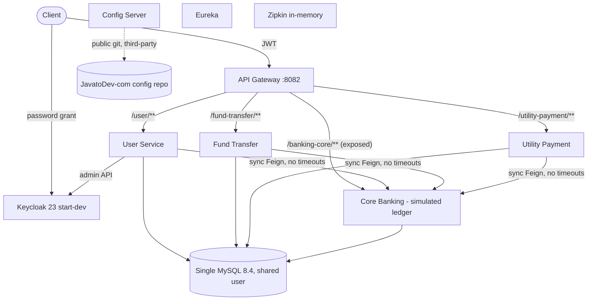

# Product Context - Internet Banking Concept Microservices

> Repository: `Persistent-Systems-Test/ts-java-spring-boot-internet-banking` | Baseline: `main` @ `fa1c445` | Assessment date: 2026-11-03 | Generated by Devin (AI) - evidence-based; items needing confirmation are marked.

This is the single source of truth for the PDD and TDD. Every statement is classified:

| Class | Meaning |
|---|---|
| VERIFIED | Verified implementation - observed in source code/config in this repository |
| DOCUMENTED | Documented but unverified - stated in README/docs, not found in code |
| INFERRED | Inferred - assessor reasoning from code structure; not explicitly documented |
| MISSING | Missing information - not present in repository |
| STAKEHOLDER | Requires stakeholder validation - business information not derivable from code |

## 1. Product overview and purpose

| Aspect | Statement | Class | Evidence |
|---|---|---|---|
| Purpose | Digital (internet) banking channel platform exposing REST APIs for online-banking user onboarding, account lookup, intra-bank fund transfers and utility bill payments, on top of a simulated core banking ledger. | VERIFIED | [E-01](https://github.com/Persistent-Systems-Test/ts-java-spring-boot-internet-banking/blob/fa1c445/README.md#L1-L20) `README.md` (1-20); E-26 `core-banking-service/src/main/java/com/javatodev/finance/controller/*.java` |
| Origin | Tutorial/reference implementation by javatodev.com (MIT), first commit 2021-05-09, upgraded to Java 21 / Spring Boot 3.2.4 in 2024. | VERIFIED | [E-01](https://github.com/Persistent-Systems-Test/ts-java-spring-boot-internet-banking/blob/fa1c445/README.md#L1-L20) `README.md` (1-20); [E-04](https://github.com/Persistent-Systems-Test/ts-java-spring-boot-internet-banking/blob/fa1c445/LICENSE#L1-L3) `LICENSE` (1-3); E-43 `git log` |
| Business Problem | Banks need a secure self-service digital channel decoupled from the core banking system so channel features evolve independently of the core. | INFERRED | [E-01](https://github.com/Persistent-Systems-Test/ts-java-spring-boot-internet-banking/blob/fa1c445/README.md#L1-L20) `README.md` (1-20); E-26 `core-banking-service/src/main/java/com/javatodev/finance/controller/*.java` |
| Objectives | Stated objective is educational: demonstrate Spring Boot microservices patterns that 'evolve as a full fledged REST API collection until deployments'. Commercial objectives/outcomes are not documented. | DOCUMENTED / STAKEHOLDER | [E-01](https://github.com/Persistent-Systems-Test/ts-java-spring-boot-internet-banking/blob/fa1c445/README.md#L1-L20) `README.md` (1-20) |

## 2. Target users and stakeholders

| User / stakeholder | Need / interaction | Class | Evidence |
|---|---|---|---|
| Retail bank customer (existing core customer) | Registers, logs in, transfers funds, pays bills | VERIFIED (API only, no UI) | [E-28](https://github.com/Persistent-Systems-Test/ts-java-spring-boot-internet-banking/blob/fa1c445/internet-banking-user-service/src/main/java/com/javatodev/finance/controller/UserController.java#L28-L55) `UserController.java` (28-55); [E-33](https://github.com/Persistent-Systems-Test/ts-java-spring-boot-internet-banking/blob/fa1c445/internet-banking-fund-transfer-service/src/main/java/com/javatodev/finance/service/FundTransferService.java#L31-L51) `FundTransferService.java` (31-51); [E-34](https://github.com/Persistent-Systems-Test/ts-java-spring-boot-internet-banking/blob/fa1c445/internet-banking-utility-payment-service/src/main/java/com/javatodev/finance/service/UtilityPaymentService.java#L31-L53) `UtilityPaymentService.java` (31-53) |
| Bank administrator / operations | Approves/blacklists registrations | VERIFIED (PATCH status; no role model) | [E-28](https://github.com/Persistent-Systems-Test/ts-java-spring-boot-internet-banking/blob/fa1c445/internet-banking-user-service/src/main/java/com/javatodev/finance/controller/UserController.java#L28-L55) `UserController.java` (28-55); [E-29](https://github.com/Persistent-Systems-Test/ts-java-spring-boot-internet-banking/blob/fa1c445/internet-banking-user-service/src/main/java/com/javatodev/finance/service/UserService.java#L33-L111) `UserService.java` (33-111) |
| Developer / learner | Learns microservices patterns via tutorial, Postman, compose | DOCUMENTED | [E-01](https://github.com/Persistent-Systems-Test/ts-java-spring-boot-internet-banking/blob/fa1c445/README.md#L1-L20) `README.md` (1-20); [E-42](https://github.com/Persistent-Systems-Test/ts-java-spring-boot-internet-banking/blob/fa1c445/postman_collection/JAVA_TO_DEV_MICROSERVICES.postman_collection.json) `JAVA_TO_DEV_MICROSERVICES.postman_collection.json` |
| Compliance, risk, customer-service staff | No supporting capability | MISSING | No repository evidence available (absence of artefact) |
| Commercial buyer / target segment | Not documented | STAKEHOLDER | No repository evidence available (absence of artefact) |

## 3. Functional capabilities

| ID | Capability | Class | Evidence |
|---|---|---|---|
| CAP-01 | Customer self-registration | VERIFIED | [E-28](https://github.com/Persistent-Systems-Test/ts-java-spring-boot-internet-banking/blob/fa1c445/internet-banking-user-service/src/main/java/com/javatodev/finance/controller/UserController.java#L28-L55) `UserController.java` (28-55); [E-29](https://github.com/Persistent-Systems-Test/ts-java-spring-boot-internet-banking/blob/fa1c445/internet-banking-user-service/src/main/java/com/javatodev/finance/service/UserService.java#L33-L111) `UserService.java` (33-111) |
| CAP-02 | Registration approval / status management | VERIFIED | [E-28](https://github.com/Persistent-Systems-Test/ts-java-spring-boot-internet-banking/blob/fa1c445/internet-banking-user-service/src/main/java/com/javatodev/finance/controller/UserController.java#L28-L55) `UserController.java` (28-55); [E-29](https://github.com/Persistent-Systems-Test/ts-java-spring-boot-internet-banking/blob/fa1c445/internet-banking-user-service/src/main/java/com/javatodev/finance/service/UserService.java#L33-L111) `UserService.java` (33-111) |
| CAP-03 | Authentication (OIDC/JWT via Keycloak) | VERIFIED | [E-10](https://github.com/Persistent-Systems-Test/ts-java-spring-boot-internet-banking/blob/fa1c445/docker-compose/keycloak/realm-export.json#L686-L873) `realm-export.json` (686-873); [E-15](https://github.com/Persistent-Systems-Test/ts-java-spring-boot-internet-banking/blob/fa1c445/internet-banking-api-gateway/src/main/java/com/javatodev/finance/configuration/security/SecurityConfiguration.java#L24-L35) `SecurityConfiguration.java` (24-35) |
| CAP-04 | Bank account & biller lookup | VERIFIED | E-26 `core-banking-service/src/main/java/com/javatodev/finance/controller/*.java` |
| CAP-05 | Intra-bank fund transfer | VERIFIED | [E-18](https://github.com/Persistent-Systems-Test/ts-java-spring-boot-internet-banking/blob/fa1c445/core-banking-service/src/main/java/com/javatodev/finance/service/TransactionService.java#L35-L46) `TransactionService.java` (35-46); [E-33](https://github.com/Persistent-Systems-Test/ts-java-spring-boot-internet-banking/blob/fa1c445/internet-banking-fund-transfer-service/src/main/java/com/javatodev/finance/service/FundTransferService.java#L31-L51) `FundTransferService.java` (31-51) |
| CAP-06 | Utility bill payment (ledger debit only) | VERIFIED | [E-21](https://github.com/Persistent-Systems-Test/ts-java-spring-boot-internet-banking/blob/fa1c445/core-banking-service/src/main/java/com/javatodev/finance/service/TransactionService.java#L48-L75) `TransactionService.java` (48-75); [E-34](https://github.com/Persistent-Systems-Test/ts-java-spring-boot-internet-banking/blob/fa1c445/internet-banking-utility-payment-service/src/main/java/com/javatodev/finance/service/UtilityPaymentService.java#L31-L53) `UtilityPaymentService.java` (31-53) |
| CAP-07 | Transfer / payment history (paged) | VERIFIED | [E-33](https://github.com/Persistent-Systems-Test/ts-java-spring-boot-internet-banking/blob/fa1c445/internet-banking-fund-transfer-service/src/main/java/com/javatodev/finance/service/FundTransferService.java#L31-L51) `FundTransferService.java` (31-51); [E-34](https://github.com/Persistent-Systems-Test/ts-java-spring-boot-internet-banking/blob/fa1c445/internet-banking-utility-payment-service/src/main/java/com/javatodev/finance/service/UtilityPaymentService.java#L31-L53) `UtilityPaymentService.java` (31-53) |
| CAP-08 | Customer & user listing | VERIFIED | E-26 `core-banking-service/src/main/java/com/javatodev/finance/controller/*.java`; [E-29](https://github.com/Persistent-Systems-Test/ts-java-spring-boot-internet-banking/blob/fa1c445/internet-banking-user-service/src/main/java/com/javatodev/finance/service/UserService.java#L33-L111) `UserService.java` (33-111) |
| CAP-09 | Audit columns on channel records | VERIFIED | E-36 `*/src/main/java/com/javatodev/finance/model/dto/AuditAware.java` |
| CAP-10 | Distributed tracing | VERIFIED | E-37 `*/build.gradle`; E-14 `[external] *-service.yml` (ddl-auto / management) |
| CAP-11 | Notifications via RabbitMQ | DOCUMENTED (not implemented) | [E-02](https://github.com/Persistent-Systems-Test/ts-java-spring-boot-internet-banking/blob/fa1c445/README.md#L60-L75) `README.md` (60-75); [E-03](https://github.com/Persistent-Systems-Test/ts-java-spring-boot-internet-banking/blob/fa1c445/README.md#L83-L101) `README.md` (83-101) |
| CAP-12 | Prometheus metrics / Kubernetes deployment | DOCUMENTED (not implemented) | [E-03](https://github.com/Persistent-Systems-Test/ts-java-spring-boot-internet-banking/blob/fa1c445/README.md#L83-L101) `README.md` (83-101) |

## 4. Core business workflows and user journeys

### WF-01 Onboarding

1. Customer POST /user/api/v1/bank-users/register {email, identification, password}
2. User svc: Keycloak search(email) -> reject if found
3. User svc -> Core GET /api/v1/user/{identification}
4. Email must equal core email
5. Create disabled Keycloak user with password
6. Persist local user status=PENDING
7. Admin PATCH /update/{id} status=APPROVED -> Keycloak user enabled

Evidence: [E-28](https://github.com/Persistent-Systems-Test/ts-java-spring-boot-internet-banking/blob/fa1c445/internet-banking-user-service/src/main/java/com/javatodev/finance/controller/UserController.java#L28-L55) `UserController.java` (28-55); [E-29](https://github.com/Persistent-Systems-Test/ts-java-spring-boot-internet-banking/blob/fa1c445/internet-banking-user-service/src/main/java/com/javatodev/finance/service/UserService.java#L33-L111) `UserService.java` (33-111)

### WF-02 Login

1. Client calls Keycloak token endpoint (password grant)
2. Gateway validates JWT via JWKS on each call

Evidence: [E-10](https://github.com/Persistent-Systems-Test/ts-java-spring-boot-internet-banking/blob/fa1c445/docker-compose/keycloak/realm-export.json#L686-L873) `realm-export.json` (686-873); [E-15](https://github.com/Persistent-Systems-Test/ts-java-spring-boot-internet-banking/blob/fa1c445/internet-banking-api-gateway/src/main/java/com/javatodev/finance/configuration/security/SecurityConfiguration.java#L24-L35) `SecurityConfiguration.java` (24-35)

### WF-03 Fund transfer

1. POST /fund-transfer/api/v1/transfer {fromAccount,toAccount,amount}
2. Persist fund_transfer PENDING
3. Feign -> Core POST /api/v1/transaction/fund-transfer
4. Core validates balance, updates both accounts, writes 2 ledger rows
5. Mark SUCCESS with core transactionId

Evidence: [E-18](https://github.com/Persistent-Systems-Test/ts-java-spring-boot-internet-banking/blob/fa1c445/core-banking-service/src/main/java/com/javatodev/finance/service/TransactionService.java#L35-L46) `TransactionService.java` (35-46); [E-20](https://github.com/Persistent-Systems-Test/ts-java-spring-boot-internet-banking/blob/fa1c445/core-banking-service/src/main/java/com/javatodev/finance/service/TransactionService.java) `TransactionService.java` (63-64,90-91,99-100); [E-33](https://github.com/Persistent-Systems-Test/ts-java-spring-boot-internet-banking/blob/fa1c445/internet-banking-fund-transfer-service/src/main/java/com/javatodev/finance/service/FundTransferService.java#L31-L51) `FundTransferService.java` (31-51)

### WF-04 Utility payment

1. POST /utility-payment/api/v1/utility-payment {providerId,amount,referenceNumber,account}
2. Persist PROCESSING
3. Feign -> Core util-payment: debit account, write ledger row
4. Mark SUCCESS

Evidence: [E-21](https://github.com/Persistent-Systems-Test/ts-java-spring-boot-internet-banking/blob/fa1c445/core-banking-service/src/main/java/com/javatodev/finance/service/TransactionService.java#L48-L75) `TransactionService.java` (48-75); [E-34](https://github.com/Persistent-Systems-Test/ts-java-spring-boot-internet-banking/blob/fa1c445/internet-banking-utility-payment-service/src/main/java/com/javatodev/finance/service/UtilityPaymentService.java#L31-L53) `UtilityPaymentService.java` (31-53)

### WF-05 History

1. GET /fund-transfer/api/v1/transfer or /utility-payment/api/v1/utility-payment (paged, all records)

Evidence: [E-33](https://github.com/Persistent-Systems-Test/ts-java-spring-boot-internet-banking/blob/fa1c445/internet-banking-fund-transfer-service/src/main/java/com/javatodev/finance/service/FundTransferService.java#L31-L51) `FundTransferService.java` (31-51); [E-34](https://github.com/Persistent-Systems-Test/ts-java-spring-boot-internet-banking/blob/fa1c445/internet-banking-utility-payment-service/src/main/java/com/javatodev/finance/service/UtilityPaymentService.java#L31-L53) `UtilityPaymentService.java` (31-53)

## 5. Business rules and validations

| ID | Rule | Class | Evidence |
|---|---|---|---|
| BR-01 | Registration requires the identification number to exist in core and email to match core record | VERIFIED | [E-29](https://github.com/Persistent-Systems-Test/ts-java-spring-boot-internet-banking/blob/fa1c445/internet-banking-user-service/src/main/java/com/javatodev/finance/service/UserService.java#L33-L111) `UserService.java` (33-111) |
| BR-02 | Email must not already exist in Keycloak (fuzzy search) | VERIFIED | [E-29](https://github.com/Persistent-Systems-Test/ts-java-spring-boot-internet-banking/blob/fa1c445/internet-banking-user-service/src/main/java/com/javatodev/finance/service/UserService.java#L33-L111) `UserService.java` (33-111); [E-30](https://github.com/Persistent-Systems-Test/ts-java-spring-boot-internet-banking/blob/fa1c445/internet-banking-user-service/src/main/java/com/javatodev/finance/service/KeycloakUserService.java#L36) `KeycloakUserService.java` (36) |
| BR-03 | New online users start PENDING and disabled until APPROVED | VERIFIED | [E-29](https://github.com/Persistent-Systems-Test/ts-java-spring-boot-internet-banking/blob/fa1c445/internet-banking-user-service/src/main/java/com/javatodev/finance/service/UserService.java#L33-L111) `UserService.java` (33-111) |
| BR-04 | Debit allowed if actualBalance >= amount and actualBalance >= 0 | VERIFIED | [E-19](https://github.com/Persistent-Systems-Test/ts-java-spring-boot-internet-banking/blob/fa1c445/core-banking-service/src/main/java/com/javatodev/finance/service/TransactionService.java#L77-L81) `TransactionService.java` (77-81) |
| BR-05 | Amount must be positive | MISSING (not enforced) | [E-19](https://github.com/Persistent-Systems-Test/ts-java-spring-boot-internet-banking/blob/fa1c445/core-banking-service/src/main/java/com/javatodev/finance/service/TransactionService.java#L77-L81) `TransactionService.java` (77-81) |
| BR-06 | Only ACTIVE accounts may transact | MISSING (enum exists, not enforced) | [E-19](https://github.com/Persistent-Systems-Test/ts-java-spring-boot-internet-banking/blob/fa1c445/core-banking-service/src/main/java/com/javatodev/finance/service/TransactionService.java#L77-L81) `TransactionService.java` (77-81); E-25 `core-banking-service/src/main/java/com/javatodev/finance/model/{AccountType,AccountStatus,TransactionType}.java` |
| BR-07 | Customer may only debit own accounts | MISSING | [E-33](https://github.com/Persistent-Systems-Test/ts-java-spring-boot-internet-banking/blob/fa1c445/internet-banking-fund-transfer-service/src/main/java/com/javatodev/finance/service/FundTransferService.java#L31-L51) `FundTransferService.java` (31-51) |
| BR-08 | Transaction limits / cut-offs / fees | MISSING | No repository evidence available (absence of artefact) |

## 6. Data entities and relationships

| Entity / table | Owner service | Key attributes | Relationships |
|---|---|---|---|
| banking_core_user | core | id, first_name, last_name, email, identification_number | 1-* account |
| banking_core_account | core | id, number, type, status, actual_balance, available_balance DECIMAL(19,2), user_id | *-1 user; 1-* transaction |
| banking_core_transaction | core | id, amount, transaction_type, reference_number, transaction_id, account_id | *-1 account (mapped @OneToOne) |
| banking_core_utility_account | core | id, number, provider_name | - |
| user | user-service | id, auth_id, identification, status + audit | auth_id -> Keycloak user |
| fund_transfer | fund-transfer | id, transaction_reference, from_account, to_account, amount, status + audit | transaction_reference -> core transaction_id |
| utility_payment | utility-payment | id, provider_id, amount, reference_number, account, transaction_id, status + audit | transaction_id -> core |

## 7. API capabilities

| Service | Method | Path | Purpose |
|---|---|---|---|
| Gateway | * | /user/** /fund-transfer/** /banking-core/** /utility-payment/** | Routing; JWT required except register & actuator |
| User | POST | /api/v1/bank-users/register | Register (public) |
| User | PATCH | /api/v1/bank-users/update/{id} | Change status |
| User | GET | /api/v1/bank-users, /api/v1/bank-users/{id} | List / read |
| Fund Transfer | POST/GET | /api/v1/transfer | Transfer / history |
| Utility Payment | POST/GET | /api/v1/utility-payment | Pay / history |
| Core | GET | /api/v1/account/bank-account/{n}, /api/v1/account/util-account/{provider} | Lookups |
| Core | POST | /api/v1/transaction/fund-transfer, /api/v1/transaction/util-payment | Ledger postings |
| Core | GET | /api/v1/user/{identification}, /api/v1/user | Customer lookup |

## 8. Product modules and components

| Module | Port | Java files | LOC | Responsibility |
|---|---|---|---|---|
| core-banking-service | 8092 | 36 | 831 | Simulated core ledger |
| internet-banking-user-service | 8083 | 32 | 822 | Registration, approval, Keycloak sync |
| internet-banking-fund-transfer-service | 8084 | 25 | 547 | Fund transfer orchestration + history |
| internet-banking-utility-payment-service | 8085 | 23 | 530 | Utility payment orchestration + history |
| internet-banking-api-gateway | 8082 | 3 | 86 | Edge routing + JWT validation |
| internet-banking-config-server | 8090 | 1 | 15 | Spring Cloud Config (git) |
| internet-banking-service-registry | 8081 | 1 | 15 | Eureka server |

## 9. External integrations and product dependencies

| Integration | Used by | Class | Evidence |
|---|---|---|---|
| Keycloak Admin REST API | User service (client_credentials) | VERIFIED | [E-31](https://github.com/Persistent-Systems-Test/ts-java-spring-boot-internet-banking/blob/fa1c445/internet-banking-user-service/src/main/java/com/javatodev/finance/configuration/keycloak/KeycloakProperties.java#L25-L40) `KeycloakProperties.java` (25-40) |
| Keycloak OIDC / JWKS | Gateway | VERIFIED | [E-15](https://github.com/Persistent-Systems-Test/ts-java-spring-boot-internet-banking/blob/fa1c445/internet-banking-api-gateway/src/main/java/com/javatodev/finance/configuration/security/SecurityConfiguration.java#L24-L35) `SecurityConfiguration.java` (24-35) |
| External config repo (GitHub) | Config Server | VERIFIED | [E-11](https://github.com/Persistent-Systems-Test/ts-java-spring-boot-internet-banking/blob/fa1c445/internet-banking-config-server/src/main/resources/application.yml#L1-L10) `application.yml` (1-10) |
| Zipkin | All services | VERIFIED | E-14 `[external] *-service.yml` (ddl-auto / management) |
| RabbitMQ | - | DOCUMENTED only | [E-03](https://github.com/Persistent-Systems-Test/ts-java-spring-boot-internet-banking/blob/fa1c445/README.md#L83-L101) `README.md` (83-101) |
| Real CBS / payment rails / biller aggregator | - | MISSING | [E-21](https://github.com/Persistent-Systems-Test/ts-java-spring-boot-internet-banking/blob/fa1c445/core-banking-service/src/main/java/com/javatodev/finance/service/TransactionService.java#L48-L75) `TransactionService.java` (48-75) |

## 10. Deployment and operational context

docker-compose on a single host: 7 app containers + MySQL + Keycloak + Postgres + Zipkin, static IPs on 172.25.0.0/16, images referenced as javatodev/*; services wait for registry/config/MySQL via wait-for-it.sh. No Kubernetes/IaC/CI.

Class: VERIFIED. Evidence: [E-05](https://github.com/Persistent-Systems-Test/ts-java-spring-boot-internet-banking/blob/fa1c445/docker-compose/docker-compose.yml#L1-L139) `docker-compose.yml` (1-139); E-39 `*/Dockerfile`; E-43 `git log`

## 11. Missing information and items requiring stakeholder validation

- Business KPIs, customers, revenue, adoption, SLAs - not in repository (STAKEHOLDER)
- Production deployment history / incidents - not in repository (STAKEHOLDER)
- Ownership of external config repo and Docker Hub images (STAKEHOLDER)
- Target core banking system and payment rails (STAKEHOLDER)
- Non-functional requirements: TPS, latency, RPO/RTO, data residency (MISSING)
- Security testing / VAPT reports (MISSING)
- Build/test execution results - dependency download blocked (HTTP 429) in assessment environment (LIMITATION)
