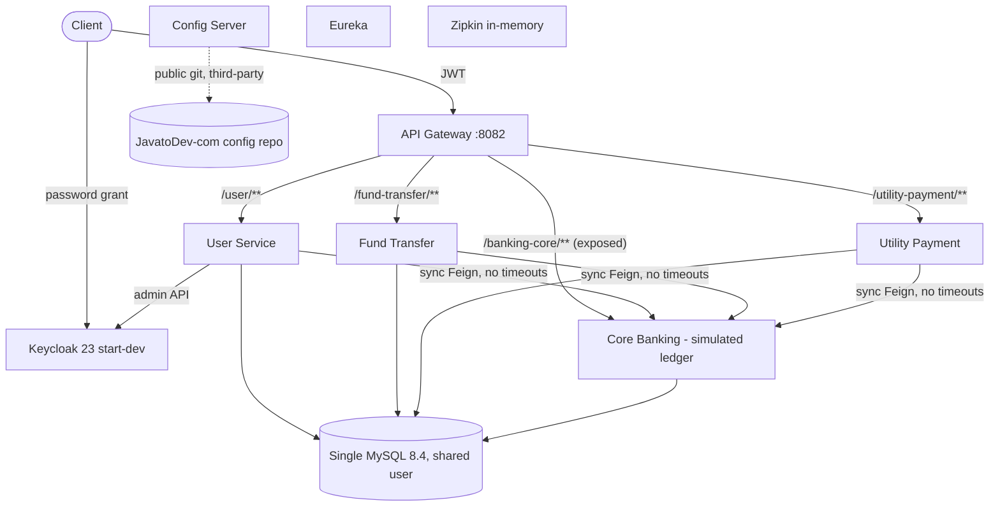

# PDD - Product Architecture Assessment

> Repository: `Persistent-Systems-Test/ts-java-spring-boot-internet-banking` | Baseline: `main` @ `fa1c445` | Assessment date: 2026-11-03 | Generated by Devin (AI) - evidence-based; items needing confirmation are marked.

## Modules and functional decomposition

| Module | Port | Java files | LOC | Responsibility |
|---|---|---|---|---|
| core-banking-service | 8092 | 36 | 831 | Simulated core ledger |
| internet-banking-user-service | 8083 | 32 | 822 | Registration, approval, Keycloak sync |
| internet-banking-fund-transfer-service | 8084 | 25 | 547 | Fund transfer orchestration + history |
| internet-banking-utility-payment-service | 8085 | 23 | 530 | Utility payment orchestration + history |
| internet-banking-api-gateway | 8082 | 3 | 86 | Edge routing + JWT validation |
| internet-banking-config-server | 8090 | 1 | 15 | Spring Cloud Config (git) |
| internet-banking-service-registry | 8081 | 1 | 15 | Eureka server |

## Component interactions

## API capabilities

| Service | Method | Path | Purpose |
|---|---|---|---|
| Gateway | * | /user/** /fund-transfer/** /banking-core/** /utility-payment/** | Routing; JWT required except register & actuator |
| User | POST | /api/v1/bank-users/register | Register (public) |
| User | PATCH | /api/v1/bank-users/update/{id} | Change status |
| User | GET | /api/v1/bank-users, /api/v1/bank-users/{id} | List / read |
| Fund Transfer | POST/GET | /api/v1/transfer | Transfer / history |
| Utility Payment | POST/GET | /api/v1/utility-payment | Pay / history |
| Core | GET | /api/v1/account/bank-account/{n}, /api/v1/account/util-account/{provider} | Lookups |
| Core | POST | /api/v1/transaction/fund-transfer, /api/v1/transaction/util-payment | Ledger postings |
| Core | GET | /api/v1/user/{identification}, /api/v1/user | Customer lookup |

## Integration architecture

| Integration | Used by | Class | Evidence |
|---|---|---|---|
| Keycloak Admin REST API | User service (client_credentials) | VERIFIED | [E-31](https://github.com/Persistent-Systems-Test/ts-java-spring-boot-internet-banking/blob/fa1c445/internet-banking-user-service/src/main/java/com/javatodev/finance/configuration/keycloak/KeycloakProperties.java#L25-L40) `KeycloakProperties.java` (25-40) |
| Keycloak OIDC / JWKS | Gateway | VERIFIED | [E-15](https://github.com/Persistent-Systems-Test/ts-java-spring-boot-internet-banking/blob/fa1c445/internet-banking-api-gateway/src/main/java/com/javatodev/finance/configuration/security/SecurityConfiguration.java#L24-L35) `SecurityConfiguration.java` (24-35) |
| External config repo (GitHub) | Config Server | VERIFIED | [E-11](https://github.com/Persistent-Systems-Test/ts-java-spring-boot-internet-banking/blob/fa1c445/internet-banking-config-server/src/main/resources/application.yml#L1-L10) `application.yml` (1-10) |
| Zipkin | All services | VERIFIED | E-14 `[external] *-service.yml` (ddl-auto / management) |
| RabbitMQ | - | DOCUMENTED only | [E-03](https://github.com/Persistent-Systems-Test/ts-java-spring-boot-internet-banking/blob/fa1c445/README.md#L83-L101) `README.md` (83-101) |
| Real CBS / payment rails / biller aggregator | - | MISSING | [E-21](https://github.com/Persistent-Systems-Test/ts-java-spring-boot-internet-banking/blob/fa1c445/core-banking-service/src/main/java/com/javatodev/finance/service/TransactionService.java#L48-L75) `TransactionService.java` (48-75) |

## Architecture findings

#### PDD-A-01 - Clean separation between channel services and core ledger

| Field | Value |
|---|---|
| Finding ID | PDD-A-01 |
| Assessment category | D. Product Architecture |
| Description | Channel services own requests/status; core owns balances and postings; integration via declarative Feign clients. |
| Supporting repository evidence | E-26 `core-banking-service/src/main/java/com/javatodev/finance/controller/*.java`; [E-33](https://github.com/Persistent-Systems-Test/ts-java-spring-boot-internet-banking/blob/fa1c445/internet-banking-fund-transfer-service/src/main/java/com/javatodev/finance/service/FundTransferService.java#L31-L51) `FundTransferService.java` (31-51); [E-34](https://github.com/Persistent-Systems-Test/ts-java-spring-boot-internet-banking/blob/fa1c445/internet-banking-utility-payment-service/src/main/java/com/javatodev/finance/service/UtilityPaymentService.java#L31-L53) `UtilityPaymentService.java` (31-53) |
| Business impact | Positive: enables replacing the simulated core with a real CBS behind the same contract. |
| Severity / priority | Low |
| Recommendation | Preserve the boundary; formalise it as an anti-corruption/adapter layer. |
| Confidence | High |

#### PDD-A-02 - No adapter layer for real core banking, payment rails or billers

| Field | Value |
|---|---|
| Finding ID | PDD-A-02 |
| Assessment category | D. Product Architecture |
| Description | Core is a simulated ledger; no interfaces for external CBS, interbank rails or biller aggregators. |
| Supporting repository evidence | [E-21](https://github.com/Persistent-Systems-Test/ts-java-spring-boot-internet-banking/blob/fa1c445/core-banking-service/src/main/java/com/javatodev/finance/service/TransactionService.java#L48-L75) `TransactionService.java` (48-75); E-26 `core-banking-service/src/main/java/com/javatodev/finance/controller/*.java` |
| Business impact | Integration effort for first real deployment is unbounded until target systems are known. |
| Severity / priority | High |
| Recommendation | Define CBS/payment-hub adapter contracts early (stakeholder input on target systems). |
| Confidence | Medium |

#### PDD-A-03 - API contracts are inconsistent across docs and code

| Field | Value |
|---|---|
| Finding ID | PDD-A-03 |
| Assessment category | D. Product Architecture |
| Description | Postman uses /core/** and /payment/** and /bank-user while gateway routes are /banking-core/** and /utility-payment/** and controller uses /bank-users; account number typed Long in two services vs String in core. |
| Supporting repository evidence | [E-42](https://github.com/Persistent-Systems-Test/ts-java-spring-boot-internet-banking/blob/fa1c445/postman_collection/JAVA_TO_DEV_MICROSERVICES.postman_collection.json) `JAVA_TO_DEV_MICROSERVICES.postman_collection.json`; E-13 `[external] internet-banking-api-gateway*.yml` (routes); E-44 `*/src/main/java/com/javatodev/finance/model/**/AccountResponse.java` (9) |
| Business impact | Integrator friction; demos fail; latent data bugs for non-numeric account numbers. |
| Severity / priority | Medium |
| Recommendation | Publish versioned OpenAPI specs as the contract; align Postman and DTO types. |
| Confidence | High |

## Scalability and extensibility findings

#### PDD-S-01 - Configuration externalised but owned by a third party

| Field | Value |
|---|---|
| Finding ID | PDD-S-01 |
| Assessment category | F. Scalability & Extensibility |
| Description | All runtime settings are pulled from JavatoDev-com config repo; changing behaviour requires editing a repo the organisation does not control. |
| Supporting repository evidence | [E-11](https://github.com/Persistent-Systems-Test/ts-java-spring-boot-internet-banking/blob/fa1c445/internet-banking-config-server/src/main/resources/application.yml#L1-L10) `application.yml` (1-10); E-12 `*/src/main/resources/bootstrap*.yml` |
| Business impact | Configurability exists but is not under the product owner's control. |
| Severity / priority | High |
| Recommendation | Internalise configuration into an organisation-owned store. |
| Confidence | High |

#### PDD-S-02 - No multi-tenancy or multi-bank support

| Field | Value |
|---|---|
| Finding ID | PDD-S-02 |
| Assessment category | F. Scalability & Extensibility |
| Description | Single realm, single schema set, no tenant identifiers. |
| Supporting repository evidence | [E-08](https://github.com/Persistent-Systems-Test/ts-java-spring-boot-internet-banking/blob/fa1c445/docker-compose/mysql/privileges.sql#L5-L8) `privileges.sql` (5-8); [E-10](https://github.com/Persistent-Systems-Test/ts-java-spring-boot-internet-banking/blob/fa1c445/docker-compose/keycloak/realm-export.json#L686-L873) `realm-export.json` (686-873) |
| Business impact | Each bank deployment needs a separate stack; limits SaaS model. |
| Severity / priority | Medium |
| Recommendation | Decide tenancy model with stakeholders before scaling commercially. |
| Confidence | Medium |

#### PDD-S-03 - Single-currency, single-product ledger model

| Field | Value |
|---|---|
| Finding ID | PDD-S-03 |
| Assessment category | F. Scalability & Extensibility |
| Description | No currency field; account types enumerated but only savings used; transaction types limited to two. |
| Supporting repository evidence | E-24 `core-banking-service/src/main/resources/db/migration/` (V1.0.*); E-25 `core-banking-service/src/main/java/com/javatodev/finance/model/{AccountType,AccountStatus,TransactionType}.java` |
| Business impact | Adding deposits, loans, FX or new payment types requires ledger redesign. |
| Severity / priority | Medium |
| Recommendation | Generalise ledger model (currency, product, transaction codes). |
| Confidence | High |
