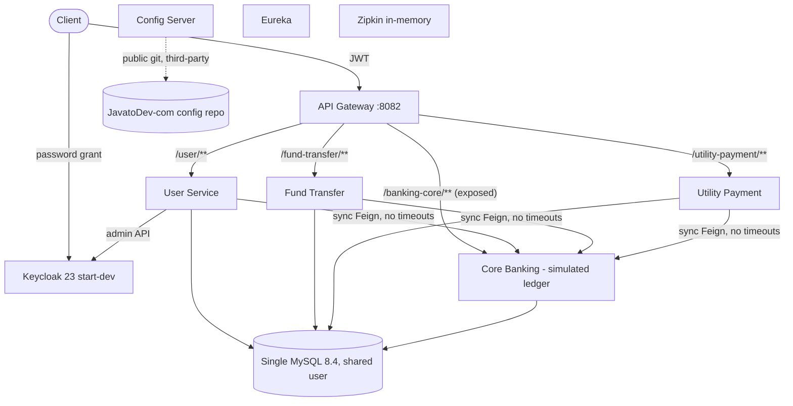
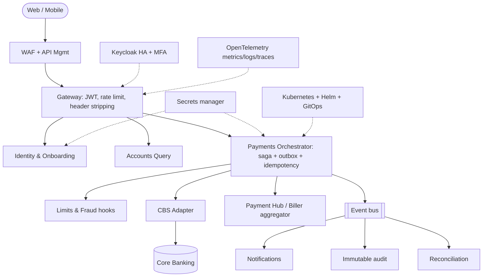

# Combined Product and Technology Due Diligence Report

**Product:** Internet Banking Concept Microservices  
**Repository:** Persistent-Systems-Test/ts-java-spring-boot-internet-banking  
**Baseline:** main @ fa1c445  
**Assessment date:** 2026-11-03  
**Prepared by:** Devin (AI), evidence-based automated assessment

## Combined Executive Summary

| Item | Value |
|---|---|
| Product verdict | Prototype / reference implementation. Suitable as a delivery accelerator for a digital banking channel; not market-ready as a product. |
| Technology verdict | Well-structured but prototype-grade Spring Cloud microservices system. Keep the skeleton; re-engineer money movement, authorisation, secrets, delivery pipeline and operability. |
| Product score | 1.7 / 5 |
| Technology score | 1.8 / 5 |
| PDD findings | 31 (Critical: 8, High: 12, Medium: 8, Low: 3) |
| TDD findings | 65 (Critical: 13, High: 25, Medium: 19, Low: 8) |
| Risks | 12 product + 12 technology |
| Recommendation | Reuse as accelerator. Phase 0 stabilisation (~4-6 weeks, ~3 engineers) closes all Critical items; Phase 1-2 (~6-8 months, 6-8 engineers) reaches bank-pilot readiness. Effort figures are indicative assessor estimates. |

### Top product messages

- Money-movement rules are unsafe: negative amounts accepted, no ownership check, available balance double-adjusted, core ledger reachable via gateway (PDD-F-01..04).
- Customer data is not scoped: every authenticated user can list all transfers and payments and read any account balance (PDD-F-05).
- Functional breadth is narrow: 0 fully-implemented and 9 partial out of a 35-capability retail internet-banking reference list (PDD-G-01).
- Regulatory capabilities (KYC/AML, SCA/MFA, consent, immutable audit) are absent (PDD-G-02).
- Runtime configuration and container images depend on third-party-owned assets (PDD-R-01).
- Business data (customers, revenue, adoption, KPIs, market position) is not in the repository and requires stakeholder validation.

### Top technology messages

- Architecture: sensible decomposition (gateway, channel services, core ledger, discovery, config, tracing) but synchronous non-atomic distributed writes and core exposed at the edge (TDD-ARC-01, TDD-ARC-02).
- Security: 8 Critical findings incl. committed secrets, broken object/function-level authorisation, header-trust model, password logging, third-party config supply chain (TDD-SEC-*).
- Data integrity: no amount validation, double-adjusted balances, no locking, no idempotency, mutable single-entry ledger (TDD-DAT-*).
- Engineering maturity: no CI/CD, 18 unit tests in one service, no IaC/Kubernetes despite README claims (TDD-ENG-*, TDD-INF-*).
- Stack currency: Spring Boot 3.2.4 / Spring Cloud 2023.0.0 and Keycloak 23 are past their open-source support windows per vendor policy (to be re-verified) (TDD-STK-01, STK-02).
- Build/test results and dependency CVE scan could not be produced in the assessment environment (Maven Central HTTP 429) - limitation, not a code defect.

## Product Context - Internet Banking Concept Microservices

This is the single source of truth for the PDD and TDD. Every statement is classified:

| Class | Meaning |
|---|---|
| VERIFIED | Verified implementation - observed in source code/config in this repository |
| DOCUMENTED | Documented but unverified - stated in README/docs, not found in code |
| INFERRED | Inferred - assessor reasoning from code structure; not explicitly documented |
| MISSING | Missing information - not present in repository |
| STAKEHOLDER | Requires stakeholder validation - business information not derivable from code |

### 1. Product overview and purpose

| Aspect | Statement | Class | Evidence |
|---|---|---|---|
| Purpose | Digital (internet) banking channel platform exposing REST APIs for online-banking user onboarding, account lookup, intra-bank fund transfers and utility bill payments, on top of a simulated core banking ledger. | VERIFIED | [E-01](https://github.com/Persistent-Systems-Test/ts-java-spring-boot-internet-banking/blob/fa1c445/README.md#L1-L20) `README.md` (1-20); E-26 `core-banking-service/src/main/java/com/javatodev/finance/controller/*.java` |
| Origin | Tutorial/reference implementation by javatodev.com (MIT), first commit 2021-05-09, upgraded to Java 21 / Spring Boot 3.2.4 in 2024. | VERIFIED | [E-01](https://github.com/Persistent-Systems-Test/ts-java-spring-boot-internet-banking/blob/fa1c445/README.md#L1-L20) `README.md` (1-20); [E-04](https://github.com/Persistent-Systems-Test/ts-java-spring-boot-internet-banking/blob/fa1c445/LICENSE#L1-L3) `LICENSE` (1-3); E-43 `git log` |
| Business Problem | Banks need a secure self-service digital channel decoupled from the core banking system so channel features evolve independently of the core. | INFERRED | [E-01](https://github.com/Persistent-Systems-Test/ts-java-spring-boot-internet-banking/blob/fa1c445/README.md#L1-L20) `README.md` (1-20); E-26 `core-banking-service/src/main/java/com/javatodev/finance/controller/*.java` |
| Objectives | Stated objective is educational: demonstrate Spring Boot microservices patterns that 'evolve as a full fledged REST API collection until deployments'. Commercial objectives/outcomes are not documented. | DOCUMENTED / STAKEHOLDER | [E-01](https://github.com/Persistent-Systems-Test/ts-java-spring-boot-internet-banking/blob/fa1c445/README.md#L1-L20) `README.md` (1-20) |

### 2. Target users and stakeholders

| User / stakeholder | Need / interaction | Class | Evidence |
|---|---|---|---|
| Retail bank customer (existing core customer) | Registers, logs in, transfers funds, pays bills | VERIFIED (API only, no UI) | [E-28](https://github.com/Persistent-Systems-Test/ts-java-spring-boot-internet-banking/blob/fa1c445/internet-banking-user-service/src/main/java/com/javatodev/finance/controller/UserController.java#L28-L55) `UserController.java` (28-55); [E-33](https://github.com/Persistent-Systems-Test/ts-java-spring-boot-internet-banking/blob/fa1c445/internet-banking-fund-transfer-service/src/main/java/com/javatodev/finance/service/FundTransferService.java#L31-L51) `FundTransferService.java` (31-51); [E-34](https://github.com/Persistent-Systems-Test/ts-java-spring-boot-internet-banking/blob/fa1c445/internet-banking-utility-payment-service/src/main/java/com/javatodev/finance/service/UtilityPaymentService.java#L31-L53) `UtilityPaymentService.java` (31-53) |
| Bank administrator / operations | Approves/blacklists registrations | VERIFIED (PATCH status; no role model) | [E-28](https://github.com/Persistent-Systems-Test/ts-java-spring-boot-internet-banking/blob/fa1c445/internet-banking-user-service/src/main/java/com/javatodev/finance/controller/UserController.java#L28-L55) `UserController.java` (28-55); [E-29](https://github.com/Persistent-Systems-Test/ts-java-spring-boot-internet-banking/blob/fa1c445/internet-banking-user-service/src/main/java/com/javatodev/finance/service/UserService.java#L33-L111) `UserService.java` (33-111) |
| Developer / learner | Learns microservices patterns via tutorial, Postman, compose | DOCUMENTED | [E-01](https://github.com/Persistent-Systems-Test/ts-java-spring-boot-internet-banking/blob/fa1c445/README.md#L1-L20) `README.md` (1-20); [E-42](https://github.com/Persistent-Systems-Test/ts-java-spring-boot-internet-banking/blob/fa1c445/postman_collection/JAVA_TO_DEV_MICROSERVICES.postman_collection.json) `JAVA_TO_DEV_MICROSERVICES.postman_collection.json` |
| Compliance, risk, customer-service staff | No supporting capability | MISSING | No repository evidence available (absence of artefact) |
| Commercial buyer / target segment | Not documented | STAKEHOLDER | No repository evidence available (absence of artefact) |

### 3. Functional capabilities

| ID | Capability | Class | Evidence |
|---|---|---|---|
| CAP-01 | Customer self-registration | VERIFIED | [E-28](https://github.com/Persistent-Systems-Test/ts-java-spring-boot-internet-banking/blob/fa1c445/internet-banking-user-service/src/main/java/com/javatodev/finance/controller/UserController.java#L28-L55) `UserController.java` (28-55); [E-29](https://github.com/Persistent-Systems-Test/ts-java-spring-boot-internet-banking/blob/fa1c445/internet-banking-user-service/src/main/java/com/javatodev/finance/service/UserService.java#L33-L111) `UserService.java` (33-111) |
| CAP-02 | Registration approval / status management | VERIFIED | [E-28](https://github.com/Persistent-Systems-Test/ts-java-spring-boot-internet-banking/blob/fa1c445/internet-banking-user-service/src/main/java/com/javatodev/finance/controller/UserController.java#L28-L55) `UserController.java` (28-55); [E-29](https://github.com/Persistent-Systems-Test/ts-java-spring-boot-internet-banking/blob/fa1c445/internet-banking-user-service/src/main/java/com/javatodev/finance/service/UserService.java#L33-L111) `UserService.java` (33-111) |
| CAP-03 | Authentication (OIDC/JWT via Keycloak) | VERIFIED | [E-10](https://github.com/Persistent-Systems-Test/ts-java-spring-boot-internet-banking/blob/fa1c445/docker-compose/keycloak/realm-export.json#L686-L873) `realm-export.json` (686-873); [E-15](https://github.com/Persistent-Systems-Test/ts-java-spring-boot-internet-banking/blob/fa1c445/internet-banking-api-gateway/src/main/java/com/javatodev/finance/configuration/security/SecurityConfiguration.java#L24-L35) `SecurityConfiguration.java` (24-35) |
| CAP-04 | Bank account & biller lookup | VERIFIED | E-26 `core-banking-service/src/main/java/com/javatodev/finance/controller/*.java` |
| CAP-05 | Intra-bank fund transfer | VERIFIED | [E-18](https://github.com/Persistent-Systems-Test/ts-java-spring-boot-internet-banking/blob/fa1c445/core-banking-service/src/main/java/com/javatodev/finance/service/TransactionService.java#L35-L46) `TransactionService.java` (35-46); [E-33](https://github.com/Persistent-Systems-Test/ts-java-spring-boot-internet-banking/blob/fa1c445/internet-banking-fund-transfer-service/src/main/java/com/javatodev/finance/service/FundTransferService.java#L31-L51) `FundTransferService.java` (31-51) |
| CAP-06 | Utility bill payment (ledger debit only) | VERIFIED | [E-21](https://github.com/Persistent-Systems-Test/ts-java-spring-boot-internet-banking/blob/fa1c445/core-banking-service/src/main/java/com/javatodev/finance/service/TransactionService.java#L48-L75) `TransactionService.java` (48-75); [E-34](https://github.com/Persistent-Systems-Test/ts-java-spring-boot-internet-banking/blob/fa1c445/internet-banking-utility-payment-service/src/main/java/com/javatodev/finance/service/UtilityPaymentService.java#L31-L53) `UtilityPaymentService.java` (31-53) |
| CAP-07 | Transfer / payment history (paged) | VERIFIED | [E-33](https://github.com/Persistent-Systems-Test/ts-java-spring-boot-internet-banking/blob/fa1c445/internet-banking-fund-transfer-service/src/main/java/com/javatodev/finance/service/FundTransferService.java#L31-L51) `FundTransferService.java` (31-51); [E-34](https://github.com/Persistent-Systems-Test/ts-java-spring-boot-internet-banking/blob/fa1c445/internet-banking-utility-payment-service/src/main/java/com/javatodev/finance/service/UtilityPaymentService.java#L31-L53) `UtilityPaymentService.java` (31-53) |
| CAP-08 | Customer & user listing | VERIFIED | E-26 `core-banking-service/src/main/java/com/javatodev/finance/controller/*.java`; [E-29](https://github.com/Persistent-Systems-Test/ts-java-spring-boot-internet-banking/blob/fa1c445/internet-banking-user-service/src/main/java/com/javatodev/finance/service/UserService.java#L33-L111) `UserService.java` (33-111) |
| CAP-09 | Audit columns on channel records | VERIFIED | E-36 `*/src/main/java/com/javatodev/finance/model/dto/AuditAware.java` |
| CAP-10 | Distributed tracing | VERIFIED | E-37 `*/build.gradle`; E-14 `[external] *-service.yml` (ddl-auto / management) |
| CAP-11 | Notifications via RabbitMQ | DOCUMENTED (not implemented) | [E-02](https://github.com/Persistent-Systems-Test/ts-java-spring-boot-internet-banking/blob/fa1c445/README.md#L60-L75) `README.md` (60-75); [E-03](https://github.com/Persistent-Systems-Test/ts-java-spring-boot-internet-banking/blob/fa1c445/README.md#L83-L101) `README.md` (83-101) |
| CAP-12 | Prometheus metrics / Kubernetes deployment | DOCUMENTED (not implemented) | [E-03](https://github.com/Persistent-Systems-Test/ts-java-spring-boot-internet-banking/blob/fa1c445/README.md#L83-L101) `README.md` (83-101) |

### 4. Core business workflows and user journeys

#### WF-01 Onboarding

1. Customer POST /user/api/v1/bank-users/register {email, identification, password}
2. User svc: Keycloak search(email) -> reject if found
3. User svc -> Core GET /api/v1/user/{identification}
4. Email must equal core email
5. Create disabled Keycloak user with password
6. Persist local user status=PENDING
7. Admin PATCH /update/{id} status=APPROVED -> Keycloak user enabled

Evidence: [E-28](https://github.com/Persistent-Systems-Test/ts-java-spring-boot-internet-banking/blob/fa1c445/internet-banking-user-service/src/main/java/com/javatodev/finance/controller/UserController.java#L28-L55) `UserController.java` (28-55); [E-29](https://github.com/Persistent-Systems-Test/ts-java-spring-boot-internet-banking/blob/fa1c445/internet-banking-user-service/src/main/java/com/javatodev/finance/service/UserService.java#L33-L111) `UserService.java` (33-111)

#### WF-02 Login

1. Client calls Keycloak token endpoint (password grant)
2. Gateway validates JWT via JWKS on each call

Evidence: [E-10](https://github.com/Persistent-Systems-Test/ts-java-spring-boot-internet-banking/blob/fa1c445/docker-compose/keycloak/realm-export.json#L686-L873) `realm-export.json` (686-873); [E-15](https://github.com/Persistent-Systems-Test/ts-java-spring-boot-internet-banking/blob/fa1c445/internet-banking-api-gateway/src/main/java/com/javatodev/finance/configuration/security/SecurityConfiguration.java#L24-L35) `SecurityConfiguration.java` (24-35)

#### WF-03 Fund transfer

1. POST /fund-transfer/api/v1/transfer {fromAccount,toAccount,amount}
2. Persist fund_transfer PENDING
3. Feign -> Core POST /api/v1/transaction/fund-transfer
4. Core validates balance, updates both accounts, writes 2 ledger rows
5. Mark SUCCESS with core transactionId

Evidence: [E-18](https://github.com/Persistent-Systems-Test/ts-java-spring-boot-internet-banking/blob/fa1c445/core-banking-service/src/main/java/com/javatodev/finance/service/TransactionService.java#L35-L46) `TransactionService.java` (35-46); [E-20](https://github.com/Persistent-Systems-Test/ts-java-spring-boot-internet-banking/blob/fa1c445/core-banking-service/src/main/java/com/javatodev/finance/service/TransactionService.java) `TransactionService.java` (63-64,90-91,99-100); [E-33](https://github.com/Persistent-Systems-Test/ts-java-spring-boot-internet-banking/blob/fa1c445/internet-banking-fund-transfer-service/src/main/java/com/javatodev/finance/service/FundTransferService.java#L31-L51) `FundTransferService.java` (31-51)

#### WF-04 Utility payment

1. POST /utility-payment/api/v1/utility-payment {providerId,amount,referenceNumber,account}
2. Persist PROCESSING
3. Feign -> Core util-payment: debit account, write ledger row
4. Mark SUCCESS

Evidence: [E-21](https://github.com/Persistent-Systems-Test/ts-java-spring-boot-internet-banking/blob/fa1c445/core-banking-service/src/main/java/com/javatodev/finance/service/TransactionService.java#L48-L75) `TransactionService.java` (48-75); [E-34](https://github.com/Persistent-Systems-Test/ts-java-spring-boot-internet-banking/blob/fa1c445/internet-banking-utility-payment-service/src/main/java/com/javatodev/finance/service/UtilityPaymentService.java#L31-L53) `UtilityPaymentService.java` (31-53)

#### WF-05 History

1. GET /fund-transfer/api/v1/transfer or /utility-payment/api/v1/utility-payment (paged, all records)

Evidence: [E-33](https://github.com/Persistent-Systems-Test/ts-java-spring-boot-internet-banking/blob/fa1c445/internet-banking-fund-transfer-service/src/main/java/com/javatodev/finance/service/FundTransferService.java#L31-L51) `FundTransferService.java` (31-51); [E-34](https://github.com/Persistent-Systems-Test/ts-java-spring-boot-internet-banking/blob/fa1c445/internet-banking-utility-payment-service/src/main/java/com/javatodev/finance/service/UtilityPaymentService.java#L31-L53) `UtilityPaymentService.java` (31-53)

### 5. Business rules and validations

| ID | Rule | Class | Evidence |
|---|---|---|---|
| BR-01 | Registration requires the identification number to exist in core and email to match core record | VERIFIED | [E-29](https://github.com/Persistent-Systems-Test/ts-java-spring-boot-internet-banking/blob/fa1c445/internet-banking-user-service/src/main/java/com/javatodev/finance/service/UserService.java#L33-L111) `UserService.java` (33-111) |
| BR-02 | Email must not already exist in Keycloak (fuzzy search) | VERIFIED | [E-29](https://github.com/Persistent-Systems-Test/ts-java-spring-boot-internet-banking/blob/fa1c445/internet-banking-user-service/src/main/java/com/javatodev/finance/service/UserService.java#L33-L111) `UserService.java` (33-111); [E-30](https://github.com/Persistent-Systems-Test/ts-java-spring-boot-internet-banking/blob/fa1c445/internet-banking-user-service/src/main/java/com/javatodev/finance/service/KeycloakUserService.java#L36) `KeycloakUserService.java` (36) |
| BR-03 | New online users start PENDING and disabled until APPROVED | VERIFIED | [E-29](https://github.com/Persistent-Systems-Test/ts-java-spring-boot-internet-banking/blob/fa1c445/internet-banking-user-service/src/main/java/com/javatodev/finance/service/UserService.java#L33-L111) `UserService.java` (33-111) |
| BR-04 | Debit allowed if actualBalance >= amount and actualBalance >= 0 | VERIFIED | [E-19](https://github.com/Persistent-Systems-Test/ts-java-spring-boot-internet-banking/blob/fa1c445/core-banking-service/src/main/java/com/javatodev/finance/service/TransactionService.java#L77-L81) `TransactionService.java` (77-81) |
| BR-05 | Amount must be positive | MISSING (not enforced) | [E-19](https://github.com/Persistent-Systems-Test/ts-java-spring-boot-internet-banking/blob/fa1c445/core-banking-service/src/main/java/com/javatodev/finance/service/TransactionService.java#L77-L81) `TransactionService.java` (77-81) |
| BR-06 | Only ACTIVE accounts may transact | MISSING (enum exists, not enforced) | [E-19](https://github.com/Persistent-Systems-Test/ts-java-spring-boot-internet-banking/blob/fa1c445/core-banking-service/src/main/java/com/javatodev/finance/service/TransactionService.java#L77-L81) `TransactionService.java` (77-81); E-25 `core-banking-service/src/main/java/com/javatodev/finance/model/{AccountType,AccountStatus,TransactionType}.java` |
| BR-07 | Customer may only debit own accounts | MISSING | [E-33](https://github.com/Persistent-Systems-Test/ts-java-spring-boot-internet-banking/blob/fa1c445/internet-banking-fund-transfer-service/src/main/java/com/javatodev/finance/service/FundTransferService.java#L31-L51) `FundTransferService.java` (31-51) |
| BR-08 | Transaction limits / cut-offs / fees | MISSING | No repository evidence available (absence of artefact) |

### 6. Data entities and relationships

| Entity / table | Owner service | Key attributes | Relationships |
|---|---|---|---|
| banking_core_user | core | id, first_name, last_name, email, identification_number | 1-* account |
| banking_core_account | core | id, number, type, status, actual_balance, available_balance DECIMAL(19,2), user_id | *-1 user; 1-* transaction |
| banking_core_transaction | core | id, amount, transaction_type, reference_number, transaction_id, account_id | *-1 account (mapped @OneToOne) |
| banking_core_utility_account | core | id, number, provider_name | - |
| user | user-service | id, auth_id, identification, status + audit | auth_id -> Keycloak user |
| fund_transfer | fund-transfer | id, transaction_reference, from_account, to_account, amount, status + audit | transaction_reference -> core transaction_id |
| utility_payment | utility-payment | id, provider_id, amount, reference_number, account, transaction_id, status + audit | transaction_id -> core |

### 7. API capabilities

| Service | Method | Path | Purpose |
|---|---|---|---|
| Gateway | * | /user/** /fund-transfer/** /banking-core/** /utility-payment/** | Routing; JWT required except register & actuator |
| User | POST | /api/v1/bank-users/register | Register (public) |
| User | PATCH | /api/v1/bank-users/update/{id} | Change status |
| User | GET | /api/v1/bank-users, /api/v1/bank-users/{id} | List / read |
| Fund Transfer | POST/GET | /api/v1/transfer | Transfer / history |
| Utility Payment | POST/GET | /api/v1/utility-payment | Pay / history |
| Core | GET | /api/v1/account/bank-account/{n}, /api/v1/account/util-account/{provider} | Lookups |
| Core | POST | /api/v1/transaction/fund-transfer, /api/v1/transaction/util-payment | Ledger postings |
| Core | GET | /api/v1/user/{identification}, /api/v1/user | Customer lookup |

### 8. Product modules and components

| Module | Port | Java files | LOC | Responsibility |
|---|---|---|---|---|
| core-banking-service | 8092 | 36 | 831 | Simulated core ledger |
| internet-banking-user-service | 8083 | 32 | 822 | Registration, approval, Keycloak sync |
| internet-banking-fund-transfer-service | 8084 | 25 | 547 | Fund transfer orchestration + history |
| internet-banking-utility-payment-service | 8085 | 23 | 530 | Utility payment orchestration + history |
| internet-banking-api-gateway | 8082 | 3 | 86 | Edge routing + JWT validation |
| internet-banking-config-server | 8090 | 1 | 15 | Spring Cloud Config (git) |
| internet-banking-service-registry | 8081 | 1 | 15 | Eureka server |

### 9. External integrations and product dependencies

| Integration | Used by | Class | Evidence |
|---|---|---|---|
| Keycloak Admin REST API | User service (client_credentials) | VERIFIED | [E-31](https://github.com/Persistent-Systems-Test/ts-java-spring-boot-internet-banking/blob/fa1c445/internet-banking-user-service/src/main/java/com/javatodev/finance/configuration/keycloak/KeycloakProperties.java#L25-L40) `KeycloakProperties.java` (25-40) |
| Keycloak OIDC / JWKS | Gateway | VERIFIED | [E-15](https://github.com/Persistent-Systems-Test/ts-java-spring-boot-internet-banking/blob/fa1c445/internet-banking-api-gateway/src/main/java/com/javatodev/finance/configuration/security/SecurityConfiguration.java#L24-L35) `SecurityConfiguration.java` (24-35) |
| External config repo (GitHub) | Config Server | VERIFIED | [E-11](https://github.com/Persistent-Systems-Test/ts-java-spring-boot-internet-banking/blob/fa1c445/internet-banking-config-server/src/main/resources/application.yml#L1-L10) `application.yml` (1-10) |
| Zipkin | All services | VERIFIED | E-14 `[external] *-service.yml` (ddl-auto / management) |
| RabbitMQ | - | DOCUMENTED only | [E-03](https://github.com/Persistent-Systems-Test/ts-java-spring-boot-internet-banking/blob/fa1c445/README.md#L83-L101) `README.md` (83-101) |
| Real CBS / payment rails / biller aggregator | - | MISSING | [E-21](https://github.com/Persistent-Systems-Test/ts-java-spring-boot-internet-banking/blob/fa1c445/core-banking-service/src/main/java/com/javatodev/finance/service/TransactionService.java#L48-L75) `TransactionService.java` (48-75) |

### 10. Deployment and operational context

docker-compose on a single host: 7 app containers + MySQL + Keycloak + Postgres + Zipkin, static IPs on 172.25.0.0/16, images referenced as javatodev/*; services wait for registry/config/MySQL via wait-for-it.sh. No Kubernetes/IaC/CI.

Class: VERIFIED. Evidence: [E-05](https://github.com/Persistent-Systems-Test/ts-java-spring-boot-internet-banking/blob/fa1c445/docker-compose/docker-compose.yml#L1-L139) `docker-compose.yml` (1-139); E-39 `*/Dockerfile`; E-43 `git log`

### 11. Missing information and items requiring stakeholder validation

- Business KPIs, customers, revenue, adoption, SLAs - not in repository (STAKEHOLDER)
- Production deployment history / incidents - not in repository (STAKEHOLDER)
- Ownership of external config repo and Docker Hub images (STAKEHOLDER)
- Target core banking system and payment rails (STAKEHOLDER)
- Non-functional requirements: TPS, latency, RPO/RTO, data residency (MISSING)
- Security testing / VAPT reports (MISSING)
- Build/test execution results - dependency download blocked (HTTP 429) in assessment environment (LIMITATION)

## PDD - Executive Summary

**Verdict:** Prototype / reference implementation. Suitable as a delivery accelerator for a digital banking channel; not market-ready as a product.

**Overall product score:** 1.7 / 5

**Maturity:** Concept / prototype (self-described tutorial 'concept', E-01). Happy-path API flows exist end-to-end; no UI, no production hardening.

### Key messages

- Money-movement rules are unsafe: negative amounts accepted, no ownership check, available balance double-adjusted, core ledger reachable via gateway (PDD-F-01..04).
- Customer data is not scoped: every authenticated user can list all transfers and payments and read any account balance (PDD-F-05).
- Functional breadth is narrow: 0 fully-implemented and 9 partial out of a 35-capability retail internet-banking reference list (PDD-G-01).
- Regulatory capabilities (KYC/AML, SCA/MFA, consent, immutable audit) are absent (PDD-G-02).
- Runtime configuration and container images depend on third-party-owned assets (PDD-R-01).
- Business data (customers, revenue, adoption, KPIs, market position) is not in the repository and requires stakeholder validation.

### Scorecard (1 = absent, 5 = best-in-class; assessor judgement)

| Dimension | Score | Basis |
|---|---|---|
| Functional breadth | 1.5 | 9 partial / 26 absent of 35 reference capabilities |
| Functional correctness | 1.0 | PDD-F-01..F-04 |
| Security & privacy (product view) | 1.0 | PDD-F-02, F-05, F-06, F-10 |
| Compliance readiness | 1.0 | PDD-G-02 |
| User experience | 1.0 | API-only, inconsistent errors (PDD-E-01..E-03) |
| Integration readiness | 2.0 | Clean Feign seam to core, OIDC; no adapters (PDD-A-02) |
| Operability | 2.0 | Tracing/actuator; no reconciliation (PDD-F-08) |
| Documentation & DX | 3.5 | README, tutorial series, Postman, compose |
| Architecture fitness | 3.0 | Sensible channel/core split (PDD-A-01) |
| Commercial readiness | 1.5 | MIT third-party code, branding, external deps (PDD-R-01, R-02) |

### Findings overview

31 findings (Critical: 8, High: 12, Medium: 8, Low: 3).

| ID | Category | Title | Severity | Confidence |
|---|---|---|---|---|
| PDD-F-01 | B. Functional | Negative and zero amounts accepted for transfers and payments | Critical | High |
| PDD-F-02 | B. Functional | No check that the customer owns the source account | Critical | High |
| PDD-F-03 | B. Functional | Core ledger operations reachable directly by end users | Critical | High |
| PDD-F-04 | B. Functional | Available balance shown to customers is wrong after every transaction | Critical | High |
| PDD-F-05 | B. Functional | History and lookups are not scoped to the customer | Critical | High |
| PDD-F-06 | B. Functional | Any authenticated user can approve or blacklist registrations | Critical | High |
| PDD-G-02 | G. Product Risk | Regulatory capabilities absent | Critical | High |
| PDD-R-05 | G. Product Risk | Published credentials in README and repository | Critical | High |
| PDD-A-02 | D. Product Architecture | No adapter layer for real core banking, payment rails or billers | High | Medium |
| PDD-E-01 | E. User Experience | No customer-facing user interface | High | High |
| PDD-E-03 | E. User Experience | No customer dashboard or own-account listing | High | High |
| PDD-F-07 | B. Functional | Blocked, dormant or pending accounts can transact | High | High |
| PDD-F-08 | B. Functional | Failed payments remain PENDING/PROCESSING forever | High | High |
| PDD-F-09 | B. Functional | Duplicate submission creates duplicate debits | High | High |
| PDD-F-10 | B. Functional | Utility payments debit the customer but no biller is paid | High | High |
| PDD-F-12 | B. Functional | Disabling or blacklisting a user does not block login | High | High |
| PDD-G-01 | G. Product Risk | Narrow functional coverage versus a retail internet-banking reference set | High | Medium |
| PDD-R-01 | G. Product Risk | Operational dependency on third-party assets | High | High |
| PDD-R-04 | G. Product Risk | Seed test data shipped in production migration | High | High |
| PDD-S-01 | F. Scalability & Extensibility | Configuration externalised but owned by a third party | High | High |
| PDD-A-03 | D. Product Architecture | API contracts are inconsistent across docs and code | Medium | High |
| PDD-C-02 | C. Business Value | Business outcomes and KPIs not defined | Medium | High |
| PDD-E-02 | E. User Experience | Error responses are technical and inconsistent | Medium | High |
| PDD-F-11 | B. Functional | Same-account transfers are permitted | Medium | High |
| PDD-R-02 | G. Product Risk | No exclusive IP; rebranding required | Medium | High |
| PDD-R-03 | G. Product Risk | Low maintenance activity and single original author | Medium | High |
| PDD-S-02 | F. Scalability & Extensibility | No multi-tenancy or multi-bank support | Medium | Medium |
| PDD-S-03 | F. Scalability & Extensibility | Single-currency, single-product ledger model | Medium | High |
| PDD-A-01 | D. Product Architecture | Clean separation between channel services and core ledger | Low | High |
| PDD-C-01 | C. Business Value | Accelerator value for digital-channel delivery | Low | Medium |
| PDD-E-04 | E. User Experience | Accessibility cannot be assessed | Low | High |

### Strengths

- Clear bounded contexts: onboarding/identity, transfers, bill-pay, ledger (PDD-A-01)
- Modern, widely-skilled stack (Java 21, Spring Boot 3, Spring Cloud) (E-37)
- Standards-based identity with Keycloak/OIDC (E-15)
- Easy local setup with docker-compose, seed data and Postman (E-05, E-42)
- Good learning documentation (tutorial series linked in README) (E-01)

### Weaknesses

- Critical money-movement and authorisation defects (PDD-F-01..F-06)
- Narrow functional scope; no UI (PDD-G-01, PDD-E-01)
- No compliance capabilities (PDD-G-02)
- Third-party-owned runtime assets and branding (PDD-R-01, PDD-R-02)
- No business case/KPIs in evidence (PDD-C-02)

### Overall Product Due Diligence assessment

Proceed only as an accelerator. Close Critical findings in a 4-6 week stabilisation phase before any external exposure; plan a 9-12 month programme to reach a bank-pilot MVP (indicative assessor estimate).

## PDD - Product Overview and Context

| Aspect | Assessment | Class | Evidence |
|---|---|---|---|
| Vision | Not documented. README states an educational intent: an 'internet banking API concept' that evolves 'as a full fledged REST API collection until deployments'. | DOCUMENTED | [E-01](https://github.com/Persistent-Systems-Test/ts-java-spring-boot-internet-banking/blob/fa1c445/README.md#L1-L20) `README.md` (1-20) |
| Mission | Not documented - requires stakeholder validation. | STAKEHOLDER | No repository evidence available (absence of artefact) |
| Objectives | Implied by code: enable existing bank customers to self-onboard and perform transfers and bill payments online, separated from the core ledger. | INFERRED | E-26 `core-banking-service/src/main/java/com/javatodev/finance/controller/*.java`; [E-29](https://github.com/Persistent-Systems-Test/ts-java-spring-boot-internet-banking/blob/fa1c445/internet-banking-user-service/src/main/java/com/javatodev/finance/service/UserService.java#L33-L111) `UserService.java` (33-111) |
| Value Proposition | Channel/core separation; modern Spring Cloud stack; standards-based identity (Keycloak/OIDC); one-command local environment with seed data and Postman collection. | VERIFIED | [E-05](https://github.com/Persistent-Systems-Test/ts-java-spring-boot-internet-banking/blob/fa1c445/docker-compose/docker-compose.yml#L1-L139) `docker-compose.yml` (1-139); [E-11](https://github.com/Persistent-Systems-Test/ts-java-spring-boot-internet-banking/blob/fa1c445/internet-banking-config-server/src/main/resources/application.yml#L1-L10) `application.yml` (1-10); [E-15](https://github.com/Persistent-Systems-Test/ts-java-spring-boot-internet-banking/blob/fa1c445/internet-banking-api-gateway/src/main/java/com/javatodev/finance/configuration/security/SecurityConfiguration.java#L24-L35) `SecurityConfiguration.java` (24-35); [E-42](https://github.com/Persistent-Systems-Test/ts-java-spring-boot-internet-banking/blob/fa1c445/postman_collection/JAVA_TO_DEV_MICROSERVICES.postman_collection.json) `JAVA_TO_DEV_MICROSERVICES.postman_collection.json` |
| Segments | Not documented. Assessor inference: system integrators and bank IT teams seeking a greenfield digital-channel accelerator for smaller banks/credit unions/NBFCs. Requires stakeholder validation. | INFERRED / STAKEHOLDER | No repository evidence available (absence of artefact) |
| Alignment | The implemented flows address the core of the stated problem (self-service money movement) but the absence of authorisation, validation and compliance features means the solution does not yet safely solve it. | INFERRED | [E-19](https://github.com/Persistent-Systems-Test/ts-java-spring-boot-internet-banking/blob/fa1c445/core-banking-service/src/main/java/com/javatodev/finance/service/TransactionService.java#L77-L81) `TransactionService.java` (77-81); [E-33](https://github.com/Persistent-Systems-Test/ts-java-spring-boot-internet-banking/blob/fa1c445/internet-banking-fund-transfer-service/src/main/java/com/javatodev/finance/service/FundTransferService.java#L31-L51) `FundTransferService.java` (31-51) |

### Stakeholders

| User / stakeholder | Need | Class | Evidence |
|---|---|---|---|
| Retail bank customer (existing core customer) | Registers, logs in, transfers funds, pays bills | VERIFIED (API only, no UI) | [E-28](https://github.com/Persistent-Systems-Test/ts-java-spring-boot-internet-banking/blob/fa1c445/internet-banking-user-service/src/main/java/com/javatodev/finance/controller/UserController.java#L28-L55) `UserController.java` (28-55); [E-33](https://github.com/Persistent-Systems-Test/ts-java-spring-boot-internet-banking/blob/fa1c445/internet-banking-fund-transfer-service/src/main/java/com/javatodev/finance/service/FundTransferService.java#L31-L51) `FundTransferService.java` (31-51); [E-34](https://github.com/Persistent-Systems-Test/ts-java-spring-boot-internet-banking/blob/fa1c445/internet-banking-utility-payment-service/src/main/java/com/javatodev/finance/service/UtilityPaymentService.java#L31-L53) `UtilityPaymentService.java` (31-53) |
| Bank administrator / operations | Approves/blacklists registrations | VERIFIED (PATCH status; no role model) | [E-28](https://github.com/Persistent-Systems-Test/ts-java-spring-boot-internet-banking/blob/fa1c445/internet-banking-user-service/src/main/java/com/javatodev/finance/controller/UserController.java#L28-L55) `UserController.java` (28-55); [E-29](https://github.com/Persistent-Systems-Test/ts-java-spring-boot-internet-banking/blob/fa1c445/internet-banking-user-service/src/main/java/com/javatodev/finance/service/UserService.java#L33-L111) `UserService.java` (33-111) |
| Developer / learner | Learns microservices patterns via tutorial, Postman, compose | DOCUMENTED | [E-01](https://github.com/Persistent-Systems-Test/ts-java-spring-boot-internet-banking/blob/fa1c445/README.md#L1-L20) `README.md` (1-20); [E-42](https://github.com/Persistent-Systems-Test/ts-java-spring-boot-internet-banking/blob/fa1c445/postman_collection/JAVA_TO_DEV_MICROSERVICES.postman_collection.json) `JAVA_TO_DEV_MICROSERVICES.postman_collection.json` |
| Compliance, risk, customer-service staff | No supporting capability | MISSING | No repository evidence available (absence of artefact) |
| Commercial buyer / target segment | Not documented | STAKEHOLDER | No repository evidence available (absence of artefact) |

Full context: `../context/product-context.md`.

## PDD - Functional Capability Assessment

### Product feature inventory

| ID | Feature | Status | Quality | Evidence | Notes |
|---|---|---|---|---|---|
| FT-01 | Customer self-registration | Implemented | Partial | [E-28](https://github.com/Persistent-Systems-Test/ts-java-spring-boot-internet-banking/blob/fa1c445/internet-banking-user-service/src/main/java/com/javatodev/finance/controller/UserController.java#L28-L55) `UserController.java` (28-55); [E-29](https://github.com/Persistent-Systems-Test/ts-java-spring-boot-internet-banking/blob/fa1c445/internet-banking-user-service/src/main/java/com/javatodev/finance/service/UserService.java#L33-L111) `UserService.java` (33-111) | No email/OTP verification, no password policy, password logged |
| FT-02 | Registration approval / blacklist | Implemented | Partial | [E-28](https://github.com/Persistent-Systems-Test/ts-java-spring-boot-internet-banking/blob/fa1c445/internet-banking-user-service/src/main/java/com/javatodev/finance/controller/UserController.java#L28-L55) `UserController.java` (28-55); [E-29](https://github.com/Persistent-Systems-Test/ts-java-spring-boot-internet-banking/blob/fa1c445/internet-banking-user-service/src/main/java/com/javatodev/finance/service/UserService.java#L33-L111) `UserService.java` (33-111) | No admin role; DISABLED/BLACKLIST do not disable Keycloak login |
| FT-03 | Login (OIDC password grant) | Implemented | Basic | [E-10](https://github.com/Persistent-Systems-Test/ts-java-spring-boot-internet-banking/blob/fa1c445/docker-compose/keycloak/realm-export.json#L686-L873) `realm-export.json` (686-873); [E-15](https://github.com/Persistent-Systems-Test/ts-java-spring-boot-internet-banking/blob/fa1c445/internet-banking-api-gateway/src/main/java/com/javatodev/finance/configuration/security/SecurityConfiguration.java#L24-L35) `SecurityConfiguration.java` (24-35) | No MFA; brute-force protection off |
| FT-04 | Intra-bank fund transfer | Implemented | Defective | [E-18](https://github.com/Persistent-Systems-Test/ts-java-spring-boot-internet-banking/blob/fa1c445/core-banking-service/src/main/java/com/javatodev/finance/service/TransactionService.java#L35-L46) `TransactionService.java` (35-46); [E-19](https://github.com/Persistent-Systems-Test/ts-java-spring-boot-internet-banking/blob/fa1c445/core-banking-service/src/main/java/com/javatodev/finance/service/TransactionService.java#L77-L81) `TransactionService.java` (77-81); [E-20](https://github.com/Persistent-Systems-Test/ts-java-spring-boot-internet-banking/blob/fa1c445/core-banking-service/src/main/java/com/javatodev/finance/service/TransactionService.java) `TransactionService.java` (63-64,90-91,99-100); [E-33](https://github.com/Persistent-Systems-Test/ts-java-spring-boot-internet-banking/blob/fa1c445/internet-banking-fund-transfer-service/src/main/java/com/javatodev/finance/service/FundTransferService.java#L31-L51) `FundTransferService.java` (31-51) | See PDD-F-01..F-04, F-07 |
| FT-05 | Utility bill payment | Implemented | Defective | [E-21](https://github.com/Persistent-Systems-Test/ts-java-spring-boot-internet-banking/blob/fa1c445/core-banking-service/src/main/java/com/javatodev/finance/service/TransactionService.java#L48-L75) `TransactionService.java` (48-75); [E-34](https://github.com/Persistent-Systems-Test/ts-java-spring-boot-internet-banking/blob/fa1c445/internet-banking-utility-payment-service/src/main/java/com/javatodev/finance/service/UtilityPaymentService.java#L31-L53) `UtilityPaymentService.java` (31-53) | Ledger debit only; no biller settlement |
| FT-06 | Transfer / payment history | Implemented | Defective | [E-33](https://github.com/Persistent-Systems-Test/ts-java-spring-boot-internet-banking/blob/fa1c445/internet-banking-fund-transfer-service/src/main/java/com/javatodev/finance/service/FundTransferService.java#L31-L51) `FundTransferService.java` (31-51); [E-34](https://github.com/Persistent-Systems-Test/ts-java-spring-boot-internet-banking/blob/fa1c445/internet-banking-utility-payment-service/src/main/java/com/javatodev/finance/service/UtilityPaymentService.java#L31-L53) `UtilityPaymentService.java` (31-53) | Not customer-scoped |
| FT-07 | Account and biller lookup | Implemented | Basic | E-26 `core-banking-service/src/main/java/com/javatodev/finance/controller/*.java` | Any account visible to any user |
| FT-08 | Customer / user listing | Implemented | Basic | E-26 `core-banking-service/src/main/java/com/javatodev/finance/controller/*.java`; [E-29](https://github.com/Persistent-Systems-Test/ts-java-spring-boot-internet-banking/blob/fa1c445/internet-banking-user-service/src/main/java/com/javatodev/finance/service/UserService.java#L33-L111) `UserService.java` (33-111) | No role restriction |
| FT-09 | OpenAPI documentation (runtime) | Implemented | Basic | E-47 `*/src/main/java/com/javatodev/finance/controller/*Controller.java`; E-37 `*/build.gradle` | WebFlux UI starter in MVC services |
| FT-10 | Notifications (RabbitMQ) | Documented only | Absent | [E-02](https://github.com/Persistent-Systems-Test/ts-java-spring-boot-internet-banking/blob/fa1c445/README.md#L60-L75) `README.md` (60-75); [E-03](https://github.com/Persistent-Systems-Test/ts-java-spring-boot-internet-banking/blob/fa1c445/README.md#L83-L101) `README.md` (83-101) | README: 'PENDING Development' |
| FT-11 | Web / mobile UI | Absent | Absent | No repository evidence available (absence of artefact) | API-only |

### Core workflows

| Workflow | Steps | Evidence |
|---|---|---|
| WF-01 Onboarding | Customer POST /user/api/v1/bank-users/register {email, identification, password} -> User svc: Keycloak search(email) -> reject if found -> User svc -> Core GET /api/v1/user/{identification} -> Email must equal core email -> Create disabled Keycloak user with password -> Persist local user status=PENDING -> Admin PATCH /update/{id} status=APPROVED -> Keycloak user enabled | [E-28](https://github.com/Persistent-Systems-Test/ts-java-spring-boot-internet-banking/blob/fa1c445/internet-banking-user-service/src/main/java/com/javatodev/finance/controller/UserController.java#L28-L55) `UserController.java` (28-55); [E-29](https://github.com/Persistent-Systems-Test/ts-java-spring-boot-internet-banking/blob/fa1c445/internet-banking-user-service/src/main/java/com/javatodev/finance/service/UserService.java#L33-L111) `UserService.java` (33-111) |
| WF-02 Login | Client calls Keycloak token endpoint (password grant) -> Gateway validates JWT via JWKS on each call | [E-10](https://github.com/Persistent-Systems-Test/ts-java-spring-boot-internet-banking/blob/fa1c445/docker-compose/keycloak/realm-export.json#L686-L873) `realm-export.json` (686-873); [E-15](https://github.com/Persistent-Systems-Test/ts-java-spring-boot-internet-banking/blob/fa1c445/internet-banking-api-gateway/src/main/java/com/javatodev/finance/configuration/security/SecurityConfiguration.java#L24-L35) `SecurityConfiguration.java` (24-35) |
| WF-03 Fund transfer | POST /fund-transfer/api/v1/transfer {fromAccount,toAccount,amount} -> Persist fund_transfer PENDING -> Feign -> Core POST /api/v1/transaction/fund-transfer -> Core validates balance, updates both accounts, writes 2 ledger rows -> Mark SUCCESS with core transactionId | [E-18](https://github.com/Persistent-Systems-Test/ts-java-spring-boot-internet-banking/blob/fa1c445/core-banking-service/src/main/java/com/javatodev/finance/service/TransactionService.java#L35-L46) `TransactionService.java` (35-46); [E-20](https://github.com/Persistent-Systems-Test/ts-java-spring-boot-internet-banking/blob/fa1c445/core-banking-service/src/main/java/com/javatodev/finance/service/TransactionService.java) `TransactionService.java` (63-64,90-91,99-100); [E-33](https://github.com/Persistent-Systems-Test/ts-java-spring-boot-internet-banking/blob/fa1c445/internet-banking-fund-transfer-service/src/main/java/com/javatodev/finance/service/FundTransferService.java#L31-L51) `FundTransferService.java` (31-51) |
| WF-04 Utility payment | POST /utility-payment/api/v1/utility-payment {providerId,amount,referenceNumber,account} -> Persist PROCESSING -> Feign -> Core util-payment: debit account, write ledger row -> Mark SUCCESS | [E-21](https://github.com/Persistent-Systems-Test/ts-java-spring-boot-internet-banking/blob/fa1c445/core-banking-service/src/main/java/com/javatodev/finance/service/TransactionService.java#L48-L75) `TransactionService.java` (48-75); [E-34](https://github.com/Persistent-Systems-Test/ts-java-spring-boot-internet-banking/blob/fa1c445/internet-banking-utility-payment-service/src/main/java/com/javatodev/finance/service/UtilityPaymentService.java#L31-L53) `UtilityPaymentService.java` (31-53) |
| WF-05 History | GET /fund-transfer/api/v1/transfer or /utility-payment/api/v1/utility-payment (paged, all records) | [E-33](https://github.com/Persistent-Systems-Test/ts-java-spring-boot-internet-banking/blob/fa1c445/internet-banking-fund-transfer-service/src/main/java/com/javatodev/finance/service/FundTransferService.java#L31-L51) `FundTransferService.java` (31-51); [E-34](https://github.com/Persistent-Systems-Test/ts-java-spring-boot-internet-banking/blob/fa1c445/internet-banking-utility-payment-service/src/main/java/com/javatodev/finance/service/UtilityPaymentService.java#L31-L53) `UtilityPaymentService.java` (31-53) |

### User journey assessment

| Journey | Workflow | Assessment | Findings |
|---|---|---|---|
| UJ-01 Register & get approved | WF-01 | Works on happy path; no verification step, approval not role-protected, password logged | PDD-F-06, PDD-F-12, PDD-E-02 |
| UJ-02 Log in | WF-02 | Password grant only; no MFA, no recovery | PDD-G-02 |
| UJ-03 View my accounts | - | Not supported | PDD-E-03 |
| UJ-04 Transfer money | WF-03 | Works on happy path; unsafe rules, wrong balances, no confirmation/receipt | PDD-F-01, PDD-F-02, PDD-F-04, PDD-F-09 |
| UJ-05 Pay a bill | WF-04 | Ledger debit only; biller not paid | PDD-F-10 |
| UJ-06 View history | WF-05 | Shows all customers' records | PDD-F-05 |

### Functional findings

##### PDD-F-01 - Negative and zero amounts accepted for transfers and payments

| Field | Value |
|---|---|
| Finding ID | PDD-F-01 |
| Assessment category | B. Functional |
| Description | validateBalance only rejects when balance < amount; there is no amount > 0 rule and no Bean Validation. A negative transfer debits the beneficiary and credits the initiator. |
| Supporting repository evidence | [E-19](https://github.com/Persistent-Systems-Test/ts-java-spring-boot-internet-banking/blob/fa1c445/core-banking-service/src/main/java/com/javatodev/finance/service/TransactionService.java#L77-L81) `TransactionService.java` (77-81); [E-18](https://github.com/Persistent-Systems-Test/ts-java-spring-boot-internet-banking/blob/fa1c445/core-banking-service/src/main/java/com/javatodev/finance/service/TransactionService.java#L35-L46) `TransactionService.java` (35-46) |
| Business impact | Direct fraud/theft vector; customer funds can be moved without consent. |
| Severity / priority | Critical |
| Recommendation | Enforce amount > 0 and max-amount rules at API and ledger level; add tests. |
| Confidence | High |

##### PDD-F-02 - No check that the customer owns the source account

| Field | Value |
|---|---|
| Finding ID | PDD-F-02 |
| Assessment category | B. Functional |
| Description | Orchestrators forward fromAccount/account verbatim to core; JWT identity is never mapped to the customer's accounts. |
| Supporting repository evidence | [E-33](https://github.com/Persistent-Systems-Test/ts-java-spring-boot-internet-banking/blob/fa1c445/internet-banking-fund-transfer-service/src/main/java/com/javatodev/finance/service/FundTransferService.java#L31-L51) `FundTransferService.java` (31-51); [E-34](https://github.com/Persistent-Systems-Test/ts-java-spring-boot-internet-banking/blob/fa1c445/internet-banking-utility-payment-service/src/main/java/com/javatodev/finance/service/UtilityPaymentService.java#L31-L53) `UtilityPaymentService.java` (31-53); [E-18](https://github.com/Persistent-Systems-Test/ts-java-spring-boot-internet-banking/blob/fa1c445/core-banking-service/src/main/java/com/javatodev/finance/service/TransactionService.java#L35-L46) `TransactionService.java` (35-46) |
| Business impact | Any logged-in user can move money out of any account. |
| Severity / priority | Critical |
| Recommendation | Introduce customer-account entitlement checks derived from the authenticated identity. |
| Confidence | High |

##### PDD-F-03 - Core ledger operations reachable directly by end users

| Field | Value |
|---|---|
| Finding ID | PDD-F-03 |
| Assessment category | B. Functional |
| Description | Gateway routes /banking-core/** to core-banking-service with only 'authenticated' required, bypassing channel services and their history records. |
| Supporting repository evidence | E-13 `[external] internet-banking-api-gateway*.yml` (routes); [E-15](https://github.com/Persistent-Systems-Test/ts-java-spring-boot-internet-banking/blob/fa1c445/internet-banking-api-gateway/src/main/java/com/javatodev/finance/configuration/security/SecurityConfiguration.java#L24-L35) `SecurityConfiguration.java` (24-35) |
| Business impact | Unrecorded ledger manipulation; channel controls can be bypassed. |
| Severity / priority | Critical |
| Recommendation | Remove public route to core; restrict core to internal service-to-service calls. |
| Confidence | High |

##### PDD-F-04 - Available balance shown to customers is wrong after every transaction

| Field | Value |
|---|---|
| Finding ID | PDD-F-04 |
| Assessment category | B. Functional |
| Description | After updating actualBalance, availableBalance is recomputed from the new actual and adjusted again (debit: -2x; credit: +2x). Any existing hold is overwritten. |
| Supporting repository evidence | [E-20](https://github.com/Persistent-Systems-Test/ts-java-spring-boot-internet-banking/blob/fa1c445/core-banking-service/src/main/java/com/javatodev/finance/service/TransactionService.java) `TransactionService.java` (63-64,90-91,99-100) |
| Business impact | Incorrect balances, wrongful declines/approvals, customer complaints, reconciliation breaks. |
| Severity / priority | Critical |
| Recommendation | Correct balance arithmetic; model holds explicitly; add balance assertions in tests. |
| Confidence | High |

##### PDD-F-05 - History and lookups are not scoped to the customer

| Field | Value |
|---|---|
| Finding ID | PDD-F-05 |
| Assessment category | B. Functional |
| Description | Transfer and payment history use findAll(pageable); core account lookup returns any account by number. |
| Supporting repository evidence | [E-33](https://github.com/Persistent-Systems-Test/ts-java-spring-boot-internet-banking/blob/fa1c445/internet-banking-fund-transfer-service/src/main/java/com/javatodev/finance/service/FundTransferService.java#L31-L51) `FundTransferService.java` (31-51); [E-34](https://github.com/Persistent-Systems-Test/ts-java-spring-boot-internet-banking/blob/fa1c445/internet-banking-utility-payment-service/src/main/java/com/javatodev/finance/service/UtilityPaymentService.java#L31-L53) `UtilityPaymentService.java` (31-53); E-26 `core-banking-service/src/main/java/com/javatodev/finance/controller/*.java` |
| Business impact | Privacy breach exposing all customers' financial data. |
| Severity / priority | Critical |
| Recommendation | Filter every read by the authenticated customer; restrict admin listing to back-office roles. |
| Confidence | High |

##### PDD-F-06 - Any authenticated user can approve or blacklist registrations

| Field | Value |
|---|---|
| Finding ID | PDD-F-06 |
| Assessment category | B. Functional |
| Description | PATCH /bank-users/update/{id} has no role check; Keycloak realm defines no business roles. |
| Supporting repository evidence | [E-28](https://github.com/Persistent-Systems-Test/ts-java-spring-boot-internet-banking/blob/fa1c445/internet-banking-user-service/src/main/java/com/javatodev/finance/controller/UserController.java#L28-L55) `UserController.java` (28-55); [E-10](https://github.com/Persistent-Systems-Test/ts-java-spring-boot-internet-banking/blob/fa1c445/docker-compose/keycloak/realm-export.json#L686-L873) `realm-export.json` (686-873) |
| Business impact | Self-approval / privilege escalation; onboarding control ineffective. |
| Severity / priority | Critical |
| Recommendation | Introduce admin/ops roles and maker-checker approval. |
| Confidence | High |

##### PDD-F-07 - Blocked, dormant or pending accounts can transact

| Field | Value |
|---|---|
| Finding ID | PDD-F-07 |
| Assessment category | B. Functional |
| Description | AccountStatus enum exists but is never consulted during debit or credit. |
| Supporting repository evidence | [E-19](https://github.com/Persistent-Systems-Test/ts-java-spring-boot-internet-banking/blob/fa1c445/core-banking-service/src/main/java/com/javatodev/finance/service/TransactionService.java#L77-L81) `TransactionService.java` (77-81); E-25 `core-banking-service/src/main/java/com/javatodev/finance/model/{AccountType,AccountStatus,TransactionType}.java` |
| Business impact | Breach of account-freeze obligations (e.g. court orders, fraud holds). |
| Severity / priority | High |
| Recommendation | Enforce status rules for both debit and credit legs. |
| Confidence | High |

##### PDD-F-08 - Failed payments remain PENDING/PROCESSING forever

| Field | Value |
|---|---|
| Finding ID | PDD-F-08 |
| Assessment category | B. Functional |
| Description | Orchestrators save a pending record, call core, then update to SUCCESS; exceptions are not handled and FAILED is never set; no reconciliation. |
| Supporting repository evidence | [E-33](https://github.com/Persistent-Systems-Test/ts-java-spring-boot-internet-banking/blob/fa1c445/internet-banking-fund-transfer-service/src/main/java/com/javatodev/finance/service/FundTransferService.java#L31-L51) `FundTransferService.java` (31-51); [E-34](https://github.com/Persistent-Systems-Test/ts-java-spring-boot-internet-banking/blob/fa1c445/internet-banking-utility-payment-service/src/main/java/com/javatodev/finance/service/UtilityPaymentService.java#L31-L53) `UtilityPaymentService.java` (31-53) |
| Business impact | Phantom or duplicate payments visible to customers; operations cannot reconcile. |
| Severity / priority | High |
| Recommendation | Explicit payment state machine with FAILED/REVERSED, timeouts and reconciliation. |
| Confidence | High |

##### PDD-F-09 - Duplicate submission creates duplicate debits

| Field | Value |
|---|---|
| Finding ID | PDD-F-09 |
| Assessment category | B. Functional |
| Description | No idempotency key; each POST creates a new transaction. |
| Supporting repository evidence | [E-33](https://github.com/Persistent-Systems-Test/ts-java-spring-boot-internet-banking/blob/fa1c445/internet-banking-fund-transfer-service/src/main/java/com/javatodev/finance/service/FundTransferService.java#L31-L51) `FundTransferService.java` (31-51); [E-18](https://github.com/Persistent-Systems-Test/ts-java-spring-boot-internet-banking/blob/fa1c445/core-banking-service/src/main/java/com/javatodev/finance/service/TransactionService.java#L35-L46) `TransactionService.java` (35-46) |
| Business impact | Double charging on client/network retries. |
| Severity / priority | High |
| Recommendation | Idempotency-Key on payment APIs end-to-end. |
| Confidence | High |

##### PDD-F-10 - Utility payments debit the customer but no biller is paid

| Field | Value |
|---|---|
| Finding ID | PDD-F-10 |
| Assessment category | B. Functional |
| Description | Core utilPayment only debits the customer account; comment notes third-party biller API would be called; no settlement/suspense credit. |
| Supporting repository evidence | [E-21](https://github.com/Persistent-Systems-Test/ts-java-spring-boot-internet-banking/blob/fa1c445/core-banking-service/src/main/java/com/javatodev/finance/service/TransactionService.java#L48-L75) `TransactionService.java` (48-75) |
| Business impact | In a real deployment customer money would leave without settlement; prototype only. |
| Severity / priority | High |
| Recommendation | Integrate a biller aggregator and post to a settlement account. |
| Confidence | High |

##### PDD-F-11 - Same-account transfers are permitted

| Field | Value |
|---|---|
| Finding ID | PDD-F-11 |
| Assessment category | B. Functional |
| Description | No from != to rule. |
| Supporting repository evidence | [E-18](https://github.com/Persistent-Systems-Test/ts-java-spring-boot-internet-banking/blob/fa1c445/core-banking-service/src/main/java/com/javatodev/finance/service/TransactionService.java#L35-L46) `TransactionService.java` (35-46) |
| Business impact | Noise in ledger; potential gaming of limits once added. |
| Severity / priority | Medium |
| Recommendation | Reject identical source and destination. |
| Confidence | High |

##### PDD-F-12 - Disabling or blacklisting a user does not block login

| Field | Value |
|---|---|
| Finding ID | PDD-F-12 |
| Assessment category | B. Functional |
| Description | Only APPROVED triggers a Keycloak update; DISABLED/BLACKLIST only change the local status. |
| Supporting repository evidence | [E-29](https://github.com/Persistent-Systems-Test/ts-java-spring-boot-internet-banking/blob/fa1c445/internet-banking-user-service/src/main/java/com/javatodev/finance/service/UserService.java#L33-L111) `UserService.java` (33-111) |
| Business impact | Blocked customers can still authenticate and transact. |
| Severity / priority | High |
| Recommendation | Synchronise all lifecycle states to the IdP (disable user, revoke sessions). |
| Confidence | High |

### User experience findings

##### PDD-E-01 - No customer-facing user interface

| Field | Value |
|---|---|
| Finding ID | PDD-E-01 |
| Assessment category | E. User Experience |
| Description | Repository contains only backend services; interaction is via Postman/HTTP. |
| Supporting repository evidence | [E-05](https://github.com/Persistent-Systems-Test/ts-java-spring-boot-internet-banking/blob/fa1c445/docker-compose/docker-compose.yml#L1-L139) `docker-compose.yml` (1-139); [E-42](https://github.com/Persistent-Systems-Test/ts-java-spring-boot-internet-banking/blob/fa1c445/postman_collection/JAVA_TO_DEV_MICROSERVICES.postman_collection.json) `JAVA_TO_DEV_MICROSERVICES.postman_collection.json` |
| Business impact | Cannot be piloted with customers without building web/mobile front-ends. |
| Severity / priority | High |
| Recommendation | Build web (and later mobile) channel against the APIs. |
| Confidence | High |

##### PDD-E-02 - Error responses are technical and inconsistent

| Field | Value |
|---|---|
| Finding ID | PDD-E-02 |
| Assessment category | E. User Experience |
| Description | Generic handler returns HTTP 400 with raw exception text for all unexpected errors. |
| Supporting repository evidence | E-27 `*/src/main/java/com/javatodev/finance/exception/GlobalExceptionHandler.java` (core:27 ft:24 user:27 up:27) |
| Business impact | Poor customer messaging; support cost; information disclosure. |
| Severity / priority | Medium |
| Recommendation | Standard error model (RFC 7807) with user-safe messages and correct status codes. |
| Confidence | High |

##### PDD-E-03 - No customer dashboard or own-account listing

| Field | Value |
|---|---|
| Finding ID | PDD-E-03 |
| Assessment category | E. User Experience |
| Description | No endpoint returns the authenticated customer's accounts. |
| Supporting repository evidence | E-26 `core-banking-service/src/main/java/com/javatodev/finance/controller/*.java` |
| Business impact | Basic 'view my accounts' journey missing. |
| Severity / priority | High |
| Recommendation | Add customer-scoped accounts query API. |
| Confidence | High |

##### PDD-E-04 - Accessibility cannot be assessed

| Field | Value |
|---|---|
| Finding ID | PDD-E-04 |
| Assessment category | E. User Experience |
| Description | No UI exists; accessibility evidence not available. |
| Supporting repository evidence | No repository evidence available (absence of artefact) |
| Business impact | Unknown; to be addressed once UI exists. |
| Severity / priority | Low |
| Recommendation | Adopt WCAG 2.1 AA as UI acceptance criterion. |
| Confidence | High |

## PDD - Business Value Assessment

| Dimension | Assessment | Class | Evidence |
|---|---|---|---|
| Business value proposition | Accelerator for a digital banking channel; demonstrates target architecture patterns. | INFERRED | [E-01](https://github.com/Persistent-Systems-Test/ts-java-spring-boot-internet-banking/blob/fa1c445/README.md#L1-L20) `README.md` (1-20); [E-05](https://github.com/Persistent-Systems-Test/ts-java-spring-boot-internet-banking/blob/fa1c445/docker-compose/docker-compose.yml#L1-L139) `docker-compose.yml` (1-139) |
| Outcome alignment | Flows align with self-service outcomes (reduced branch transactions) but cannot be safely realised until Critical findings are fixed. | INFERRED | [E-19](https://github.com/Persistent-Systems-Test/ts-java-spring-boot-internet-banking/blob/fa1c445/core-banking-service/src/main/java/com/javatodev/finance/service/TransactionService.java#L77-L81) `TransactionService.java` (77-81); [E-33](https://github.com/Persistent-Systems-Test/ts-java-spring-boot-internet-banking/blob/fa1c445/internet-banking-fund-transfer-service/src/main/java/com/javatodev/finance/service/FundTransferService.java#L31-L51) `FundTransferService.java` (31-51) |
| Operational efficiency | Self-registration with approval and straight-through intra-bank transfers would reduce manual work once secured; no ops tooling (reconciliation, admin console) yet. | INFERRED | [E-29](https://github.com/Persistent-Systems-Test/ts-java-spring-boot-internet-banking/blob/fa1c445/internet-banking-user-service/src/main/java/com/javatodev/finance/service/UserService.java#L33-L111) `UserService.java` (33-111); [E-33](https://github.com/Persistent-Systems-Test/ts-java-spring-boot-internet-banking/blob/fa1c445/internet-banking-fund-transfer-service/src/main/java/com/javatodev/finance/service/FundTransferService.java#L31-L51) `FundTransferService.java` (31-51) |
| Business scalability | Stateless services can scale horizontally; single-tenant design and simulated core limit commercial scaling. | INFERRED | [E-05](https://github.com/Persistent-Systems-Test/ts-java-spring-boot-internet-banking/blob/fa1c445/docker-compose/docker-compose.yml#L1-L139) `docker-compose.yml` (1-139); [E-08](https://github.com/Persistent-Systems-Test/ts-java-spring-boot-internet-banking/blob/fa1c445/docker-compose/mysql/privileges.sql#L5-L8) `privileges.sql` (5-8) |
| Productivity improvements | Delivery-team productivity gain from reusable scaffolding; magnitude requires stakeholder measurement. | STAKEHOLDER | No repository evidence available (absence of artefact) |
| Revenue / market share / adoption | Not available in repository. | STAKEHOLDER | No repository evidence available (absence of artefact) |

Revenue, market share, customer feedback, adoption statistics and business KPIs are **not available in the repository** and are not estimated here; they require business stakeholder validation.

### Findings

##### PDD-C-01 - Accelerator value for digital-channel delivery

| Field | Value |
|---|---|
| Finding ID | PDD-C-01 |
| Assessment category | C. Business Value |
| Description | Working skeleton of gateway, identity, discovery, config, tracing and three business flows reduces initial setup effort. |
| Supporting repository evidence | [E-05](https://github.com/Persistent-Systems-Test/ts-java-spring-boot-internet-banking/blob/fa1c445/docker-compose/docker-compose.yml#L1-L139) `docker-compose.yml` (1-139); E-37 `*/build.gradle` |
| Business impact | Positive: shortens time-to-first-demo for delivery teams. |
| Severity / priority | Low |
| Recommendation | Position as internal accelerator; quantify reuse savings with delivery teams. |
| Confidence | Medium |

##### PDD-C-02 - Business outcomes and KPIs not defined

| Field | Value |
|---|---|
| Finding ID | PDD-C-02 |
| Assessment category | C. Business Value |
| Description | No documented KPIs, customers, revenue or SLAs. |
| Supporting repository evidence | No repository evidence available (absence of artefact) |
| Business impact | Value case cannot be validated from the repository. |
| Severity / priority | Medium |
| Recommendation | Obtain business case and KPIs from stakeholders. |
| Confidence | High |

## PDD - Product Architecture Assessment

### Modules and functional decomposition

| Module | Port | Java files | LOC | Responsibility |
|---|---|---|---|---|
| core-banking-service | 8092 | 36 | 831 | Simulated core ledger |
| internet-banking-user-service | 8083 | 32 | 822 | Registration, approval, Keycloak sync |
| internet-banking-fund-transfer-service | 8084 | 25 | 547 | Fund transfer orchestration + history |
| internet-banking-utility-payment-service | 8085 | 23 | 530 | Utility payment orchestration + history |
| internet-banking-api-gateway | 8082 | 3 | 86 | Edge routing + JWT validation |
| internet-banking-config-server | 8090 | 1 | 15 | Spring Cloud Config (git) |
| internet-banking-service-registry | 8081 | 1 | 15 | Eureka server |

### Component interactions

### API capabilities

| Service | Method | Path | Purpose |
|---|---|---|---|
| Gateway | * | /user/** /fund-transfer/** /banking-core/** /utility-payment/** | Routing; JWT required except register & actuator |
| User | POST | /api/v1/bank-users/register | Register (public) |
| User | PATCH | /api/v1/bank-users/update/{id} | Change status |
| User | GET | /api/v1/bank-users, /api/v1/bank-users/{id} | List / read |
| Fund Transfer | POST/GET | /api/v1/transfer | Transfer / history |
| Utility Payment | POST/GET | /api/v1/utility-payment | Pay / history |
| Core | GET | /api/v1/account/bank-account/{n}, /api/v1/account/util-account/{provider} | Lookups |
| Core | POST | /api/v1/transaction/fund-transfer, /api/v1/transaction/util-payment | Ledger postings |
| Core | GET | /api/v1/user/{identification}, /api/v1/user | Customer lookup |

### Integration architecture

| Integration | Used by | Class | Evidence |
|---|---|---|---|
| Keycloak Admin REST API | User service (client_credentials) | VERIFIED | [E-31](https://github.com/Persistent-Systems-Test/ts-java-spring-boot-internet-banking/blob/fa1c445/internet-banking-user-service/src/main/java/com/javatodev/finance/configuration/keycloak/KeycloakProperties.java#L25-L40) `KeycloakProperties.java` (25-40) |
| Keycloak OIDC / JWKS | Gateway | VERIFIED | [E-15](https://github.com/Persistent-Systems-Test/ts-java-spring-boot-internet-banking/blob/fa1c445/internet-banking-api-gateway/src/main/java/com/javatodev/finance/configuration/security/SecurityConfiguration.java#L24-L35) `SecurityConfiguration.java` (24-35) |
| External config repo (GitHub) | Config Server | VERIFIED | [E-11](https://github.com/Persistent-Systems-Test/ts-java-spring-boot-internet-banking/blob/fa1c445/internet-banking-config-server/src/main/resources/application.yml#L1-L10) `application.yml` (1-10) |
| Zipkin | All services | VERIFIED | E-14 `[external] *-service.yml` (ddl-auto / management) |
| RabbitMQ | - | DOCUMENTED only | [E-03](https://github.com/Persistent-Systems-Test/ts-java-spring-boot-internet-banking/blob/fa1c445/README.md#L83-L101) `README.md` (83-101) |
| Real CBS / payment rails / biller aggregator | - | MISSING | [E-21](https://github.com/Persistent-Systems-Test/ts-java-spring-boot-internet-banking/blob/fa1c445/core-banking-service/src/main/java/com/javatodev/finance/service/TransactionService.java#L48-L75) `TransactionService.java` (48-75) |

### Architecture findings

##### PDD-A-01 - Clean separation between channel services and core ledger

| Field | Value |
|---|---|
| Finding ID | PDD-A-01 |
| Assessment category | D. Product Architecture |
| Description | Channel services own requests/status; core owns balances and postings; integration via declarative Feign clients. |
| Supporting repository evidence | E-26 `core-banking-service/src/main/java/com/javatodev/finance/controller/*.java`; [E-33](https://github.com/Persistent-Systems-Test/ts-java-spring-boot-internet-banking/blob/fa1c445/internet-banking-fund-transfer-service/src/main/java/com/javatodev/finance/service/FundTransferService.java#L31-L51) `FundTransferService.java` (31-51); [E-34](https://github.com/Persistent-Systems-Test/ts-java-spring-boot-internet-banking/blob/fa1c445/internet-banking-utility-payment-service/src/main/java/com/javatodev/finance/service/UtilityPaymentService.java#L31-L53) `UtilityPaymentService.java` (31-53) |
| Business impact | Positive: enables replacing the simulated core with a real CBS behind the same contract. |
| Severity / priority | Low |
| Recommendation | Preserve the boundary; formalise it as an anti-corruption/adapter layer. |
| Confidence | High |

##### PDD-A-02 - No adapter layer for real core banking, payment rails or billers

| Field | Value |
|---|---|
| Finding ID | PDD-A-02 |
| Assessment category | D. Product Architecture |
| Description | Core is a simulated ledger; no interfaces for external CBS, interbank rails or biller aggregators. |
| Supporting repository evidence | [E-21](https://github.com/Persistent-Systems-Test/ts-java-spring-boot-internet-banking/blob/fa1c445/core-banking-service/src/main/java/com/javatodev/finance/service/TransactionService.java#L48-L75) `TransactionService.java` (48-75); E-26 `core-banking-service/src/main/java/com/javatodev/finance/controller/*.java` |
| Business impact | Integration effort for first real deployment is unbounded until target systems are known. |
| Severity / priority | High |
| Recommendation | Define CBS/payment-hub adapter contracts early (stakeholder input on target systems). |
| Confidence | Medium |

##### PDD-A-03 - API contracts are inconsistent across docs and code

| Field | Value |
|---|---|
| Finding ID | PDD-A-03 |
| Assessment category | D. Product Architecture |
| Description | Postman uses /core/** and /payment/** and /bank-user while gateway routes are /banking-core/** and /utility-payment/** and controller uses /bank-users; account number typed Long in two services vs String in core. |
| Supporting repository evidence | [E-42](https://github.com/Persistent-Systems-Test/ts-java-spring-boot-internet-banking/blob/fa1c445/postman_collection/JAVA_TO_DEV_MICROSERVICES.postman_collection.json) `JAVA_TO_DEV_MICROSERVICES.postman_collection.json`; E-13 `[external] internet-banking-api-gateway*.yml` (routes); E-44 `*/src/main/java/com/javatodev/finance/model/**/AccountResponse.java` (9) |
| Business impact | Integrator friction; demos fail; latent data bugs for non-numeric account numbers. |
| Severity / priority | Medium |
| Recommendation | Publish versioned OpenAPI specs as the contract; align Postman and DTO types. |
| Confidence | High |

### Scalability and extensibility findings

##### PDD-S-01 - Configuration externalised but owned by a third party

| Field | Value |
|---|---|
| Finding ID | PDD-S-01 |
| Assessment category | F. Scalability & Extensibility |
| Description | All runtime settings are pulled from JavatoDev-com config repo; changing behaviour requires editing a repo the organisation does not control. |
| Supporting repository evidence | [E-11](https://github.com/Persistent-Systems-Test/ts-java-spring-boot-internet-banking/blob/fa1c445/internet-banking-config-server/src/main/resources/application.yml#L1-L10) `application.yml` (1-10); E-12 `*/src/main/resources/bootstrap*.yml` |
| Business impact | Configurability exists but is not under the product owner's control. |
| Severity / priority | High |
| Recommendation | Internalise configuration into an organisation-owned store. |
| Confidence | High |

##### PDD-S-02 - No multi-tenancy or multi-bank support

| Field | Value |
|---|---|
| Finding ID | PDD-S-02 |
| Assessment category | F. Scalability & Extensibility |
| Description | Single realm, single schema set, no tenant identifiers. |
| Supporting repository evidence | [E-08](https://github.com/Persistent-Systems-Test/ts-java-spring-boot-internet-banking/blob/fa1c445/docker-compose/mysql/privileges.sql#L5-L8) `privileges.sql` (5-8); [E-10](https://github.com/Persistent-Systems-Test/ts-java-spring-boot-internet-banking/blob/fa1c445/docker-compose/keycloak/realm-export.json#L686-L873) `realm-export.json` (686-873) |
| Business impact | Each bank deployment needs a separate stack; limits SaaS model. |
| Severity / priority | Medium |
| Recommendation | Decide tenancy model with stakeholders before scaling commercially. |
| Confidence | Medium |

##### PDD-S-03 - Single-currency, single-product ledger model

| Field | Value |
|---|---|
| Finding ID | PDD-S-03 |
| Assessment category | F. Scalability & Extensibility |
| Description | No currency field; account types enumerated but only savings used; transaction types limited to two. |
| Supporting repository evidence | E-24 `core-banking-service/src/main/resources/db/migration/` (V1.0.*); E-25 `core-banking-service/src/main/java/com/javatodev/finance/model/{AccountType,AccountStatus,TransactionType}.java` |
| Business impact | Adding deposits, loans, FX or new payment types requires ledger redesign. |
| Severity / priority | Medium |
| Recommendation | Generalise ledger model (currency, product, transaction codes). |
| Confidence | High |

## PDD - Product Gap Analysis

Reference list: assessor-defined checklist of 35 capabilities typical of a retail internet-banking channel. It is a structured judgement, **not market data**.

Coverage: implemented 0, partial 9, absent 26.

| Capability group | Capability | Status |
|---|---|---|
| Onboarding & identity | Self-registration of existing customers | Partial |
| Onboarding & identity | eKYC / new-to-bank onboarding | Absent |
| Onboarding & identity | MFA / strong customer authentication | Absent |
| Onboarding & identity | Device binding | Absent |
| Onboarding & identity | Password reset / recovery | Absent |
| Onboarding & identity | Session management / idle timeout policy | Absent |
| Accounts | Account dashboard (my accounts) | Absent |
| Accounts | Balance enquiry (own accounts) | Partial |
| Accounts | Transaction history / mini-statement | Partial |
| Accounts | e-Statements / certificates | Absent |
| Accounts | Deposits & loans view | Absent |
| Payments | Own-account transfer | Partial |
| Payments | Intra-bank third-party transfer | Partial |
| Payments | Beneficiary management | Absent |
| Payments | Domestic interbank transfers | Absent |
| Payments | Instant payment rails | Absent |
| Payments | International transfers | Absent |
| Payments | Scheduled / standing instructions | Absent |
| Payments | Bill payment via biller aggregator | Partial |
| Payments | Transaction limits | Absent |
| Payments | Payment status tracking / reversal | Absent |
| Cards | Card management | Absent |
| Engagement | Notifications (SMS/email/push) | Absent |
| Engagement | Service requests | Absent |
| Engagement | Web / mobile UI | Absent |
| Engagement | Multi-language | Partial |
| Back-office | Admin console with RBAC | Absent |
| Back-office | Maker-checker approvals | Absent |
| Back-office | Reporting & reconciliation | Absent |
| Risk & compliance | Fraud / AML monitoring | Absent |
| Risk & compliance | Sanctions screening | Absent |
| Risk & compliance | Immutable audit log | Partial |
| Risk & compliance | Consent & privacy management | Absent |
| Risk & compliance | Open-banking APIs | Absent |
| Engagement | API documentation for integrators | Partial |

### Documented vs implemented

| Documented item | Status | Evidence |
|---|---|---|
| RabbitMQ messaging | Not implemented | [E-03](https://github.com/Persistent-Systems-Test/ts-java-spring-boot-internet-banking/blob/fa1c445/README.md#L83-L101) `README.md` (83-101) |
| Notification service | Not implemented ('PENDING Development') | [E-02](https://github.com/Persistent-Systems-Test/ts-java-spring-boot-internet-banking/blob/fa1c445/README.md#L60-L75) `README.md` (60-75) |
| Prometheus | Not implemented | [E-03](https://github.com/Persistent-Systems-Test/ts-java-spring-boot-internet-banking/blob/fa1c445/README.md#L83-L101) `README.md` (83-101); E-37 `*/build.gradle` |
| Kubernetes | No manifests | [E-03](https://github.com/Persistent-Systems-Test/ts-java-spring-boot-internet-banking/blob/fa1c445/README.md#L83-L101) `README.md` (83-101) |

### Gap-related findings

| ID | Category | Title | Severity | Confidence |
|---|---|---|---|---|
| PDD-F-01 | B. Functional | Negative and zero amounts accepted for transfers and payments | Critical | High |
| PDD-F-02 | B. Functional | No check that the customer owns the source account | Critical | High |
| PDD-F-03 | B. Functional | Core ledger operations reachable directly by end users | Critical | High |
| PDD-F-04 | B. Functional | Available balance shown to customers is wrong after every transaction | Critical | High |
| PDD-F-05 | B. Functional | History and lookups are not scoped to the customer | Critical | High |
| PDD-F-06 | B. Functional | Any authenticated user can approve or blacklist registrations | Critical | High |
| PDD-G-02 | G. Product Risk | Regulatory capabilities absent | Critical | High |
| PDD-R-05 | G. Product Risk | Published credentials in README and repository | Critical | High |
| PDD-A-02 | D. Product Architecture | No adapter layer for real core banking, payment rails or billers | High | Medium |
| PDD-E-01 | E. User Experience | No customer-facing user interface | High | High |
| PDD-E-03 | E. User Experience | No customer dashboard or own-account listing | High | High |
| PDD-F-07 | B. Functional | Blocked, dormant or pending accounts can transact | High | High |
| PDD-F-08 | B. Functional | Failed payments remain PENDING/PROCESSING forever | High | High |
| PDD-F-09 | B. Functional | Duplicate submission creates duplicate debits | High | High |
| PDD-F-10 | B. Functional | Utility payments debit the customer but no biller is paid | High | High |
| PDD-F-12 | B. Functional | Disabling or blacklisting a user does not block login | High | High |
| PDD-G-01 | G. Product Risk | Narrow functional coverage versus a retail internet-banking reference set | High | Medium |
| PDD-R-01 | G. Product Risk | Operational dependency on third-party assets | High | High |
| PDD-R-04 | G. Product Risk | Seed test data shipped in production migration | High | High |
| PDD-S-01 | F. Scalability & Extensibility | Configuration externalised but owned by a third party | High | High |

## PDD - Product Risk Register

| Risk ID | Risk | Likelihood | Impact | Rating | Findings | Mitigation |
|---|---|---|---|---|---|---|
| PR-01 | Fraud / financial loss through money-movement defects | High | Severe | Critical | PDD-F-01, PDD-F-02, PDD-F-03, PDD-F-04 | Fix before any external exposure |
| PR-02 | Customer data-protection breach | High | Severe | Critical | PDD-F-05, PDD-R-05 | Customer scoping; credential rotation |
| PR-03 | Regulatory rejection (KYC/AML/SCA absent) | High | Severe | Critical | PDD-G-02 | Compliance-by-design workstream |
| PR-04 | Third-party control of config and images | Medium | High | High | PDD-R-01, PDD-S-01 | Internalise assets |
| PR-05 | Underestimated productisation effort | High | High | High | PDD-G-01, PDD-E-01 | Plan as accelerator programme |
| PR-06 | Real core/rails integration complexity | High | High | High | PDD-A-02, PDD-F-10 | Adapter contracts; identify target systems |
| PR-07 | Operational failure: stuck/duplicate payments | High | High | High | PDD-F-08, PDD-F-09 | Payment state machine, idempotency, reconciliation |
| PR-08 | Onboarding control bypass | High | High | High | PDD-F-06, PDD-F-12 | RBAC, maker-checker, IdP lifecycle sync |
| PR-09 | Adoption challenge: no UI, inconsistent contracts | High | Medium | Medium | PDD-E-01, PDD-E-03, PDD-A-03 | UI build; published OpenAPI |
| PR-10 | IP/branding and upstream sustainability | Medium | Medium | Medium | PDD-R-02, PDD-R-03 | Own codebase; rebrand |
| PR-11 | Business case not evidenced | Medium | Medium | Medium | PDD-C-02 | Stakeholder validation |
| PR-12 | Production data contamination by seed data | Medium | High | High | PDD-R-04 | Test-only migrations |

### Risk findings

##### PDD-G-01 - Narrow functional coverage versus a retail internet-banking reference set

| Field | Value |
|---|---|
| Finding ID | PDD-G-01 |
| Assessment category | G. Product Risk |
| Description | 0 fully-implemented, 9 partial, 26 absent of 35 reference capabilities (assessor checklist). |
| Supporting repository evidence | E-26 `core-banking-service/src/main/java/com/javatodev/finance/controller/*.java` |
| Business impact | Large build effort before market parity. |
| Severity / priority | High |
| Recommendation | Prioritised roadmap (see product-roadmap). |
| Confidence | Medium |

##### PDD-G-02 - Regulatory capabilities absent

| Field | Value |
|---|---|
| Finding ID | PDD-G-02 |
| Assessment category | G. Product Risk |
| Description | No KYC/AML, sanctions, SCA/MFA, consent, or regulator-grade audit trail. |
| Supporting repository evidence | [E-10](https://github.com/Persistent-Systems-Test/ts-java-spring-boot-internet-banking/blob/fa1c445/docker-compose/keycloak/realm-export.json#L686-L873) `realm-export.json` (686-873); E-36 `*/src/main/java/com/javatodev/finance/model/dto/AuditAware.java` |
| Business impact | Cannot be deployed in a regulated jurisdiction. |
| Severity / priority | Critical |
| Recommendation | Compliance-by-design workstream; engage compliance early. |
| Confidence | High |

##### PDD-R-01 - Operational dependency on third-party assets

| Field | Value |
|---|---|
| Finding ID | PDD-R-01 |
| Assessment category | G. Product Risk |
| Description | Config repo and Docker images (javatodev/*) owned by original author. |
| Supporting repository evidence | [E-11](https://github.com/Persistent-Systems-Test/ts-java-spring-boot-internet-banking/blob/fa1c445/internet-banking-config-server/src/main/resources/application.yml#L1-L10) `application.yml` (1-10); [E-05](https://github.com/Persistent-Systems-Test/ts-java-spring-boot-internet-banking/blob/fa1c445/docker-compose/docker-compose.yml#L1-L139) `docker-compose.yml` (1-139) |
| Business impact | Third party can alter or remove assets; supply-chain and continuity risk. |
| Severity / priority | High |
| Recommendation | Fork and internalise config and image builds. |
| Confidence | High |

##### PDD-R-02 - No exclusive IP; rebranding required

| Field | Value |
|---|---|
| Finding ID | PDD-R-02 |
| Assessment category | G. Product Risk |
| Description | MIT-licensed third-party code; packages, realm, images and FUNDING.yml carry original branding. |
| Supporting repository evidence | [E-04](https://github.com/Persistent-Systems-Test/ts-java-spring-boot-internet-banking/blob/fa1c445/LICENSE#L1-L3) `LICENSE` (1-3); [E-48](https://github.com/Persistent-Systems-Test/ts-java-spring-boot-internet-banking/blob/fa1c445/.github/FUNDING.yml) `FUNDING.yml` |
| Business impact | Competitors can use the same base; limited acquisition value of code itself. |
| Severity / priority | Medium |
| Recommendation | Retain licence notice; rebrand; value lies in additions. |
| Confidence | High |

##### PDD-R-03 - Low maintenance activity and single original author

| Field | Value |
|---|---|
| Finding ID | PDD-R-03 |
| Assessment category | G. Product Risk |
| Description | Commit history: 59 (2021), 12 (2022), 1 (2023), 113 (2024), 8 (2025), 1 (2026). |
| Supporting repository evidence | E-43 `git log` |
| Business impact | Key-person and sustainability risk if upstream is relied on. |
| Severity / priority | Medium |
| Recommendation | Own the codebase internally; build team knowledge. |
| Confidence | High |

##### PDD-R-04 - Seed test data shipped in production migration

| Field | Value |
|---|---|
| Finding ID | PDD-R-04 |
| Assessment category | G. Product Risk |
| Description | Flyway temp_data migration inserts sample customers and balances in every environment. |
| Supporting repository evidence | E-24 `core-banking-service/src/main/resources/db/migration/` (V1.0.*) |
| Business impact | Fake customers/balances in production ledger. |
| Severity / priority | High |
| Recommendation | Separate test data from production migrations. |
| Confidence | High |

##### PDD-R-05 - Published credentials in README and repository

| Field | Value |
|---|---|
| Finding ID | PDD-R-05 |
| Assessment category | G. Product Risk |
| Description | README publishes a test user password; compose and realm files contain secrets. |
| Supporting repository evidence | [E-02](https://github.com/Persistent-Systems-Test/ts-java-spring-boot-internet-banking/blob/fa1c445/README.md#L60-L75) `README.md` (60-75); [E-06](https://github.com/Persistent-Systems-Test/ts-java-spring-boot-internet-banking/blob/fa1c445/docker-compose/docker-compose.yml) `docker-compose.yml` (21-23,43,52); [E-10](https://github.com/Persistent-Systems-Test/ts-java-spring-boot-internet-banking/blob/fa1c445/docker-compose/keycloak/realm-export.json#L686-L873) `realm-export.json` (686-873) |
| Business impact | Any environment built from defaults is trivially accessible. |
| Severity / priority | Critical |
| Recommendation | Rotate and externalise all credentials before any shared deployment. |
| Confidence | High |

## PDD - Product Improvement Recommendations and Prioritised Roadmap

### Roadmap (indicative assessor estimate)

| Phase | Timeline | Findings addressed | Outcome |
|---|---|---|---|
| P0 Stabilise | 0-6 weeks | PDD-F-01, PDD-F-02, PDD-F-03, PDD-F-04, PDD-F-05, PDD-F-06, PDD-R-01, PDD-R-04, PDD-R-05, PDD-R-02, PDD-C-02 | Safe for internal demos; secrets rotated; config owned; rebranded; business case & KPIs obtained |
| P1 MVP channel | 2-5 months | PDD-F-07, PDD-F-08, PDD-F-09, PDD-F-11, PDD-F-12, PDD-E-01, PDD-E-02, PDD-E-03, PDD-A-03 | MFA, dashboard, scoped history, beneficiaries, limits, idempotent payments, notifications, admin console, web UI |
| P2 Bank-ready | 5-9 months | PDD-A-02, PDD-F-10, PDD-G-02, PDD-S-01, PDD-S-03, PDD-R-03, PDD-A-01 | Real CBS adapter, interbank rail, biller aggregator, AML/fraud hooks, immutable audit, HA/DR, VAPT |
| P3 Differentiate | 9-12+ months | PDD-G-01, PDD-S-02, PDD-E-04, PDD-C-01 | Mobile, open banking, eKYC onboarding, tenancy model |

### Improvement recommendations

| Finding | Severity | Recommendation |
|---|---|---|
| PDD-F-01 | Critical | Enforce amount > 0 and max-amount rules at API and ledger level; add tests. |
| PDD-F-02 | Critical | Introduce customer-account entitlement checks derived from the authenticated identity. |
| PDD-F-03 | Critical | Remove public route to core; restrict core to internal service-to-service calls. |
| PDD-F-04 | Critical | Correct balance arithmetic; model holds explicitly; add balance assertions in tests. |
| PDD-F-05 | Critical | Filter every read by the authenticated customer; restrict admin listing to back-office roles. |
| PDD-F-06 | Critical | Introduce admin/ops roles and maker-checker approval. |
| PDD-G-02 | Critical | Compliance-by-design workstream; engage compliance early. |
| PDD-R-05 | Critical | Rotate and externalise all credentials before any shared deployment. |
| PDD-F-07 | High | Enforce status rules for both debit and credit legs. |
| PDD-F-08 | High | Explicit payment state machine with FAILED/REVERSED, timeouts and reconciliation. |
| PDD-F-09 | High | Idempotency-Key on payment APIs end-to-end. |
| PDD-F-10 | High | Integrate a biller aggregator and post to a settlement account. |
| PDD-F-12 | High | Synchronise all lifecycle states to the IdP (disable user, revoke sessions). |
| PDD-A-02 | High | Define CBS/payment-hub adapter contracts early (stakeholder input on target systems). |
| PDD-E-01 | High | Build web (and later mobile) channel against the APIs. |
| PDD-E-03 | High | Add customer-scoped accounts query API. |
| PDD-S-01 | High | Internalise configuration into an organisation-owned store. |
| PDD-G-01 | High | Prioritised roadmap (see product-roadmap). |
| PDD-R-01 | High | Fork and internalise config and image builds. |
| PDD-R-04 | High | Separate test data from production migrations. |
| PDD-F-11 | Medium | Reject identical source and destination. |
| PDD-A-03 | Medium | Publish versioned OpenAPI specs as the contract; align Postman and DTO types. |
| PDD-E-02 | Medium | Standard error model (RFC 7807) with user-safe messages and correct status codes. |
| PDD-S-02 | Medium | Decide tenancy model with stakeholders before scaling commercially. |
| PDD-S-03 | Medium | Generalise ledger model (currency, product, transaction codes). |
| PDD-C-02 | Medium | Obtain business case and KPIs from stakeholders. |
| PDD-R-02 | Medium | Retain licence notice; rebrand; value lies in additions. |
| PDD-R-03 | Medium | Own the codebase internally; build team knowledge. |
| PDD-A-01 | Low | Preserve the boundary; formalise it as an anti-corruption/adapter layer. |
| PDD-E-04 | Low | Adopt WCAG 2.1 AA as UI acceptance criterion. |
| PDD-C-01 | Low | Position as internal accelerator; quantify reuse savings with delivery teams. |

## TDD - Executive Summary

Derived from the product context and PDD findings.

**Verdict:** Well-structured but prototype-grade Spring Cloud microservices system. Keep the skeleton; re-engineer money movement, authorisation, secrets, delivery pipeline and operability.

**Overall technology score:** 1.8 / 5

### Key messages

- Architecture: sensible decomposition (gateway, channel services, core ledger, discovery, config, tracing) but synchronous non-atomic distributed writes and core exposed at the edge (TDD-ARC-01, TDD-ARC-02).
- Security: 8 Critical findings incl. committed secrets, broken object/function-level authorisation, header-trust model, password logging, third-party config supply chain (TDD-SEC-*).
- Data integrity: no amount validation, double-adjusted balances, no locking, no idempotency, mutable single-entry ledger (TDD-DAT-*).
- Engineering maturity: no CI/CD, 18 unit tests in one service, no IaC/Kubernetes despite README claims (TDD-ENG-*, TDD-INF-*).
- Stack currency: Spring Boot 3.2.4 / Spring Cloud 2023.0.0 and Keycloak 23 are past their open-source support windows per vendor policy (to be re-verified) (TDD-STK-01, STK-02).
- Build/test results and dependency CVE scan could not be produced in the assessment environment (Maven Central HTTP 429) - limitation, not a code defect.

### Scorecard (assessor judgement)

| Dimension | Score | Basis |
|---|---|---|
| Technology stack | 2.5 | Modern Java 21 / Spring; framework line out of OSS support; springdoc mismatch |
| Application architecture | 3.0 | Good bounded contexts; sync-only; no saga/outbox |
| Code quality | 2.5 | Readable, layered; duplication; no validation; raw ResponseEntity |
| Security | 1.0 | 8 Critical / 8 High |
| Data architecture | 1.0 | Ledger integrity defects; ddl-auto update; seed data in prod migration |
| Infrastructure & deployment | 1.5 | Compose only; no IaC/K8s/CI; root containers |
| Scalability & performance | 1.5 | Stateless services but no locking, caching, async, perf tests |
| Reliability & operability | 1.5 | No timeouts/circuit breakers/HA/DR; tracing present |
| Engineering maturity | 1.5 | No CI/CD; minimal tests; good README |

### Findings overview

65 findings (Critical: 13, High: 25, Medium: 19, Low: 8).

| ID | Domain | Title | Severity | Priority | Complexity |
|---|---|---|---|---|---|
| TDD-ARC-01 | B. Architecture | Synchronous, non-atomic distributed write for payments | Critical | P1 | High |
| TDD-ARC-02 | B. Architecture | Core ledger exposed through public gateway route | Critical | P0 | Low |
| TDD-ARC-03 | B. Architecture | No authorisation tier between edge and services | Critical | P0 | Medium |
| TDD-CQ-02 | C. Code Quality | No input validation layer | Critical | P0 | Low |
| TDD-DAT-01 | E. Data Architecture | Available balance double-adjusted | Critical | P0 | Low |
| TDD-DAT-02 | E. Data Architecture | Lost updates under concurrency | Critical | P0 | Medium |
| TDD-SEC-01 | D. Security | Secrets committed to version control | Critical | P0 | Low |
| TDD-SEC-02 | D. Security | Broken object-level authorisation (OWASP API1) | Critical | P0 | Medium |
| TDD-SEC-03 | D. Security | Broken function-level authorisation (OWASP API5) | Critical | P0 | Low |
| TDD-SEC-04 | D. Security | Header-based identity trusted; internal ports published | Critical | P0 | Low |
| TDD-SEC-05 | D. Security | Plain-text password written to logs | Critical | P0 | Low |
| TDD-SEC-06 | D. Security | Supply chain: third-party config repo and images | Critical | P0 | Low |
| TDD-SEC-07 | D. Security | No input validation (OWASP API3/API6) - security view | Critical | P0 | Low |
| TDD-ARC-04 | B. Architecture | Shared MySQL server and over-privileged shared DB user | High | P1 | Medium |
| TDD-ARC-06 | B. Architecture | No adapter / anti-corruption layer for real core and payment rails | High | P2 | High |
| TDD-ARC-07 | B. Architecture | Gateway identity-propagation filter likely ineffective | High | P0 | Low |
| TDD-CQ-03 | C. Code Quality | Generic exception handler leaks internals and misuses HTTP 400 | High | P0 | Low |
| TDD-DAT-03 | E. Data Architecture | Account status ignored in postings | High | P0 | Low |
| TDD-DAT-04 | E. Data Architecture | No idempotency keys | High | P1 | Medium |
| TDD-DAT-05 | E. Data Architecture | Mutable single-entry ledger without timestamps | High | P1 | High |
| TDD-DAT-06 | E. Data Architecture | Hibernate ddl-auto: update in three services | High | P1 | Low |
| TDD-DAT-07 | E. Data Architecture | Seed data in production migration path | High | P0 | Low |
| TDD-DAT-09 | E. Data Architecture | No backup, retention or data-lifecycle evidence | High | P1 | Medium |
| TDD-ENG-01 | I. Engineering Maturity | Minimal automated tests | High | P0 | Medium |
| TDD-INF-01 | F. Infrastructure & Deployment | No CI/CD pipeline | High | P0 | Medium |
| TDD-INF-02 | F. Infrastructure & Deployment | No Infrastructure-as-Code or Kubernetes manifests | High | P1 | Medium |
| TDD-INF-05 | F. Infrastructure & Deployment | Keycloak realm with secrets imported from JSON in dev mode | High | P1 | Medium |
| TDD-REL-01 | H. Reliability & Operability | No timeouts, retries or circuit breakers | High | P1 | Low |
| TDD-REL-02 | H. Reliability & Operability | Single instances of all stateful components | High | P2 | Medium |
| TDD-REL-05 | H. Reliability & Operability | No DR / business-continuity design | High | P2 | High |
| TDD-SCA-01 | G. Scalability & Performance | Stateless services scale horizontally but ledger concurrency unsafe | High | P1 | Medium |
| TDD-SEC-08 | D. Security | Actuator over-exposure | High | P0 | Low |
| TDD-SEC-09 | D. Security | Keycloak not hardened | High | P1 | Medium |
| TDD-SEC-11 | D. Security | No rate limiting or anti-automation | High | P1 | Low |
| TDD-SEC-12 | D. Security | Sensitive data in logs (Feign FULL, DTO toString) | High | P0 | Low |
| TDD-SEC-13 | D. Security | Containers run as root; mutable image tags | High | P1 | Low |
| TDD-STK-01 | A. Technology Stack | Spring Boot 3.2.4 / Spring Cloud 2023.0.0 outside OSS support window | High | P1 | Medium |
| TDD-STK-02 | A. Technology Stack | Keycloak 23 server with 24.x admin client | High | P1 | Medium |
| TDD-ARC-05 | B. Architecture | No asynchronous/event backbone | Medium | P1 | Medium |
| TDD-ARC-08 | B. Architecture | Platform duplication: Eureka + Config Server + static IPs | Medium | P2 | Medium |
| TDD-CQ-01 | C. Code Quality | Cross-cutting code duplicated in every service | Medium | P1 | Medium |
| TDD-CQ-05 | C. Code Quality | Incorrect JPA relationship on ledger row | Medium | P1 | Low |
| TDD-CQ-07 | C. Code Quality | Non-thread-safe static Keycloak client and fuzzy user search | Medium | P1 | Low |
| TDD-CQ-08 | C. Code Quality | No static analysis or formatting standards | Medium | P1 | Low |
| TDD-DAT-08 | E. Data Architecture | No currency, settlement or suspense accounts | Medium | P2 | Medium |
| TDD-ENG-02 | I. Engineering Maturity | Seven independent builds; no version catalog | Medium | P1 | Low |
| TDD-ENG-03 | I. Engineering Maturity | No release management or versioning | Medium | P1 | Low |
| TDD-INF-03 | F. Infrastructure & Deployment | Images built from host-prebuilt JARs | Medium | P1 | Low |
| TDD-INF-04 | F. Infrastructure & Deployment | Environment config hard-codes developer IP and static IPs | Medium | P0 | Low |
| TDD-REL-03 | H. Reliability & Operability | Startup ordering via wait-for-it; no health checks | Medium | P1 | Low |
| TDD-REL-04 | H. Reliability & Operability | Observability limited to tracing | Medium | P1 | Medium |
| TDD-SCA-02 | G. Scalability & Performance | N+1 calls to Keycloak when listing users | Medium | P2 | Low |
| TDD-SCA-04 | G. Scalability & Performance | No asynchronous processing | Medium | P2 | Medium |
| TDD-SCA-05 | G. Scalability & Performance | No performance test assets or NFRs | Medium | P1 | Low |
| TDD-SEC-10 | D. Security | No transport encryption inside the system | Medium | P1 | Medium |
| TDD-SEC-14 | D. Security | Dependency vulnerability status unknown | Medium | P0 | Low |
| TDD-STK-04 | A. Technology Stack | Documented technologies not implemented | Medium | P2 | Low |
| TDD-CQ-04 | C. Code Quality | Weakly-typed controllers and reflective mapping | Low | P2 | Low |
| TDD-CQ-06 | C. Code Quality | Type mismatch for account number across services | Low | P2 | Low |
| TDD-DAT-10 | E. Data Architecture | Unbounded pagination | Low | P2 | Low |
| TDD-ENG-04 | I. Engineering Maturity | Documentation good for learning, thin for operations | Low | P2 | Low |
| TDD-ENG-05 | I. Engineering Maturity | Developer API collection out of date | Low | P2 | Low |
| TDD-SCA-03 | G. Scalability & Performance | No caching layer | Low | P3 | Low |
| TDD-SEC-15 | D. Security | CSRF disabled at gateway | Low | P3 | Low |
| TDD-STK-03 | A. Technology Stack | springdoc WebFlux UI starter used in Spring MVC services | Low | P2 | Low |

### Overall Technology Due Diligence assessment

Reuse as accelerator. Phase 0 stabilisation (~4-6 weeks, ~3 engineers) closes all Critical items; Phase 1-2 (~6-8 months, 6-8 engineers) reaches bank-pilot readiness. Effort figures are indicative assessor estimates.

## TDD - Current Technology Stack Inventory

| Layer | Component | Version | Evidence | Lifecycle / support note | Confidence |
|---|---|---|---|---|---|
| Language/runtime | Java (Temurin JRE Alpine image) | 21 (image 21.0.2_13) | E-37, E-39 | Java 21 is an LTS release; image patch level is old | High |
| Framework | Spring Boot | 3.2.4 | E-37 | 3.2.x open-source support ended per Spring support policy (re-verify at spring.io) | Medium |
| Framework | Spring Cloud | 2023.0.0 | E-37 | Release train paired with Boot 3.2; OSS support ended (re-verify) | Medium |
| Gateway | Spring Cloud Gateway (WebFlux) | BOM | E-15 | Current project | High |
| Discovery | Netflix Eureka | BOM | E-37 | Maintained in Spring Cloud; redundant on Kubernetes | High |
| Config | Spring Cloud Config Server (git) | BOM | E-11 | Backed by third-party repo | High |
| Integration | OpenFeign (+ feign-okhttp 13.2.1 in user svc) | BOM | E-37 | Spring Cloud OpenFeign is feature-complete/maintenance mode | Medium |
| Persistence | Spring Data JPA / Hibernate | BOM | E-37 | Current | High |
| Database | MySQL server / Connector-J | 8.4.0 / 8.4.0 | E-05, E-37 | 8.4 is an LTS line | Medium |
| Database | PostgreSQL (Keycloak only) | 15 | E-05 | Supported major | Medium |
| Migrations | Flyway (core only) | 10.12.0 | E-37 | Current major | High |
| Identity | Keycloak server | 23.0.7 (start-dev) | E-05 | Superseded by later majors; no longer patched (re-verify) | Medium |
| Identity | Keycloak admin client | 24.0.4 | E-37 | Version-skewed vs server 23 | High |
| Security | Spring Security OAuth2 resource server | BOM (gateway only) | E-15 | Only at edge | High |
| Observability | Micrometer Tracing (Brave) + Zipkin reporter, Actuator | BOM / Zipkin 3 | E-37, E-14 | Current approach for Boot 3 | High |
| API docs | springdoc-openapi-starter-webflux-ui | 2.1.0 | E-37 | Wrong flavour for Spring MVC services; outdated | High |
| Messaging | RabbitMQ | - | E-03 | Documented only; not implemented | High |
| Code-gen | Lombok | BOM | E-37 | Current | High |
| Build | Gradle wrapper x7 | 8.6 | E-38 | No root build / version catalog | High |
| Container | Docker / docker-compose | compose 3.6 | E-05, E-39 | No orchestrator manifests | High |
| Testing | JUnit 5, Mockito, H2 | BOM / 2.2.224 | E-40 | Unit-level only | High |

Lifecycle statements are based on vendor support policies known to the assessor and were not re-verified online during this assessment (confidence Medium); confirm before decisions.

### Findings

##### TDD-STK-01 - Spring Boot 3.2.4 / Spring Cloud 2023.0.0 outside OSS support window

| Field | Value |
|---|---|
| Finding ID | TDD-STK-01 |
| Technology domain | A. Technology Stack |
| Description | All services pin Boot 3.2.4 and Cloud 2023.0.0. |
| Supporting repository evidence | E-37 `*/build.gradle` |
| Technical impact | No upstream security patches without commercial support. |
| Business impact | Exposure to unpatched CVEs; audit findings. |
| Risk severity | High |
| Recommended remediation | Upgrade to a supported Boot 3.x/Cloud release train; add Renovate/Dependabot. |
| Implementation complexity | Medium |
| Priority | P1 |
| Confidence | Medium |
| Related PDD findings | PDD-R-03 |

##### TDD-STK-02 - Keycloak 23 server with 24.x admin client

| Field | Value |
|---|---|
| Finding ID | TDD-STK-02 |
| Technology domain | A. Technology Stack |
| Description | Server 23.0.7 runs in start-dev; admin client 24.0.4. |
| Supporting repository evidence | [E-05](https://github.com/Persistent-Systems-Test/ts-java-spring-boot-internet-banking/blob/fa1c445/docker-compose/docker-compose.yml#L1-L139) `docker-compose.yml` (1-139); E-37 `*/build.gradle` |
| Technical impact | Unsupported IdP version; client/server skew. |
| Business impact | Identity-layer vulnerabilities affect all customers. |
| Risk severity | High |
| Recommended remediation | Upgrade Keycloak (production mode) and align admin client. |
| Implementation complexity | Medium |
| Priority | P1 |
| Confidence | Medium |
| Related PDD findings | PDD-G-02 |

##### TDD-STK-03 - springdoc WebFlux UI starter used in Spring MVC services

| Field | Value |
|---|---|
| Finding ID | TDD-STK-03 |
| Technology domain | A. Technology Stack |
| Description | springdoc-openapi-starter-webflux-ui 2.1.0 declared in core, user, fund-transfer, utility (servlet apps). |
| Supporting repository evidence | E-37 `*/build.gradle` |
| Technical impact | Swagger UI may not register; mixed reactive deps on classpath. |
| Business impact | Integrator documentation unreliable. |
| Risk severity | Low |
| Recommended remediation | Use springdoc-openapi-starter-webmvc-ui matching Boot version. |
| Implementation complexity | Low |
| Priority | P2 |
| Confidence | High |
| Related PDD findings | PDD-A-03 |

##### TDD-STK-04 - Documented technologies not implemented

| Field | Value |
|---|---|
| Finding ID | TDD-STK-04 |
| Technology domain | A. Technology Stack |
| Description | README lists RabbitMQ, Prometheus, Kubernetes, Sleuth; none present in code (Sleuth replaced by Micrometer). |
| Supporting repository evidence | [E-03](https://github.com/Persistent-Systems-Test/ts-java-spring-boot-internet-banking/blob/fa1c445/README.md#L83-L101) `README.md` (83-101); E-37 `*/build.gradle` |
| Technical impact | Architecture docs misrepresent system. |
| Business impact | Misleading due-diligence/marketing claims. |
| Risk severity | Medium |
| Recommended remediation | Correct README; implement only if roadmap requires. |
| Implementation complexity | Low |
| Priority | P2 |
| Confidence | High |
| Related PDD findings | PDD-G-01 |

## TDD - Application, Technology and Data Architecture Assessment

### Current-state architecture (logical/physical)

Patterns observed: API gateway, service registry, externalised configuration, declarative REST clients, layered controller/service/repository, DTO mappers, JPA auditing. Constraints: synchronous coupling, single database server, third-party config source.

### Application & technology architecture findings

##### TDD-ARC-01 - Synchronous, non-atomic distributed write for payments

| Field | Value |
|---|---|
| Finding ID | TDD-ARC-01 |
| Technology domain | B. Architecture |
| Description | Orchestrator saves PENDING, calls core via Feign, then saves SUCCESS; no saga, outbox or compensation. |
| Supporting repository evidence | [E-33](https://github.com/Persistent-Systems-Test/ts-java-spring-boot-internet-banking/blob/fa1c445/internet-banking-fund-transfer-service/src/main/java/com/javatodev/finance/service/FundTransferService.java#L31-L51) `FundTransferService.java` (31-51); [E-34](https://github.com/Persistent-Systems-Test/ts-java-spring-boot-internet-banking/blob/fa1c445/internet-banking-utility-payment-service/src/main/java/com/javatodev/finance/service/UtilityPaymentService.java#L31-L53) `UtilityPaymentService.java` (31-53) |
| Technical impact | Partial failures leave channel and ledger inconsistent. |
| Business impact | Lost/duplicate payments; reconciliation cost. |
| Risk severity | Critical |
| Recommended remediation | Saga state machine + transactional outbox + idempotent ledger API + reconciliation job. |
| Implementation complexity | High |
| Priority | P1 |
| Confidence | High |
| Related PDD findings | PDD-F-08, PDD-F-09 |

##### TDD-ARC-02 - Core ledger exposed through public gateway route

| Field | Value |
|---|---|
| Finding ID | TDD-ARC-02 |
| Technology domain | B. Architecture |
| Description | Route /banking-core/** -> core-banking-service; gateway only requires authentication. |
| Supporting repository evidence | E-13 `[external] internet-banking-api-gateway*.yml` (routes); [E-15](https://github.com/Persistent-Systems-Test/ts-java-spring-boot-internet-banking/blob/fa1c445/internet-banking-api-gateway/src/main/java/com/javatodev/finance/configuration/security/SecurityConfiguration.java#L24-L35) `SecurityConfiguration.java` (24-35) |
| Technical impact | Ledger API reachable from the internet. |
| Business impact | Unrecorded money movement. |
| Risk severity | Critical |
| Recommended remediation | Remove route; internal network only; service-to-service auth. |
| Implementation complexity | Low |
| Priority | P0 |
| Confidence | High |
| Related PDD findings | PDD-F-03 |

##### TDD-ARC-03 - No authorisation tier between edge and services

| Field | Value |
|---|---|
| Finding ID | TDD-ARC-03 |
| Technology domain | B. Architecture |
| Description | Gateway enforces 'authenticated'; downstream services have no Spring Security and trust X-Auth-Id. |
| Supporting repository evidence | [E-15](https://github.com/Persistent-Systems-Test/ts-java-spring-boot-internet-banking/blob/fa1c445/internet-banking-api-gateway/src/main/java/com/javatodev/finance/configuration/security/SecurityConfiguration.java#L24-L35) `SecurityConfiguration.java` (24-35); [E-17](https://github.com/Persistent-Systems-Test/ts-java-spring-boot-internet-banking/blob/fa1c445/internet-banking-user-service/src/main/java/com/javatodev/finance/configuration/filter/AppAuthUserFilter.java#L21-L33) `AppAuthUserFilter.java` (21-33) |
| Technical impact | Every resource vulnerable to IDOR; zero-trust absent. |
| Business impact | Data breach and fraud. |
| Risk severity | Critical |
| Recommended remediation | Every service as OAuth2 resource server; entitlement/policy layer. |
| Implementation complexity | Medium |
| Priority | P0 |
| Confidence | High |
| Related PDD findings | PDD-F-02, PDD-F-05, PDD-F-06 |

##### TDD-ARC-04 - Shared MySQL server and over-privileged shared DB user

| Field | Value |
|---|---|
| Finding ID | TDD-ARC-04 |
| Technology domain | B. Architecture |
| Description | Four schemas on one instance; one app user with DDL+DML on *.*. |
| Supporting repository evidence | [E-07](https://github.com/Persistent-Systems-Test/ts-java-spring-boot-internet-banking/blob/fa1c445/docker-compose/mysql/privileges.sql#L1-L2) `privileges.sql` (1-2); [E-08](https://github.com/Persistent-Systems-Test/ts-java-spring-boot-internet-banking/blob/fa1c445/docker-compose/mysql/privileges.sql#L5-L8) `privileges.sql` (5-8) |
| Technical impact | Blast radius across services; no data-ownership enforcement. |
| Business impact | One compromise exposes all data. |
| Risk severity | High |
| Recommended remediation | Per-service least-privilege users; separate ledger instance in prod. |
| Implementation complexity | Medium |
| Priority | P1 |
| Confidence | High |
| Related PDD findings | PDD-S-02 |

##### TDD-ARC-05 - No asynchronous/event backbone

| Field | Value |
|---|---|
| Finding ID | TDD-ARC-05 |
| Technology domain | B. Architecture |
| Description | No broker or domain events though README describes RabbitMQ notifications. |
| Supporting repository evidence | [E-02](https://github.com/Persistent-Systems-Test/ts-java-spring-boot-internet-banking/blob/fa1c445/README.md#L60-L75) `README.md` (60-75); [E-03](https://github.com/Persistent-Systems-Test/ts-java-spring-boot-internet-banking/blob/fa1c445/README.md#L83-L101) `README.md` (83-101) |
| Technical impact | Tight temporal coupling; no notification/audit stream. |
| Business impact | No customer notifications; harder integration. |
| Risk severity | Medium |
| Recommended remediation | Introduce Kafka/RabbitMQ with outbox-published domain events. |
| Implementation complexity | Medium |
| Priority | P1 |
| Confidence | High |
| Related PDD findings | PDD-G-01 |

##### TDD-ARC-06 - No adapter / anti-corruption layer for real core and payment rails

| Field | Value |
|---|---|
| Finding ID | TDD-ARC-06 |
| Technology domain | B. Architecture |
| Description | Core is a simulated ledger with bespoke REST API. |
| Supporting repository evidence | E-26 `core-banking-service/src/main/java/com/javatodev/finance/controller/*.java`; [E-21](https://github.com/Persistent-Systems-Test/ts-java-spring-boot-internet-banking/blob/fa1c445/core-banking-service/src/main/java/com/javatodev/finance/service/TransactionService.java#L48-L75) `TransactionService.java` (48-75) |
| Technical impact | Replacing core requires changes in every orchestrator. |
| Business impact | Unbounded first-integration effort. |
| Risk severity | High |
| Recommended remediation | Define ports/adapters (CBS, payment hub, biller) behind stable internal contracts. |
| Implementation complexity | High |
| Priority | P2 |
| Confidence | Medium |
| Related PDD findings | PDD-A-02, PDD-F-10 |

##### TDD-ARC-07 - Gateway identity-propagation filter likely ineffective

| Field | Value |
|---|---|
| Finding ID | TDD-ARC-07 |
| Technology domain | B. Architecture |
| Description | GlobalFilter calls exchange.getRequest().mutate().header(...).build() but returns the original exchange, so X-Auth-Id is not added; client-supplied X-Auth-Id passes through. |
| Supporting repository evidence | [E-16](https://github.com/Persistent-Systems-Test/ts-java-spring-boot-internet-banking/blob/fa1c445/internet-banking-api-gateway/src/main/java/com/javatodev/finance/configuration/GatewayConfiguration.java#L18-L28) `GatewayConfiguration.java` (18-28) |
| Technical impact | Audit identity missing or spoofable. |
| Business impact | Untrustworthy audit trail. |
| Risk severity | High |
| Recommended remediation | Return exchange.mutate().request(mutated).build(); strip inbound X-Auth-* headers. Confirm at runtime. |
| Implementation complexity | Low |
| Priority | P0 |
| Confidence | Medium |
| Related PDD findings | PDD-G-02 |

##### TDD-ARC-08 - Platform duplication: Eureka + Config Server + static IPs

| Field | Value |
|---|---|
| Finding ID | TDD-ARC-08 |
| Technology domain | B. Architecture |
| Description | Discovery and config via Spring Cloud plus static Docker IPs in config. |
| Supporting repository evidence | [E-05](https://github.com/Persistent-Systems-Test/ts-java-spring-boot-internet-banking/blob/fa1c445/docker-compose/docker-compose.yml#L1-L139) `docker-compose.yml` (1-139); E-12 `*/src/main/resources/bootstrap*.yml`; E-14 `[external] *-service.yml` (ddl-auto / management) |
| Technical impact | Extra moving parts; brittle addressing. |
| Business impact | Higher ops cost. |
| Risk severity | Medium |
| Recommended remediation | On Kubernetes use native DNS/ConfigMaps/Secrets or Spring Cloud Kubernetes. |
| Implementation complexity | Medium |
| Priority | P2 |
| Confidence | High |
| Related PDD findings | PDD-S-01 |

### Data architecture

| Entity / table | Owner service | Key attributes | Relationships |
|---|---|---|---|
| banking_core_user | core | id, first_name, last_name, email, identification_number | 1-* account |
| banking_core_account | core | id, number, type, status, actual_balance, available_balance DECIMAL(19,2), user_id | *-1 user; 1-* transaction |
| banking_core_transaction | core | id, amount, transaction_type, reference_number, transaction_id, account_id | *-1 account (mapped @OneToOne) |
| banking_core_utility_account | core | id, number, provider_name | - |
| user | user-service | id, auth_id, identification, status + audit | auth_id -> Keycloak user |
| fund_transfer | fund-transfer | id, transaction_reference, from_account, to_account, amount, status + audit | transaction_reference -> core transaction_id |
| utility_payment | utility-payment | id, provider_id, amount, reference_number, account, transaction_id, status + audit | transaction_id -> core |

##### TDD-DAT-01 - Available balance double-adjusted

| Field | Value |
|---|---|
| Finding ID | TDD-DAT-01 |
| Technology domain | E. Data Architecture |
| Description | availableBalance computed from already-updated actualBalance on debit and credit. |
| Supporting repository evidence | [E-20](https://github.com/Persistent-Systems-Test/ts-java-spring-boot-internet-banking/blob/fa1c445/core-banking-service/src/main/java/com/javatodev/finance/service/TransactionService.java) `TransactionService.java` (63-64,90-91,99-100) |
| Technical impact | Ledger inconsistency. |
| Business impact | Wrong customer balances. |
| Risk severity | Critical |
| Recommended remediation | available = available -/+ amount; explicit holds. |
| Implementation complexity | Low |
| Priority | P0 |
| Confidence | High |
| Related PDD findings | PDD-F-04 |

##### TDD-DAT-02 - Lost updates under concurrency

| Field | Value |
|---|---|
| Finding ID | TDD-DAT-02 |
| Technology domain | E. Data Architecture |
| Description | Read-modify-write on BankAccountEntity without @Version or SELECT ... FOR UPDATE. |
| Supporting repository evidence | [E-23](https://github.com/Persistent-Systems-Test/ts-java-spring-boot-internet-banking/blob/fa1c445/core-banking-service/src/main/java/com/javatodev/finance/model/entity/BankAccountEntity.java#L16-L37) `BankAccountEntity.java` (16-37); [E-18](https://github.com/Persistent-Systems-Test/ts-java-spring-boot-internet-banking/blob/fa1c445/core-banking-service/src/main/java/com/javatodev/finance/service/TransactionService.java#L35-L46) `TransactionService.java` (35-46) |
| Technical impact | Concurrent debits can overdraw. |
| Business impact | Financial loss. |
| Risk severity | Critical |
| Recommended remediation | Pessimistic locking ordered by account id or optimistic @Version + retry; DB CHECK constraints. |
| Implementation complexity | Medium |
| Priority | P0 |
| Confidence | High |
| Related PDD findings | PDD-F-01, PDD-F-04 |

##### TDD-DAT-03 - Account status ignored in postings

| Field | Value |
|---|---|
| Finding ID | TDD-DAT-03 |
| Technology domain | E. Data Architecture |
| Description | Status not checked in TransactionService. |
| Supporting repository evidence | [E-19](https://github.com/Persistent-Systems-Test/ts-java-spring-boot-internet-banking/blob/fa1c445/core-banking-service/src/main/java/com/javatodev/finance/service/TransactionService.java#L77-L81) `TransactionService.java` (77-81); E-25 `core-banking-service/src/main/java/com/javatodev/finance/model/{AccountType,AccountStatus,TransactionType}.java` |
| Technical impact | Invalid postings. |
| Business impact | Regulatory breach. |
| Risk severity | High |
| Recommended remediation | Status rules in ledger domain. |
| Implementation complexity | Low |
| Priority | P0 |
| Confidence | High |
| Related PDD findings | PDD-F-07 |

##### TDD-DAT-04 - No idempotency keys

| Field | Value |
|---|---|
| Finding ID | TDD-DAT-04 |
| Technology domain | E. Data Architecture |
| Description | transactionId generated server-side per call; no unique client key. |
| Supporting repository evidence | [E-18](https://github.com/Persistent-Systems-Test/ts-java-spring-boot-internet-banking/blob/fa1c445/core-banking-service/src/main/java/com/javatodev/finance/service/TransactionService.java#L35-L46) `TransactionService.java` (35-46); [E-33](https://github.com/Persistent-Systems-Test/ts-java-spring-boot-internet-banking/blob/fa1c445/internet-banking-fund-transfer-service/src/main/java/com/javatodev/finance/service/FundTransferService.java#L31-L51) `FundTransferService.java` (31-51) |
| Technical impact | Duplicates on retry. |
| Business impact | Double debits. |
| Risk severity | High |
| Recommended remediation | Idempotency-Key persisted with unique constraint. |
| Implementation complexity | Medium |
| Priority | P1 |
| Confidence | High |
| Related PDD findings | PDD-F-09 |

##### TDD-DAT-05 - Mutable single-entry ledger without timestamps

| Field | Value |
|---|---|
| Finding ID | TDD-DAT-05 |
| Technology domain | E. Data Architecture |
| Description | Balances are mutable columns; transaction rows lack timestamps, status, balance-after; transaction_id not unique. |
| Supporting repository evidence | [E-22](https://github.com/Persistent-Systems-Test/ts-java-spring-boot-internet-banking/blob/fa1c445/core-banking-service/src/main/java/com/javatodev/finance/model/entity/TransactionEntity.java#L17-L35) `TransactionEntity.java` (17-35); E-24 `core-banking-service/src/main/resources/db/migration/` (V1.0.*) |
| Technical impact | No auditability or replay; weak integrity. |
| Business impact | Audit/regulatory failure. |
| Risk severity | High |
| Recommended remediation | Double-entry append-only journal with posted_at/value_date and unique ids. |
| Implementation complexity | High |
| Priority | P1 |
| Confidence | High |
| Related PDD findings | PDD-G-02, PDD-S-03 |

##### TDD-DAT-06 - Hibernate ddl-auto: update in three services

| Field | Value |
|---|---|
| Finding ID | TDD-DAT-06 |
| Technology domain | E. Data Architecture |
| Description | User, fund-transfer, utility-payment schemas managed by Hibernate auto-DDL. |
| Supporting repository evidence | E-14 `[external] *-service.yml` (ddl-auto / management) |
| Technical impact | Uncontrolled schema drift. |
| Business impact | Production outages/data loss. |
| Risk severity | High |
| Recommended remediation | Flyway in all services; ddl-auto validate. |
| Implementation complexity | Low |
| Priority | P1 |
| Confidence | High |
| Related PDD findings | - |

##### TDD-DAT-07 - Seed data in production migration path

| Field | Value |
|---|---|
| Finding ID | TDD-DAT-07 |
| Technology domain | E. Data Architecture |
| Description | V1.0.20210427174721__temp_data.sql inserts customers/accounts/billers. |
| Supporting repository evidence | E-24 `core-banking-service/src/main/resources/db/migration/` (V1.0.*) |
| Technical impact | Fake data in every environment. |
| Business impact | Ledger contamination. |
| Risk severity | High |
| Recommended remediation | Move to test-only Flyway location. |
| Implementation complexity | Low |
| Priority | P0 |
| Confidence | High |
| Related PDD findings | PDD-R-04 |

##### TDD-DAT-08 - No currency, settlement or suspense accounts

| Field | Value |
|---|---|
| Finding ID | TDD-DAT-08 |
| Technology domain | E. Data Architecture |
| Description | No currency column; utility payment has no credit leg. |
| Supporting repository evidence | E-24 `core-banking-service/src/main/resources/db/migration/` (V1.0.*); [E-21](https://github.com/Persistent-Systems-Test/ts-java-spring-boot-internet-banking/blob/fa1c445/core-banking-service/src/main/java/com/javatodev/finance/service/TransactionService.java#L48-L75) `TransactionService.java` (48-75) |
| Technical impact | Ledger cannot balance. |
| Business impact | Unreconcilable books. |
| Risk severity | Medium |
| Recommended remediation | Currency + GL/settlement accounts. |
| Implementation complexity | Medium |
| Priority | P2 |
| Confidence | High |
| Related PDD findings | PDD-F-10, PDD-S-03 |

##### TDD-DAT-09 - No backup, retention or data-lifecycle evidence

| Field | Value |
|---|---|
| Finding ID | TDD-DAT-09 |
| Technology domain | E. Data Architecture |
| Description | No backup scripts, retention policies, or archival in repository; volumes only. |
| Supporting repository evidence | [E-05](https://github.com/Persistent-Systems-Test/ts-java-spring-boot-internet-banking/blob/fa1c445/docker-compose/docker-compose.yml#L1-L139) `docker-compose.yml` (1-139) |
| Technical impact | Data loss on host failure. |
| Business impact | Business continuity risk. |
| Risk severity | High |
| Recommended remediation | Define RPO/RTO; automated backups and PITR; retention policy. |
| Implementation complexity | Medium |
| Priority | P1 |
| Confidence | High |
| Related PDD findings | PDD-R-01 |

##### TDD-DAT-10 - Unbounded pagination

| Field | Value |
|---|---|
| Finding ID | TDD-DAT-10 |
| Technology domain | E. Data Architecture |
| Description | Pageable endpoints without max page size. |
| Supporting repository evidence | E-26 `core-banking-service/src/main/java/com/javatodev/finance/controller/*.java`; [E-33](https://github.com/Persistent-Systems-Test/ts-java-spring-boot-internet-banking/blob/fa1c445/internet-banking-fund-transfer-service/src/main/java/com/javatodev/finance/service/FundTransferService.java#L31-L51) `FundTransferService.java` (31-51) |
| Technical impact | Large queries / memory pressure. |
| Business impact | Availability. |
| Risk severity | Low |
| Recommended remediation | spring.data.web.pageable.max-page-size. |
| Implementation complexity | Low |
| Priority | P2 |
| Confidence | Medium |
| Related PDD findings | - |

### Architecture gap analysis

| Dimension | Current state | Target state | Gap findings |
|---|---|---|---|
| Edge & identity | Gateway JWT validation only; Keycloak dev mode; no MFA | WAF + API mgmt, rate limiting, HA Keycloak with MFA, auth-code+PKCE | TDD-SEC-09, TDD-SEC-11, TDD-STK-02 |
| Authorisation | None below edge; header trust | Zero-trust: JWT per service, entitlements, RBAC, maker-checker | TDD-ARC-03, TDD-SEC-02, TDD-SEC-03, TDD-SEC-04 |
| Payments orchestration | Sync Feign, no state machine | Saga + outbox + idempotency + reconciliation | TDD-ARC-01, TDD-DAT-04 |
| Ledger | Mutable single-entry, simulated | Adapter to real CBS; double-entry journal if in-house | TDD-DAT-05, TDD-ARC-06 |
| Integration | Synchronous only | Event bus for notifications/audit/reconciliation | TDD-ARC-05, TDD-SCA-04 |
| Data management | Shared MySQL, ddl-auto update, seed data | Per-service least privilege, Flyway, backups/PITR | TDD-ARC-04, TDD-DAT-06, TDD-DAT-07, TDD-DAT-09 |
| Platform | docker-compose, static IPs, Eureka/Config | Kubernetes + Helm, ConfigMaps/Secrets, IaC | TDD-INF-02, TDD-ARC-08, TDD-INF-04 |
| Delivery | No CI/CD | Secure pipeline with quality and security gates | TDD-INF-01, TDD-ENG-01, TDD-SEC-14 |
| Operability | Tracing only | OTel metrics/logs/traces, SLOs, alerting, HA/DR | TDD-REL-01, TDD-REL-02, TDD-REL-04, TDD-REL-05 |

### Target-state technology architecture

## TDD - Code Quality and Engineering Maturity Assessment

| Metric | Value |
|---|---|
| Production Java LOC / files | ~2,846 / 121 |
| Test Java LOC / files | ~413 / 10 |
| Unit tests | 18 (core-banking only) |
| Bean Validation annotations | 0 |
| Method-level security annotations | 0 |
| Static analysis config | None |

### Code quality findings

##### TDD-CQ-01 - Cross-cutting code duplicated in every service

| Field | Value |
|---|---|
| Finding ID | TDD-CQ-01 |
| Technology domain | C. Code Quality |
| Description | ApiRequestContext*, AppAuthUserFilter, AuditAware, BaseMapper, GlobalExceptionHandler, ErrorResponse copied per service. |
| Supporting repository evidence | [E-17](https://github.com/Persistent-Systems-Test/ts-java-spring-boot-internet-banking/blob/fa1c445/internet-banking-user-service/src/main/java/com/javatodev/finance/configuration/filter/AppAuthUserFilter.java#L21-L33) `AppAuthUserFilter.java` (21-33); E-27 `*/src/main/java/com/javatodev/finance/exception/GlobalExceptionHandler.java` (core:27 ft:24 user:27 up:27); E-36 `*/src/main/java/com/javatodev/finance/model/dto/AuditAware.java` |
| Technical impact | Fixes drift between services. |
| Business impact | Slower, riskier change. |
| Risk severity | Medium |
| Recommended remediation | Shared internal starter library. |
| Implementation complexity | Medium |
| Priority | P1 |
| Confidence | High |
| Related PDD findings | PDD-R-03 |

##### TDD-CQ-02 - No input validation layer

| Field | Value |
|---|---|
| Finding ID | TDD-CQ-02 |
| Technology domain | C. Code Quality |
| Description | Zero Bean Validation annotations in the codebase. |
| Supporting repository evidence | [E-19](https://github.com/Persistent-Systems-Test/ts-java-spring-boot-internet-banking/blob/fa1c445/core-banking-service/src/main/java/com/javatodev/finance/service/TransactionService.java#L77-L81) `TransactionService.java` (77-81); [E-28](https://github.com/Persistent-Systems-Test/ts-java-spring-boot-internet-banking/blob/fa1c445/internet-banking-user-service/src/main/java/com/javatodev/finance/controller/UserController.java#L28-L55) `UserController.java` (28-55) |
| Technical impact | Invalid data reaches domain logic. |
| Business impact | Fraud and data quality issues. |
| Risk severity | Critical |
| Recommended remediation | Bean Validation on all request DTOs + domain invariants. |
| Implementation complexity | Low |
| Priority | P0 |
| Confidence | High |
| Related PDD findings | PDD-F-01, PDD-F-11 |

##### TDD-CQ-03 - Generic exception handler leaks internals and misuses HTTP 400

| Field | Value |
|---|---|
| Finding ID | TDD-CQ-03 |
| Technology domain | C. Code Quality |
| Description | handleException returns 'Exception occur inside API ' + e for all exceptions. |
| Supporting repository evidence | E-27 `*/src/main/java/com/javatodev/finance/exception/GlobalExceptionHandler.java` (core:27 ft:24 user:27 up:27) |
| Technical impact | Information disclosure; clients cannot distinguish errors. |
| Business impact | Poor UX, support overhead. |
| Risk severity | High |
| Recommended remediation | RFC 7807 ProblemDetail, correct status codes, correlation id. |
| Implementation complexity | Low |
| Priority | P0 |
| Confidence | High |
| Related PDD findings | PDD-E-02 |

##### TDD-CQ-04 - Weakly-typed controllers and reflective mapping

| Field | Value |
|---|---|
| Finding ID | TDD-CQ-04 |
| Technology domain | C. Code Quality |
| Description | Raw ResponseEntity return types; BeanUtils.copyProperties mappers instantiated with new. |
| Supporting repository evidence | E-26 `core-banking-service/src/main/java/com/javatodev/finance/controller/*.java`; [E-33](https://github.com/Persistent-Systems-Test/ts-java-spring-boot-internet-banking/blob/fa1c445/internet-banking-fund-transfer-service/src/main/java/com/javatodev/finance/service/FundTransferService.java#L31-L51) `FundTransferService.java` (31-51) |
| Technical impact | Silent field mismatches; weak API contracts. |
| Business impact | Integration defects. |
| Risk severity | Low |
| Recommended remediation | Typed responses; MapStruct mappers as beans. |
| Implementation complexity | Low |
| Priority | P2 |
| Confidence | High |
| Related PDD findings | PDD-A-03 |

##### TDD-CQ-05 - Incorrect JPA relationship on ledger row

| Field | Value |
|---|---|
| Finding ID | TDD-CQ-05 |
| Technology domain | C. Code Quality |
| Description | TransactionEntity.account mapped @OneToOne(cascade = ALL) for a many-to-one relationship. |
| Supporting repository evidence | [E-22](https://github.com/Persistent-Systems-Test/ts-java-spring-boot-internet-banking/blob/fa1c445/core-banking-service/src/main/java/com/javatodev/finance/model/entity/TransactionEntity.java#L17-L35) `TransactionEntity.java` (17-35) |
| Technical impact | Cascade from transaction to account can persist/delete accounts unintentionally. |
| Business impact | Ledger corruption risk. |
| Risk severity | Medium |
| Recommended remediation | @ManyToOne without cascade. |
| Implementation complexity | Low |
| Priority | P1 |
| Confidence | High |
| Related PDD findings | PDD-F-04 |

##### TDD-CQ-06 - Type mismatch for account number across services

| Field | Value |
|---|---|
| Finding ID | TDD-CQ-06 |
| Technology domain | C. Code Quality |
| Description | AccountResponse.number is Long in fund-transfer and utility-payment, String in core. |
| Supporting repository evidence | E-44 `*/src/main/java/com/javatodev/finance/model/**/AccountResponse.java` (9) |
| Technical impact | Leading zeros / alphanumeric numbers break. |
| Business impact | Failures with real CBS formats. |
| Risk severity | Low |
| Recommended remediation | Use String consistently; shared contract. |
| Implementation complexity | Low |
| Priority | P2 |
| Confidence | High |
| Related PDD findings | PDD-A-03 |

##### TDD-CQ-07 - Non-thread-safe static Keycloak client and fuzzy user search

| Field | Value |
|---|---|
| Finding ID | TDD-CQ-07 |
| Technology domain | C. Code Quality |
| Description | Static lazily-initialised Keycloak instance; users().search(email) then get(0). |
| Supporting repository evidence | [E-31](https://github.com/Persistent-Systems-Test/ts-java-spring-boot-internet-banking/blob/fa1c445/internet-banking-user-service/src/main/java/com/javatodev/finance/configuration/keycloak/KeycloakProperties.java#L25-L40) `KeycloakProperties.java` (25-40); [E-30](https://github.com/Persistent-Systems-Test/ts-java-spring-boot-internet-banking/blob/fa1c445/internet-banking-user-service/src/main/java/com/javatodev/finance/service/KeycloakUserService.java#L36) `KeycloakUserService.java` (36); [E-29](https://github.com/Persistent-Systems-Test/ts-java-spring-boot-internet-banking/blob/fa1c445/internet-banking-user-service/src/main/java/com/javatodev/finance/service/UserService.java#L33-L111) `UserService.java` (33-111) |
| Technical impact | Race on init; wrong user matched for similar emails. |
| Business impact | Mis-linked identities. |
| Risk severity | Medium |
| Recommended remediation | Spring-managed singleton bean; exact email search; use created id from Location header. |
| Implementation complexity | Low |
| Priority | P1 |
| Confidence | High |
| Related PDD findings | PDD-F-12 |

##### TDD-CQ-08 - No static analysis or formatting standards

| Field | Value |
|---|---|
| Finding ID | TDD-CQ-08 |
| Technology domain | C. Code Quality |
| Description | No Checkstyle/SpotBugs/PMD/Spotless/Sonar configuration. |
| Supporting repository evidence | E-38 `*/gradle/wrapper/gradle-wrapper.properties` |
| Technical impact | Quality regressions undetected. |
| Business impact | Higher defect rate. |
| Risk severity | Medium |
| Recommended remediation | Add Spotless + SpotBugs/Sonar gates in CI. |
| Implementation complexity | Low |
| Priority | P1 |
| Confidence | High |
| Related PDD findings | - |

### Engineering maturity findings

##### TDD-ENG-01 - Minimal automated tests

| Field | Value |
|---|---|
| Finding ID | TDD-ENG-01 |
| Technology domain | I. Engineering Maturity |
| Description | 18 unit tests in core (do not assert balances); contextLoads elsewhere; no integration/contract/E2E. |
| Supporting repository evidence | E-40 `*/src/test/**` |
| Technical impact | Regressions undetected (e.g. TDD-DAT-01 passes tests). |
| Business impact | Defects reach customers. |
| Risk severity | High |
| Recommended remediation | Testcontainers, WireMock, contract tests, Newman/Karate E2E; JaCoCo gate. |
| Implementation complexity | Medium |
| Priority | P0 |
| Confidence | High |
| Related PDD findings | PDD-F-04 |

##### TDD-ENG-02 - Seven independent builds; no version catalog

| Field | Value |
|---|---|
| Finding ID | TDD-ENG-02 |
| Technology domain | I. Engineering Maturity |
| Description | Each service has its own wrapper and duplicated versions. |
| Supporting repository evidence | E-38 `*/gradle/wrapper/gradle-wrapper.properties`; E-37 `*/build.gradle` |
| Technical impact | Version skew; slow upgrades. |
| Business impact | Maintenance cost. |
| Risk severity | Medium |
| Recommended remediation | Gradle multi-project + libs.versions.toml. |
| Implementation complexity | Low |
| Priority | P1 |
| Confidence | High |
| Related PDD findings | - |

##### TDD-ENG-03 - No release management or versioning

| Field | Value |
|---|---|
| Finding ID | TDD-ENG-03 |
| Technology domain | I. Engineering Maturity |
| Description | All services 0.0.1-SNAPSHOT; README releases link to upstream repo. |
| Supporting repository evidence | E-37 `*/build.gradle`; [E-01](https://github.com/Persistent-Systems-Test/ts-java-spring-boot-internet-banking/blob/fa1c445/README.md#L1-L20) `README.md` (1-20) |
| Technical impact | Untraceable deployments. |
| Business impact | Change-management audit gaps. |
| Risk severity | Medium |
| Recommended remediation | Semantic versioning, tagged releases, changelog. |
| Implementation complexity | Low |
| Priority | P1 |
| Confidence | High |
| Related PDD findings | - |

##### TDD-ENG-04 - Documentation good for learning, thin for operations

| Field | Value |
|---|---|
| Finding ID | TDD-ENG-04 |
| Technology domain | I. Engineering Maturity |
| Description | README + tutorial links + one diagram; no ADRs, runbooks or API specs. |
| Supporting repository evidence | [E-01](https://github.com/Persistent-Systems-Test/ts-java-spring-boot-internet-banking/blob/fa1c445/README.md#L1-L20) `README.md` (1-20); [E-46](https://github.com/Persistent-Systems-Test/ts-java-spring-boot-internet-banking/blob/fa1c445/draw_io/centralized_configuration.drawio) `centralized_configuration.drawio` |
| Technical impact | Onboarding of ops teams slow. |
| Business impact | Support cost. |
| Risk severity | Low |
| Recommended remediation | ADRs, runbooks, published OpenAPI. |
| Implementation complexity | Low |
| Priority | P2 |
| Confidence | High |
| Related PDD findings | PDD-A-03 |

##### TDD-ENG-05 - Developer API collection out of date

| Field | Value |
|---|---|
| Finding ID | TDD-ENG-05 |
| Technology domain | I. Engineering Maturity |
| Description | Postman paths differ from gateway routes and controller paths. |
| Supporting repository evidence | [E-42](https://github.com/Persistent-Systems-Test/ts-java-spring-boot-internet-banking/blob/fa1c445/postman_collection/JAVA_TO_DEV_MICROSERVICES.postman_collection.json) `JAVA_TO_DEV_MICROSERVICES.postman_collection.json` |
| Technical impact | Manual testing friction. |
| Business impact | Demo failures. |
| Risk severity | Low |
| Recommended remediation | Regenerate collection from OpenAPI; run in CI. |
| Implementation complexity | Low |
| Priority | P2 |
| Confidence | High |
| Related PDD findings | PDD-A-03 |

## TDD - Security Assessment

The presence of Spring Security and Keycloak is **not** treated as evidence that the application is secure; each control was checked in code/config.

| ID | Domain | Title | Severity | Priority | Complexity |
|---|---|---|---|---|---|
| TDD-SEC-01 | D. Security | Secrets committed to version control | Critical | P0 | Low |
| TDD-SEC-02 | D. Security | Broken object-level authorisation (OWASP API1) | Critical | P0 | Medium |
| TDD-SEC-03 | D. Security | Broken function-level authorisation (OWASP API5) | Critical | P0 | Low |
| TDD-SEC-04 | D. Security | Header-based identity trusted; internal ports published | Critical | P0 | Low |
| TDD-SEC-05 | D. Security | Plain-text password written to logs | Critical | P0 | Low |
| TDD-SEC-06 | D. Security | Supply chain: third-party config repo and images | Critical | P0 | Low |
| TDD-SEC-07 | D. Security | No input validation (OWASP API3/API6) - security view | Critical | P0 | Low |
| TDD-SEC-08 | D. Security | Actuator over-exposure | High | P0 | Low |
| TDD-SEC-09 | D. Security | Keycloak not hardened | High | P1 | Medium |
| TDD-SEC-11 | D. Security | No rate limiting or anti-automation | High | P1 | Low |
| TDD-SEC-12 | D. Security | Sensitive data in logs (Feign FULL, DTO toString) | High | P0 | Low |
| TDD-SEC-13 | D. Security | Containers run as root; mutable image tags | High | P1 | Low |
| TDD-SEC-10 | D. Security | No transport encryption inside the system | Medium | P1 | Medium |
| TDD-SEC-14 | D. Security | Dependency vulnerability status unknown | Medium | P0 | Low |
| TDD-SEC-15 | D. Security | CSRF disabled at gateway | Low | P3 | Low |

##### TDD-SEC-01 - Secrets committed to version control

| Field | Value |
|---|---|
| Finding ID | TDD-SEC-01 |
| Technology domain | D. Security |
| Description | MySQL root/app, Keycloak admin/DB passwords, two Keycloak client secrets, test client secret, published test user password. |
| Supporting repository evidence | [E-06](https://github.com/Persistent-Systems-Test/ts-java-spring-boot-internet-banking/blob/fa1c445/docker-compose/docker-compose.yml) `docker-compose.yml` (21-23,43,52); [E-07](https://github.com/Persistent-Systems-Test/ts-java-spring-boot-internet-banking/blob/fa1c445/docker-compose/mysql/privileges.sql#L1-L2) `privileges.sql` (1-2); [E-10](https://github.com/Persistent-Systems-Test/ts-java-spring-boot-internet-banking/blob/fa1c445/docker-compose/keycloak/realm-export.json#L686-L873) `realm-export.json` (686-873); [E-41](https://github.com/Persistent-Systems-Test/ts-java-spring-boot-internet-banking/blob/fa1c445/internet-banking-user-service/src/test/resources/application.yml#L35) `application.yml` (35); [E-02](https://github.com/Persistent-Systems-Test/ts-java-spring-boot-internet-banking/blob/fa1c445/README.md#L60-L75) `README.md` (60-75) |
| Technical impact | Credential compromise of any default deployment. |
| Business impact | Account takeover, data breach. |
| Risk severity | Critical |
| Recommended remediation | Rotate; secrets manager/K8s Secrets; gitleaks in CI; history purge if public. |
| Implementation complexity | Low |
| Priority | P0 |
| Confidence | High |
| Related PDD findings | PDD-R-05 |

##### TDD-SEC-02 - Broken object-level authorisation (OWASP API1)

| Field | Value |
|---|---|
| Finding ID | TDD-SEC-02 |
| Technology domain | D. Security |
| Description | No ownership checks on transfer source, account lookup, history. |
| Supporting repository evidence | [E-33](https://github.com/Persistent-Systems-Test/ts-java-spring-boot-internet-banking/blob/fa1c445/internet-banking-fund-transfer-service/src/main/java/com/javatodev/finance/service/FundTransferService.java#L31-L51) `FundTransferService.java` (31-51); [E-34](https://github.com/Persistent-Systems-Test/ts-java-spring-boot-internet-banking/blob/fa1c445/internet-banking-utility-payment-service/src/main/java/com/javatodev/finance/service/UtilityPaymentService.java#L31-L53) `UtilityPaymentService.java` (31-53); E-26 `core-banking-service/src/main/java/com/javatodev/finance/controller/*.java` |
| Technical impact | Horizontal privilege escalation. |
| Business impact | Fraud and privacy breach. |
| Risk severity | Critical |
| Recommended remediation | Derive customer from validated JWT; entitlement checks; scoped queries. |
| Implementation complexity | Medium |
| Priority | P0 |
| Confidence | High |
| Related PDD findings | PDD-F-02, PDD-F-05 |

##### TDD-SEC-03 - Broken function-level authorisation (OWASP API5)

| Field | Value |
|---|---|
| Finding ID | TDD-SEC-03 |
| Technology domain | D. Security |
| Description | Status update endpoint callable by any authenticated user; no roles in realm. |
| Supporting repository evidence | [E-28](https://github.com/Persistent-Systems-Test/ts-java-spring-boot-internet-banking/blob/fa1c445/internet-banking-user-service/src/main/java/com/javatodev/finance/controller/UserController.java#L28-L55) `UserController.java` (28-55); [E-10](https://github.com/Persistent-Systems-Test/ts-java-spring-boot-internet-banking/blob/fa1c445/docker-compose/keycloak/realm-export.json#L686-L873) `realm-export.json` (686-873) |
| Technical impact | Vertical privilege escalation. |
| Business impact | Self-approval of accounts. |
| Risk severity | Critical |
| Recommended remediation | Realm roles + @PreAuthorize + maker-checker. |
| Implementation complexity | Low |
| Priority | P0 |
| Confidence | High |
| Related PDD findings | PDD-F-06 |

##### TDD-SEC-04 - Header-based identity trusted; internal ports published

| Field | Value |
|---|---|
| Finding ID | TDD-SEC-04 |
| Technology domain | D. Security |
| Description | Services read X-Auth-Id without JWT validation; compose publishes 8083-8085, 8092, 3306 on host. |
| Supporting repository evidence | [E-17](https://github.com/Persistent-Systems-Test/ts-java-spring-boot-internet-banking/blob/fa1c445/internet-banking-user-service/src/main/java/com/javatodev/finance/configuration/filter/AppAuthUserFilter.java#L21-L33) `AppAuthUserFilter.java` (21-33); [E-05](https://github.com/Persistent-Systems-Test/ts-java-spring-boot-internet-banking/blob/fa1c445/docker-compose/docker-compose.yml#L1-L139) `docker-compose.yml` (1-139) |
| Technical impact | Gateway bypass and identity spoofing. |
| Business impact | Untraceable fraudulent actions. |
| Risk severity | Critical |
| Recommended remediation | Resource server per service; publish only gateway port; strip inbound auth headers. |
| Implementation complexity | Low |
| Priority | P0 |
| Confidence | High |
| Related PDD findings | PDD-F-02 |

##### TDD-SEC-05 - Plain-text password written to logs

| Field | Value |
|---|---|
| Finding ID | TDD-SEC-05 |
| Technology domain | D. Security |
| Description | UserController logs request.toString(); Lombok @Data User includes password. |
| Supporting repository evidence | [E-28](https://github.com/Persistent-Systems-Test/ts-java-spring-boot-internet-banking/blob/fa1c445/internet-banking-user-service/src/main/java/com/javatodev/finance/controller/UserController.java#L28-L55) `UserController.java` (28-55); [E-32](https://github.com/Persistent-Systems-Test/ts-java-spring-boot-internet-banking/blob/fa1c445/internet-banking-user-service/src/main/java/com/javatodev/finance/model/dto/User.java#L1-L20) `User.java` (1-20) |
| Technical impact | Credential exposure in log stores. |
| Business impact | Regulatory breach; account takeover. |
| Risk severity | Critical |
| Recommended remediation | Separate request DTO; @ToString.Exclude; log redaction policy. |
| Implementation complexity | Low |
| Priority | P0 |
| Confidence | High |
| Related PDD findings | PDD-F-06 |

##### TDD-SEC-06 - Supply chain: third-party config repo and images

| Field | Value |
|---|---|
| Finding ID | TDD-SEC-06 |
| Technology domain | D. Security |
| Description | Config Server pulls from JavatoDev-com public repo; compose uses javatodev/* images. |
| Supporting repository evidence | [E-11](https://github.com/Persistent-Systems-Test/ts-java-spring-boot-internet-banking/blob/fa1c445/internet-banking-config-server/src/main/resources/application.yml#L1-L10) `application.yml` (1-10); [E-05](https://github.com/Persistent-Systems-Test/ts-java-spring-boot-internet-banking/blob/fa1c445/docker-compose/docker-compose.yml#L1-L139) `docker-compose.yml` (1-139) |
| Technical impact | Third party controls routes, DB URLs and binaries. |
| Business impact | Full compromise possible via upstream change. |
| Risk severity | Critical |
| Recommended remediation | Org-owned private config; build/sign images in own CI; SBOM. |
| Implementation complexity | Low |
| Priority | P0 |
| Confidence | High |
| Related PDD findings | PDD-R-01, PDD-S-01 |

##### TDD-SEC-07 - No input validation (OWASP API3/API6) - security view

| Field | Value |
|---|---|
| Finding ID | TDD-SEC-07 |
| Technology domain | D. Security |
| Description | Negative amounts and arbitrary fields accepted; mass-assignment via BeanUtils.copyProperties from request DTOs. |
| Supporting repository evidence | [E-19](https://github.com/Persistent-Systems-Test/ts-java-spring-boot-internet-banking/blob/fa1c445/core-banking-service/src/main/java/com/javatodev/finance/service/TransactionService.java#L77-L81) `TransactionService.java` (77-81); [E-33](https://github.com/Persistent-Systems-Test/ts-java-spring-boot-internet-banking/blob/fa1c445/internet-banking-fund-transfer-service/src/main/java/com/javatodev/finance/service/FundTransferService.java#L31-L51) `FundTransferService.java` (31-51) |
| Technical impact | Business-logic abuse. |
| Business impact | Financial loss. |
| Risk severity | Critical |
| Recommended remediation | Validation + explicit DTO-to-entity mapping. |
| Implementation complexity | Low |
| Priority | P0 |
| Confidence | High |
| Related PDD findings | PDD-F-01 |

##### TDD-SEC-08 - Actuator over-exposure

| Field | Value |
|---|---|
| Finding ID | TDD-SEC-08 |
| Technology domain | D. Security |
| Description | Gateway and fund-transfer expose all actuator endpoints; gateway permits /actuator/** and /*/actuator/** unauthenticated. |
| Supporting repository evidence | E-14 `[external] *-service.yml` (ddl-auto / management); [E-15](https://github.com/Persistent-Systems-Test/ts-java-spring-boot-internet-banking/blob/fa1c445/internet-banking-api-gateway/src/main/java/com/javatodev/finance/configuration/security/SecurityConfiguration.java#L24-L35) `SecurityConfiguration.java` (24-35) |
| Technical impact | env/configprops/heapdump disclosure. |
| Business impact | Secrets and PII leakage. |
| Risk severity | High |
| Recommended remediation | Expose health/info/prometheus only; separate management port; auth. |
| Implementation complexity | Low |
| Priority | P0 |
| Confidence | High |
| Related PDD findings | - |

##### TDD-SEC-09 - Keycloak not hardened

| Field | Value |
|---|---|
| Finding ID | TDD-SEC-09 |
| Technology domain | D. Security |
| Description | start-dev, HTTP, sslRequired=external, brute-force off, no password policy, direct-access grants with wildcard redirect URIs. |
| Supporting repository evidence | [E-05](https://github.com/Persistent-Systems-Test/ts-java-spring-boot-internet-banking/blob/fa1c445/docker-compose/docker-compose.yml#L1-L139) `docker-compose.yml` (1-139); [E-09](https://github.com/Persistent-Systems-Test/ts-java-spring-boot-internet-banking/blob/fa1c445/docker-compose/keycloak/realm-export.json) `realm-export.json` (29,38); [E-10](https://github.com/Persistent-Systems-Test/ts-java-spring-boot-internet-banking/blob/fa1c445/docker-compose/keycloak/realm-export.json#L686-L873) `realm-export.json` (686-873) |
| Technical impact | Credential stuffing, token theft. |
| Business impact | Account takeover. |
| Risk severity | High |
| Recommended remediation | Production mode with TLS, brute-force detection, password policy, MFA, auth-code+PKCE only, exact redirects. |
| Implementation complexity | Medium |
| Priority | P1 |
| Confidence | High |
| Related PDD findings | PDD-G-02 |

##### TDD-SEC-10 - No transport encryption inside the system

| Field | Value |
|---|---|
| Finding ID | TDD-SEC-10 |
| Technology domain | D. Security |
| Description | HTTP for Eureka/Config/Feign/Keycloak; JDBC URLs without TLS parameters. |
| Supporting repository evidence | E-14 `[external] *-service.yml` (ddl-auto / management); [E-05](https://github.com/Persistent-Systems-Test/ts-java-spring-boot-internet-banking/blob/fa1c445/docker-compose/docker-compose.yml#L1-L139) `docker-compose.yml` (1-139) |
| Technical impact | Traffic interception on shared networks. |
| Business impact | Data-in-transit non-compliance. |
| Risk severity | Medium |
| Recommended remediation | mTLS (mesh) or TLS per hop; MySQL sslMode=VERIFY_IDENTITY. |
| Implementation complexity | Medium |
| Priority | P1 |
| Confidence | High |
| Related PDD findings | PDD-G-02 |

##### TDD-SEC-11 - No rate limiting or anti-automation

| Field | Value |
|---|---|
| Finding ID | TDD-SEC-11 |
| Technology domain | D. Security |
| Description | Public register endpoint and payment endpoints unthrottled. |
| Supporting repository evidence | [E-15](https://github.com/Persistent-Systems-Test/ts-java-spring-boot-internet-banking/blob/fa1c445/internet-banking-api-gateway/src/main/java/com/javatodev/finance/configuration/security/SecurityConfiguration.java#L24-L35) `SecurityConfiguration.java` (24-35); E-13 `[external] internet-banking-api-gateway*.yml` (routes) |
| Technical impact | Enumeration and brute-force. |
| Business impact | Fraud, availability. |
| Risk severity | High |
| Recommended remediation | Gateway RequestRateLimiter; CAPTCHA; velocity limits. |
| Implementation complexity | Low |
| Priority | P1 |
| Confidence | High |
| Related PDD findings | PDD-G-02 |

##### TDD-SEC-12 - Sensitive data in logs (Feign FULL, DTO toString)

| Field | Value |
|---|---|
| Finding ID | TDD-SEC-12 |
| Technology domain | D. Security |
| Description | Fund-transfer Feign Logger.Level.FULL; controllers log full request DTOs. |
| Supporting repository evidence | [E-35](https://github.com/Persistent-Systems-Test/ts-java-spring-boot-internet-banking/blob/fa1c445/internet-banking-fund-transfer-service/src/main/java/com/javatodev/finance/configuration/CustomFeignClientConfiguration.java#L13) `CustomFeignClientConfiguration.java` (13); [E-33](https://github.com/Persistent-Systems-Test/ts-java-spring-boot-internet-banking/blob/fa1c445/internet-banking-fund-transfer-service/src/main/java/com/javatodev/finance/service/FundTransferService.java#L31-L51) `FundTransferService.java` (31-51) |
| Technical impact | Account numbers/amounts in logs. |
| Business impact | Privacy non-compliance. |
| Risk severity | High |
| Recommended remediation | BASIC logging; masking. |
| Implementation complexity | Low |
| Priority | P0 |
| Confidence | High |
| Related PDD findings | PDD-F-05 |

##### TDD-SEC-13 - Containers run as root; mutable image tags

| Field | Value |
|---|---|
| Finding ID | TDD-SEC-13 |
| Technology domain | D. Security |
| Description | Dockerfiles lack USER; compose uses tags like openzipkin/zipkin:3, postgres:15. |
| Supporting repository evidence | E-39 `*/Dockerfile`; [E-05](https://github.com/Persistent-Systems-Test/ts-java-spring-boot-internet-banking/blob/fa1c445/docker-compose/docker-compose.yml#L1-L139) `docker-compose.yml` (1-139) |
| Technical impact | Container breakout impact; non-reproducible deploys. |
| Business impact | Security audit failure. |
| Risk severity | High |
| Recommended remediation | Non-root user, read-only FS, pinned digests, image scanning. |
| Implementation complexity | Low |
| Priority | P1 |
| Confidence | High |
| Related PDD findings | - |

##### TDD-SEC-14 - Dependency vulnerability status unknown

| Field | Value |
|---|---|
| Finding ID | TDD-SEC-14 |
| Technology domain | D. Security |
| Description | No SCA tooling in repo; scan could not run in assessment (dependency download blocked). |
| Supporting repository evidence | E-37 `*/build.gradle`; E-43 `git log` |
| Technical impact | Unknown CVE exposure. |
| Business impact | Unquantified security risk. |
| Risk severity | Medium |
| Recommended remediation | OWASP Dependency-Check/Trivy in CI; SBOM. |
| Implementation complexity | Low |
| Priority | P0 |
| Confidence | High |
| Related PDD findings | - |

##### TDD-SEC-15 - CSRF disabled at gateway

| Field | Value |
|---|---|
| Finding ID | TDD-SEC-15 |
| Technology domain | D. Security |
| Description | csrf disabled - acceptable for pure bearer-token APIs only. |
| Supporting repository evidence | [E-15](https://github.com/Persistent-Systems-Test/ts-java-spring-boot-internet-banking/blob/fa1c445/internet-banking-api-gateway/src/main/java/com/javatodev/finance/configuration/security/SecurityConfiguration.java#L24-L35) `SecurityConfiguration.java` (24-35) |
| Technical impact | Risk if cookie sessions/BFF introduced. |
| Business impact | Low today. |
| Risk severity | Low |
| Recommended remediation | Document decision; enable if cookies used. |
| Implementation complexity | Low |
| Priority | P3 |
| Confidence | High |
| Related PDD findings | - |

## TDD - Infrastructure, Deployment, Reliability and Operational Readiness

### Infrastructure and deployment findings

##### TDD-INF-01 - No CI/CD pipeline

| Field | Value |
|---|---|
| Finding ID | TDD-INF-01 |
| Technology domain | F. Infrastructure & Deployment |
| Description | Workflows removed in HEAD commit; no pipeline definitions. |
| Supporting repository evidence | E-43 `git log` |
| Technical impact | No automated build/test/scan/deploy. |
| Business impact | Slow, risky releases. |
| Risk severity | High |
| Recommended remediation | CI per service: build, test, SAST, SCA, secret scan, image build/scan/sign, deploy. |
| Implementation complexity | Medium |
| Priority | P0 |
| Confidence | High |
| Related PDD findings | PDD-R-03 |

##### TDD-INF-02 - No Infrastructure-as-Code or Kubernetes manifests

| Field | Value |
|---|---|
| Finding ID | TDD-INF-02 |
| Technology domain | F. Infrastructure & Deployment |
| Description | Only docker-compose; README claims Kubernetes. |
| Supporting repository evidence | [E-05](https://github.com/Persistent-Systems-Test/ts-java-spring-boot-internet-banking/blob/fa1c445/docker-compose/docker-compose.yml#L1-L139) `docker-compose.yml` (1-139); [E-03](https://github.com/Persistent-Systems-Test/ts-java-spring-boot-internet-banking/blob/fa1c445/README.md#L83-L101) `README.md` (83-101) |
| Technical impact | Not cloud-deployable reproducibly. |
| Business impact | Deployment effort for every client. |
| Risk severity | High |
| Recommended remediation | Helm/Kustomize; Terraform for cloud resources. |
| Implementation complexity | Medium |
| Priority | P1 |
| Confidence | High |
| Related PDD findings | PDD-S-02 |

##### TDD-INF-03 - Images built from host-prebuilt JARs

| Field | Value |
|---|---|
| Finding ID | TDD-INF-03 |
| Technology domain | F. Infrastructure & Deployment |
| Description | Dockerfiles ADD build/libs/*.jar; no multi-stage build. |
| Supporting repository evidence | E-39 `*/Dockerfile` |
| Technical impact | Non-reproducible artefacts. |
| Business impact | Supply-chain audit gaps. |
| Risk severity | Medium |
| Recommended remediation | Multi-stage builds or Jib/Buildpacks in CI. |
| Implementation complexity | Low |
| Priority | P1 |
| Confidence | High |
| Related PDD findings | - |

##### TDD-INF-04 - Environment config hard-codes developer IP and static IPs

| Field | Value |
|---|---|
| Finding ID | TDD-INF-04 |
| Technology domain | F. Infrastructure & Deployment |
| Description | Default bootstrap uses 192.168.1.5; external config uses 172.25.0.x. |
| Supporting repository evidence | E-12 `*/src/main/resources/bootstrap*.yml`; E-14 `[external] *-service.yml` (ddl-auto / management) |
| Technical impact | Broken portability. |
| Business impact | Deployment failures. |
| Risk severity | Medium |
| Recommended remediation | 12-factor env-var configuration; DNS names. |
| Implementation complexity | Low |
| Priority | P0 |
| Confidence | High |
| Related PDD findings | PDD-S-01 |

##### TDD-INF-05 - Keycloak realm with secrets imported from JSON in dev mode

| Field | Value |
|---|---|
| Finding ID | TDD-INF-05 |
| Technology domain | F. Infrastructure & Deployment |
| Description | Realm export with secrets mounted; start-dev --import-realm. |
| Supporting repository evidence | [E-05](https://github.com/Persistent-Systems-Test/ts-java-spring-boot-internet-banking/blob/fa1c445/docker-compose/docker-compose.yml#L1-L139) `docker-compose.yml` (1-139); [E-10](https://github.com/Persistent-Systems-Test/ts-java-spring-boot-internet-banking/blob/fa1c445/docker-compose/keycloak/realm-export.json#L686-L873) `realm-export.json` (686-873) |
| Technical impact | Non-production IdP setup. |
| Business impact | Security and stability risk. |
| Risk severity | High |
| Recommended remediation | Keycloak Operator / realm-as-code with injected secrets. |
| Implementation complexity | Medium |
| Priority | P1 |
| Confidence | High |
| Related PDD findings | PDD-G-02 |

### Reliability and operational readiness findings

##### TDD-REL-01 - No timeouts, retries or circuit breakers

| Field | Value |
|---|---|
| Finding ID | TDD-REL-01 |
| Technology domain | H. Reliability & Operability |
| Description | No Resilience4j/Spring Cloud CircuitBreaker; Feign defaults. |
| Supporting repository evidence | E-37 `*/build.gradle`; [E-33](https://github.com/Persistent-Systems-Test/ts-java-spring-boot-internet-banking/blob/fa1c445/internet-banking-fund-transfer-service/src/main/java/com/javatodev/finance/service/FundTransferService.java#L31-L51) `FundTransferService.java` (31-51) |
| Technical impact | Cascading failures; thread exhaustion. |
| Business impact | Outages. |
| Risk severity | High |
| Recommended remediation | Resilience4j timeouts/circuit breakers; retries only for idempotent calls. |
| Implementation complexity | Low |
| Priority | P1 |
| Confidence | High |
| Related PDD findings | PDD-F-08 |

##### TDD-REL-02 - Single instances of all stateful components

| Field | Value |
|---|---|
| Finding ID | TDD-REL-02 |
| Technology domain | H. Reliability & Operability |
| Description | One MySQL, one Keycloak, one Eureka, one Config Server, in-memory Zipkin. |
| Supporting repository evidence | [E-05](https://github.com/Persistent-Systems-Test/ts-java-spring-boot-internet-banking/blob/fa1c445/docker-compose/docker-compose.yml#L1-L139) `docker-compose.yml` (1-139) |
| Technical impact | Single points of failure. |
| Business impact | Downtime. |
| Risk severity | High |
| Recommended remediation | HA pairs / managed services; clustered Keycloak. |
| Implementation complexity | Medium |
| Priority | P2 |
| Confidence | High |
| Related PDD findings | PDD-R-01 |

##### TDD-REL-03 - Startup ordering via wait-for-it; no health checks

| Field | Value |
|---|---|
| Finding ID | TDD-REL-03 |
| Technology domain | H. Reliability & Operability |
| Description | Compose entrypoints chain wait-for-it.sh; no healthcheck stanzas. |
| Supporting repository evidence | [E-05](https://github.com/Persistent-Systems-Test/ts-java-spring-boot-internet-banking/blob/fa1c445/docker-compose/docker-compose.yml#L1-L139) `docker-compose.yml` (1-139); E-39 `*/Dockerfile` |
| Technical impact | Fragile startup; no self-healing. |
| Business impact | Operational toil. |
| Risk severity | Medium |
| Recommended remediation | Readiness/liveness probes on actuator health groups. |
| Implementation complexity | Low |
| Priority | P1 |
| Confidence | High |
| Related PDD findings | - |

##### TDD-REL-04 - Observability limited to tracing

| Field | Value |
|---|---|
| Finding ID | TDD-REL-04 |
| Technology domain | H. Reliability & Operability |
| Description | Tracing 100% sampled to in-memory Zipkin; no metrics registry, structured logs or alerting. |
| Supporting repository evidence | E-14 `[external] *-service.yml` (ddl-auto / management); E-37 `*/build.gradle` |
| Technical impact | Blind to errors and saturation. |
| Business impact | Slow incident response. |
| Risk severity | Medium |
| Recommended remediation | OpenTelemetry, Prometheus metrics, JSON logs with trace ids, alerting/SLOs. |
| Implementation complexity | Medium |
| Priority | P1 |
| Confidence | High |
| Related PDD findings | PDD-F-08 |

##### TDD-REL-05 - No DR / business-continuity design

| Field | Value |
|---|---|
| Finding ID | TDD-REL-05 |
| Technology domain | H. Reliability & Operability |
| Description | No DR documentation or automation in repository. |
| Supporting repository evidence | [E-05](https://github.com/Persistent-Systems-Test/ts-java-spring-boot-internet-banking/blob/fa1c445/docker-compose/docker-compose.yml#L1-L139) `docker-compose.yml` (1-139) |
| Technical impact | Unbounded recovery time. |
| Business impact | Regulatory BCP non-compliance. |
| Risk severity | High |
| Recommended remediation | Define RPO/RTO; multi-AZ; DR runbooks and tests. |
| Implementation complexity | High |
| Priority | P2 |
| Confidence | High |
| Related PDD findings | PDD-G-02 |

## TDD - Scalability and Performance Assessment

No performance test evidence exists in the repository; no throughput or latency figures are claimed.

##### TDD-SCA-01 - Stateless services scale horizontally but ledger concurrency unsafe

| Field | Value |
|---|---|
| Finding ID | TDD-SCA-01 |
| Technology domain | G. Scalability & Performance |
| Description | Services hold no session state; scaling core increases lost-update risk (TDD-DAT-02). |
| Supporting repository evidence | [E-23](https://github.com/Persistent-Systems-Test/ts-java-spring-boot-internet-banking/blob/fa1c445/core-banking-service/src/main/java/com/javatodev/finance/model/entity/BankAccountEntity.java#L16-L37) `BankAccountEntity.java` (16-37); [E-05](https://github.com/Persistent-Systems-Test/ts-java-spring-boot-internet-banking/blob/fa1c445/docker-compose/docker-compose.yml#L1-L139) `docker-compose.yml` (1-139) |
| Technical impact | Scaling blocked by data integrity. |
| Business impact | Throughput ceiling. |
| Risk severity | High |
| Recommended remediation | Fix locking first, then HPA. |
| Implementation complexity | Medium |
| Priority | P1 |
| Confidence | Medium |
| Related PDD findings | PDD-S-02 |

##### TDD-SCA-02 - N+1 calls to Keycloak when listing users

| Field | Value |
|---|---|
| Finding ID | TDD-SCA-02 |
| Technology domain | G. Scalability & Performance |
| Description | readUsers performs one admin-API call per user. |
| Supporting repository evidence | [E-29](https://github.com/Persistent-Systems-Test/ts-java-spring-boot-internet-banking/blob/fa1c445/internet-banking-user-service/src/main/java/com/javatodev/finance/service/UserService.java#L33-L111) `UserService.java` (33-111) |
| Technical impact | Latency grows with page size. |
| Business impact | Slow back-office screens. |
| Risk severity | Medium |
| Recommended remediation | Batch fetch or cache email locally. |
| Implementation complexity | Low |
| Priority | P2 |
| Confidence | High |
| Related PDD findings | - |

##### TDD-SCA-03 - No caching layer

| Field | Value |
|---|---|
| Finding ID | TDD-SCA-03 |
| Technology domain | G. Scalability & Performance |
| Description | No cache configuration for read-heavy lookups. |
| Supporting repository evidence | E-26 `core-banking-service/src/main/java/com/javatodev/finance/controller/*.java` |
| Technical impact | Unnecessary DB load. |
| Business impact | Higher infra cost. |
| Risk severity | Low |
| Recommended remediation | Caffeine/Redis with TTL for biller/account metadata. |
| Implementation complexity | Low |
| Priority | P3 |
| Confidence | High |
| Related PDD findings | - |

##### TDD-SCA-04 - No asynchronous processing

| Field | Value |
|---|---|
| Finding ID | TDD-SCA-04 |
| Technology domain | G. Scalability & Performance |
| Description | All flows synchronous request/response. |
| Supporting repository evidence | [E-33](https://github.com/Persistent-Systems-Test/ts-java-spring-boot-internet-banking/blob/fa1c445/internet-banking-fund-transfer-service/src/main/java/com/javatodev/finance/service/FundTransferService.java#L31-L51) `FundTransferService.java` (31-51); [E-34](https://github.com/Persistent-Systems-Test/ts-java-spring-boot-internet-banking/blob/fa1c445/internet-banking-utility-payment-service/src/main/java/com/javatodev/finance/service/UtilityPaymentService.java#L31-L53) `UtilityPaymentService.java` (31-53) |
| Technical impact | Latency coupling to core. |
| Business impact | Poor resilience under load. |
| Risk severity | Medium |
| Recommended remediation | Async for notifications/settlement via event bus. |
| Implementation complexity | Medium |
| Priority | P2 |
| Confidence | High |
| Related PDD findings | PDD-G-01 |

##### TDD-SCA-05 - No performance test assets or NFRs

| Field | Value |
|---|---|
| Finding ID | TDD-SCA-05 |
| Technology domain | G. Scalability & Performance |
| Description | No load tests, no SLOs. |
| Supporting repository evidence | E-40 `*/src/test/**` |
| Technical impact | Capacity unknown. |
| Business impact | Cannot commit to SLAs. |
| Risk severity | Medium |
| Recommended remediation | Define NFRs with stakeholders; k6/Gatling baselines. |
| Implementation complexity | Low |
| Priority | P1 |
| Confidence | High |
| Related PDD findings | PDD-C-02 |

## TDD - Technical Debt Register

| Debt ID | Item | Type | Findings | Interest (cost of inaction) | Effort (engineer-weeks, indicative) |
|---|---|---|---|---|---|
| TD-01 | Ledger integrity (validation, balance math, locking, status) | Design/code | TDD-CQ-02, TDD-DAT-01, TDD-DAT-02, TDD-DAT-03 | Financial loss on every defective posting | 3.5 |
| TD-02 | Distributed transaction design (saga/outbox/idempotency) | Architecture | TDD-ARC-01, TDD-DAT-04 | Reconciliation effort grows with volume | 6 |
| TD-03 | Authorisation model | Security/architecture | TDD-ARC-03, TDD-SEC-02, TDD-SEC-03, TDD-SEC-04 | Blocks any external exposure | 4 |
| TD-04 | Secrets and supply chain | Security/ops | TDD-SEC-01, TDD-SEC-06, TDD-INF-04 | Continuous compromise exposure | 3 |
| TD-05 | Duplicated cross-cutting code + build fragmentation | Code/build | TDD-CQ-01, TDD-ENG-02 | Every fix x4-7 | 3 |
| TD-06 | Schema management (ddl-auto, seed data, ledger model) | Data | TDD-DAT-05, TDD-DAT-06, TDD-DAT-07 | Drift and audit gaps | 5 |
| TD-07 | Delivery pipeline & tests | Process | TDD-INF-01, TDD-ENG-01, TDD-CQ-08, TDD-SEC-14 | Regression risk on every change | 6 |
| TD-08 | Framework currency | Lifecycle | TDD-STK-01, TDD-STK-02, TDD-STK-03 | Rising upgrade cost; CVE exposure | 3 |
| TD-09 | Resilience & observability | Operability | TDD-REL-01, TDD-REL-03, TDD-REL-04 | Longer outages | 4 |
| TD-10 | Deployment platform (IaC/K8s/images) | Infrastructure | TDD-INF-02, TDD-INF-03, TDD-INF-05, TDD-SEC-13 | Manual per-client deployments | 6 |
| TD-11 | Minor code hygiene (typing, mapping, JPA relation, Keycloak client) | Code | TDD-CQ-04, TDD-CQ-05, TDD-CQ-06, TDD-CQ-07 | Latent bugs | 2 |

Total indicative effort: ~46 engineer-weeks.

## TDD - Technology Risk Register

| Risk ID | Risk | Likelihood | Impact | Rating | Findings | Mitigation |
|---|---|---|---|---|---|---|
| TR-01 | Fraudulent fund movement via API | High | Severe | Critical | TDD-SEC-02, TDD-SEC-07, TDD-ARC-02, TDD-DAT-02 | Phase-0 authz + validation + locking |
| TR-02 | Credential compromise from committed secrets | High | Severe | Critical | TDD-SEC-01, TDD-SEC-05 | Rotate, vault, redaction |
| TR-03 | Upstream supply-chain tampering (config/images) | Medium | Severe | Critical | TDD-SEC-06 | Internalise assets |
| TR-04 | Ledger inconsistency / unreconcilable books | High | High | Critical | TDD-DAT-01, TDD-ARC-01, TDD-DAT-05 | Ledger redesign + reconciliation |
| TR-05 | Unpatched framework/IdP vulnerabilities | Medium | High | High | TDD-STK-01, TDD-STK-02, TDD-SEC-14 | Upgrade + SCA |
| TR-06 | Production outage from cascading failures / SPOFs | Medium | High | High | TDD-REL-01, TDD-REL-02 | Resilience4j, HA |
| TR-07 | Data loss without backups/DR | Medium | Severe | High | TDD-DAT-09, TDD-REL-05 | Backups, PITR, DR |
| TR-08 | Schema drift from auto-DDL | Medium | Medium | Medium | TDD-DAT-06 | Flyway everywhere |
| TR-09 | Regression defects due to low test coverage | High | Medium | High | TDD-ENG-01, TDD-INF-01 | Test pyramid + CI |
| TR-10 | Integration overrun with real CBS / rails | High | High | High | TDD-ARC-06 | Adapter contracts early |
| TR-11 | Information disclosure via errors/actuator/logs | High | Medium | High | TDD-CQ-03, TDD-SEC-08, TDD-SEC-12 | ProblemDetail, actuator lockdown, masking |
| TR-12 | Maintainability decay from duplication/fragmented builds | Medium | Medium | Medium | TDD-CQ-01, TDD-ENG-02 | Shared starter, multi-project build |

## TDD - Modernisation Recommendations and Prioritised Technology Roadmap

### Modernisation recommendations

| ID | Recommendation | Findings |
|---|---|---|
| MOD-01 | Upgrade to supported Spring Boot / Spring Cloud / Keycloak lines | TDD-STK-01, TDD-STK-02 |
| MOD-02 | Adopt Gradle multi-project with version catalog and shared internal starter | TDD-ENG-02, TDD-CQ-01 |
| MOD-03 | Kubernetes-native deployment (Helm, probes, HPA, Secrets), drop static IPs | TDD-INF-02, TDD-REL-03, TDD-INF-04 |
| MOD-04 | OpenTelemetry-based observability stack | TDD-REL-04 |
| MOD-05 | Event-driven payments (saga + outbox) on Kafka/RabbitMQ | TDD-ARC-01, TDD-ARC-05 |
| MOD-06 | Ports-and-adapters for CBS / payment hub / biller aggregator | TDD-ARC-06 |
| MOD-07 | Zero-trust security model (per-service resource servers, mTLS, policy engine) | TDD-ARC-03, TDD-SEC-10 |
| MOD-08 | Secure software supply chain (SBOM, signing, SCA, secret scanning) | TDD-SEC-06, TDD-SEC-14, TDD-INF-03 |

### Roadmap (indicative assessor estimate)

| Phase | Timeline | Team | Findings addressed |
|---|---|---|---|
| Phase 0 - Stabilise | 0-6 weeks | ~3 engineers (~15 EW) | TDD-ARC-02, TDD-ARC-03, TDD-ARC-07, TDD-CQ-02, TDD-CQ-03, TDD-SEC-01, TDD-SEC-02, TDD-SEC-03, TDD-SEC-04, TDD-SEC-05, TDD-SEC-06, TDD-SEC-07, TDD-SEC-08, TDD-SEC-12, TDD-SEC-14, TDD-DAT-01, TDD-DAT-02, TDD-DAT-03, TDD-DAT-07, TDD-INF-01, TDD-INF-04, TDD-ENG-01 |
| Phase 1 - Production engineering | 1.5-5 months | 6-8 engineers | TDD-STK-01, TDD-STK-02, TDD-ARC-01, TDD-ARC-04, TDD-ARC-05, TDD-CQ-01, TDD-CQ-05, TDD-CQ-07, TDD-CQ-08, TDD-SEC-09, TDD-SEC-10, TDD-SEC-11, TDD-SEC-13, TDD-DAT-04, TDD-DAT-05, TDD-DAT-06, TDD-DAT-09, TDD-INF-02, TDD-INF-03, TDD-INF-05, TDD-SCA-01, TDD-SCA-05, TDD-REL-01, TDD-REL-03, TDD-REL-04, TDD-ENG-02, TDD-ENG-03 |
| Phase 2 - Bank-ready | 5-9 months | 6-8 engineers | TDD-ARC-06, TDD-ARC-08, TDD-DAT-08, TDD-SCA-02, TDD-SCA-04, TDD-REL-02, TDD-REL-05, TDD-STK-03, TDD-STK-04, TDD-CQ-04, TDD-CQ-06, TDD-DAT-10, TDD-ENG-04, TDD-ENG-05 |
| Phase 3 - Optimise | 9-12+ months | steady-state team | TDD-SCA-03, TDD-SEC-15 |

### Target-state technology architecture

## Product-Technology Traceability Matrix

| Product Capability | Product Finding | Technology Component | Technology Finding | Business Impact | Recommendation |
|---|---|---|---|---|---|
| CAP-05 Intra-bank fund transfer | PDD-F-01 | core-banking TransactionService; request DTOs | TDD-CQ-02, TDD-SEC-07 | Theft via negative amounts | Validation + ledger invariants (Phase 0) |
| CAP-05 Intra-bank fund transfer | PDD-F-02 | Fund-transfer orchestrator; gateway; missing entitlement layer | TDD-SEC-02, TDD-ARC-03, TDD-SEC-04 | Unauthorised debits | Per-service JWT validation + ownership checks |
| CAP-05 / CAP-06 Ledger postings | PDD-F-03 | Gateway route /banking-core/** | TDD-ARC-02 | Bypass of channel controls | Remove route; internal-only core |
| CAP-04 / CAP-05 Balances | PDD-F-04 | TransactionService balance arithmetic; BankAccountEntity | TDD-DAT-01, TDD-DAT-02, TDD-CQ-05 | Wrong balances, overdrafts | Fix arithmetic, locking, tests asserting balances |
| CAP-07 History / CAP-04 Lookup | PDD-F-05 | FundTransferService/UtilityPaymentService findAll; AccountService | TDD-SEC-02, TDD-SEC-12 | Privacy breach | Customer-scoped queries; log masking |
| CAP-02 Registration approval | PDD-F-06, PDD-F-12 | User service UserController/UserService; Keycloak realm | TDD-SEC-03, TDD-CQ-07, TDD-SEC-05 | Self-approval; blocked users still log in; password leakage | RBAC + maker-checker; sync lifecycle to IdP; redact logs |
| CAP-05 Fund transfer | PDD-F-07 | TransactionService status rules | TDD-DAT-03 | Frozen accounts transact | Status checks in ledger |
| CAP-05 / CAP-06 Payment lifecycle | PDD-F-08, PDD-F-09 | Orchestrators + Feign | TDD-ARC-01, TDD-DAT-04, TDD-REL-01 | Stuck/duplicate payments | Saga, outbox, idempotency, circuit breakers |
| CAP-06 Utility payment | PDD-F-10 | core utilPayment; no biller adapter | TDD-ARC-06, TDD-DAT-08 | Customer debited without settlement | Biller adapter + settlement GL |
| CAP-03 Authentication | PDD-G-02 | Keycloak 23 realm, gateway | TDD-SEC-09, TDD-STK-02, TDD-SEC-11 | Account takeover; regulatory non-compliance (SCA) | Hardened, upgraded Keycloak with MFA + rate limiting |
| CAP-09 Audit | PDD-G-02 | AuditAware, gateway X-Auth-Id filter | TDD-ARC-07, TDD-DAT-05 | Untrustworthy audit trail | Fix propagation; immutable audit stream |
| Platform configuration | PDD-R-01, PDD-S-01 | Config Server -> external repo; javatodev/* images | TDD-SEC-06, TDD-INF-04, TDD-ARC-08 | Third-party control of production behaviour | Internalise config and image builds |
| All capabilities (credentials) | PDD-R-05 | docker-compose, realm-export, test yml, README | TDD-SEC-01 | Trivial compromise of default deployments | Rotate + secrets manager |
| Ledger data | PDD-R-04 | Flyway temp_data migration | TDD-DAT-07 | Fake customers in prod | Test-only migration location |
| CAP-11 Notifications | PDD-G-01 | No broker | TDD-ARC-05, TDD-STK-04 | No customer alerts | Event bus + notification service |
| Integrator APIs | PDD-A-03 | Postman, DTOs, springdoc | TDD-STK-03, TDD-CQ-06, TDD-ENG-05, TDD-CQ-04 | Integration friction | Published OpenAPI contracts; regenerate Postman |
| Real core / rails | PDD-A-02 | Simulated core | TDD-ARC-06 | Unbounded integration effort | Adapter contracts |
| Error handling (all) | PDD-E-02 | GlobalExceptionHandler x4 | TDD-CQ-03 | Poor UX; info disclosure | ProblemDetail |
| Multi-bank / scale | PDD-S-02 | Single MySQL, single realm, compose | TDD-ARC-04, TDD-INF-02, TDD-SCA-01, TDD-REL-02 | Cannot scale commercially | K8s, per-service DBs, HA; tenancy decision |
| Product evolution | PDD-S-03, PDD-R-03 | Ledger model; duplicated code; fragmented builds | TDD-DAT-05, TDD-CQ-01, TDD-ENG-02, TDD-STK-01 | Slow feature delivery | Ledger generalisation; shared starter; upgrades |
| CAP-05 Fund transfer (same-account) | PDD-F-11 | Request validation | TDD-CQ-02 | Ledger noise; limit gaming | from != to validation |
| Account dashboard | PDD-E-03 | Missing customer-scoped accounts query; entitlement model | TDD-SEC-02, TDD-ARC-03 | Basic journey missing | Accounts query API on top of entitlement layer |
| Customer UI / accessibility | PDD-E-01, PDD-E-04 | No front-end component in repository | - (outside repository scope) | Cannot pilot with customers | Build web/mobile channel (outside current codebase) |
| Quality assurance | PDD-F-04 | Test suite | TDD-ENG-01, TDD-INF-01 | Defects reach customers | Test pyramid + CI gates |
| Business continuity | PDD-R-01 | Storage, DR | TDD-DAT-09, TDD-REL-05 | Data loss / long outages | Backups, PITR, DR plan |

### PDD findings without a technology counterpart

| PDD finding | Reason |
|---|---|
| PDD-A-01 | Strength (channel/core separation) - preserved in target architecture (TDD target state) |
| PDD-C-01 | Strength (accelerator value) - no technology deficiency |
| PDD-C-02 | Business information gap - requires stakeholder validation |
| PDD-R-02 | Licensing/branding - legal/commercial, not technical |

### Product capabilities with insufficient technical support

- CAP-05 (validation, ownership, locking)
- CAP-06 (no biller/settlement)
- CAP-07 (no scoping)
- CAP-11 (no broker)
- CAP-12 (no metrics/K8s)

### Technology limitations affecting product functionality

- TDD-ARC-01 sync non-atomic writes -> stuck payments
- TDD-ARC-06 simulated core -> no real accounts
- TDD-DAT-05 mutable ledger -> no statements/audit

### Product scalability constraints caused by architecture

- TDD-DAT-02 ledger locking
- TDD-ARC-04 shared DB
- TDD-REL-02 single instances
- TDD-INF-02 no orchestrator

### Security gaps affecting product capabilities

- TDD-SEC-01..07 (all Critical) affect CAP-01..07
- TDD-SEC-09 affects CAP-03
- TDD-ARC-07 affects CAP-09

### Technical debt affecting product evolution

- TD-02 distributed transactions
- TD-05 duplication/builds
- TD-06 schema management
- TD-08 framework currency

### Modernisation opportunities

- MOD-01..MOD-08 (see TDD technology roadmap)

### Coverage check

Every PDD finding is referenced in this matrix or listed above; every TDD finding with PDD references links back to an existing PDD finding; every TDD finding is scheduled in the technology roadmap.

## Evidence Index

All findings cite these IDs. Links point to the baseline commit `fa1c445`. Items prefixed `[external]` are in the externally-hosted config repository (github.com/JavatoDev-com/internet-banking-microservices-configurations (configuration/, branch main)).

| ID | Path / source | Lines | What it shows |
|---|---|---|---|
| E-01 | README.md | 1-20 | Self-description as tutorial 'Internet banking API concept'; releases 1.0.0 / 2.0.0 |
| E-02 | README.md | 60-75 | Test credentials published; list of microservices incl. RabbitMQ + Notification service 'PENDING Development' |
| E-03 | README.md | 83-101 | Technology stack list (incl. RabbitMQ, Prometheus, Kubernetes, Sleuth) |
| E-04 | LICENSE | 1-3 | MIT licence, (c) 2022 javatodev.com |
| E-05 | docker-compose/docker-compose.yml | 1-139 | Full stack: Zipkin, Keycloak 23.0.7 start-dev, Postgres 15, MySQL, 7 services, static IPs 172.25.0.0/16, host ports published |
| E-06 | docker-compose/docker-compose.yml | 21-23,43,52 | Hard-coded Keycloak admin/DB and MySQL root passwords |
| E-07 | docker-compose/mysql/privileges.sql | 1-2 | Shared app DB user with CREATE/ALTER/DROP/DML on *.*; password in clear |
| E-08 | docker-compose/mysql/privileges.sql | 5-8 | Four logical schemas on one MySQL instance |
| E-09 | docker-compose/keycloak/realm-export.json | 29,38 | sslRequired=external; bruteForceProtected=false |
| E-10 | docker-compose/keycloak/realm-export.json | 686-873 | Business clients with directAccessGrantsEnabled=true, wildcard redirect URIs '/*', committed client secrets (lines 759, 861) |
| E-11 | internet-banking-config-server/src/main/resources/application.yml | 1-10 | Config Server git backend = third-party public repo JavatoDev-com/internet-banking-microservices-configurations |
| E-12 | */src/main/resources/bootstrap*.yml | - | Only app name + config URI per profile; default profile hard-codes 192.168.1.5 |
| E-13 | [external] internet-banking-api-gateway*.yml | routes | Gateway routes /user/**, /fund-transfer/**, /banking-core/**, /utility-payment/** (StripPrefix=1, lb://) |
| E-14 | [external] *-service.yml | ddl-auto / management | ddl-auto: update for user, fund-transfer, utility-payment; actuator exposure '*' for gateway & fund-transfer |
| E-15 | internet-banking-api-gateway/src/main/java/com/javatodev/finance/configuration/security/SecurityConfiguration.java | 24-35 | permitAll on register + all actuator paths; anyExchange().authenticated(); CSRF disabled; JWT via JWKS |
| E-16 | internet-banking-api-gateway/src/main/java/com/javatodev/finance/configuration/GatewayConfiguration.java | 18-28 | GlobalFilter builds mutated request with X-Auth-Id but returns original exchange |
| E-17 | internet-banking-user-service/src/main/java/com/javatodev/finance/configuration/filter/AppAuthUserFilter.java | 21-33 | Services trust X-Auth-Id header for audit identity; no JWT validation downstream |
| E-18 | core-banking-service/src/main/java/com/javatodev/finance/service/TransactionService.java | 35-46 | fundTransfer: reads accounts, validateBalance, internalFundTransfer |
| E-19 | core-banking-service/src/main/java/com/javatodev/finance/service/TransactionService.java | 77-81 | validateBalance only checks balance<0 or balance<amount (no amount>0, no status check) |
| E-20 | core-banking-service/src/main/java/com/javatodev/finance/service/TransactionService.java | 63-64,90-91,99-100 | availableBalance recomputed from already-updated actualBalance -> double adjustment |
| E-21 | core-banking-service/src/main/java/com/javatodev/finance/service/TransactionService.java | 48-75 | utilPayment: debit only; comment 'we can call third party API...'; no settlement credit |
| E-22 | core-banking-service/src/main/java/com/javatodev/finance/model/entity/TransactionEntity.java | 17-35 | Ledger row: amount, type, reference, transactionId; @OneToOne(cascade=ALL) to account; no timestamp |
| E-23 | core-banking-service/src/main/java/com/javatodev/finance/model/entity/BankAccountEntity.java | 16-37 | Mutable balances; no @Version |
| E-24 | core-banking-service/src/main/resources/db/migration/ | V1.0.* | Flyway schema (user, account, utility_account, transaction) + temp_data seed migration |
| E-25 | core-banking-service/src/main/java/com/javatodev/finance/model/{AccountType,AccountStatus,TransactionType}.java | - | Domain enums |
| E-26 | core-banking-service/src/main/java/com/javatodev/finance/controller/*.java | - | Core APIs: account lookup, fund-transfer, util-payment, user lookup |
| E-27 | */src/main/java/com/javatodev/finance/exception/GlobalExceptionHandler.java | core:27 ft:24 user:27 up:27 | Generic handler returns 400 'Exception occur inside API ' + e |
| E-28 | internet-banking-user-service/src/main/java/com/javatodev/finance/controller/UserController.java | 28-55 | register (logs request.toString incl. password, line 31), PATCH update status (no role check), list, read |
| E-29 | internet-banking-user-service/src/main/java/com/javatodev/finance/service/UserService.java | 33-111 | Registration flow (Keycloak search, core lookup, create disabled user, get(0) line 67); readUsers N+1 (line 84); approve enables Keycloak user |
| E-30 | internet-banking-user-service/src/main/java/com/javatodev/finance/service/KeycloakUserService.java | 36 | users().search(email) - fuzzy search |
| E-31 | internet-banking-user-service/src/main/java/com/javatodev/finance/configuration/keycloak/KeycloakProperties.java | 25-40 | Static lazily-initialised Keycloak client (client_credentials) |
| E-32 | internet-banking-user-service/src/main/java/com/javatodev/finance/model/dto/User.java | 1-20 | @Data DTO including password field |
| E-33 | internet-banking-fund-transfer-service/src/main/java/com/javatodev/finance/service/FundTransferService.java | 31-51 | Save PENDING -> Feign core -> SUCCESS; no failure handling; findAll unscoped (line 50) |
| E-34 | internet-banking-utility-payment-service/src/main/java/com/javatodev/finance/service/UtilityPaymentService.java | 31-53 | Save PROCESSING -> Feign core -> SUCCESS; no failure handling; findAll unscoped (line 50) |
| E-35 | internet-banking-fund-transfer-service/src/main/java/com/javatodev/finance/configuration/CustomFeignClientConfiguration.java | 13 | Feign Logger.Level.FULL |
| E-36 | */src/main/java/com/javatodev/finance/model/dto/AuditAware.java | - | createdBy/Date, modifiedBy/Date, @Version on channel entities |
| E-37 | */build.gradle | - | Spring Boot 3.2.4, Spring Cloud 2023.0.0, springdoc webflux-ui 2.1.0, Keycloak admin 24.0.4, Flyway 10.12.0, MySQL connector 8.4.0 |
| E-38 | */gradle/wrapper/gradle-wrapper.properties | - | 7 independent Gradle 8.6 builds; no root project |
| E-39 | */Dockerfile | - | eclipse-temurin:21.0.2_13-jre-alpine; ADD prebuilt jar; no USER; wait-for-it.sh |
| E-40 | */src/test/** | - | 18 unit tests in core-banking (Transaction 9, Account 6, User 3); contextLoads only elsewhere |
| E-41 | internet-banking-user-service/src/test/resources/application.yml | 35 | Keycloak client secret committed in test config |
| E-42 | postman_collection/JAVA_TO_DEV_MICROSERVICES.postman_collection.json | - | 14 requests; uses /core/** and /payment/** and /bank-user paths that do not match gateway routes / controller paths |
| E-43 | git log | - | 194 commits 2021-05-09..2026; last commit removed GitHub Actions workflows; no .github/workflows present |
| E-44 | */src/main/java/com/javatodev/finance/model/**/AccountResponse.java | 9 | Account number typed Long in fund-transfer & utility-payment vs String in core |
| E-45 | core-banking-service/src/main/resources/messages*.properties | - | i18n: default + French messages only |
| E-46 | draw_io/centralized_configuration.drawio | - | Only architecture diagram in repo (centralised configuration) |
| E-47 | */src/main/java/com/javatodev/finance/controller/*Controller.java | - | springdoc @Tag/@Operation annotations (OpenAPI generated at runtime; no static spec file) |
| E-48 | .github/FUNDING.yml | - | Patreon funding file of original author |

## Limitations and information gaps

- Static analysis only - services were not executed end-to-end; findings marked Medium confidence (e.g. TDD-ARC-07) should be confirmed at runtime.
- `./gradlew test` with JDK 21 could not complete: Maven Central returned HTTP 429 (rate limit) during dependency resolution in the assessment environment. Test pass/fail status and dependency CVE scan are therefore not available.
- Runtime configuration lives in an external, third-party repository; it was reviewed at its current HEAD, which the services do not pin.
- Technology lifecycle/support statements were not re-verified online (confidence Medium).
- Business data (customers, revenue, KPIs, market share, adoption, SLAs, incidents) is not in the repository and has not been estimated.
- The 35-item capability reference list and effort/timeline estimates are assessor judgement, not market or benchmark data.
- No UI exists; accessibility could not be assessed.
