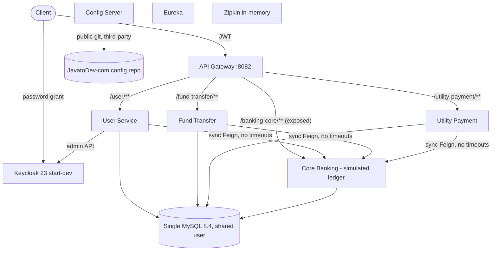

# Product Context Document

**Product:** Internet Banking Concept Microservices  
**Repository:** Persistent-Systems-Test/ts-java-spring-boot-internet-banking  
**Baseline:** main @ fa1c445  
**Assessment date:** 2026-11-03  
**Prepared by:** Devin (AI), evidence-based automated assessment

## Product Context - Internet Banking Concept Microservices

This is the single source of truth for the PDD and TDD. Every statement is classified:

| Class | Meaning |
|---|---|
| VERIFIED | Verified implementation - observed in source code/config in this repository |
| DOCUMENTED | Documented but unverified - stated in README/docs, not found in code |
| INFERRED | Inferred - assessor reasoning from code structure; not explicitly documented |
| MISSING | Missing information - not present in repository |
| STAKEHOLDER | Requires stakeholder validation - business information not derivable from code |

### 1. Product overview and purpose

| Aspect | Statement | Class | Evidence |
|---|---|---|---|
| Purpose | Digital (internet) banking channel platform exposing REST APIs for online-banking user onboarding, account lookup, intra-bank fund transfers and utility bill payments, on top of a simulated core banking ledger. | VERIFIED | [E-01](https://github.com/Persistent-Systems-Test/ts-java-spring-boot-internet-banking/blob/fa1c445/README.md#L1-L20) `README.md` (1-20); E-26 `core-banking-service/src/main/java/com/javatodev/finance/controller/*.java` |
| Origin | Tutorial/reference implementation by javatodev.com (MIT), first commit 2021-05-09, upgraded to Java 21 / Spring Boot 3.2.4 in 2024. | VERIFIED | [E-01](https://github.com/Persistent-Systems-Test/ts-java-spring-boot-internet-banking/blob/fa1c445/README.md#L1-L20) `README.md` (1-20); [E-04](https://github.com/Persistent-Systems-Test/ts-java-spring-boot-internet-banking/blob/fa1c445/LICENSE#L1-L3) `LICENSE` (1-3); E-43 `git log` |
| Business Problem | Banks need a secure self-service digital channel decoupled from the core banking system so channel features evolve independently of the core. | INFERRED | [E-01](https://github.com/Persistent-Systems-Test/ts-java-spring-boot-internet-banking/blob/fa1c445/README.md#L1-L20) `README.md` (1-20); E-26 `core-banking-service/src/main/java/com/javatodev/finance/controller/*.java` |
| Objectives | Stated objective is educational: demonstrate Spring Boot microservices patterns that 'evolve as a full fledged REST API collection until deployments'. Commercial objectives/outcomes are not documented. | DOCUMENTED / STAKEHOLDER | [E-01](https://github.com/Persistent-Systems-Test/ts-java-spring-boot-internet-banking/blob/fa1c445/README.md#L1-L20) `README.md` (1-20) |

### 2. Target users and stakeholders

| User / stakeholder | Need / interaction | Class | Evidence |
|---|---|---|---|
| Retail bank customer (existing core customer) | Registers, logs in, transfers funds, pays bills | VERIFIED (API only, no UI) | [E-28](https://github.com/Persistent-Systems-Test/ts-java-spring-boot-internet-banking/blob/fa1c445/internet-banking-user-service/src/main/java/com/javatodev/finance/controller/UserController.java#L28-L55) `UserController.java` (28-55); [E-33](https://github.com/Persistent-Systems-Test/ts-java-spring-boot-internet-banking/blob/fa1c445/internet-banking-fund-transfer-service/src/main/java/com/javatodev/finance/service/FundTransferService.java#L31-L51) `FundTransferService.java` (31-51); [E-34](https://github.com/Persistent-Systems-Test/ts-java-spring-boot-internet-banking/blob/fa1c445/internet-banking-utility-payment-service/src/main/java/com/javatodev/finance/service/UtilityPaymentService.java#L31-L53) `UtilityPaymentService.java` (31-53) |
| Bank administrator / operations | Approves/blacklists registrations | VERIFIED (PATCH status; no role model) | [E-28](https://github.com/Persistent-Systems-Test/ts-java-spring-boot-internet-banking/blob/fa1c445/internet-banking-user-service/src/main/java/com/javatodev/finance/controller/UserController.java#L28-L55) `UserController.java` (28-55); [E-29](https://github.com/Persistent-Systems-Test/ts-java-spring-boot-internet-banking/blob/fa1c445/internet-banking-user-service/src/main/java/com/javatodev/finance/service/UserService.java#L33-L111) `UserService.java` (33-111) |
| Developer / learner | Learns microservices patterns via tutorial, Postman, compose | DOCUMENTED | [E-01](https://github.com/Persistent-Systems-Test/ts-java-spring-boot-internet-banking/blob/fa1c445/README.md#L1-L20) `README.md` (1-20); [E-42](https://github.com/Persistent-Systems-Test/ts-java-spring-boot-internet-banking/blob/fa1c445/postman_collection/JAVA_TO_DEV_MICROSERVICES.postman_collection.json) `JAVA_TO_DEV_MICROSERVICES.postman_collection.json` |
| Compliance, risk, customer-service staff | No supporting capability | MISSING | No repository evidence available (absence of artefact) |
| Commercial buyer / target segment | Not documented | STAKEHOLDER | No repository evidence available (absence of artefact) |

### 3. Functional capabilities

| ID | Capability | Class | Evidence |
|---|---|---|---|
| CAP-01 | Customer self-registration | VERIFIED | [E-28](https://github.com/Persistent-Systems-Test/ts-java-spring-boot-internet-banking/blob/fa1c445/internet-banking-user-service/src/main/java/com/javatodev/finance/controller/UserController.java#L28-L55) `UserController.java` (28-55); [E-29](https://github.com/Persistent-Systems-Test/ts-java-spring-boot-internet-banking/blob/fa1c445/internet-banking-user-service/src/main/java/com/javatodev/finance/service/UserService.java#L33-L111) `UserService.java` (33-111) |
| CAP-02 | Registration approval / status management | VERIFIED | [E-28](https://github.com/Persistent-Systems-Test/ts-java-spring-boot-internet-banking/blob/fa1c445/internet-banking-user-service/src/main/java/com/javatodev/finance/controller/UserController.java#L28-L55) `UserController.java` (28-55); [E-29](https://github.com/Persistent-Systems-Test/ts-java-spring-boot-internet-banking/blob/fa1c445/internet-banking-user-service/src/main/java/com/javatodev/finance/service/UserService.java#L33-L111) `UserService.java` (33-111) |
| CAP-03 | Authentication (OIDC/JWT via Keycloak) | VERIFIED | [E-10](https://github.com/Persistent-Systems-Test/ts-java-spring-boot-internet-banking/blob/fa1c445/docker-compose/keycloak/realm-export.json#L686-L873) `realm-export.json` (686-873); [E-15](https://github.com/Persistent-Systems-Test/ts-java-spring-boot-internet-banking/blob/fa1c445/internet-banking-api-gateway/src/main/java/com/javatodev/finance/configuration/security/SecurityConfiguration.java#L24-L35) `SecurityConfiguration.java` (24-35) |
| CAP-04 | Bank account & biller lookup | VERIFIED | E-26 `core-banking-service/src/main/java/com/javatodev/finance/controller/*.java` |
| CAP-05 | Intra-bank fund transfer | VERIFIED | [E-18](https://github.com/Persistent-Systems-Test/ts-java-spring-boot-internet-banking/blob/fa1c445/core-banking-service/src/main/java/com/javatodev/finance/service/TransactionService.java#L35-L46) `TransactionService.java` (35-46); [E-33](https://github.com/Persistent-Systems-Test/ts-java-spring-boot-internet-banking/blob/fa1c445/internet-banking-fund-transfer-service/src/main/java/com/javatodev/finance/service/FundTransferService.java#L31-L51) `FundTransferService.java` (31-51) |
| CAP-06 | Utility bill payment (ledger debit only) | VERIFIED | [E-21](https://github.com/Persistent-Systems-Test/ts-java-spring-boot-internet-banking/blob/fa1c445/core-banking-service/src/main/java/com/javatodev/finance/service/TransactionService.java#L48-L75) `TransactionService.java` (48-75); [E-34](https://github.com/Persistent-Systems-Test/ts-java-spring-boot-internet-banking/blob/fa1c445/internet-banking-utility-payment-service/src/main/java/com/javatodev/finance/service/UtilityPaymentService.java#L31-L53) `UtilityPaymentService.java` (31-53) |
| CAP-07 | Transfer / payment history (paged) | VERIFIED | [E-33](https://github.com/Persistent-Systems-Test/ts-java-spring-boot-internet-banking/blob/fa1c445/internet-banking-fund-transfer-service/src/main/java/com/javatodev/finance/service/FundTransferService.java#L31-L51) `FundTransferService.java` (31-51); [E-34](https://github.com/Persistent-Systems-Test/ts-java-spring-boot-internet-banking/blob/fa1c445/internet-banking-utility-payment-service/src/main/java/com/javatodev/finance/service/UtilityPaymentService.java#L31-L53) `UtilityPaymentService.java` (31-53) |
| CAP-08 | Customer & user listing | VERIFIED | E-26 `core-banking-service/src/main/java/com/javatodev/finance/controller/*.java`; [E-29](https://github.com/Persistent-Systems-Test/ts-java-spring-boot-internet-banking/blob/fa1c445/internet-banking-user-service/src/main/java/com/javatodev/finance/service/UserService.java#L33-L111) `UserService.java` (33-111) |
| CAP-09 | Audit columns on channel records | VERIFIED | E-36 `*/src/main/java/com/javatodev/finance/model/dto/AuditAware.java` |
| CAP-10 | Distributed tracing | VERIFIED | E-37 `*/build.gradle`; E-14 `[external] *-service.yml` (ddl-auto / management) |
| CAP-11 | Notifications via RabbitMQ | DOCUMENTED (not implemented) | [E-02](https://github.com/Persistent-Systems-Test/ts-java-spring-boot-internet-banking/blob/fa1c445/README.md#L60-L75) `README.md` (60-75); [E-03](https://github.com/Persistent-Systems-Test/ts-java-spring-boot-internet-banking/blob/fa1c445/README.md#L83-L101) `README.md` (83-101) |
| CAP-12 | Prometheus metrics / Kubernetes deployment | DOCUMENTED (not implemented) | [E-03](https://github.com/Persistent-Systems-Test/ts-java-spring-boot-internet-banking/blob/fa1c445/README.md#L83-L101) `README.md` (83-101) |

### 4. Core business workflows and user journeys

#### WF-01 Onboarding

1. Customer POST /user/api/v1/bank-users/register {email, identification, password}
2. User svc: Keycloak search(email) -> reject if found
3. User svc -> Core GET /api/v1/user/{identification}
4. Email must equal core email
5. Create disabled Keycloak user with password
6. Persist local user status=PENDING
7. Admin PATCH /update/{id} status=APPROVED -> Keycloak user enabled

Evidence: [E-28](https://github.com/Persistent-Systems-Test/ts-java-spring-boot-internet-banking/blob/fa1c445/internet-banking-user-service/src/main/java/com/javatodev/finance/controller/UserController.java#L28-L55) `UserController.java` (28-55); [E-29](https://github.com/Persistent-Systems-Test/ts-java-spring-boot-internet-banking/blob/fa1c445/internet-banking-user-service/src/main/java/com/javatodev/finance/service/UserService.java#L33-L111) `UserService.java` (33-111)

#### WF-02 Login

1. Client calls Keycloak token endpoint (password grant)
2. Gateway validates JWT via JWKS on each call

Evidence: [E-10](https://github.com/Persistent-Systems-Test/ts-java-spring-boot-internet-banking/blob/fa1c445/docker-compose/keycloak/realm-export.json#L686-L873) `realm-export.json` (686-873); [E-15](https://github.com/Persistent-Systems-Test/ts-java-spring-boot-internet-banking/blob/fa1c445/internet-banking-api-gateway/src/main/java/com/javatodev/finance/configuration/security/SecurityConfiguration.java#L24-L35) `SecurityConfiguration.java` (24-35)

#### WF-03 Fund transfer

1. POST /fund-transfer/api/v1/transfer {fromAccount,toAccount,amount}
2. Persist fund_transfer PENDING
3. Feign -> Core POST /api/v1/transaction/fund-transfer
4. Core validates balance, updates both accounts, writes 2 ledger rows
5. Mark SUCCESS with core transactionId

Evidence: [E-18](https://github.com/Persistent-Systems-Test/ts-java-spring-boot-internet-banking/blob/fa1c445/core-banking-service/src/main/java/com/javatodev/finance/service/TransactionService.java#L35-L46) `TransactionService.java` (35-46); [E-20](https://github.com/Persistent-Systems-Test/ts-java-spring-boot-internet-banking/blob/fa1c445/core-banking-service/src/main/java/com/javatodev/finance/service/TransactionService.java) `TransactionService.java` (63-64,90-91,99-100); [E-33](https://github.com/Persistent-Systems-Test/ts-java-spring-boot-internet-banking/blob/fa1c445/internet-banking-fund-transfer-service/src/main/java/com/javatodev/finance/service/FundTransferService.java#L31-L51) `FundTransferService.java` (31-51)

#### WF-04 Utility payment

1. POST /utility-payment/api/v1/utility-payment {providerId,amount,referenceNumber,account}
2. Persist PROCESSING
3. Feign -> Core util-payment: debit account, write ledger row
4. Mark SUCCESS

Evidence: [E-21](https://github.com/Persistent-Systems-Test/ts-java-spring-boot-internet-banking/blob/fa1c445/core-banking-service/src/main/java/com/javatodev/finance/service/TransactionService.java#L48-L75) `TransactionService.java` (48-75); [E-34](https://github.com/Persistent-Systems-Test/ts-java-spring-boot-internet-banking/blob/fa1c445/internet-banking-utility-payment-service/src/main/java/com/javatodev/finance/service/UtilityPaymentService.java#L31-L53) `UtilityPaymentService.java` (31-53)

#### WF-05 History

1. GET /fund-transfer/api/v1/transfer or /utility-payment/api/v1/utility-payment (paged, all records)

Evidence: [E-33](https://github.com/Persistent-Systems-Test/ts-java-spring-boot-internet-banking/blob/fa1c445/internet-banking-fund-transfer-service/src/main/java/com/javatodev/finance/service/FundTransferService.java#L31-L51) `FundTransferService.java` (31-51); [E-34](https://github.com/Persistent-Systems-Test/ts-java-spring-boot-internet-banking/blob/fa1c445/internet-banking-utility-payment-service/src/main/java/com/javatodev/finance/service/UtilityPaymentService.java#L31-L53) `UtilityPaymentService.java` (31-53)

### 5. Business rules and validations

| ID | Rule | Class | Evidence |
|---|---|---|---|
| BR-01 | Registration requires the identification number to exist in core and email to match core record | VERIFIED | [E-29](https://github.com/Persistent-Systems-Test/ts-java-spring-boot-internet-banking/blob/fa1c445/internet-banking-user-service/src/main/java/com/javatodev/finance/service/UserService.java#L33-L111) `UserService.java` (33-111) |
| BR-02 | Email must not already exist in Keycloak (fuzzy search) | VERIFIED | [E-29](https://github.com/Persistent-Systems-Test/ts-java-spring-boot-internet-banking/blob/fa1c445/internet-banking-user-service/src/main/java/com/javatodev/finance/service/UserService.java#L33-L111) `UserService.java` (33-111); [E-30](https://github.com/Persistent-Systems-Test/ts-java-spring-boot-internet-banking/blob/fa1c445/internet-banking-user-service/src/main/java/com/javatodev/finance/service/KeycloakUserService.java#L36) `KeycloakUserService.java` (36) |
| BR-03 | New online users start PENDING and disabled until APPROVED | VERIFIED | [E-29](https://github.com/Persistent-Systems-Test/ts-java-spring-boot-internet-banking/blob/fa1c445/internet-banking-user-service/src/main/java/com/javatodev/finance/service/UserService.java#L33-L111) `UserService.java` (33-111) |
| BR-04 | Debit allowed if actualBalance >= amount and actualBalance >= 0 | VERIFIED | [E-19](https://github.com/Persistent-Systems-Test/ts-java-spring-boot-internet-banking/blob/fa1c445/core-banking-service/src/main/java/com/javatodev/finance/service/TransactionService.java#L77-L81) `TransactionService.java` (77-81) |
| BR-05 | Amount must be positive | MISSING (not enforced) | [E-19](https://github.com/Persistent-Systems-Test/ts-java-spring-boot-internet-banking/blob/fa1c445/core-banking-service/src/main/java/com/javatodev/finance/service/TransactionService.java#L77-L81) `TransactionService.java` (77-81) |
| BR-06 | Only ACTIVE accounts may transact | MISSING (enum exists, not enforced) | [E-19](https://github.com/Persistent-Systems-Test/ts-java-spring-boot-internet-banking/blob/fa1c445/core-banking-service/src/main/java/com/javatodev/finance/service/TransactionService.java#L77-L81) `TransactionService.java` (77-81); E-25 `core-banking-service/src/main/java/com/javatodev/finance/model/{AccountType,AccountStatus,TransactionType}.java` |
| BR-07 | Customer may only debit own accounts | MISSING | [E-33](https://github.com/Persistent-Systems-Test/ts-java-spring-boot-internet-banking/blob/fa1c445/internet-banking-fund-transfer-service/src/main/java/com/javatodev/finance/service/FundTransferService.java#L31-L51) `FundTransferService.java` (31-51) |
| BR-08 | Transaction limits / cut-offs / fees | MISSING | No repository evidence available (absence of artefact) |

### 6. Data entities and relationships

| Entity / table | Owner service | Key attributes | Relationships |
|---|---|---|---|
| banking_core_user | core | id, first_name, last_name, email, identification_number | 1-* account |
| banking_core_account | core | id, number, type, status, actual_balance, available_balance DECIMAL(19,2), user_id | *-1 user; 1-* transaction |
| banking_core_transaction | core | id, amount, transaction_type, reference_number, transaction_id, account_id | *-1 account (mapped @OneToOne) |
| banking_core_utility_account | core | id, number, provider_name | - |
| user | user-service | id, auth_id, identification, status + audit | auth_id -> Keycloak user |
| fund_transfer | fund-transfer | id, transaction_reference, from_account, to_account, amount, status + audit | transaction_reference -> core transaction_id |
| utility_payment | utility-payment | id, provider_id, amount, reference_number, account, transaction_id, status + audit | transaction_id -> core |

### 7. API capabilities

| Service | Method | Path | Purpose |
|---|---|---|---|
| Gateway | * | /user/** /fund-transfer/** /banking-core/** /utility-payment/** | Routing; JWT required except register & actuator |
| User | POST | /api/v1/bank-users/register | Register (public) |
| User | PATCH | /api/v1/bank-users/update/{id} | Change status |
| User | GET | /api/v1/bank-users, /api/v1/bank-users/{id} | List / read |
| Fund Transfer | POST/GET | /api/v1/transfer | Transfer / history |
| Utility Payment | POST/GET | /api/v1/utility-payment | Pay / history |
| Core | GET | /api/v1/account/bank-account/{n}, /api/v1/account/util-account/{provider} | Lookups |
| Core | POST | /api/v1/transaction/fund-transfer, /api/v1/transaction/util-payment | Ledger postings |
| Core | GET | /api/v1/user/{identification}, /api/v1/user | Customer lookup |

### 8. Product modules and components

| Module | Port | Java files | LOC | Responsibility |
|---|---|---|---|---|
| core-banking-service | 8092 | 36 | 831 | Simulated core ledger |
| internet-banking-user-service | 8083 | 32 | 822 | Registration, approval, Keycloak sync |
| internet-banking-fund-transfer-service | 8084 | 25 | 547 | Fund transfer orchestration + history |
| internet-banking-utility-payment-service | 8085 | 23 | 530 | Utility payment orchestration + history |
| internet-banking-api-gateway | 8082 | 3 | 86 | Edge routing + JWT validation |
| internet-banking-config-server | 8090 | 1 | 15 | Spring Cloud Config (git) |
| internet-banking-service-registry | 8081 | 1 | 15 | Eureka server |

### 9. External integrations and product dependencies

| Integration | Used by | Class | Evidence |
|---|---|---|---|
| Keycloak Admin REST API | User service (client_credentials) | VERIFIED | [E-31](https://github.com/Persistent-Systems-Test/ts-java-spring-boot-internet-banking/blob/fa1c445/internet-banking-user-service/src/main/java/com/javatodev/finance/configuration/keycloak/KeycloakProperties.java#L25-L40) `KeycloakProperties.java` (25-40) |
| Keycloak OIDC / JWKS | Gateway | VERIFIED | [E-15](https://github.com/Persistent-Systems-Test/ts-java-spring-boot-internet-banking/blob/fa1c445/internet-banking-api-gateway/src/main/java/com/javatodev/finance/configuration/security/SecurityConfiguration.java#L24-L35) `SecurityConfiguration.java` (24-35) |
| External config repo (GitHub) | Config Server | VERIFIED | [E-11](https://github.com/Persistent-Systems-Test/ts-java-spring-boot-internet-banking/blob/fa1c445/internet-banking-config-server/src/main/resources/application.yml#L1-L10) `application.yml` (1-10) |
| Zipkin | All services | VERIFIED | E-14 `[external] *-service.yml` (ddl-auto / management) |
| RabbitMQ | - | DOCUMENTED only | [E-03](https://github.com/Persistent-Systems-Test/ts-java-spring-boot-internet-banking/blob/fa1c445/README.md#L83-L101) `README.md` (83-101) |
| Real CBS / payment rails / biller aggregator | - | MISSING | [E-21](https://github.com/Persistent-Systems-Test/ts-java-spring-boot-internet-banking/blob/fa1c445/core-banking-service/src/main/java/com/javatodev/finance/service/TransactionService.java#L48-L75) `TransactionService.java` (48-75) |

### 10. Deployment and operational context

docker-compose on a single host: 7 app containers + MySQL + Keycloak + Postgres + Zipkin, static IPs on 172.25.0.0/16, images referenced as javatodev/*; services wait for registry/config/MySQL via wait-for-it.sh. No Kubernetes/IaC/CI.

Class: VERIFIED. Evidence: [E-05](https://github.com/Persistent-Systems-Test/ts-java-spring-boot-internet-banking/blob/fa1c445/docker-compose/docker-compose.yml#L1-L139) `docker-compose.yml` (1-139); E-39 `*/Dockerfile`; E-43 `git log`

### 11. Missing information and items requiring stakeholder validation

- Business KPIs, customers, revenue, adoption, SLAs - not in repository (STAKEHOLDER)
- Production deployment history / incidents - not in repository (STAKEHOLDER)
- Ownership of external config repo and Docker Hub images (STAKEHOLDER)
- Target core banking system and payment rails (STAKEHOLDER)
- Non-functional requirements: TPS, latency, RPO/RTO, data residency (MISSING)
- Security testing / VAPT reports (MISSING)
- Build/test execution results - dependency download blocked (HTTP 429) in assessment environment (LIMITATION)

## Repository Inventory

### Discovery checklist

| Area | Status | Notes |
|---|---|---|
| Repository structure | VERIFIED | 7 Gradle projects + docker-compose/, postman_collection/, draw_io/ |
| README / documentation | VERIFIED | README.md only; links to external tutorial articles |
| Application source code | VERIFIED | 121 Java files, ~2,846 LOC |
| Configuration files | VERIFIED | bootstrap*.yml in repo; runtime config in external repo (E-11, E-13, E-14) |
| Build & deployment files | VERIFIED | build.gradle x7, Dockerfile x7, docker-compose x2 |
| Dependency management | VERIFIED | Gradle + Spring dependency-management BOM; no lock files, no version catalog |
| API specifications | VERIFIED (runtime only) | springdoc annotations; no static OpenAPI file; Postman collection |
| Database schemas & migrations | VERIFIED | Flyway in core only; Hibernate ddl-auto update elsewhere |
| Infrastructure-as-Code | MISSING | No Terraform/Helm/K8s manifests (README lists Kubernetes) |
| CI/CD pipelines | MISSING | Workflows removed in HEAD commit |
| Unit / integration / E2E tests | PARTIAL | 18 unit tests (core); smoke tests; no integration/E2E automation |
| Architecture diagrams | PARTIAL | One draw.io diagram (centralised config); README links external image |
| Operational / monitoring config | PARTIAL | Actuator + Zipkin tracing; no metrics backend/alerts/dashboards |
| Security / authentication | VERIFIED | Keycloak realm export, gateway resource server, user-service admin client |

### Languages

- Java 21 (VERIFIED, build.gradle sourceCompatibility)
- SQL (Flyway migrations)
- YAML (Spring config, docker-compose)
- Shell (wait-for-it.sh)

### Frameworks

- Spring Boot 3.2.4
- Spring Cloud 2023.0.0 (Gateway, Netflix Eureka, Config, OpenFeign)
- Spring Data JPA / Hibernate
- Spring Security OAuth2 Resource Server (gateway only)
- Micrometer Tracing (Brave) + Zipkin reporter
- springdoc-openapi 2.1.0
- Lombok
- Flyway 10.12.0 (core only)

### Platforms

- MySQL 8.4.0
- PostgreSQL 15 (Keycloak)
- Keycloak 23.0.7 (+ admin client 24.0.4)
- Zipkin 3
- Docker / docker-compose 3.6
- Eclipse Temurin 21 JRE Alpine

### Tools

- Gradle 8.6 wrapper x7
- Postman collection + environment
- draw.io diagram
- IntelliJ HTTP file (api_test.http)

### Modules

| Module | Port | Java files | LOC | Responsibility |
|---|---|---|---|---|
| core-banking-service | 8092 | 36 | 831 | Simulated core ledger |
| internet-banking-user-service | 8083 | 32 | 822 | Registration, approval, Keycloak sync |
| internet-banking-fund-transfer-service | 8084 | 25 | 547 | Fund transfer orchestration + history |
| internet-banking-utility-payment-service | 8085 | 23 | 530 | Utility payment orchestration + history |
| internet-banking-api-gateway | 8082 | 3 | 86 | Edge routing + JWT validation |
| internet-banking-config-server | 8090 | 1 | 15 | Spring Cloud Config (git) |
| internet-banking-service-registry | 8081 | 1 | 15 | Eureka server |

Totals: ~2,846 production Java LOC in 121 files; ~413 test LOC in 10 files; 194 commits (2021-05-09 to 2026).

## Evidence Index

All findings cite these IDs. Links point to the baseline commit `fa1c445`. Items prefixed `[external]` are in the externally-hosted config repository (github.com/JavatoDev-com/internet-banking-microservices-configurations (configuration/, branch main)).

| ID | Path / source | Lines | What it shows |
|---|---|---|---|
| E-01 | README.md | 1-20 | Self-description as tutorial 'Internet banking API concept'; releases 1.0.0 / 2.0.0 |
| E-02 | README.md | 60-75 | Test credentials published; list of microservices incl. RabbitMQ + Notification service 'PENDING Development' |
| E-03 | README.md | 83-101 | Technology stack list (incl. RabbitMQ, Prometheus, Kubernetes, Sleuth) |
| E-04 | LICENSE | 1-3 | MIT licence, (c) 2022 javatodev.com |
| E-05 | docker-compose/docker-compose.yml | 1-139 | Full stack: Zipkin, Keycloak 23.0.7 start-dev, Postgres 15, MySQL, 7 services, static IPs 172.25.0.0/16, host ports published |
| E-06 | docker-compose/docker-compose.yml | 21-23,43,52 | Hard-coded Keycloak admin/DB and MySQL root passwords |
| E-07 | docker-compose/mysql/privileges.sql | 1-2 | Shared app DB user with CREATE/ALTER/DROP/DML on *.*; password in clear |
| E-08 | docker-compose/mysql/privileges.sql | 5-8 | Four logical schemas on one MySQL instance |
| E-09 | docker-compose/keycloak/realm-export.json | 29,38 | sslRequired=external; bruteForceProtected=false |
| E-10 | docker-compose/keycloak/realm-export.json | 686-873 | Business clients with directAccessGrantsEnabled=true, wildcard redirect URIs '/*', committed client secrets (lines 759, 861) |
| E-11 | internet-banking-config-server/src/main/resources/application.yml | 1-10 | Config Server git backend = third-party public repo JavatoDev-com/internet-banking-microservices-configurations |
| E-12 | */src/main/resources/bootstrap*.yml | - | Only app name + config URI per profile; default profile hard-codes 192.168.1.5 |
| E-13 | [external] internet-banking-api-gateway*.yml | routes | Gateway routes /user/**, /fund-transfer/**, /banking-core/**, /utility-payment/** (StripPrefix=1, lb://) |
| E-14 | [external] *-service.yml | ddl-auto / management | ddl-auto: update for user, fund-transfer, utility-payment; actuator exposure '*' for gateway & fund-transfer |
| E-15 | internet-banking-api-gateway/src/main/java/com/javatodev/finance/configuration/security/SecurityConfiguration.java | 24-35 | permitAll on register + all actuator paths; anyExchange().authenticated(); CSRF disabled; JWT via JWKS |
| E-16 | internet-banking-api-gateway/src/main/java/com/javatodev/finance/configuration/GatewayConfiguration.java | 18-28 | GlobalFilter builds mutated request with X-Auth-Id but returns original exchange |
| E-17 | internet-banking-user-service/src/main/java/com/javatodev/finance/configuration/filter/AppAuthUserFilter.java | 21-33 | Services trust X-Auth-Id header for audit identity; no JWT validation downstream |
| E-18 | core-banking-service/src/main/java/com/javatodev/finance/service/TransactionService.java | 35-46 | fundTransfer: reads accounts, validateBalance, internalFundTransfer |
| E-19 | core-banking-service/src/main/java/com/javatodev/finance/service/TransactionService.java | 77-81 | validateBalance only checks balance<0 or balance<amount (no amount>0, no status check) |
| E-20 | core-banking-service/src/main/java/com/javatodev/finance/service/TransactionService.java | 63-64,90-91,99-100 | availableBalance recomputed from already-updated actualBalance -> double adjustment |
| E-21 | core-banking-service/src/main/java/com/javatodev/finance/service/TransactionService.java | 48-75 | utilPayment: debit only; comment 'we can call third party API...'; no settlement credit |
| E-22 | core-banking-service/src/main/java/com/javatodev/finance/model/entity/TransactionEntity.java | 17-35 | Ledger row: amount, type, reference, transactionId; @OneToOne(cascade=ALL) to account; no timestamp |
| E-23 | core-banking-service/src/main/java/com/javatodev/finance/model/entity/BankAccountEntity.java | 16-37 | Mutable balances; no @Version |
| E-24 | core-banking-service/src/main/resources/db/migration/ | V1.0.* | Flyway schema (user, account, utility_account, transaction) + temp_data seed migration |
| E-25 | core-banking-service/src/main/java/com/javatodev/finance/model/{AccountType,AccountStatus,TransactionType}.java | - | Domain enums |
| E-26 | core-banking-service/src/main/java/com/javatodev/finance/controller/*.java | - | Core APIs: account lookup, fund-transfer, util-payment, user lookup |
| E-27 | */src/main/java/com/javatodev/finance/exception/GlobalExceptionHandler.java | core:27 ft:24 user:27 up:27 | Generic handler returns 400 'Exception occur inside API ' + e |
| E-28 | internet-banking-user-service/src/main/java/com/javatodev/finance/controller/UserController.java | 28-55 | register (logs request.toString incl. password, line 31), PATCH update status (no role check), list, read |
| E-29 | internet-banking-user-service/src/main/java/com/javatodev/finance/service/UserService.java | 33-111 | Registration flow (Keycloak search, core lookup, create disabled user, get(0) line 67); readUsers N+1 (line 84); approve enables Keycloak user |
| E-30 | internet-banking-user-service/src/main/java/com/javatodev/finance/service/KeycloakUserService.java | 36 | users().search(email) - fuzzy search |
| E-31 | internet-banking-user-service/src/main/java/com/javatodev/finance/configuration/keycloak/KeycloakProperties.java | 25-40 | Static lazily-initialised Keycloak client (client_credentials) |
| E-32 | internet-banking-user-service/src/main/java/com/javatodev/finance/model/dto/User.java | 1-20 | @Data DTO including password field |
| E-33 | internet-banking-fund-transfer-service/src/main/java/com/javatodev/finance/service/FundTransferService.java | 31-51 | Save PENDING -> Feign core -> SUCCESS; no failure handling; findAll unscoped (line 50) |
| E-34 | internet-banking-utility-payment-service/src/main/java/com/javatodev/finance/service/UtilityPaymentService.java | 31-53 | Save PROCESSING -> Feign core -> SUCCESS; no failure handling; findAll unscoped (line 50) |
| E-35 | internet-banking-fund-transfer-service/src/main/java/com/javatodev/finance/configuration/CustomFeignClientConfiguration.java | 13 | Feign Logger.Level.FULL |
| E-36 | */src/main/java/com/javatodev/finance/model/dto/AuditAware.java | - | createdBy/Date, modifiedBy/Date, @Version on channel entities |
| E-37 | */build.gradle | - | Spring Boot 3.2.4, Spring Cloud 2023.0.0, springdoc webflux-ui 2.1.0, Keycloak admin 24.0.4, Flyway 10.12.0, MySQL connector 8.4.0 |
| E-38 | */gradle/wrapper/gradle-wrapper.properties | - | 7 independent Gradle 8.6 builds; no root project |
| E-39 | */Dockerfile | - | eclipse-temurin:21.0.2_13-jre-alpine; ADD prebuilt jar; no USER; wait-for-it.sh |
| E-40 | */src/test/** | - | 18 unit tests in core-banking (Transaction 9, Account 6, User 3); contextLoads only elsewhere |
| E-41 | internet-banking-user-service/src/test/resources/application.yml | 35 | Keycloak client secret committed in test config |
| E-42 | postman_collection/JAVA_TO_DEV_MICROSERVICES.postman_collection.json | - | 14 requests; uses /core/** and /payment/** and /bank-user paths that do not match gateway routes / controller paths |
| E-43 | git log | - | 194 commits 2021-05-09..2026; last commit removed GitHub Actions workflows; no .github/workflows present |
| E-44 | */src/main/java/com/javatodev/finance/model/**/AccountResponse.java | 9 | Account number typed Long in fund-transfer & utility-payment vs String in core |
| E-45 | core-banking-service/src/main/resources/messages*.properties | - | i18n: default + French messages only |
| E-46 | draw_io/centralized_configuration.drawio | - | Only architecture diagram in repo (centralised configuration) |
| E-47 | */src/main/java/com/javatodev/finance/controller/*Controller.java | - | springdoc @Tag/@Operation annotations (OpenAPI generated at runtime; no static spec file) |
| E-48 | .github/FUNDING.yml | - | Patreon funding file of original author |

## Limitations and information gaps

- Static analysis only - services were not executed end-to-end; findings marked Medium confidence (e.g. TDD-ARC-07) should be confirmed at runtime.
- `./gradlew test` with JDK 21 could not complete: Maven Central returned HTTP 429 (rate limit) during dependency resolution in the assessment environment. Test pass/fail status and dependency CVE scan are therefore not available.
- Runtime configuration lives in an external, third-party repository; it was reviewed at its current HEAD, which the services do not pin.
- Technology lifecycle/support statements were not re-verified online (confidence Medium).
- Business data (customers, revenue, KPIs, market share, adoption, SLAs, incidents) is not in the repository and has not been estimated.
- The 35-item capability reference list and effort/timeline estimates are assessor judgement, not market or benchmark data.
- No UI exists; accessibility could not be assessed.
