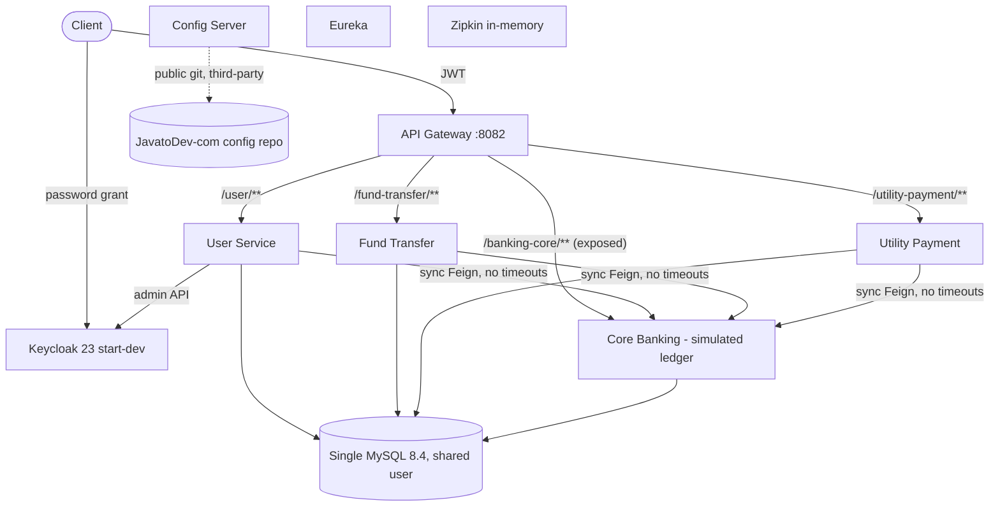

# Product Due Diligence Report

**Product:** Internet Banking Concept Microservices  
**Repository:** Persistent-Systems-Test/ts-java-spring-boot-internet-banking  
**Baseline:** main @ fa1c445  
**Assessment date:** 2026-11-03  
**Prepared by:** Devin (AI), evidence-based automated assessment

## PDD - Executive Summary

**Verdict:** Prototype / reference implementation. Suitable as a delivery accelerator for a digital banking channel; not market-ready as a product.

**Overall product score:** 1.7 / 5

**Maturity:** Concept / prototype (self-described tutorial 'concept', E-01). Happy-path API flows exist end-to-end; no UI, no production hardening.

### Key messages

- Money-movement rules are unsafe: negative amounts accepted, no ownership check, available balance double-adjusted, core ledger reachable via gateway (PDD-F-01..04).
- Customer data is not scoped: every authenticated user can list all transfers and payments and read any account balance (PDD-F-05).
- Functional breadth is narrow: 0 fully-implemented and 9 partial out of a 35-capability retail internet-banking reference list (PDD-G-01).
- Regulatory capabilities (KYC/AML, SCA/MFA, consent, immutable audit) are absent (PDD-G-02).
- Runtime configuration and container images depend on third-party-owned assets (PDD-R-01).
- Business data (customers, revenue, adoption, KPIs, market position) is not in the repository and requires stakeholder validation.

### Scorecard (1 = absent, 5 = best-in-class; assessor judgement)

| Dimension | Score | Basis |
|---|---|---|
| Functional breadth | 1.5 | 9 partial / 26 absent of 35 reference capabilities |
| Functional correctness | 1.0 | PDD-F-01..F-04 |
| Security & privacy (product view) | 1.0 | PDD-F-02, F-05, F-06, F-10 |
| Compliance readiness | 1.0 | PDD-G-02 |
| User experience | 1.0 | API-only, inconsistent errors (PDD-E-01..E-03) |
| Integration readiness | 2.0 | Clean Feign seam to core, OIDC; no adapters (PDD-A-02) |
| Operability | 2.0 | Tracing/actuator; no reconciliation (PDD-F-08) |
| Documentation & DX | 3.5 | README, tutorial series, Postman, compose |
| Architecture fitness | 3.0 | Sensible channel/core split (PDD-A-01) |
| Commercial readiness | 1.5 | MIT third-party code, branding, external deps (PDD-R-01, R-02) |

### Findings overview

31 findings (Critical: 8, High: 12, Medium: 8, Low: 3).

| ID | Category | Title | Severity | Confidence |
|---|---|---|---|---|
| PDD-F-01 | B. Functional | Negative and zero amounts accepted for transfers and payments | Critical | High |
| PDD-F-02 | B. Functional | No check that the customer owns the source account | Critical | High |
| PDD-F-03 | B. Functional | Core ledger operations reachable directly by end users | Critical | High |
| PDD-F-04 | B. Functional | Available balance shown to customers is wrong after every transaction | Critical | High |
| PDD-F-05 | B. Functional | History and lookups are not scoped to the customer | Critical | High |
| PDD-F-06 | B. Functional | Any authenticated user can approve or blacklist registrations | Critical | High |
| PDD-G-02 | G. Product Risk | Regulatory capabilities absent | Critical | High |
| PDD-R-05 | G. Product Risk | Published credentials in README and repository | Critical | High |
| PDD-A-02 | D. Product Architecture | No adapter layer for real core banking, payment rails or billers | High | Medium |
| PDD-E-01 | E. User Experience | No customer-facing user interface | High | High |
| PDD-E-03 | E. User Experience | No customer dashboard or own-account listing | High | High |
| PDD-F-07 | B. Functional | Blocked, dormant or pending accounts can transact | High | High |
| PDD-F-08 | B. Functional | Failed payments remain PENDING/PROCESSING forever | High | High |
| PDD-F-09 | B. Functional | Duplicate submission creates duplicate debits | High | High |
| PDD-F-10 | B. Functional | Utility payments debit the customer but no biller is paid | High | High |
| PDD-F-12 | B. Functional | Disabling or blacklisting a user does not block login | High | High |
| PDD-G-01 | G. Product Risk | Narrow functional coverage versus a retail internet-banking reference set | High | Medium |
| PDD-R-01 | G. Product Risk | Operational dependency on third-party assets | High | High |
| PDD-R-04 | G. Product Risk | Seed test data shipped in production migration | High | High |
| PDD-S-01 | F. Scalability & Extensibility | Configuration externalised but owned by a third party | High | High |
| PDD-A-03 | D. Product Architecture | API contracts are inconsistent across docs and code | Medium | High |
| PDD-C-02 | C. Business Value | Business outcomes and KPIs not defined | Medium | High |
| PDD-E-02 | E. User Experience | Error responses are technical and inconsistent | Medium | High |
| PDD-F-11 | B. Functional | Same-account transfers are permitted | Medium | High |
| PDD-R-02 | G. Product Risk | No exclusive IP; rebranding required | Medium | High |
| PDD-R-03 | G. Product Risk | Low maintenance activity and single original author | Medium | High |
| PDD-S-02 | F. Scalability & Extensibility | No multi-tenancy or multi-bank support | Medium | Medium |
| PDD-S-03 | F. Scalability & Extensibility | Single-currency, single-product ledger model | Medium | High |
| PDD-A-01 | D. Product Architecture | Clean separation between channel services and core ledger | Low | High |
| PDD-C-01 | C. Business Value | Accelerator value for digital-channel delivery | Low | Medium |
| PDD-E-04 | E. User Experience | Accessibility cannot be assessed | Low | High |

### Strengths

- Clear bounded contexts: onboarding/identity, transfers, bill-pay, ledger (PDD-A-01)
- Modern, widely-skilled stack (Java 21, Spring Boot 3, Spring Cloud) (E-37)
- Standards-based identity with Keycloak/OIDC (E-15)
- Easy local setup with docker-compose, seed data and Postman (E-05, E-42)
- Good learning documentation (tutorial series linked in README) (E-01)

### Weaknesses

- Critical money-movement and authorisation defects (PDD-F-01..F-06)
- Narrow functional scope; no UI (PDD-G-01, PDD-E-01)
- No compliance capabilities (PDD-G-02)
- Third-party-owned runtime assets and branding (PDD-R-01, PDD-R-02)
- No business case/KPIs in evidence (PDD-C-02)

### Overall Product Due Diligence assessment

Proceed only as an accelerator. Close Critical findings in a 4-6 week stabilisation phase before any external exposure; plan a 9-12 month programme to reach a bank-pilot MVP (indicative assessor estimate).

## PDD - Product Overview and Context

| Aspect | Assessment | Class | Evidence |
|---|---|---|---|
| Vision | Not documented. README states an educational intent: an 'internet banking API concept' that evolves 'as a full fledged REST API collection until deployments'. | DOCUMENTED | [E-01](https://github.com/Persistent-Systems-Test/ts-java-spring-boot-internet-banking/blob/fa1c445/README.md#L1-L20) `README.md` (1-20) |
| Mission | Not documented - requires stakeholder validation. | STAKEHOLDER | No repository evidence available (absence of artefact) |
| Objectives | Implied by code: enable existing bank customers to self-onboard and perform transfers and bill payments online, separated from the core ledger. | INFERRED | E-26 `core-banking-service/src/main/java/com/javatodev/finance/controller/*.java`; [E-29](https://github.com/Persistent-Systems-Test/ts-java-spring-boot-internet-banking/blob/fa1c445/internet-banking-user-service/src/main/java/com/javatodev/finance/service/UserService.java#L33-L111) `UserService.java` (33-111) |
| Value Proposition | Channel/core separation; modern Spring Cloud stack; standards-based identity (Keycloak/OIDC); one-command local environment with seed data and Postman collection. | VERIFIED | [E-05](https://github.com/Persistent-Systems-Test/ts-java-spring-boot-internet-banking/blob/fa1c445/docker-compose/docker-compose.yml#L1-L139) `docker-compose.yml` (1-139); [E-11](https://github.com/Persistent-Systems-Test/ts-java-spring-boot-internet-banking/blob/fa1c445/internet-banking-config-server/src/main/resources/application.yml#L1-L10) `application.yml` (1-10); [E-15](https://github.com/Persistent-Systems-Test/ts-java-spring-boot-internet-banking/blob/fa1c445/internet-banking-api-gateway/src/main/java/com/javatodev/finance/configuration/security/SecurityConfiguration.java#L24-L35) `SecurityConfiguration.java` (24-35); [E-42](https://github.com/Persistent-Systems-Test/ts-java-spring-boot-internet-banking/blob/fa1c445/postman_collection/JAVA_TO_DEV_MICROSERVICES.postman_collection.json) `JAVA_TO_DEV_MICROSERVICES.postman_collection.json` |
| Segments | Not documented. Assessor inference: system integrators and bank IT teams seeking a greenfield digital-channel accelerator for smaller banks/credit unions/NBFCs. Requires stakeholder validation. | INFERRED / STAKEHOLDER | No repository evidence available (absence of artefact) |
| Alignment | The implemented flows address the core of the stated problem (self-service money movement) but the absence of authorisation, validation and compliance features means the solution does not yet safely solve it. | INFERRED | [E-19](https://github.com/Persistent-Systems-Test/ts-java-spring-boot-internet-banking/blob/fa1c445/core-banking-service/src/main/java/com/javatodev/finance/service/TransactionService.java#L77-L81) `TransactionService.java` (77-81); [E-33](https://github.com/Persistent-Systems-Test/ts-java-spring-boot-internet-banking/blob/fa1c445/internet-banking-fund-transfer-service/src/main/java/com/javatodev/finance/service/FundTransferService.java#L31-L51) `FundTransferService.java` (31-51) |

### Stakeholders

| User / stakeholder | Need | Class | Evidence |
|---|---|---|---|
| Retail bank customer (existing core customer) | Registers, logs in, transfers funds, pays bills | VERIFIED (API only, no UI) | [E-28](https://github.com/Persistent-Systems-Test/ts-java-spring-boot-internet-banking/blob/fa1c445/internet-banking-user-service/src/main/java/com/javatodev/finance/controller/UserController.java#L28-L55) `UserController.java` (28-55); [E-33](https://github.com/Persistent-Systems-Test/ts-java-spring-boot-internet-banking/blob/fa1c445/internet-banking-fund-transfer-service/src/main/java/com/javatodev/finance/service/FundTransferService.java#L31-L51) `FundTransferService.java` (31-51); [E-34](https://github.com/Persistent-Systems-Test/ts-java-spring-boot-internet-banking/blob/fa1c445/internet-banking-utility-payment-service/src/main/java/com/javatodev/finance/service/UtilityPaymentService.java#L31-L53) `UtilityPaymentService.java` (31-53) |
| Bank administrator / operations | Approves/blacklists registrations | VERIFIED (PATCH status; no role model) | [E-28](https://github.com/Persistent-Systems-Test/ts-java-spring-boot-internet-banking/blob/fa1c445/internet-banking-user-service/src/main/java/com/javatodev/finance/controller/UserController.java#L28-L55) `UserController.java` (28-55); [E-29](https://github.com/Persistent-Systems-Test/ts-java-spring-boot-internet-banking/blob/fa1c445/internet-banking-user-service/src/main/java/com/javatodev/finance/service/UserService.java#L33-L111) `UserService.java` (33-111) |
| Developer / learner | Learns microservices patterns via tutorial, Postman, compose | DOCUMENTED | [E-01](https://github.com/Persistent-Systems-Test/ts-java-spring-boot-internet-banking/blob/fa1c445/README.md#L1-L20) `README.md` (1-20); [E-42](https://github.com/Persistent-Systems-Test/ts-java-spring-boot-internet-banking/blob/fa1c445/postman_collection/JAVA_TO_DEV_MICROSERVICES.postman_collection.json) `JAVA_TO_DEV_MICROSERVICES.postman_collection.json` |
| Compliance, risk, customer-service staff | No supporting capability | MISSING | No repository evidence available (absence of artefact) |
| Commercial buyer / target segment | Not documented | STAKEHOLDER | No repository evidence available (absence of artefact) |

Full context: `../context/product-context.md`.

## PDD - Functional Capability Assessment

### Product feature inventory

| ID | Feature | Status | Quality | Evidence | Notes |
|---|---|---|---|---|---|
| FT-01 | Customer self-registration | Implemented | Partial | [E-28](https://github.com/Persistent-Systems-Test/ts-java-spring-boot-internet-banking/blob/fa1c445/internet-banking-user-service/src/main/java/com/javatodev/finance/controller/UserController.java#L28-L55) `UserController.java` (28-55); [E-29](https://github.com/Persistent-Systems-Test/ts-java-spring-boot-internet-banking/blob/fa1c445/internet-banking-user-service/src/main/java/com/javatodev/finance/service/UserService.java#L33-L111) `UserService.java` (33-111) | No email/OTP verification, no password policy, password logged |
| FT-02 | Registration approval / blacklist | Implemented | Partial | [E-28](https://github.com/Persistent-Systems-Test/ts-java-spring-boot-internet-banking/blob/fa1c445/internet-banking-user-service/src/main/java/com/javatodev/finance/controller/UserController.java#L28-L55) `UserController.java` (28-55); [E-29](https://github.com/Persistent-Systems-Test/ts-java-spring-boot-internet-banking/blob/fa1c445/internet-banking-user-service/src/main/java/com/javatodev/finance/service/UserService.java#L33-L111) `UserService.java` (33-111) | No admin role; DISABLED/BLACKLIST do not disable Keycloak login |
| FT-03 | Login (OIDC password grant) | Implemented | Basic | [E-10](https://github.com/Persistent-Systems-Test/ts-java-spring-boot-internet-banking/blob/fa1c445/docker-compose/keycloak/realm-export.json#L686-L873) `realm-export.json` (686-873); [E-15](https://github.com/Persistent-Systems-Test/ts-java-spring-boot-internet-banking/blob/fa1c445/internet-banking-api-gateway/src/main/java/com/javatodev/finance/configuration/security/SecurityConfiguration.java#L24-L35) `SecurityConfiguration.java` (24-35) | No MFA; brute-force protection off |
| FT-04 | Intra-bank fund transfer | Implemented | Defective | [E-18](https://github.com/Persistent-Systems-Test/ts-java-spring-boot-internet-banking/blob/fa1c445/core-banking-service/src/main/java/com/javatodev/finance/service/TransactionService.java#L35-L46) `TransactionService.java` (35-46); [E-19](https://github.com/Persistent-Systems-Test/ts-java-spring-boot-internet-banking/blob/fa1c445/core-banking-service/src/main/java/com/javatodev/finance/service/TransactionService.java#L77-L81) `TransactionService.java` (77-81); [E-20](https://github.com/Persistent-Systems-Test/ts-java-spring-boot-internet-banking/blob/fa1c445/core-banking-service/src/main/java/com/javatodev/finance/service/TransactionService.java) `TransactionService.java` (63-64,90-91,99-100); [E-33](https://github.com/Persistent-Systems-Test/ts-java-spring-boot-internet-banking/blob/fa1c445/internet-banking-fund-transfer-service/src/main/java/com/javatodev/finance/service/FundTransferService.java#L31-L51) `FundTransferService.java` (31-51) | See PDD-F-01..F-04, F-07 |
| FT-05 | Utility bill payment | Implemented | Defective | [E-21](https://github.com/Persistent-Systems-Test/ts-java-spring-boot-internet-banking/blob/fa1c445/core-banking-service/src/main/java/com/javatodev/finance/service/TransactionService.java#L48-L75) `TransactionService.java` (48-75); [E-34](https://github.com/Persistent-Systems-Test/ts-java-spring-boot-internet-banking/blob/fa1c445/internet-banking-utility-payment-service/src/main/java/com/javatodev/finance/service/UtilityPaymentService.java#L31-L53) `UtilityPaymentService.java` (31-53) | Ledger debit only; no biller settlement |
| FT-06 | Transfer / payment history | Implemented | Defective | [E-33](https://github.com/Persistent-Systems-Test/ts-java-spring-boot-internet-banking/blob/fa1c445/internet-banking-fund-transfer-service/src/main/java/com/javatodev/finance/service/FundTransferService.java#L31-L51) `FundTransferService.java` (31-51); [E-34](https://github.com/Persistent-Systems-Test/ts-java-spring-boot-internet-banking/blob/fa1c445/internet-banking-utility-payment-service/src/main/java/com/javatodev/finance/service/UtilityPaymentService.java#L31-L53) `UtilityPaymentService.java` (31-53) | Not customer-scoped |
| FT-07 | Account and biller lookup | Implemented | Basic | E-26 `core-banking-service/src/main/java/com/javatodev/finance/controller/*.java` | Any account visible to any user |
| FT-08 | Customer / user listing | Implemented | Basic | E-26 `core-banking-service/src/main/java/com/javatodev/finance/controller/*.java`; [E-29](https://github.com/Persistent-Systems-Test/ts-java-spring-boot-internet-banking/blob/fa1c445/internet-banking-user-service/src/main/java/com/javatodev/finance/service/UserService.java#L33-L111) `UserService.java` (33-111) | No role restriction |
| FT-09 | OpenAPI documentation (runtime) | Implemented | Basic | E-47 `*/src/main/java/com/javatodev/finance/controller/*Controller.java`; E-37 `*/build.gradle` | WebFlux UI starter in MVC services |
| FT-10 | Notifications (RabbitMQ) | Documented only | Absent | [E-02](https://github.com/Persistent-Systems-Test/ts-java-spring-boot-internet-banking/blob/fa1c445/README.md#L60-L75) `README.md` (60-75); [E-03](https://github.com/Persistent-Systems-Test/ts-java-spring-boot-internet-banking/blob/fa1c445/README.md#L83-L101) `README.md` (83-101) | README: 'PENDING Development' |
| FT-11 | Web / mobile UI | Absent | Absent | No repository evidence available (absence of artefact) | API-only |

### Core workflows

| Workflow | Steps | Evidence |
|---|---|---|
| WF-01 Onboarding | Customer POST /user/api/v1/bank-users/register {email, identification, password} -> User svc: Keycloak search(email) -> reject if found -> User svc -> Core GET /api/v1/user/{identification} -> Email must equal core email -> Create disabled Keycloak user with password -> Persist local user status=PENDING -> Admin PATCH /update/{id} status=APPROVED -> Keycloak user enabled | [E-28](https://github.com/Persistent-Systems-Test/ts-java-spring-boot-internet-banking/blob/fa1c445/internet-banking-user-service/src/main/java/com/javatodev/finance/controller/UserController.java#L28-L55) `UserController.java` (28-55); [E-29](https://github.com/Persistent-Systems-Test/ts-java-spring-boot-internet-banking/blob/fa1c445/internet-banking-user-service/src/main/java/com/javatodev/finance/service/UserService.java#L33-L111) `UserService.java` (33-111) |
| WF-02 Login | Client calls Keycloak token endpoint (password grant) -> Gateway validates JWT via JWKS on each call | [E-10](https://github.com/Persistent-Systems-Test/ts-java-spring-boot-internet-banking/blob/fa1c445/docker-compose/keycloak/realm-export.json#L686-L873) `realm-export.json` (686-873); [E-15](https://github.com/Persistent-Systems-Test/ts-java-spring-boot-internet-banking/blob/fa1c445/internet-banking-api-gateway/src/main/java/com/javatodev/finance/configuration/security/SecurityConfiguration.java#L24-L35) `SecurityConfiguration.java` (24-35) |
| WF-03 Fund transfer | POST /fund-transfer/api/v1/transfer {fromAccount,toAccount,amount} -> Persist fund_transfer PENDING -> Feign -> Core POST /api/v1/transaction/fund-transfer -> Core validates balance, updates both accounts, writes 2 ledger rows -> Mark SUCCESS with core transactionId | [E-18](https://github.com/Persistent-Systems-Test/ts-java-spring-boot-internet-banking/blob/fa1c445/core-banking-service/src/main/java/com/javatodev/finance/service/TransactionService.java#L35-L46) `TransactionService.java` (35-46); [E-20](https://github.com/Persistent-Systems-Test/ts-java-spring-boot-internet-banking/blob/fa1c445/core-banking-service/src/main/java/com/javatodev/finance/service/TransactionService.java) `TransactionService.java` (63-64,90-91,99-100); [E-33](https://github.com/Persistent-Systems-Test/ts-java-spring-boot-internet-banking/blob/fa1c445/internet-banking-fund-transfer-service/src/main/java/com/javatodev/finance/service/FundTransferService.java#L31-L51) `FundTransferService.java` (31-51) |
| WF-04 Utility payment | POST /utility-payment/api/v1/utility-payment {providerId,amount,referenceNumber,account} -> Persist PROCESSING -> Feign -> Core util-payment: debit account, write ledger row -> Mark SUCCESS | [E-21](https://github.com/Persistent-Systems-Test/ts-java-spring-boot-internet-banking/blob/fa1c445/core-banking-service/src/main/java/com/javatodev/finance/service/TransactionService.java#L48-L75) `TransactionService.java` (48-75); [E-34](https://github.com/Persistent-Systems-Test/ts-java-spring-boot-internet-banking/blob/fa1c445/internet-banking-utility-payment-service/src/main/java/com/javatodev/finance/service/UtilityPaymentService.java#L31-L53) `UtilityPaymentService.java` (31-53) |
| WF-05 History | GET /fund-transfer/api/v1/transfer or /utility-payment/api/v1/utility-payment (paged, all records) | [E-33](https://github.com/Persistent-Systems-Test/ts-java-spring-boot-internet-banking/blob/fa1c445/internet-banking-fund-transfer-service/src/main/java/com/javatodev/finance/service/FundTransferService.java#L31-L51) `FundTransferService.java` (31-51); [E-34](https://github.com/Persistent-Systems-Test/ts-java-spring-boot-internet-banking/blob/fa1c445/internet-banking-utility-payment-service/src/main/java/com/javatodev/finance/service/UtilityPaymentService.java#L31-L53) `UtilityPaymentService.java` (31-53) |

### User journey assessment

| Journey | Workflow | Assessment | Findings |
|---|---|---|---|
| UJ-01 Register & get approved | WF-01 | Works on happy path; no verification step, approval not role-protected, password logged | PDD-F-06, PDD-F-12, PDD-E-02 |
| UJ-02 Log in | WF-02 | Password grant only; no MFA, no recovery | PDD-G-02 |
| UJ-03 View my accounts | - | Not supported | PDD-E-03 |
| UJ-04 Transfer money | WF-03 | Works on happy path; unsafe rules, wrong balances, no confirmation/receipt | PDD-F-01, PDD-F-02, PDD-F-04, PDD-F-09 |
| UJ-05 Pay a bill | WF-04 | Ledger debit only; biller not paid | PDD-F-10 |
| UJ-06 View history | WF-05 | Shows all customers' records | PDD-F-05 |

### Functional findings

##### PDD-F-01 - Negative and zero amounts accepted for transfers and payments

| Field | Value |
|---|---|
| Finding ID | PDD-F-01 |
| Assessment category | B. Functional |
| Description | validateBalance only rejects when balance < amount; there is no amount > 0 rule and no Bean Validation. A negative transfer debits the beneficiary and credits the initiator. |
| Supporting repository evidence | [E-19](https://github.com/Persistent-Systems-Test/ts-java-spring-boot-internet-banking/blob/fa1c445/core-banking-service/src/main/java/com/javatodev/finance/service/TransactionService.java#L77-L81) `TransactionService.java` (77-81); [E-18](https://github.com/Persistent-Systems-Test/ts-java-spring-boot-internet-banking/blob/fa1c445/core-banking-service/src/main/java/com/javatodev/finance/service/TransactionService.java#L35-L46) `TransactionService.java` (35-46) |
| Business impact | Direct fraud/theft vector; customer funds can be moved without consent. |
| Severity / priority | Critical |
| Recommendation | Enforce amount > 0 and max-amount rules at API and ledger level; add tests. |
| Confidence | High |

##### PDD-F-02 - No check that the customer owns the source account

| Field | Value |
|---|---|
| Finding ID | PDD-F-02 |
| Assessment category | B. Functional |
| Description | Orchestrators forward fromAccount/account verbatim to core; JWT identity is never mapped to the customer's accounts. |
| Supporting repository evidence | [E-33](https://github.com/Persistent-Systems-Test/ts-java-spring-boot-internet-banking/blob/fa1c445/internet-banking-fund-transfer-service/src/main/java/com/javatodev/finance/service/FundTransferService.java#L31-L51) `FundTransferService.java` (31-51); [E-34](https://github.com/Persistent-Systems-Test/ts-java-spring-boot-internet-banking/blob/fa1c445/internet-banking-utility-payment-service/src/main/java/com/javatodev/finance/service/UtilityPaymentService.java#L31-L53) `UtilityPaymentService.java` (31-53); [E-18](https://github.com/Persistent-Systems-Test/ts-java-spring-boot-internet-banking/blob/fa1c445/core-banking-service/src/main/java/com/javatodev/finance/service/TransactionService.java#L35-L46) `TransactionService.java` (35-46) |
| Business impact | Any logged-in user can move money out of any account. |
| Severity / priority | Critical |
| Recommendation | Introduce customer-account entitlement checks derived from the authenticated identity. |
| Confidence | High |

##### PDD-F-03 - Core ledger operations reachable directly by end users

| Field | Value |
|---|---|
| Finding ID | PDD-F-03 |
| Assessment category | B. Functional |
| Description | Gateway routes /banking-core/** to core-banking-service with only 'authenticated' required, bypassing channel services and their history records. |
| Supporting repository evidence | E-13 `[external] internet-banking-api-gateway*.yml` (routes); [E-15](https://github.com/Persistent-Systems-Test/ts-java-spring-boot-internet-banking/blob/fa1c445/internet-banking-api-gateway/src/main/java/com/javatodev/finance/configuration/security/SecurityConfiguration.java#L24-L35) `SecurityConfiguration.java` (24-35) |
| Business impact | Unrecorded ledger manipulation; channel controls can be bypassed. |
| Severity / priority | Critical |
| Recommendation | Remove public route to core; restrict core to internal service-to-service calls. |
| Confidence | High |

##### PDD-F-04 - Available balance shown to customers is wrong after every transaction

| Field | Value |
|---|---|
| Finding ID | PDD-F-04 |
| Assessment category | B. Functional |
| Description | After updating actualBalance, availableBalance is recomputed from the new actual and adjusted again (debit: -2x; credit: +2x). Any existing hold is overwritten. |
| Supporting repository evidence | [E-20](https://github.com/Persistent-Systems-Test/ts-java-spring-boot-internet-banking/blob/fa1c445/core-banking-service/src/main/java/com/javatodev/finance/service/TransactionService.java) `TransactionService.java` (63-64,90-91,99-100) |
| Business impact | Incorrect balances, wrongful declines/approvals, customer complaints, reconciliation breaks. |
| Severity / priority | Critical |
| Recommendation | Correct balance arithmetic; model holds explicitly; add balance assertions in tests. |
| Confidence | High |

##### PDD-F-05 - History and lookups are not scoped to the customer

| Field | Value |
|---|---|
| Finding ID | PDD-F-05 |
| Assessment category | B. Functional |
| Description | Transfer and payment history use findAll(pageable); core account lookup returns any account by number. |
| Supporting repository evidence | [E-33](https://github.com/Persistent-Systems-Test/ts-java-spring-boot-internet-banking/blob/fa1c445/internet-banking-fund-transfer-service/src/main/java/com/javatodev/finance/service/FundTransferService.java#L31-L51) `FundTransferService.java` (31-51); [E-34](https://github.com/Persistent-Systems-Test/ts-java-spring-boot-internet-banking/blob/fa1c445/internet-banking-utility-payment-service/src/main/java/com/javatodev/finance/service/UtilityPaymentService.java#L31-L53) `UtilityPaymentService.java` (31-53); E-26 `core-banking-service/src/main/java/com/javatodev/finance/controller/*.java` |
| Business impact | Privacy breach exposing all customers' financial data. |
| Severity / priority | Critical |
| Recommendation | Filter every read by the authenticated customer; restrict admin listing to back-office roles. |
| Confidence | High |

##### PDD-F-06 - Any authenticated user can approve or blacklist registrations

| Field | Value |
|---|---|
| Finding ID | PDD-F-06 |
| Assessment category | B. Functional |
| Description | PATCH /bank-users/update/{id} has no role check; Keycloak realm defines no business roles. |
| Supporting repository evidence | [E-28](https://github.com/Persistent-Systems-Test/ts-java-spring-boot-internet-banking/blob/fa1c445/internet-banking-user-service/src/main/java/com/javatodev/finance/controller/UserController.java#L28-L55) `UserController.java` (28-55); [E-10](https://github.com/Persistent-Systems-Test/ts-java-spring-boot-internet-banking/blob/fa1c445/docker-compose/keycloak/realm-export.json#L686-L873) `realm-export.json` (686-873) |
| Business impact | Self-approval / privilege escalation; onboarding control ineffective. |
| Severity / priority | Critical |
| Recommendation | Introduce admin/ops roles and maker-checker approval. |
| Confidence | High |

##### PDD-F-07 - Blocked, dormant or pending accounts can transact

| Field | Value |
|---|---|
| Finding ID | PDD-F-07 |
| Assessment category | B. Functional |
| Description | AccountStatus enum exists but is never consulted during debit or credit. |
| Supporting repository evidence | [E-19](https://github.com/Persistent-Systems-Test/ts-java-spring-boot-internet-banking/blob/fa1c445/core-banking-service/src/main/java/com/javatodev/finance/service/TransactionService.java#L77-L81) `TransactionService.java` (77-81); E-25 `core-banking-service/src/main/java/com/javatodev/finance/model/{AccountType,AccountStatus,TransactionType}.java` |
| Business impact | Breach of account-freeze obligations (e.g. court orders, fraud holds). |
| Severity / priority | High |
| Recommendation | Enforce status rules for both debit and credit legs. |
| Confidence | High |

##### PDD-F-08 - Failed payments remain PENDING/PROCESSING forever

| Field | Value |
|---|---|
| Finding ID | PDD-F-08 |
| Assessment category | B. Functional |
| Description | Orchestrators save a pending record, call core, then update to SUCCESS; exceptions are not handled and FAILED is never set; no reconciliation. |
| Supporting repository evidence | [E-33](https://github.com/Persistent-Systems-Test/ts-java-spring-boot-internet-banking/blob/fa1c445/internet-banking-fund-transfer-service/src/main/java/com/javatodev/finance/service/FundTransferService.java#L31-L51) `FundTransferService.java` (31-51); [E-34](https://github.com/Persistent-Systems-Test/ts-java-spring-boot-internet-banking/blob/fa1c445/internet-banking-utility-payment-service/src/main/java/com/javatodev/finance/service/UtilityPaymentService.java#L31-L53) `UtilityPaymentService.java` (31-53) |
| Business impact | Phantom or duplicate payments visible to customers; operations cannot reconcile. |
| Severity / priority | High |
| Recommendation | Explicit payment state machine with FAILED/REVERSED, timeouts and reconciliation. |
| Confidence | High |

##### PDD-F-09 - Duplicate submission creates duplicate debits

| Field | Value |
|---|---|
| Finding ID | PDD-F-09 |
| Assessment category | B. Functional |
| Description | No idempotency key; each POST creates a new transaction. |
| Supporting repository evidence | [E-33](https://github.com/Persistent-Systems-Test/ts-java-spring-boot-internet-banking/blob/fa1c445/internet-banking-fund-transfer-service/src/main/java/com/javatodev/finance/service/FundTransferService.java#L31-L51) `FundTransferService.java` (31-51); [E-18](https://github.com/Persistent-Systems-Test/ts-java-spring-boot-internet-banking/blob/fa1c445/core-banking-service/src/main/java/com/javatodev/finance/service/TransactionService.java#L35-L46) `TransactionService.java` (35-46) |
| Business impact | Double charging on client/network retries. |
| Severity / priority | High |
| Recommendation | Idempotency-Key on payment APIs end-to-end. |
| Confidence | High |

##### PDD-F-10 - Utility payments debit the customer but no biller is paid

| Field | Value |
|---|---|
| Finding ID | PDD-F-10 |
| Assessment category | B. Functional |
| Description | Core utilPayment only debits the customer account; comment notes third-party biller API would be called; no settlement/suspense credit. |
| Supporting repository evidence | [E-21](https://github.com/Persistent-Systems-Test/ts-java-spring-boot-internet-banking/blob/fa1c445/core-banking-service/src/main/java/com/javatodev/finance/service/TransactionService.java#L48-L75) `TransactionService.java` (48-75) |
| Business impact | In a real deployment customer money would leave without settlement; prototype only. |
| Severity / priority | High |
| Recommendation | Integrate a biller aggregator and post to a settlement account. |
| Confidence | High |

##### PDD-F-11 - Same-account transfers are permitted

| Field | Value |
|---|---|
| Finding ID | PDD-F-11 |
| Assessment category | B. Functional |
| Description | No from != to rule. |
| Supporting repository evidence | [E-18](https://github.com/Persistent-Systems-Test/ts-java-spring-boot-internet-banking/blob/fa1c445/core-banking-service/src/main/java/com/javatodev/finance/service/TransactionService.java#L35-L46) `TransactionService.java` (35-46) |
| Business impact | Noise in ledger; potential gaming of limits once added. |
| Severity / priority | Medium |
| Recommendation | Reject identical source and destination. |
| Confidence | High |

##### PDD-F-12 - Disabling or blacklisting a user does not block login

| Field | Value |
|---|---|
| Finding ID | PDD-F-12 |
| Assessment category | B. Functional |
| Description | Only APPROVED triggers a Keycloak update; DISABLED/BLACKLIST only change the local status. |
| Supporting repository evidence | [E-29](https://github.com/Persistent-Systems-Test/ts-java-spring-boot-internet-banking/blob/fa1c445/internet-banking-user-service/src/main/java/com/javatodev/finance/service/UserService.java#L33-L111) `UserService.java` (33-111) |
| Business impact | Blocked customers can still authenticate and transact. |
| Severity / priority | High |
| Recommendation | Synchronise all lifecycle states to the IdP (disable user, revoke sessions). |
| Confidence | High |

### User experience findings

##### PDD-E-01 - No customer-facing user interface

| Field | Value |
|---|---|
| Finding ID | PDD-E-01 |
| Assessment category | E. User Experience |
| Description | Repository contains only backend services; interaction is via Postman/HTTP. |
| Supporting repository evidence | [E-05](https://github.com/Persistent-Systems-Test/ts-java-spring-boot-internet-banking/blob/fa1c445/docker-compose/docker-compose.yml#L1-L139) `docker-compose.yml` (1-139); [E-42](https://github.com/Persistent-Systems-Test/ts-java-spring-boot-internet-banking/blob/fa1c445/postman_collection/JAVA_TO_DEV_MICROSERVICES.postman_collection.json) `JAVA_TO_DEV_MICROSERVICES.postman_collection.json` |
| Business impact | Cannot be piloted with customers without building web/mobile front-ends. |
| Severity / priority | High |
| Recommendation | Build web (and later mobile) channel against the APIs. |
| Confidence | High |

##### PDD-E-02 - Error responses are technical and inconsistent

| Field | Value |
|---|---|
| Finding ID | PDD-E-02 |
| Assessment category | E. User Experience |
| Description | Generic handler returns HTTP 400 with raw exception text for all unexpected errors. |
| Supporting repository evidence | E-27 `*/src/main/java/com/javatodev/finance/exception/GlobalExceptionHandler.java` (core:27 ft:24 user:27 up:27) |
| Business impact | Poor customer messaging; support cost; information disclosure. |
| Severity / priority | Medium |
| Recommendation | Standard error model (RFC 7807) with user-safe messages and correct status codes. |
| Confidence | High |

##### PDD-E-03 - No customer dashboard or own-account listing

| Field | Value |
|---|---|
| Finding ID | PDD-E-03 |
| Assessment category | E. User Experience |
| Description | No endpoint returns the authenticated customer's accounts. |
| Supporting repository evidence | E-26 `core-banking-service/src/main/java/com/javatodev/finance/controller/*.java` |
| Business impact | Basic 'view my accounts' journey missing. |
| Severity / priority | High |
| Recommendation | Add customer-scoped accounts query API. |
| Confidence | High |

##### PDD-E-04 - Accessibility cannot be assessed

| Field | Value |
|---|---|
| Finding ID | PDD-E-04 |
| Assessment category | E. User Experience |
| Description | No UI exists; accessibility evidence not available. |
| Supporting repository evidence | No repository evidence available (absence of artefact) |
| Business impact | Unknown; to be addressed once UI exists. |
| Severity / priority | Low |
| Recommendation | Adopt WCAG 2.1 AA as UI acceptance criterion. |
| Confidence | High |

## PDD - Business Value Assessment

| Dimension | Assessment | Class | Evidence |
|---|---|---|---|
| Business value proposition | Accelerator for a digital banking channel; demonstrates target architecture patterns. | INFERRED | [E-01](https://github.com/Persistent-Systems-Test/ts-java-spring-boot-internet-banking/blob/fa1c445/README.md#L1-L20) `README.md` (1-20); [E-05](https://github.com/Persistent-Systems-Test/ts-java-spring-boot-internet-banking/blob/fa1c445/docker-compose/docker-compose.yml#L1-L139) `docker-compose.yml` (1-139) |
| Outcome alignment | Flows align with self-service outcomes (reduced branch transactions) but cannot be safely realised until Critical findings are fixed. | INFERRED | [E-19](https://github.com/Persistent-Systems-Test/ts-java-spring-boot-internet-banking/blob/fa1c445/core-banking-service/src/main/java/com/javatodev/finance/service/TransactionService.java#L77-L81) `TransactionService.java` (77-81); [E-33](https://github.com/Persistent-Systems-Test/ts-java-spring-boot-internet-banking/blob/fa1c445/internet-banking-fund-transfer-service/src/main/java/com/javatodev/finance/service/FundTransferService.java#L31-L51) `FundTransferService.java` (31-51) |
| Operational efficiency | Self-registration with approval and straight-through intra-bank transfers would reduce manual work once secured; no ops tooling (reconciliation, admin console) yet. | INFERRED | [E-29](https://github.com/Persistent-Systems-Test/ts-java-spring-boot-internet-banking/blob/fa1c445/internet-banking-user-service/src/main/java/com/javatodev/finance/service/UserService.java#L33-L111) `UserService.java` (33-111); [E-33](https://github.com/Persistent-Systems-Test/ts-java-spring-boot-internet-banking/blob/fa1c445/internet-banking-fund-transfer-service/src/main/java/com/javatodev/finance/service/FundTransferService.java#L31-L51) `FundTransferService.java` (31-51) |
| Business scalability | Stateless services can scale horizontally; single-tenant design and simulated core limit commercial scaling. | INFERRED | [E-05](https://github.com/Persistent-Systems-Test/ts-java-spring-boot-internet-banking/blob/fa1c445/docker-compose/docker-compose.yml#L1-L139) `docker-compose.yml` (1-139); [E-08](https://github.com/Persistent-Systems-Test/ts-java-spring-boot-internet-banking/blob/fa1c445/docker-compose/mysql/privileges.sql#L5-L8) `privileges.sql` (5-8) |
| Productivity improvements | Delivery-team productivity gain from reusable scaffolding; magnitude requires stakeholder measurement. | STAKEHOLDER | No repository evidence available (absence of artefact) |
| Revenue / market share / adoption | Not available in repository. | STAKEHOLDER | No repository evidence available (absence of artefact) |

Revenue, market share, customer feedback, adoption statistics and business KPIs are **not available in the repository** and are not estimated here; they require business stakeholder validation.

### Findings

##### PDD-C-01 - Accelerator value for digital-channel delivery

| Field | Value |
|---|---|
| Finding ID | PDD-C-01 |
| Assessment category | C. Business Value |
| Description | Working skeleton of gateway, identity, discovery, config, tracing and three business flows reduces initial setup effort. |
| Supporting repository evidence | [E-05](https://github.com/Persistent-Systems-Test/ts-java-spring-boot-internet-banking/blob/fa1c445/docker-compose/docker-compose.yml#L1-L139) `docker-compose.yml` (1-139); E-37 `*/build.gradle` |
| Business impact | Positive: shortens time-to-first-demo for delivery teams. |
| Severity / priority | Low |
| Recommendation | Position as internal accelerator; quantify reuse savings with delivery teams. |
| Confidence | Medium |

##### PDD-C-02 - Business outcomes and KPIs not defined

| Field | Value |
|---|---|
| Finding ID | PDD-C-02 |
| Assessment category | C. Business Value |
| Description | No documented KPIs, customers, revenue or SLAs. |
| Supporting repository evidence | No repository evidence available (absence of artefact) |
| Business impact | Value case cannot be validated from the repository. |
| Severity / priority | Medium |
| Recommendation | Obtain business case and KPIs from stakeholders. |
| Confidence | High |

## PDD - Product Architecture Assessment

### Modules and functional decomposition

| Module | Port | Java files | LOC | Responsibility |
|---|---|---|---|---|
| core-banking-service | 8092 | 36 | 831 | Simulated core ledger |
| internet-banking-user-service | 8083 | 32 | 822 | Registration, approval, Keycloak sync |
| internet-banking-fund-transfer-service | 8084 | 25 | 547 | Fund transfer orchestration + history |
| internet-banking-utility-payment-service | 8085 | 23 | 530 | Utility payment orchestration + history |
| internet-banking-api-gateway | 8082 | 3 | 86 | Edge routing + JWT validation |
| internet-banking-config-server | 8090 | 1 | 15 | Spring Cloud Config (git) |
| internet-banking-service-registry | 8081 | 1 | 15 | Eureka server |

### Component interactions

### API capabilities

| Service | Method | Path | Purpose |
|---|---|---|---|
| Gateway | * | /user/** /fund-transfer/** /banking-core/** /utility-payment/** | Routing; JWT required except register & actuator |
| User | POST | /api/v1/bank-users/register | Register (public) |
| User | PATCH | /api/v1/bank-users/update/{id} | Change status |
| User | GET | /api/v1/bank-users, /api/v1/bank-users/{id} | List / read |
| Fund Transfer | POST/GET | /api/v1/transfer | Transfer / history |
| Utility Payment | POST/GET | /api/v1/utility-payment | Pay / history |
| Core | GET | /api/v1/account/bank-account/{n}, /api/v1/account/util-account/{provider} | Lookups |
| Core | POST | /api/v1/transaction/fund-transfer, /api/v1/transaction/util-payment | Ledger postings |
| Core | GET | /api/v1/user/{identification}, /api/v1/user | Customer lookup |

### Integration architecture

| Integration | Used by | Class | Evidence |
|---|---|---|---|
| Keycloak Admin REST API | User service (client_credentials) | VERIFIED | [E-31](https://github.com/Persistent-Systems-Test/ts-java-spring-boot-internet-banking/blob/fa1c445/internet-banking-user-service/src/main/java/com/javatodev/finance/configuration/keycloak/KeycloakProperties.java#L25-L40) `KeycloakProperties.java` (25-40) |
| Keycloak OIDC / JWKS | Gateway | VERIFIED | [E-15](https://github.com/Persistent-Systems-Test/ts-java-spring-boot-internet-banking/blob/fa1c445/internet-banking-api-gateway/src/main/java/com/javatodev/finance/configuration/security/SecurityConfiguration.java#L24-L35) `SecurityConfiguration.java` (24-35) |
| External config repo (GitHub) | Config Server | VERIFIED | [E-11](https://github.com/Persistent-Systems-Test/ts-java-spring-boot-internet-banking/blob/fa1c445/internet-banking-config-server/src/main/resources/application.yml#L1-L10) `application.yml` (1-10) |
| Zipkin | All services | VERIFIED | E-14 `[external] *-service.yml` (ddl-auto / management) |
| RabbitMQ | - | DOCUMENTED only | [E-03](https://github.com/Persistent-Systems-Test/ts-java-spring-boot-internet-banking/blob/fa1c445/README.md#L83-L101) `README.md` (83-101) |
| Real CBS / payment rails / biller aggregator | - | MISSING | [E-21](https://github.com/Persistent-Systems-Test/ts-java-spring-boot-internet-banking/blob/fa1c445/core-banking-service/src/main/java/com/javatodev/finance/service/TransactionService.java#L48-L75) `TransactionService.java` (48-75) |

### Architecture findings

##### PDD-A-01 - Clean separation between channel services and core ledger

| Field | Value |
|---|---|
| Finding ID | PDD-A-01 |
| Assessment category | D. Product Architecture |
| Description | Channel services own requests/status; core owns balances and postings; integration via declarative Feign clients. |
| Supporting repository evidence | E-26 `core-banking-service/src/main/java/com/javatodev/finance/controller/*.java`; [E-33](https://github.com/Persistent-Systems-Test/ts-java-spring-boot-internet-banking/blob/fa1c445/internet-banking-fund-transfer-service/src/main/java/com/javatodev/finance/service/FundTransferService.java#L31-L51) `FundTransferService.java` (31-51); [E-34](https://github.com/Persistent-Systems-Test/ts-java-spring-boot-internet-banking/blob/fa1c445/internet-banking-utility-payment-service/src/main/java/com/javatodev/finance/service/UtilityPaymentService.java#L31-L53) `UtilityPaymentService.java` (31-53) |
| Business impact | Positive: enables replacing the simulated core with a real CBS behind the same contract. |
| Severity / priority | Low |
| Recommendation | Preserve the boundary; formalise it as an anti-corruption/adapter layer. |
| Confidence | High |

##### PDD-A-02 - No adapter layer for real core banking, payment rails or billers

| Field | Value |
|---|---|
| Finding ID | PDD-A-02 |
| Assessment category | D. Product Architecture |
| Description | Core is a simulated ledger; no interfaces for external CBS, interbank rails or biller aggregators. |
| Supporting repository evidence | [E-21](https://github.com/Persistent-Systems-Test/ts-java-spring-boot-internet-banking/blob/fa1c445/core-banking-service/src/main/java/com/javatodev/finance/service/TransactionService.java#L48-L75) `TransactionService.java` (48-75); E-26 `core-banking-service/src/main/java/com/javatodev/finance/controller/*.java` |
| Business impact | Integration effort for first real deployment is unbounded until target systems are known. |
| Severity / priority | High |
| Recommendation | Define CBS/payment-hub adapter contracts early (stakeholder input on target systems). |
| Confidence | Medium |

##### PDD-A-03 - API contracts are inconsistent across docs and code

| Field | Value |
|---|---|
| Finding ID | PDD-A-03 |
| Assessment category | D. Product Architecture |
| Description | Postman uses /core/** and /payment/** and /bank-user while gateway routes are /banking-core/** and /utility-payment/** and controller uses /bank-users; account number typed Long in two services vs String in core. |
| Supporting repository evidence | [E-42](https://github.com/Persistent-Systems-Test/ts-java-spring-boot-internet-banking/blob/fa1c445/postman_collection/JAVA_TO_DEV_MICROSERVICES.postman_collection.json) `JAVA_TO_DEV_MICROSERVICES.postman_collection.json`; E-13 `[external] internet-banking-api-gateway*.yml` (routes); E-44 `*/src/main/java/com/javatodev/finance/model/**/AccountResponse.java` (9) |
| Business impact | Integrator friction; demos fail; latent data bugs for non-numeric account numbers. |
| Severity / priority | Medium |
| Recommendation | Publish versioned OpenAPI specs as the contract; align Postman and DTO types. |
| Confidence | High |

### Scalability and extensibility findings

##### PDD-S-01 - Configuration externalised but owned by a third party

| Field | Value |
|---|---|
| Finding ID | PDD-S-01 |
| Assessment category | F. Scalability & Extensibility |
| Description | All runtime settings are pulled from JavatoDev-com config repo; changing behaviour requires editing a repo the organisation does not control. |
| Supporting repository evidence | [E-11](https://github.com/Persistent-Systems-Test/ts-java-spring-boot-internet-banking/blob/fa1c445/internet-banking-config-server/src/main/resources/application.yml#L1-L10) `application.yml` (1-10); E-12 `*/src/main/resources/bootstrap*.yml` |
| Business impact | Configurability exists but is not under the product owner's control. |
| Severity / priority | High |
| Recommendation | Internalise configuration into an organisation-owned store. |
| Confidence | High |

##### PDD-S-02 - No multi-tenancy or multi-bank support

| Field | Value |
|---|---|
| Finding ID | PDD-S-02 |
| Assessment category | F. Scalability & Extensibility |
| Description | Single realm, single schema set, no tenant identifiers. |
| Supporting repository evidence | [E-08](https://github.com/Persistent-Systems-Test/ts-java-spring-boot-internet-banking/blob/fa1c445/docker-compose/mysql/privileges.sql#L5-L8) `privileges.sql` (5-8); [E-10](https://github.com/Persistent-Systems-Test/ts-java-spring-boot-internet-banking/blob/fa1c445/docker-compose/keycloak/realm-export.json#L686-L873) `realm-export.json` (686-873) |
| Business impact | Each bank deployment needs a separate stack; limits SaaS model. |
| Severity / priority | Medium |
| Recommendation | Decide tenancy model with stakeholders before scaling commercially. |
| Confidence | Medium |

##### PDD-S-03 - Single-currency, single-product ledger model

| Field | Value |
|---|---|
| Finding ID | PDD-S-03 |
| Assessment category | F. Scalability & Extensibility |
| Description | No currency field; account types enumerated but only savings used; transaction types limited to two. |
| Supporting repository evidence | E-24 `core-banking-service/src/main/resources/db/migration/` (V1.0.*); E-25 `core-banking-service/src/main/java/com/javatodev/finance/model/{AccountType,AccountStatus,TransactionType}.java` |
| Business impact | Adding deposits, loans, FX or new payment types requires ledger redesign. |
| Severity / priority | Medium |
| Recommendation | Generalise ledger model (currency, product, transaction codes). |
| Confidence | High |

## PDD - Product Gap Analysis

Reference list: assessor-defined checklist of 35 capabilities typical of a retail internet-banking channel. It is a structured judgement, **not market data**.

Coverage: implemented 0, partial 9, absent 26.

| Capability group | Capability | Status |
|---|---|---|
| Onboarding & identity | Self-registration of existing customers | Partial |
| Onboarding & identity | eKYC / new-to-bank onboarding | Absent |
| Onboarding & identity | MFA / strong customer authentication | Absent |
| Onboarding & identity | Device binding | Absent |
| Onboarding & identity | Password reset / recovery | Absent |
| Onboarding & identity | Session management / idle timeout policy | Absent |
| Accounts | Account dashboard (my accounts) | Absent |
| Accounts | Balance enquiry (own accounts) | Partial |
| Accounts | Transaction history / mini-statement | Partial |
| Accounts | e-Statements / certificates | Absent |
| Accounts | Deposits & loans view | Absent |
| Payments | Own-account transfer | Partial |
| Payments | Intra-bank third-party transfer | Partial |
| Payments | Beneficiary management | Absent |
| Payments | Domestic interbank transfers | Absent |
| Payments | Instant payment rails | Absent |
| Payments | International transfers | Absent |
| Payments | Scheduled / standing instructions | Absent |
| Payments | Bill payment via biller aggregator | Partial |
| Payments | Transaction limits | Absent |
| Payments | Payment status tracking / reversal | Absent |
| Cards | Card management | Absent |
| Engagement | Notifications (SMS/email/push) | Absent |
| Engagement | Service requests | Absent |
| Engagement | Web / mobile UI | Absent |
| Engagement | Multi-language | Partial |
| Back-office | Admin console with RBAC | Absent |
| Back-office | Maker-checker approvals | Absent |
| Back-office | Reporting & reconciliation | Absent |
| Risk & compliance | Fraud / AML monitoring | Absent |
| Risk & compliance | Sanctions screening | Absent |
| Risk & compliance | Immutable audit log | Partial |
| Risk & compliance | Consent & privacy management | Absent |
| Risk & compliance | Open-banking APIs | Absent |
| Engagement | API documentation for integrators | Partial |

### Documented vs implemented

| Documented item | Status | Evidence |
|---|---|---|
| RabbitMQ messaging | Not implemented | [E-03](https://github.com/Persistent-Systems-Test/ts-java-spring-boot-internet-banking/blob/fa1c445/README.md#L83-L101) `README.md` (83-101) |
| Notification service | Not implemented ('PENDING Development') | [E-02](https://github.com/Persistent-Systems-Test/ts-java-spring-boot-internet-banking/blob/fa1c445/README.md#L60-L75) `README.md` (60-75) |
| Prometheus | Not implemented | [E-03](https://github.com/Persistent-Systems-Test/ts-java-spring-boot-internet-banking/blob/fa1c445/README.md#L83-L101) `README.md` (83-101); E-37 `*/build.gradle` |
| Kubernetes | No manifests | [E-03](https://github.com/Persistent-Systems-Test/ts-java-spring-boot-internet-banking/blob/fa1c445/README.md#L83-L101) `README.md` (83-101) |

### Gap-related findings

| ID | Category | Title | Severity | Confidence |
|---|---|---|---|---|
| PDD-F-01 | B. Functional | Negative and zero amounts accepted for transfers and payments | Critical | High |
| PDD-F-02 | B. Functional | No check that the customer owns the source account | Critical | High |
| PDD-F-03 | B. Functional | Core ledger operations reachable directly by end users | Critical | High |
| PDD-F-04 | B. Functional | Available balance shown to customers is wrong after every transaction | Critical | High |
| PDD-F-05 | B. Functional | History and lookups are not scoped to the customer | Critical | High |
| PDD-F-06 | B. Functional | Any authenticated user can approve or blacklist registrations | Critical | High |
| PDD-G-02 | G. Product Risk | Regulatory capabilities absent | Critical | High |
| PDD-R-05 | G. Product Risk | Published credentials in README and repository | Critical | High |
| PDD-A-02 | D. Product Architecture | No adapter layer for real core banking, payment rails or billers | High | Medium |
| PDD-E-01 | E. User Experience | No customer-facing user interface | High | High |
| PDD-E-03 | E. User Experience | No customer dashboard or own-account listing | High | High |
| PDD-F-07 | B. Functional | Blocked, dormant or pending accounts can transact | High | High |
| PDD-F-08 | B. Functional | Failed payments remain PENDING/PROCESSING forever | High | High |
| PDD-F-09 | B. Functional | Duplicate submission creates duplicate debits | High | High |
| PDD-F-10 | B. Functional | Utility payments debit the customer but no biller is paid | High | High |
| PDD-F-12 | B. Functional | Disabling or blacklisting a user does not block login | High | High |
| PDD-G-01 | G. Product Risk | Narrow functional coverage versus a retail internet-banking reference set | High | Medium |
| PDD-R-01 | G. Product Risk | Operational dependency on third-party assets | High | High |
| PDD-R-04 | G. Product Risk | Seed test data shipped in production migration | High | High |
| PDD-S-01 | F. Scalability & Extensibility | Configuration externalised but owned by a third party | High | High |

## PDD - Product Risk Register

| Risk ID | Risk | Likelihood | Impact | Rating | Findings | Mitigation |
|---|---|---|---|---|---|---|
| PR-01 | Fraud / financial loss through money-movement defects | High | Severe | Critical | PDD-F-01, PDD-F-02, PDD-F-03, PDD-F-04 | Fix before any external exposure |
| PR-02 | Customer data-protection breach | High | Severe | Critical | PDD-F-05, PDD-R-05 | Customer scoping; credential rotation |
| PR-03 | Regulatory rejection (KYC/AML/SCA absent) | High | Severe | Critical | PDD-G-02 | Compliance-by-design workstream |
| PR-04 | Third-party control of config and images | Medium | High | High | PDD-R-01, PDD-S-01 | Internalise assets |
| PR-05 | Underestimated productisation effort | High | High | High | PDD-G-01, PDD-E-01 | Plan as accelerator programme |
| PR-06 | Real core/rails integration complexity | High | High | High | PDD-A-02, PDD-F-10 | Adapter contracts; identify target systems |
| PR-07 | Operational failure: stuck/duplicate payments | High | High | High | PDD-F-08, PDD-F-09 | Payment state machine, idempotency, reconciliation |
| PR-08 | Onboarding control bypass | High | High | High | PDD-F-06, PDD-F-12 | RBAC, maker-checker, IdP lifecycle sync |
| PR-09 | Adoption challenge: no UI, inconsistent contracts | High | Medium | Medium | PDD-E-01, PDD-E-03, PDD-A-03 | UI build; published OpenAPI |
| PR-10 | IP/branding and upstream sustainability | Medium | Medium | Medium | PDD-R-02, PDD-R-03 | Own codebase; rebrand |
| PR-11 | Business case not evidenced | Medium | Medium | Medium | PDD-C-02 | Stakeholder validation |
| PR-12 | Production data contamination by seed data | Medium | High | High | PDD-R-04 | Test-only migrations |

### Risk findings

##### PDD-G-01 - Narrow functional coverage versus a retail internet-banking reference set

| Field | Value |
|---|---|
| Finding ID | PDD-G-01 |
| Assessment category | G. Product Risk |
| Description | 0 fully-implemented, 9 partial, 26 absent of 35 reference capabilities (assessor checklist). |
| Supporting repository evidence | E-26 `core-banking-service/src/main/java/com/javatodev/finance/controller/*.java` |
| Business impact | Large build effort before market parity. |
| Severity / priority | High |
| Recommendation | Prioritised roadmap (see product-roadmap). |
| Confidence | Medium |

##### PDD-G-02 - Regulatory capabilities absent

| Field | Value |
|---|---|
| Finding ID | PDD-G-02 |
| Assessment category | G. Product Risk |
| Description | No KYC/AML, sanctions, SCA/MFA, consent, or regulator-grade audit trail. |
| Supporting repository evidence | [E-10](https://github.com/Persistent-Systems-Test/ts-java-spring-boot-internet-banking/blob/fa1c445/docker-compose/keycloak/realm-export.json#L686-L873) `realm-export.json` (686-873); E-36 `*/src/main/java/com/javatodev/finance/model/dto/AuditAware.java` |
| Business impact | Cannot be deployed in a regulated jurisdiction. |
| Severity / priority | Critical |
| Recommendation | Compliance-by-design workstream; engage compliance early. |
| Confidence | High |

##### PDD-R-01 - Operational dependency on third-party assets

| Field | Value |
|---|---|
| Finding ID | PDD-R-01 |
| Assessment category | G. Product Risk |
| Description | Config repo and Docker images (javatodev/*) owned by original author. |
| Supporting repository evidence | [E-11](https://github.com/Persistent-Systems-Test/ts-java-spring-boot-internet-banking/blob/fa1c445/internet-banking-config-server/src/main/resources/application.yml#L1-L10) `application.yml` (1-10); [E-05](https://github.com/Persistent-Systems-Test/ts-java-spring-boot-internet-banking/blob/fa1c445/docker-compose/docker-compose.yml#L1-L139) `docker-compose.yml` (1-139) |
| Business impact | Third party can alter or remove assets; supply-chain and continuity risk. |
| Severity / priority | High |
| Recommendation | Fork and internalise config and image builds. |
| Confidence | High |

##### PDD-R-02 - No exclusive IP; rebranding required

| Field | Value |
|---|---|
| Finding ID | PDD-R-02 |
| Assessment category | G. Product Risk |
| Description | MIT-licensed third-party code; packages, realm, images and FUNDING.yml carry original branding. |
| Supporting repository evidence | [E-04](https://github.com/Persistent-Systems-Test/ts-java-spring-boot-internet-banking/blob/fa1c445/LICENSE#L1-L3) `LICENSE` (1-3); [E-48](https://github.com/Persistent-Systems-Test/ts-java-spring-boot-internet-banking/blob/fa1c445/.github/FUNDING.yml) `FUNDING.yml` |
| Business impact | Competitors can use the same base; limited acquisition value of code itself. |
| Severity / priority | Medium |
| Recommendation | Retain licence notice; rebrand; value lies in additions. |
| Confidence | High |

##### PDD-R-03 - Low maintenance activity and single original author

| Field | Value |
|---|---|
| Finding ID | PDD-R-03 |
| Assessment category | G. Product Risk |
| Description | Commit history: 59 (2021), 12 (2022), 1 (2023), 113 (2024), 8 (2025), 1 (2026). |
| Supporting repository evidence | E-43 `git log` |
| Business impact | Key-person and sustainability risk if upstream is relied on. |
| Severity / priority | Medium |
| Recommendation | Own the codebase internally; build team knowledge. |
| Confidence | High |

##### PDD-R-04 - Seed test data shipped in production migration

| Field | Value |
|---|---|
| Finding ID | PDD-R-04 |
| Assessment category | G. Product Risk |
| Description | Flyway temp_data migration inserts sample customers and balances in every environment. |
| Supporting repository evidence | E-24 `core-banking-service/src/main/resources/db/migration/` (V1.0.*) |
| Business impact | Fake customers/balances in production ledger. |
| Severity / priority | High |
| Recommendation | Separate test data from production migrations. |
| Confidence | High |

##### PDD-R-05 - Published credentials in README and repository

| Field | Value |
|---|---|
| Finding ID | PDD-R-05 |
| Assessment category | G. Product Risk |
| Description | README publishes a test user password; compose and realm files contain secrets. |
| Supporting repository evidence | [E-02](https://github.com/Persistent-Systems-Test/ts-java-spring-boot-internet-banking/blob/fa1c445/README.md#L60-L75) `README.md` (60-75); [E-06](https://github.com/Persistent-Systems-Test/ts-java-spring-boot-internet-banking/blob/fa1c445/docker-compose/docker-compose.yml) `docker-compose.yml` (21-23,43,52); [E-10](https://github.com/Persistent-Systems-Test/ts-java-spring-boot-internet-banking/blob/fa1c445/docker-compose/keycloak/realm-export.json#L686-L873) `realm-export.json` (686-873) |
| Business impact | Any environment built from defaults is trivially accessible. |
| Severity / priority | Critical |
| Recommendation | Rotate and externalise all credentials before any shared deployment. |
| Confidence | High |

## PDD - Product Improvement Recommendations and Prioritised Roadmap

### Roadmap (indicative assessor estimate)

| Phase | Timeline | Findings addressed | Outcome |
|---|---|---|---|
| P0 Stabilise | 0-6 weeks | PDD-F-01, PDD-F-02, PDD-F-03, PDD-F-04, PDD-F-05, PDD-F-06, PDD-R-01, PDD-R-04, PDD-R-05, PDD-R-02, PDD-C-02 | Safe for internal demos; secrets rotated; config owned; rebranded; business case & KPIs obtained |
| P1 MVP channel | 2-5 months | PDD-F-07, PDD-F-08, PDD-F-09, PDD-F-11, PDD-F-12, PDD-E-01, PDD-E-02, PDD-E-03, PDD-A-03 | MFA, dashboard, scoped history, beneficiaries, limits, idempotent payments, notifications, admin console, web UI |
| P2 Bank-ready | 5-9 months | PDD-A-02, PDD-F-10, PDD-G-02, PDD-S-01, PDD-S-03, PDD-R-03, PDD-A-01 | Real CBS adapter, interbank rail, biller aggregator, AML/fraud hooks, immutable audit, HA/DR, VAPT |
| P3 Differentiate | 9-12+ months | PDD-G-01, PDD-S-02, PDD-E-04, PDD-C-01 | Mobile, open banking, eKYC onboarding, tenancy model |

### Improvement recommendations

| Finding | Severity | Recommendation |
|---|---|---|
| PDD-F-01 | Critical | Enforce amount > 0 and max-amount rules at API and ledger level; add tests. |
| PDD-F-02 | Critical | Introduce customer-account entitlement checks derived from the authenticated identity. |
| PDD-F-03 | Critical | Remove public route to core; restrict core to internal service-to-service calls. |
| PDD-F-04 | Critical | Correct balance arithmetic; model holds explicitly; add balance assertions in tests. |
| PDD-F-05 | Critical | Filter every read by the authenticated customer; restrict admin listing to back-office roles. |
| PDD-F-06 | Critical | Introduce admin/ops roles and maker-checker approval. |
| PDD-G-02 | Critical | Compliance-by-design workstream; engage compliance early. |
| PDD-R-05 | Critical | Rotate and externalise all credentials before any shared deployment. |
| PDD-F-07 | High | Enforce status rules for both debit and credit legs. |
| PDD-F-08 | High | Explicit payment state machine with FAILED/REVERSED, timeouts and reconciliation. |
| PDD-F-09 | High | Idempotency-Key on payment APIs end-to-end. |
| PDD-F-10 | High | Integrate a biller aggregator and post to a settlement account. |
| PDD-F-12 | High | Synchronise all lifecycle states to the IdP (disable user, revoke sessions). |
| PDD-A-02 | High | Define CBS/payment-hub adapter contracts early (stakeholder input on target systems). |
| PDD-E-01 | High | Build web (and later mobile) channel against the APIs. |
| PDD-E-03 | High | Add customer-scoped accounts query API. |
| PDD-S-01 | High | Internalise configuration into an organisation-owned store. |
| PDD-G-01 | High | Prioritised roadmap (see product-roadmap). |
| PDD-R-01 | High | Fork and internalise config and image builds. |
| PDD-R-04 | High | Separate test data from production migrations. |
| PDD-F-11 | Medium | Reject identical source and destination. |
| PDD-A-03 | Medium | Publish versioned OpenAPI specs as the contract; align Postman and DTO types. |
| PDD-E-02 | Medium | Standard error model (RFC 7807) with user-safe messages and correct status codes. |
| PDD-S-02 | Medium | Decide tenancy model with stakeholders before scaling commercially. |
| PDD-S-03 | Medium | Generalise ledger model (currency, product, transaction codes). |
| PDD-C-02 | Medium | Obtain business case and KPIs from stakeholders. |
| PDD-R-02 | Medium | Retain licence notice; rebrand; value lies in additions. |
| PDD-R-03 | Medium | Own the codebase internally; build team knowledge. |
| PDD-A-01 | Low | Preserve the boundary; formalise it as an anti-corruption/adapter layer. |
| PDD-E-04 | Low | Adopt WCAG 2.1 AA as UI acceptance criterion. |
| PDD-C-01 | Low | Position as internal accelerator; quantify reuse savings with delivery teams. |

## Limitations and information gaps

- Static analysis only - services were not executed end-to-end; findings marked Medium confidence (e.g. TDD-ARC-07) should be confirmed at runtime.
- `./gradlew test` with JDK 21 could not complete: Maven Central returned HTTP 429 (rate limit) during dependency resolution in the assessment environment. Test pass/fail status and dependency CVE scan are therefore not available.
- Runtime configuration lives in an external, third-party repository; it was reviewed at its current HEAD, which the services do not pin.
- Technology lifecycle/support statements were not re-verified online (confidence Medium).
- Business data (customers, revenue, KPIs, market share, adoption, SLAs, incidents) is not in the repository and has not been estimated.
- The 35-item capability reference list and effort/timeline estimates are assessor judgement, not market or benchmark data.
- No UI exists; accessibility could not be assessed.
