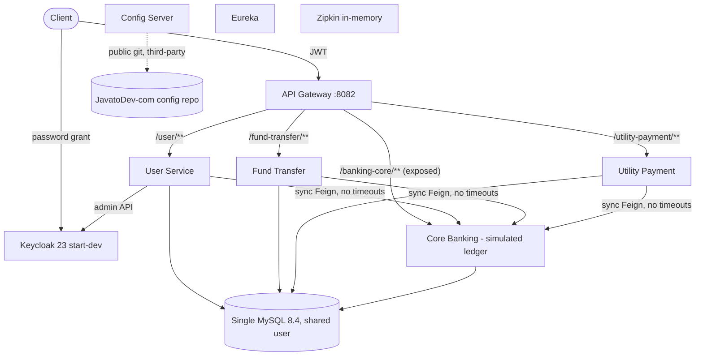
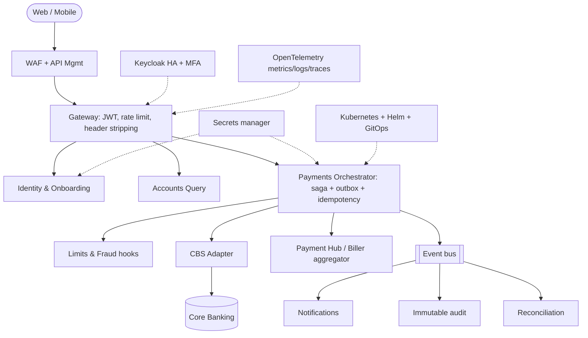

# Technology Due Diligence Report

**Product:** Internet Banking Concept Microservices  
**Repository:** Persistent-Systems-Test/ts-java-spring-boot-internet-banking  
**Baseline:** main @ fa1c445  
**Assessment date:** 2026-11-03  
**Prepared by:** Devin (AI), evidence-based automated assessment

## TDD - Executive Summary

Derived from the product context and PDD findings.

**Verdict:** Well-structured but prototype-grade Spring Cloud microservices system. Keep the skeleton; re-engineer money movement, authorisation, secrets, delivery pipeline and operability.

**Overall technology score:** 1.8 / 5

### Key messages

- Architecture: sensible decomposition (gateway, channel services, core ledger, discovery, config, tracing) but synchronous non-atomic distributed writes and core exposed at the edge (TDD-ARC-01, TDD-ARC-02).
- Security: 7 Critical findings incl. committed secrets, broken object/function-level authorisation, header-trust model, password logging, third-party config supply chain (TDD-SEC-*).
- Data integrity: no amount validation, double-adjusted balances, no locking, no idempotency, mutable single-entry ledger (TDD-DAT-*).
- Engineering maturity: no CI/CD, 18 unit tests in one service, no IaC/Kubernetes despite README claims (TDD-ENG-*, TDD-INF-*).
- Stack currency: Spring Boot 3.2.4 / Spring Cloud 2023.0.0 and Keycloak 23 are past their open-source support windows per vendor policy (to be re-verified) (TDD-STK-01, STK-02).
- Build/test results and dependency CVE scan could not be produced in the assessment environment (Maven Central HTTP 429) - limitation, not a code defect.

### Scorecard (assessor judgement)

| Dimension | Score | Basis |
|---|---|---|
| Technology stack | 2.5 | Modern Java 21 / Spring; framework line out of OSS support; springdoc mismatch |
| Application architecture | 3.0 | Good bounded contexts; sync-only; no saga/outbox |
| Code quality | 2.5 | Readable, layered; duplication; no validation; raw ResponseEntity |
| Security | 1.0 | 7 Critical / 5 High |
| Data architecture | 1.0 | Ledger integrity defects; ddl-auto update; seed data in prod migration |
| Infrastructure & deployment | 1.5 | Compose only; no IaC/K8s/CI; root containers |
| Scalability & performance | 1.5 | Stateless services but no locking, caching, async, perf tests |
| Reliability & operability | 1.5 | No timeouts/circuit breakers/HA/DR; tracing present |
| Engineering maturity | 1.5 | No CI/CD; minimal tests; good README |

### Findings overview

65 findings (Critical: 13, High: 25, Medium: 19, Low: 8).

| ID | Domain | Title | Severity | Priority | Complexity |
|---|---|---|---|---|---|
| TDD-ARC-01 | B. Architecture | Synchronous, non-atomic distributed write for payments | Critical | P1 | High |
| TDD-ARC-02 | B. Architecture | Core ledger exposed through public gateway route | Critical | P0 | Low |
| TDD-ARC-03 | B. Architecture | No authorisation tier between edge and services | Critical | P0 | Medium |
| TDD-CQ-02 | C. Code Quality | No input validation layer | Critical | P0 | Low |
| TDD-DAT-01 | E. Data Architecture | Available balance double-adjusted | Critical | P0 | Low |
| TDD-DAT-02 | E. Data Architecture | Lost updates under concurrency | Critical | P0 | Medium |
| TDD-SEC-01 | D. Security | Secrets committed to version control | Critical | P0 | Low |
| TDD-SEC-02 | D. Security | Broken object-level authorisation (OWASP API1) | Critical | P0 | Medium |
| TDD-SEC-03 | D. Security | Broken function-level authorisation (OWASP API5) | Critical | P0 | Low |
| TDD-SEC-04 | D. Security | Header-based identity trusted; internal ports published | Critical | P0 | Low |
| TDD-SEC-05 | D. Security | Plain-text password written to logs | Critical | P0 | Low |
| TDD-SEC-06 | D. Security | Supply chain: third-party config repo and images | Critical | P0 | Low |
| TDD-SEC-07 | D. Security | No input validation (OWASP API3/API6) - security view | Critical | P0 | Low |
| TDD-ARC-04 | B. Architecture | Shared MySQL server and over-privileged shared DB user | High | P1 | Medium |
| TDD-ARC-06 | B. Architecture | No adapter / anti-corruption layer for real core and payment rails | High | P2 | High |
| TDD-ARC-07 | B. Architecture | Gateway identity-propagation filter likely ineffective | High | P0 | Low |
| TDD-CQ-03 | C. Code Quality | Generic exception handler leaks internals and misuses HTTP 400 | High | P0 | Low |
| TDD-DAT-03 | E. Data Architecture | Account status ignored in postings | High | P0 | Low |
| TDD-DAT-04 | E. Data Architecture | No idempotency keys | High | P1 | Medium |
| TDD-DAT-05 | E. Data Architecture | Mutable single-entry ledger without timestamps | High | P1 | High |
| TDD-DAT-06 | E. Data Architecture | Hibernate ddl-auto: update in three services | High | P1 | Low |
| TDD-DAT-07 | E. Data Architecture | Seed data in production migration path | High | P0 | Low |
| TDD-DAT-09 | E. Data Architecture | No backup, retention or data-lifecycle evidence | High | P1 | Medium |
| TDD-ENG-01 | I. Engineering Maturity | Minimal automated tests | High | P0 | Medium |
| TDD-INF-01 | F. Infrastructure & Deployment | No CI/CD pipeline | High | P0 | Medium |
| TDD-INF-02 | F. Infrastructure & Deployment | No Infrastructure-as-Code or Kubernetes manifests | High | P1 | Medium |
| TDD-INF-05 | F. Infrastructure & Deployment | Keycloak realm with secrets imported from JSON in dev mode | High | P1 | Medium |
| TDD-REL-01 | H. Reliability & Operability | No timeouts, retries or circuit breakers | High | P1 | Low |
| TDD-REL-02 | H. Reliability & Operability | Single instances of all stateful components | High | P2 | Medium |
| TDD-REL-05 | H. Reliability & Operability | No DR / business-continuity design | High | P2 | High |
| TDD-SCA-01 | G. Scalability & Performance | Stateless services scale horizontally but ledger concurrency unsafe | High | P1 | Medium |
| TDD-SEC-08 | D. Security | Actuator over-exposure | High | P0 | Low |
| TDD-SEC-09 | D. Security | Keycloak not hardened | High | P1 | Medium |
| TDD-SEC-11 | D. Security | No rate limiting or anti-automation | High | P1 | Low |
| TDD-SEC-12 | D. Security | Sensitive data in logs (Feign FULL, DTO toString) | High | P0 | Low |
| TDD-SEC-13 | D. Security | Containers run as root; mutable image tags | High | P1 | Low |
| TDD-STK-01 | A. Technology Stack | Spring Boot 3.2.4 / Spring Cloud 2023.0.0 outside OSS support window | High | P1 | Medium |
| TDD-STK-02 | A. Technology Stack | Keycloak 23 server with 24.x admin client | High | P1 | Medium |
| TDD-ARC-05 | B. Architecture | No asynchronous/event backbone | Medium | P1 | Medium |
| TDD-ARC-08 | B. Architecture | Platform duplication: Eureka + Config Server + static IPs | Medium | P2 | Medium |
| TDD-CQ-01 | C. Code Quality | Cross-cutting code duplicated in every service | Medium | P1 | Medium |
| TDD-CQ-05 | C. Code Quality | Incorrect JPA relationship on ledger row | Medium | P1 | Low |
| TDD-CQ-07 | C. Code Quality | Non-thread-safe static Keycloak client and fuzzy user search | Medium | P1 | Low |
| TDD-CQ-08 | C. Code Quality | No static analysis or formatting standards | Medium | P1 | Low |
| TDD-DAT-08 | E. Data Architecture | No currency, settlement or suspense accounts | Medium | P2 | Medium |
| TDD-ENG-02 | I. Engineering Maturity | Seven independent builds; no version catalog | Medium | P1 | Low |
| TDD-ENG-03 | I. Engineering Maturity | No release management or versioning | Medium | P1 | Low |
| TDD-INF-03 | F. Infrastructure & Deployment | Images built from host-prebuilt JARs | Medium | P1 | Low |
| TDD-INF-04 | F. Infrastructure & Deployment | Environment config hard-codes developer IP and static IPs | Medium | P0 | Low |
| TDD-REL-03 | H. Reliability & Operability | Startup ordering via wait-for-it; no health checks | Medium | P1 | Low |
| TDD-REL-04 | H. Reliability & Operability | Observability limited to tracing | Medium | P1 | Medium |
| TDD-SCA-02 | G. Scalability & Performance | N+1 calls to Keycloak when listing users | Medium | P2 | Low |
| TDD-SCA-04 | G. Scalability & Performance | No asynchronous processing | Medium | P2 | Medium |
| TDD-SCA-05 | G. Scalability & Performance | No performance test assets or NFRs | Medium | P1 | Low |
| TDD-SEC-10 | D. Security | No transport encryption inside the system | Medium | P1 | Medium |
| TDD-SEC-14 | D. Security | Dependency vulnerability status unknown | Medium | P0 | Low |
| TDD-STK-04 | A. Technology Stack | Documented technologies not implemented | Medium | P2 | Low |
| TDD-CQ-04 | C. Code Quality | Weakly-typed controllers and reflective mapping | Low | P2 | Low |
| TDD-CQ-06 | C. Code Quality | Type mismatch for account number across services | Low | P2 | Low |
| TDD-DAT-10 | E. Data Architecture | Unbounded pagination | Low | P2 | Low |
| TDD-ENG-04 | I. Engineering Maturity | Documentation good for learning, thin for operations | Low | P2 | Low |
| TDD-ENG-05 | I. Engineering Maturity | Developer API collection out of date | Low | P2 | Low |
| TDD-SCA-03 | G. Scalability & Performance | No caching layer | Low | P3 | Low |
| TDD-SEC-15 | D. Security | CSRF disabled at gateway | Low | P3 | Low |
| TDD-STK-03 | A. Technology Stack | springdoc WebFlux UI starter used in Spring MVC services | Low | P2 | Low |

### Overall Technology Due Diligence assessment

Reuse as accelerator. Phase 0 stabilisation (~4-6 weeks, ~3 engineers) closes all Critical items; Phase 1-2 (~6-8 months, 6-8 engineers) reaches bank-pilot readiness. Effort figures are indicative assessor estimates.

## TDD - Current Technology Stack Inventory

| Layer | Component | Version | Evidence | Lifecycle / support note | Confidence |
|---|---|---|---|---|---|
| Language/runtime | Java (Temurin JRE Alpine image) | 21 (image 21.0.2_13) | E-37, E-39 | Java 21 is an LTS release; image patch level is old | High |
| Framework | Spring Boot | 3.2.4 | E-37 | 3.2.x open-source support ended per Spring support policy (re-verify at spring.io) | Medium |
| Framework | Spring Cloud | 2023.0.0 | E-37 | Release train paired with Boot 3.2; OSS support ended (re-verify) | Medium |
| Gateway | Spring Cloud Gateway (WebFlux) | BOM | E-15 | Current project | High |
| Discovery | Netflix Eureka | BOM | E-37 | Maintained in Spring Cloud; redundant on Kubernetes | High |
| Config | Spring Cloud Config Server (git) | BOM | E-11 | Backed by third-party repo | High |
| Integration | OpenFeign (+ feign-okhttp 13.2.1 in user svc) | BOM | E-37 | Spring Cloud OpenFeign is feature-complete/maintenance mode | Medium |
| Persistence | Spring Data JPA / Hibernate | BOM | E-37 | Current | High |
| Database | MySQL server / Connector-J | 8.4.0 / 8.4.0 | E-05, E-37 | 8.4 is an LTS line | Medium |
| Database | PostgreSQL (Keycloak only) | 15 | E-05 | Supported major | Medium |
| Migrations | Flyway (core only) | 10.12.0 | E-37 | Current major | High |
| Identity | Keycloak server | 23.0.7 (start-dev) | E-05 | Superseded by later majors; no longer patched (re-verify) | Medium |
| Identity | Keycloak admin client | 24.0.4 | E-37 | Version-skewed vs server 23 | High |
| Security | Spring Security OAuth2 resource server | BOM (gateway only) | E-15 | Only at edge | High |
| Observability | Micrometer Tracing (Brave) + Zipkin reporter, Actuator | BOM / Zipkin 3 | E-37, E-14 | Current approach for Boot 3 | High |
| API docs | springdoc-openapi-starter-webflux-ui | 2.1.0 | E-37 | Wrong flavour for Spring MVC services; outdated | High |
| Messaging | RabbitMQ | - | E-03 | Documented only; not implemented | High |
| Code-gen | Lombok | BOM | E-37 | Current | High |
| Build | Gradle wrapper x7 | 8.6 | E-38 | No root build / version catalog | High |
| Container | Docker / docker-compose | compose 3.6 | E-05, E-39 | No orchestrator manifests | High |
| Testing | JUnit 5, Mockito, H2 | BOM / 2.2.224 | E-40 | Unit-level only | High |

Lifecycle statements are based on vendor support policies known to the assessor and were not re-verified online during this assessment (confidence Medium); confirm before decisions.

### Findings

##### TDD-STK-01 - Spring Boot 3.2.4 / Spring Cloud 2023.0.0 outside OSS support window

| Field | Value |
|---|---|
| Finding ID | TDD-STK-01 |
| Technology domain | A. Technology Stack |
| Description | All services pin Boot 3.2.4 and Cloud 2023.0.0. |
| Supporting repository evidence | E-37 `*/build.gradle` |
| Technical impact | No upstream security patches without commercial support. |
| Business impact | Exposure to unpatched CVEs; audit findings. |
| Risk severity | High |
| Recommended remediation | Upgrade to a supported Boot 3.x/Cloud release train; add Renovate/Dependabot. |
| Implementation complexity | Medium |
| Priority | P1 |
| Confidence | Medium |
| Related PDD findings | PDD-R-03 |

##### TDD-STK-02 - Keycloak 23 server with 24.x admin client

| Field | Value |
|---|---|
| Finding ID | TDD-STK-02 |
| Technology domain | A. Technology Stack |
| Description | Server 23.0.7 runs in start-dev; admin client 24.0.4. |
| Supporting repository evidence | [E-05](https://github.com/Persistent-Systems-Test/ts-java-spring-boot-internet-banking/blob/fa1c445/docker-compose/docker-compose.yml#L1-L139) `docker-compose.yml` (1-139); E-37 `*/build.gradle` |
| Technical impact | Unsupported IdP version; client/server skew. |
| Business impact | Identity-layer vulnerabilities affect all customers. |
| Risk severity | High |
| Recommended remediation | Upgrade Keycloak (production mode) and align admin client. |
| Implementation complexity | Medium |
| Priority | P1 |
| Confidence | Medium |
| Related PDD findings | PDD-G-02 |

##### TDD-STK-03 - springdoc WebFlux UI starter used in Spring MVC services

| Field | Value |
|---|---|
| Finding ID | TDD-STK-03 |
| Technology domain | A. Technology Stack |
| Description | springdoc-openapi-starter-webflux-ui 2.1.0 declared in core, user, fund-transfer, utility (servlet apps). |
| Supporting repository evidence | E-37 `*/build.gradle` |
| Technical impact | Swagger UI may not register; mixed reactive deps on classpath. |
| Business impact | Integrator documentation unreliable. |
| Risk severity | Low |
| Recommended remediation | Use springdoc-openapi-starter-webmvc-ui matching Boot version. |
| Implementation complexity | Low |
| Priority | P2 |
| Confidence | High |
| Related PDD findings | PDD-A-03 |

##### TDD-STK-04 - Documented technologies not implemented

| Field | Value |
|---|---|
| Finding ID | TDD-STK-04 |
| Technology domain | A. Technology Stack |
| Description | README lists RabbitMQ, Prometheus, Kubernetes, Sleuth; none present in code (Sleuth replaced by Micrometer). |
| Supporting repository evidence | [E-03](https://github.com/Persistent-Systems-Test/ts-java-spring-boot-internet-banking/blob/fa1c445/README.md#L83-L101) `README.md` (83-101); E-37 `*/build.gradle` |
| Technical impact | Architecture docs misrepresent system. |
| Business impact | Misleading due-diligence/marketing claims. |
| Risk severity | Medium |
| Recommended remediation | Correct README; implement only if roadmap requires. |
| Implementation complexity | Low |
| Priority | P2 |
| Confidence | High |
| Related PDD findings | PDD-G-01 |

## TDD - Application, Technology and Data Architecture Assessment

### Current-state architecture (logical/physical)

Patterns observed: API gateway, service registry, externalised configuration, declarative REST clients, layered controller/service/repository, DTO mappers, JPA auditing. Constraints: synchronous coupling, single database server, third-party config source.

### Application & technology architecture findings

##### TDD-ARC-01 - Synchronous, non-atomic distributed write for payments

| Field | Value |
|---|---|
| Finding ID | TDD-ARC-01 |
| Technology domain | B. Architecture |
| Description | Orchestrator saves PENDING, calls core via Feign, then saves SUCCESS; no saga, outbox or compensation. |
| Supporting repository evidence | [E-33](https://github.com/Persistent-Systems-Test/ts-java-spring-boot-internet-banking/blob/fa1c445/internet-banking-fund-transfer-service/src/main/java/com/javatodev/finance/service/FundTransferService.java#L31-L51) `FundTransferService.java` (31-51); [E-34](https://github.com/Persistent-Systems-Test/ts-java-spring-boot-internet-banking/blob/fa1c445/internet-banking-utility-payment-service/src/main/java/com/javatodev/finance/service/UtilityPaymentService.java#L31-L53) `UtilityPaymentService.java` (31-53) |
| Technical impact | Partial failures leave channel and ledger inconsistent. |
| Business impact | Lost/duplicate payments; reconciliation cost. |
| Risk severity | Critical |
| Recommended remediation | Saga state machine + transactional outbox + idempotent ledger API + reconciliation job. |
| Implementation complexity | High |
| Priority | P1 |
| Confidence | High |
| Related PDD findings | PDD-F-08, PDD-F-09 |

##### TDD-ARC-02 - Core ledger exposed through public gateway route

| Field | Value |
|---|---|
| Finding ID | TDD-ARC-02 |
| Technology domain | B. Architecture |
| Description | Route /banking-core/** -> core-banking-service; gateway only requires authentication. |
| Supporting repository evidence | E-13 `[external] internet-banking-api-gateway*.yml` (routes); [E-15](https://github.com/Persistent-Systems-Test/ts-java-spring-boot-internet-banking/blob/fa1c445/internet-banking-api-gateway/src/main/java/com/javatodev/finance/configuration/security/SecurityConfiguration.java#L24-L35) `SecurityConfiguration.java` (24-35) |
| Technical impact | Ledger API reachable from the internet. |
| Business impact | Unrecorded money movement. |
| Risk severity | Critical |
| Recommended remediation | Remove route; internal network only; service-to-service auth. |
| Implementation complexity | Low |
| Priority | P0 |
| Confidence | High |
| Related PDD findings | PDD-F-03 |

##### TDD-ARC-03 - No authorisation tier between edge and services

| Field | Value |
|---|---|
| Finding ID | TDD-ARC-03 |
| Technology domain | B. Architecture |
| Description | Gateway enforces 'authenticated'; downstream services have no Spring Security and trust X-Auth-Id. |
| Supporting repository evidence | [E-15](https://github.com/Persistent-Systems-Test/ts-java-spring-boot-internet-banking/blob/fa1c445/internet-banking-api-gateway/src/main/java/com/javatodev/finance/configuration/security/SecurityConfiguration.java#L24-L35) `SecurityConfiguration.java` (24-35); [E-17](https://github.com/Persistent-Systems-Test/ts-java-spring-boot-internet-banking/blob/fa1c445/internet-banking-user-service/src/main/java/com/javatodev/finance/configuration/filter/AppAuthUserFilter.java#L21-L33) `AppAuthUserFilter.java` (21-33) |
| Technical impact | Every resource vulnerable to IDOR; zero-trust absent. |
| Business impact | Data breach and fraud. |
| Risk severity | Critical |
| Recommended remediation | Every service as OAuth2 resource server; entitlement/policy layer. |
| Implementation complexity | Medium |
| Priority | P0 |
| Confidence | High |
| Related PDD findings | PDD-F-02, PDD-F-05, PDD-F-06 |

##### TDD-ARC-04 - Shared MySQL server and over-privileged shared DB user

| Field | Value |
|---|---|
| Finding ID | TDD-ARC-04 |
| Technology domain | B. Architecture |
| Description | Four schemas on one instance; one app user with DDL+DML on *.*. |
| Supporting repository evidence | [E-07](https://github.com/Persistent-Systems-Test/ts-java-spring-boot-internet-banking/blob/fa1c445/docker-compose/mysql/privileges.sql#L1-L2) `privileges.sql` (1-2); [E-08](https://github.com/Persistent-Systems-Test/ts-java-spring-boot-internet-banking/blob/fa1c445/docker-compose/mysql/privileges.sql#L5-L8) `privileges.sql` (5-8) |
| Technical impact | Blast radius across services; no data-ownership enforcement. |
| Business impact | One compromise exposes all data. |
| Risk severity | High |
| Recommended remediation | Per-service least-privilege users; separate ledger instance in prod. |
| Implementation complexity | Medium |
| Priority | P1 |
| Confidence | High |
| Related PDD findings | PDD-S-02 |

##### TDD-ARC-05 - No asynchronous/event backbone

| Field | Value |
|---|---|
| Finding ID | TDD-ARC-05 |
| Technology domain | B. Architecture |
| Description | No broker or domain events though README describes RabbitMQ notifications. |
| Supporting repository evidence | [E-02](https://github.com/Persistent-Systems-Test/ts-java-spring-boot-internet-banking/blob/fa1c445/README.md#L60-L75) `README.md` (60-75); [E-03](https://github.com/Persistent-Systems-Test/ts-java-spring-boot-internet-banking/blob/fa1c445/README.md#L83-L101) `README.md` (83-101) |
| Technical impact | Tight temporal coupling; no notification/audit stream. |
| Business impact | No customer notifications; harder integration. |
| Risk severity | Medium |
| Recommended remediation | Introduce Kafka/RabbitMQ with outbox-published domain events. |
| Implementation complexity | Medium |
| Priority | P1 |
| Confidence | High |
| Related PDD findings | PDD-G-01 |

##### TDD-ARC-06 - No adapter / anti-corruption layer for real core and payment rails

| Field | Value |
|---|---|
| Finding ID | TDD-ARC-06 |
| Technology domain | B. Architecture |
| Description | Core is a simulated ledger with bespoke REST API. |
| Supporting repository evidence | E-26 `core-banking-service/src/main/java/com/javatodev/finance/controller/*.java`; [E-21](https://github.com/Persistent-Systems-Test/ts-java-spring-boot-internet-banking/blob/fa1c445/core-banking-service/src/main/java/com/javatodev/finance/service/TransactionService.java#L48-L75) `TransactionService.java` (48-75) |
| Technical impact | Replacing core requires changes in every orchestrator. |
| Business impact | Unbounded first-integration effort. |
| Risk severity | High |
| Recommended remediation | Define ports/adapters (CBS, payment hub, biller) behind stable internal contracts. |
| Implementation complexity | High |
| Priority | P2 |
| Confidence | Medium |
| Related PDD findings | PDD-A-02, PDD-F-10 |

##### TDD-ARC-07 - Gateway identity-propagation filter likely ineffective

| Field | Value |
|---|---|
| Finding ID | TDD-ARC-07 |
| Technology domain | B. Architecture |
| Description | GlobalFilter calls exchange.getRequest().mutate().header(...).build() but returns the original exchange, so X-Auth-Id is not added; client-supplied X-Auth-Id passes through. |
| Supporting repository evidence | [E-16](https://github.com/Persistent-Systems-Test/ts-java-spring-boot-internet-banking/blob/fa1c445/internet-banking-api-gateway/src/main/java/com/javatodev/finance/configuration/GatewayConfiguration.java#L18-L28) `GatewayConfiguration.java` (18-28) |
| Technical impact | Audit identity missing or spoofable. |
| Business impact | Untrustworthy audit trail. |
| Risk severity | High |
| Recommended remediation | Return exchange.mutate().request(mutated).build(); strip inbound X-Auth-* headers. Confirm at runtime. |
| Implementation complexity | Low |
| Priority | P0 |
| Confidence | Medium |
| Related PDD findings | PDD-G-02 |

##### TDD-ARC-08 - Platform duplication: Eureka + Config Server + static IPs

| Field | Value |
|---|---|
| Finding ID | TDD-ARC-08 |
| Technology domain | B. Architecture |
| Description | Discovery and config via Spring Cloud plus static Docker IPs in config. |
| Supporting repository evidence | [E-05](https://github.com/Persistent-Systems-Test/ts-java-spring-boot-internet-banking/blob/fa1c445/docker-compose/docker-compose.yml#L1-L139) `docker-compose.yml` (1-139); E-12 `*/src/main/resources/bootstrap*.yml`; E-14 `[external] *-service.yml` (ddl-auto / management) |
| Technical impact | Extra moving parts; brittle addressing. |
| Business impact | Higher ops cost. |
| Risk severity | Medium |
| Recommended remediation | On Kubernetes use native DNS/ConfigMaps/Secrets or Spring Cloud Kubernetes. |
| Implementation complexity | Medium |
| Priority | P2 |
| Confidence | High |
| Related PDD findings | PDD-S-01 |

### Data architecture

| Entity / table | Owner service | Key attributes | Relationships |
|---|---|---|---|
| banking_core_user | core | id, first_name, last_name, email, identification_number | 1-* account |
| banking_core_account | core | id, number, type, status, actual_balance, available_balance DECIMAL(19,2), user_id | *-1 user; 1-* transaction |
| banking_core_transaction | core | id, amount, transaction_type, reference_number, transaction_id, account_id | *-1 account (mapped @OneToOne) |
| banking_core_utility_account | core | id, number, provider_name | - |
| user | user-service | id, auth_id, identification, status + audit | auth_id -> Keycloak user |
| fund_transfer | fund-transfer | id, transaction_reference, from_account, to_account, amount, status + audit | transaction_reference -> core transaction_id |
| utility_payment | utility-payment | id, provider_id, amount, reference_number, account, transaction_id, status + audit | transaction_id -> core |

##### TDD-DAT-01 - Available balance double-adjusted

| Field | Value |
|---|---|
| Finding ID | TDD-DAT-01 |
| Technology domain | E. Data Architecture |
| Description | availableBalance computed from already-updated actualBalance on debit and credit. |
| Supporting repository evidence | [E-20](https://github.com/Persistent-Systems-Test/ts-java-spring-boot-internet-banking/blob/fa1c445/core-banking-service/src/main/java/com/javatodev/finance/service/TransactionService.java) `TransactionService.java` (63-64,90-91,99-100) |
| Technical impact | Ledger inconsistency. |
| Business impact | Wrong customer balances. |
| Risk severity | Critical |
| Recommended remediation | available = available -/+ amount; explicit holds. |
| Implementation complexity | Low |
| Priority | P0 |
| Confidence | High |
| Related PDD findings | PDD-F-04 |

##### TDD-DAT-02 - Lost updates under concurrency

| Field | Value |
|---|---|
| Finding ID | TDD-DAT-02 |
| Technology domain | E. Data Architecture |
| Description | Read-modify-write on BankAccountEntity without @Version or SELECT ... FOR UPDATE. |
| Supporting repository evidence | [E-23](https://github.com/Persistent-Systems-Test/ts-java-spring-boot-internet-banking/blob/fa1c445/core-banking-service/src/main/java/com/javatodev/finance/model/entity/BankAccountEntity.java#L16-L37) `BankAccountEntity.java` (16-37); [E-18](https://github.com/Persistent-Systems-Test/ts-java-spring-boot-internet-banking/blob/fa1c445/core-banking-service/src/main/java/com/javatodev/finance/service/TransactionService.java#L35-L46) `TransactionService.java` (35-46) |
| Technical impact | Concurrent debits can overdraw. |
| Business impact | Financial loss. |
| Risk severity | Critical |
| Recommended remediation | Pessimistic locking ordered by account id or optimistic @Version + retry; DB CHECK constraints. |
| Implementation complexity | Medium |
| Priority | P0 |
| Confidence | High |
| Related PDD findings | PDD-F-01, PDD-F-04 |

##### TDD-DAT-03 - Account status ignored in postings

| Field | Value |
|---|---|
| Finding ID | TDD-DAT-03 |
| Technology domain | E. Data Architecture |
| Description | Status not checked in TransactionService. |
| Supporting repository evidence | [E-19](https://github.com/Persistent-Systems-Test/ts-java-spring-boot-internet-banking/blob/fa1c445/core-banking-service/src/main/java/com/javatodev/finance/service/TransactionService.java#L77-L81) `TransactionService.java` (77-81); E-25 `core-banking-service/src/main/java/com/javatodev/finance/model/{AccountType,AccountStatus,TransactionType}.java` |
| Technical impact | Invalid postings. |
| Business impact | Regulatory breach. |
| Risk severity | High |
| Recommended remediation | Status rules in ledger domain. |
| Implementation complexity | Low |
| Priority | P0 |
| Confidence | High |
| Related PDD findings | PDD-F-07 |

##### TDD-DAT-04 - No idempotency keys

| Field | Value |
|---|---|
| Finding ID | TDD-DAT-04 |
| Technology domain | E. Data Architecture |
| Description | transactionId generated server-side per call; no unique client key. |
| Supporting repository evidence | [E-18](https://github.com/Persistent-Systems-Test/ts-java-spring-boot-internet-banking/blob/fa1c445/core-banking-service/src/main/java/com/javatodev/finance/service/TransactionService.java#L35-L46) `TransactionService.java` (35-46); [E-33](https://github.com/Persistent-Systems-Test/ts-java-spring-boot-internet-banking/blob/fa1c445/internet-banking-fund-transfer-service/src/main/java/com/javatodev/finance/service/FundTransferService.java#L31-L51) `FundTransferService.java` (31-51) |
| Technical impact | Duplicates on retry. |
| Business impact | Double debits. |
| Risk severity | High |
| Recommended remediation | Idempotency-Key persisted with unique constraint. |
| Implementation complexity | Medium |
| Priority | P1 |
| Confidence | High |
| Related PDD findings | PDD-F-09 |

##### TDD-DAT-05 - Mutable single-entry ledger without timestamps

| Field | Value |
|---|---|
| Finding ID | TDD-DAT-05 |
| Technology domain | E. Data Architecture |
| Description | Balances are mutable columns; transaction rows lack timestamps, status, balance-after; transaction_id not unique. |
| Supporting repository evidence | [E-22](https://github.com/Persistent-Systems-Test/ts-java-spring-boot-internet-banking/blob/fa1c445/core-banking-service/src/main/java/com/javatodev/finance/model/entity/TransactionEntity.java#L17-L35) `TransactionEntity.java` (17-35); E-24 `core-banking-service/src/main/resources/db/migration/` (V1.0.*) |
| Technical impact | No auditability or replay; weak integrity. |
| Business impact | Audit/regulatory failure. |
| Risk severity | High |
| Recommended remediation | Double-entry append-only journal with posted_at/value_date and unique ids. |
| Implementation complexity | High |
| Priority | P1 |
| Confidence | High |
| Related PDD findings | PDD-G-02, PDD-S-03 |

##### TDD-DAT-06 - Hibernate ddl-auto: update in three services

| Field | Value |
|---|---|
| Finding ID | TDD-DAT-06 |
| Technology domain | E. Data Architecture |
| Description | User, fund-transfer, utility-payment schemas managed by Hibernate auto-DDL. |
| Supporting repository evidence | E-14 `[external] *-service.yml` (ddl-auto / management) |
| Technical impact | Uncontrolled schema drift. |
| Business impact | Production outages/data loss. |
| Risk severity | High |
| Recommended remediation | Flyway in all services; ddl-auto validate. |
| Implementation complexity | Low |
| Priority | P1 |
| Confidence | High |
| Related PDD findings | - |

##### TDD-DAT-07 - Seed data in production migration path

| Field | Value |
|---|---|
| Finding ID | TDD-DAT-07 |
| Technology domain | E. Data Architecture |
| Description | V1.0.20210427174721__temp_data.sql inserts customers/accounts/billers. |
| Supporting repository evidence | E-24 `core-banking-service/src/main/resources/db/migration/` (V1.0.*) |
| Technical impact | Fake data in every environment. |
| Business impact | Ledger contamination. |
| Risk severity | High |
| Recommended remediation | Move to test-only Flyway location. |
| Implementation complexity | Low |
| Priority | P0 |
| Confidence | High |
| Related PDD findings | PDD-R-04 |

##### TDD-DAT-08 - No currency, settlement or suspense accounts

| Field | Value |
|---|---|
| Finding ID | TDD-DAT-08 |
| Technology domain | E. Data Architecture |
| Description | No currency column; utility payment has no credit leg. |
| Supporting repository evidence | E-24 `core-banking-service/src/main/resources/db/migration/` (V1.0.*); [E-21](https://github.com/Persistent-Systems-Test/ts-java-spring-boot-internet-banking/blob/fa1c445/core-banking-service/src/main/java/com/javatodev/finance/service/TransactionService.java#L48-L75) `TransactionService.java` (48-75) |
| Technical impact | Ledger cannot balance. |
| Business impact | Unreconcilable books. |
| Risk severity | Medium |
| Recommended remediation | Currency + GL/settlement accounts. |
| Implementation complexity | Medium |
| Priority | P2 |
| Confidence | High |
| Related PDD findings | PDD-F-10, PDD-S-03 |

##### TDD-DAT-09 - No backup, retention or data-lifecycle evidence

| Field | Value |
|---|---|
| Finding ID | TDD-DAT-09 |
| Technology domain | E. Data Architecture |
| Description | No backup scripts, retention policies, or archival in repository; volumes only. |
| Supporting repository evidence | [E-05](https://github.com/Persistent-Systems-Test/ts-java-spring-boot-internet-banking/blob/fa1c445/docker-compose/docker-compose.yml#L1-L139) `docker-compose.yml` (1-139) |
| Technical impact | Data loss on host failure. |
| Business impact | Business continuity risk. |
| Risk severity | High |
| Recommended remediation | Define RPO/RTO; automated backups and PITR; retention policy. |
| Implementation complexity | Medium |
| Priority | P1 |
| Confidence | High |
| Related PDD findings | PDD-R-01 |

##### TDD-DAT-10 - Unbounded pagination

| Field | Value |
|---|---|
| Finding ID | TDD-DAT-10 |
| Technology domain | E. Data Architecture |
| Description | Pageable endpoints without max page size. |
| Supporting repository evidence | E-26 `core-banking-service/src/main/java/com/javatodev/finance/controller/*.java`; [E-33](https://github.com/Persistent-Systems-Test/ts-java-spring-boot-internet-banking/blob/fa1c445/internet-banking-fund-transfer-service/src/main/java/com/javatodev/finance/service/FundTransferService.java#L31-L51) `FundTransferService.java` (31-51) |
| Technical impact | Large queries / memory pressure. |
| Business impact | Availability. |
| Risk severity | Low |
| Recommended remediation | spring.data.web.pageable.max-page-size. |
| Implementation complexity | Low |
| Priority | P2 |
| Confidence | Medium |
| Related PDD findings | - |

### Architecture gap analysis

| Dimension | Current state | Target state | Gap findings |
|---|---|---|---|
| Edge & identity | Gateway JWT validation only; Keycloak dev mode; no MFA | WAF + API mgmt, rate limiting, HA Keycloak with MFA, auth-code+PKCE | TDD-SEC-09, TDD-SEC-11, TDD-STK-02 |
| Authorisation | None below edge; header trust | Zero-trust: JWT per service, entitlements, RBAC, maker-checker | TDD-ARC-03, TDD-SEC-02, TDD-SEC-03, TDD-SEC-04 |
| Payments orchestration | Sync Feign, no state machine | Saga + outbox + idempotency + reconciliation | TDD-ARC-01, TDD-DAT-04 |
| Ledger | Mutable single-entry, simulated | Adapter to real CBS; double-entry journal if in-house | TDD-DAT-05, TDD-ARC-06 |
| Integration | Synchronous only | Event bus for notifications/audit/reconciliation | TDD-ARC-05, TDD-SCA-04 |
| Data management | Shared MySQL, ddl-auto update, seed data | Per-service least privilege, Flyway, backups/PITR | TDD-ARC-04, TDD-DAT-06, TDD-DAT-07, TDD-DAT-09 |
| Platform | docker-compose, static IPs, Eureka/Config | Kubernetes + Helm, ConfigMaps/Secrets, IaC | TDD-INF-02, TDD-ARC-08, TDD-INF-04 |
| Delivery | No CI/CD | Secure pipeline with quality and security gates | TDD-INF-01, TDD-ENG-01, TDD-SEC-14 |
| Operability | Tracing only | OTel metrics/logs/traces, SLOs, alerting, HA/DR | TDD-REL-01, TDD-REL-02, TDD-REL-04, TDD-REL-05 |

### Target-state technology architecture

## TDD - Code Quality and Engineering Maturity Assessment

| Metric | Value |
|---|---|
| Production Java LOC / files | ~2,846 / 121 |
| Test Java LOC / files | ~413 / 10 |
| Unit tests | 18 (core-banking only) |
| Bean Validation annotations | 0 |
| Method-level security annotations | 0 |
| Static analysis config | None |

### Code quality findings

##### TDD-CQ-01 - Cross-cutting code duplicated in every service

| Field | Value |
|---|---|
| Finding ID | TDD-CQ-01 |
| Technology domain | C. Code Quality |
| Description | ApiRequestContext*, AppAuthUserFilter, AuditAware, BaseMapper, GlobalExceptionHandler, ErrorResponse copied per service. |
| Supporting repository evidence | [E-17](https://github.com/Persistent-Systems-Test/ts-java-spring-boot-internet-banking/blob/fa1c445/internet-banking-user-service/src/main/java/com/javatodev/finance/configuration/filter/AppAuthUserFilter.java#L21-L33) `AppAuthUserFilter.java` (21-33); E-27 `*/src/main/java/com/javatodev/finance/exception/GlobalExceptionHandler.java` (core:27 ft:24 user:27 up:27); E-36 `*/src/main/java/com/javatodev/finance/model/dto/AuditAware.java` |
| Technical impact | Fixes drift between services. |
| Business impact | Slower, riskier change. |
| Risk severity | Medium |
| Recommended remediation | Shared internal starter library. |
| Implementation complexity | Medium |
| Priority | P1 |
| Confidence | High |
| Related PDD findings | PDD-R-03 |

##### TDD-CQ-02 - No input validation layer

| Field | Value |
|---|---|
| Finding ID | TDD-CQ-02 |
| Technology domain | C. Code Quality |
| Description | Zero Bean Validation annotations in the codebase. |
| Supporting repository evidence | [E-19](https://github.com/Persistent-Systems-Test/ts-java-spring-boot-internet-banking/blob/fa1c445/core-banking-service/src/main/java/com/javatodev/finance/service/TransactionService.java#L77-L81) `TransactionService.java` (77-81); [E-28](https://github.com/Persistent-Systems-Test/ts-java-spring-boot-internet-banking/blob/fa1c445/internet-banking-user-service/src/main/java/com/javatodev/finance/controller/UserController.java#L28-L55) `UserController.java` (28-55) |
| Technical impact | Invalid data reaches domain logic. |
| Business impact | Fraud and data quality issues. |
| Risk severity | Critical |
| Recommended remediation | Bean Validation on all request DTOs + domain invariants. |
| Implementation complexity | Low |
| Priority | P0 |
| Confidence | High |
| Related PDD findings | PDD-F-01, PDD-F-11 |

##### TDD-CQ-03 - Generic exception handler leaks internals and misuses HTTP 400

| Field | Value |
|---|---|
| Finding ID | TDD-CQ-03 |
| Technology domain | C. Code Quality |
| Description | handleException returns 'Exception occur inside API ' + e for all exceptions. |
| Supporting repository evidence | E-27 `*/src/main/java/com/javatodev/finance/exception/GlobalExceptionHandler.java` (core:27 ft:24 user:27 up:27) |
| Technical impact | Information disclosure; clients cannot distinguish errors. |
| Business impact | Poor UX, support overhead. |
| Risk severity | High |
| Recommended remediation | RFC 7807 ProblemDetail, correct status codes, correlation id. |
| Implementation complexity | Low |
| Priority | P0 |
| Confidence | High |
| Related PDD findings | PDD-E-02 |

##### TDD-CQ-04 - Weakly-typed controllers and reflective mapping

| Field | Value |
|---|---|
| Finding ID | TDD-CQ-04 |
| Technology domain | C. Code Quality |
| Description | Raw ResponseEntity return types; BeanUtils.copyProperties mappers instantiated with new. |
| Supporting repository evidence | E-26 `core-banking-service/src/main/java/com/javatodev/finance/controller/*.java`; [E-33](https://github.com/Persistent-Systems-Test/ts-java-spring-boot-internet-banking/blob/fa1c445/internet-banking-fund-transfer-service/src/main/java/com/javatodev/finance/service/FundTransferService.java#L31-L51) `FundTransferService.java` (31-51) |
| Technical impact | Silent field mismatches; weak API contracts. |
| Business impact | Integration defects. |
| Risk severity | Low |
| Recommended remediation | Typed responses; MapStruct mappers as beans. |
| Implementation complexity | Low |
| Priority | P2 |
| Confidence | High |
| Related PDD findings | PDD-A-03 |

##### TDD-CQ-05 - Incorrect JPA relationship on ledger row

| Field | Value |
|---|---|
| Finding ID | TDD-CQ-05 |
| Technology domain | C. Code Quality |
| Description | TransactionEntity.account mapped @OneToOne(cascade = ALL) for a many-to-one relationship. |
| Supporting repository evidence | [E-22](https://github.com/Persistent-Systems-Test/ts-java-spring-boot-internet-banking/blob/fa1c445/core-banking-service/src/main/java/com/javatodev/finance/model/entity/TransactionEntity.java#L17-L35) `TransactionEntity.java` (17-35) |
| Technical impact | Cascade from transaction to account can persist/delete accounts unintentionally. |
| Business impact | Ledger corruption risk. |
| Risk severity | Medium |
| Recommended remediation | @ManyToOne without cascade. |
| Implementation complexity | Low |
| Priority | P1 |
| Confidence | High |
| Related PDD findings | PDD-F-04 |

##### TDD-CQ-06 - Type mismatch for account number across services

| Field | Value |
|---|---|
| Finding ID | TDD-CQ-06 |
| Technology domain | C. Code Quality |
| Description | AccountResponse.number is Long in fund-transfer and utility-payment, String in core. |
| Supporting repository evidence | E-44 `*/src/main/java/com/javatodev/finance/model/**/AccountResponse.java` (9) |
| Technical impact | Leading zeros / alphanumeric numbers break. |
| Business impact | Failures with real CBS formats. |
| Risk severity | Low |
| Recommended remediation | Use String consistently; shared contract. |
| Implementation complexity | Low |
| Priority | P2 |
| Confidence | High |
| Related PDD findings | PDD-A-03 |

##### TDD-CQ-07 - Non-thread-safe static Keycloak client and fuzzy user search

| Field | Value |
|---|---|
| Finding ID | TDD-CQ-07 |
| Technology domain | C. Code Quality |
| Description | Static lazily-initialised Keycloak instance; users().search(email) then get(0). |
| Supporting repository evidence | [E-31](https://github.com/Persistent-Systems-Test/ts-java-spring-boot-internet-banking/blob/fa1c445/internet-banking-user-service/src/main/java/com/javatodev/finance/configuration/keycloak/KeycloakProperties.java#L25-L40) `KeycloakProperties.java` (25-40); [E-30](https://github.com/Persistent-Systems-Test/ts-java-spring-boot-internet-banking/blob/fa1c445/internet-banking-user-service/src/main/java/com/javatodev/finance/service/KeycloakUserService.java#L36) `KeycloakUserService.java` (36); [E-29](https://github.com/Persistent-Systems-Test/ts-java-spring-boot-internet-banking/blob/fa1c445/internet-banking-user-service/src/main/java/com/javatodev/finance/service/UserService.java#L33-L111) `UserService.java` (33-111) |
| Technical impact | Race on init; wrong user matched for similar emails. |
| Business impact | Mis-linked identities. |
| Risk severity | Medium |
| Recommended remediation | Spring-managed singleton bean; exact email search; use created id from Location header. |
| Implementation complexity | Low |
| Priority | P1 |
| Confidence | High |
| Related PDD findings | PDD-F-12 |

##### TDD-CQ-08 - No static analysis or formatting standards

| Field | Value |
|---|---|
| Finding ID | TDD-CQ-08 |
| Technology domain | C. Code Quality |
| Description | No Checkstyle/SpotBugs/PMD/Spotless/Sonar configuration. |
| Supporting repository evidence | E-38 `*/gradle/wrapper/gradle-wrapper.properties` |
| Technical impact | Quality regressions undetected. |
| Business impact | Higher defect rate. |
| Risk severity | Medium |
| Recommended remediation | Add Spotless + SpotBugs/Sonar gates in CI. |
| Implementation complexity | Low |
| Priority | P1 |
| Confidence | High |
| Related PDD findings | - |

### Engineering maturity findings

##### TDD-ENG-01 - Minimal automated tests

| Field | Value |
|---|---|
| Finding ID | TDD-ENG-01 |
| Technology domain | I. Engineering Maturity |
| Description | 18 unit tests in core (do not assert balances); contextLoads elsewhere; no integration/contract/E2E. |
| Supporting repository evidence | E-40 `*/src/test/**` |
| Technical impact | Regressions undetected (e.g. TDD-DAT-01 passes tests). |
| Business impact | Defects reach customers. |
| Risk severity | High |
| Recommended remediation | Testcontainers, WireMock, contract tests, Newman/Karate E2E; JaCoCo gate. |
| Implementation complexity | Medium |
| Priority | P0 |
| Confidence | High |
| Related PDD findings | PDD-F-04 |

##### TDD-ENG-02 - Seven independent builds; no version catalog

| Field | Value |
|---|---|
| Finding ID | TDD-ENG-02 |
| Technology domain | I. Engineering Maturity |
| Description | Each service has its own wrapper and duplicated versions. |
| Supporting repository evidence | E-38 `*/gradle/wrapper/gradle-wrapper.properties`; E-37 `*/build.gradle` |
| Technical impact | Version skew; slow upgrades. |
| Business impact | Maintenance cost. |
| Risk severity | Medium |
| Recommended remediation | Gradle multi-project + libs.versions.toml. |
| Implementation complexity | Low |
| Priority | P1 |
| Confidence | High |
| Related PDD findings | - |

##### TDD-ENG-03 - No release management or versioning

| Field | Value |
|---|---|
| Finding ID | TDD-ENG-03 |
| Technology domain | I. Engineering Maturity |
| Description | All services 0.0.1-SNAPSHOT; README releases link to upstream repo. |
| Supporting repository evidence | E-37 `*/build.gradle`; [E-01](https://github.com/Persistent-Systems-Test/ts-java-spring-boot-internet-banking/blob/fa1c445/README.md#L1-L20) `README.md` (1-20) |
| Technical impact | Untraceable deployments. |
| Business impact | Change-management audit gaps. |
| Risk severity | Medium |
| Recommended remediation | Semantic versioning, tagged releases, changelog. |
| Implementation complexity | Low |
| Priority | P1 |
| Confidence | High |
| Related PDD findings | - |

##### TDD-ENG-04 - Documentation good for learning, thin for operations

| Field | Value |
|---|---|
| Finding ID | TDD-ENG-04 |
| Technology domain | I. Engineering Maturity |
| Description | README + tutorial links + one diagram; no ADRs, runbooks or API specs. |
| Supporting repository evidence | [E-01](https://github.com/Persistent-Systems-Test/ts-java-spring-boot-internet-banking/blob/fa1c445/README.md#L1-L20) `README.md` (1-20); [E-46](https://github.com/Persistent-Systems-Test/ts-java-spring-boot-internet-banking/blob/fa1c445/draw_io/centralized_configuration.drawio) `centralized_configuration.drawio` |
| Technical impact | Onboarding of ops teams slow. |
| Business impact | Support cost. |
| Risk severity | Low |
| Recommended remediation | ADRs, runbooks, published OpenAPI. |
| Implementation complexity | Low |
| Priority | P2 |
| Confidence | High |
| Related PDD findings | PDD-A-03 |

##### TDD-ENG-05 - Developer API collection out of date

| Field | Value |
|---|---|
| Finding ID | TDD-ENG-05 |
| Technology domain | I. Engineering Maturity |
| Description | Postman paths differ from gateway routes and controller paths. |
| Supporting repository evidence | [E-42](https://github.com/Persistent-Systems-Test/ts-java-spring-boot-internet-banking/blob/fa1c445/postman_collection/JAVA_TO_DEV_MICROSERVICES.postman_collection.json) `JAVA_TO_DEV_MICROSERVICES.postman_collection.json` |
| Technical impact | Manual testing friction. |
| Business impact | Demo failures. |
| Risk severity | Low |
| Recommended remediation | Regenerate collection from OpenAPI; run in CI. |
| Implementation complexity | Low |
| Priority | P2 |
| Confidence | High |
| Related PDD findings | PDD-A-03 |

## TDD - Security Assessment

The presence of Spring Security and Keycloak is **not** treated as evidence that the application is secure; each control was checked in code/config.

| ID | Domain | Title | Severity | Priority | Complexity |
|---|---|---|---|---|---|
| TDD-SEC-01 | D. Security | Secrets committed to version control | Critical | P0 | Low |
| TDD-SEC-02 | D. Security | Broken object-level authorisation (OWASP API1) | Critical | P0 | Medium |
| TDD-SEC-03 | D. Security | Broken function-level authorisation (OWASP API5) | Critical | P0 | Low |
| TDD-SEC-04 | D. Security | Header-based identity trusted; internal ports published | Critical | P0 | Low |
| TDD-SEC-05 | D. Security | Plain-text password written to logs | Critical | P0 | Low |
| TDD-SEC-06 | D. Security | Supply chain: third-party config repo and images | Critical | P0 | Low |
| TDD-SEC-07 | D. Security | No input validation (OWASP API3/API6) - security view | Critical | P0 | Low |
| TDD-SEC-08 | D. Security | Actuator over-exposure | High | P0 | Low |
| TDD-SEC-09 | D. Security | Keycloak not hardened | High | P1 | Medium |
| TDD-SEC-11 | D. Security | No rate limiting or anti-automation | High | P1 | Low |
| TDD-SEC-12 | D. Security | Sensitive data in logs (Feign FULL, DTO toString) | High | P0 | Low |
| TDD-SEC-13 | D. Security | Containers run as root; mutable image tags | High | P1 | Low |
| TDD-SEC-10 | D. Security | No transport encryption inside the system | Medium | P1 | Medium |
| TDD-SEC-14 | D. Security | Dependency vulnerability status unknown | Medium | P0 | Low |
| TDD-SEC-15 | D. Security | CSRF disabled at gateway | Low | P3 | Low |

##### TDD-SEC-01 - Secrets committed to version control

| Field | Value |
|---|---|
| Finding ID | TDD-SEC-01 |
| Technology domain | D. Security |
| Description | MySQL root/app, Keycloak admin/DB passwords, two Keycloak client secrets, test client secret, published test user password. |
| Supporting repository evidence | [E-06](https://github.com/Persistent-Systems-Test/ts-java-spring-boot-internet-banking/blob/fa1c445/docker-compose/docker-compose.yml) `docker-compose.yml` (21-23,43,52); [E-07](https://github.com/Persistent-Systems-Test/ts-java-spring-boot-internet-banking/blob/fa1c445/docker-compose/mysql/privileges.sql#L1-L2) `privileges.sql` (1-2); [E-10](https://github.com/Persistent-Systems-Test/ts-java-spring-boot-internet-banking/blob/fa1c445/docker-compose/keycloak/realm-export.json#L686-L873) `realm-export.json` (686-873); [E-41](https://github.com/Persistent-Systems-Test/ts-java-spring-boot-internet-banking/blob/fa1c445/internet-banking-user-service/src/test/resources/application.yml#L35) `application.yml` (35); [E-02](https://github.com/Persistent-Systems-Test/ts-java-spring-boot-internet-banking/blob/fa1c445/README.md#L60-L75) `README.md` (60-75) |
| Technical impact | Credential compromise of any default deployment. |
| Business impact | Account takeover, data breach. |
| Risk severity | Critical |
| Recommended remediation | Rotate; secrets manager/K8s Secrets; gitleaks in CI; history purge if public. |
| Implementation complexity | Low |
| Priority | P0 |
| Confidence | High |
| Related PDD findings | PDD-R-05 |

##### TDD-SEC-02 - Broken object-level authorisation (OWASP API1)

| Field | Value |
|---|---|
| Finding ID | TDD-SEC-02 |
| Technology domain | D. Security |
| Description | No ownership checks on transfer source, account lookup, history. |
| Supporting repository evidence | [E-33](https://github.com/Persistent-Systems-Test/ts-java-spring-boot-internet-banking/blob/fa1c445/internet-banking-fund-transfer-service/src/main/java/com/javatodev/finance/service/FundTransferService.java#L31-L51) `FundTransferService.java` (31-51); [E-34](https://github.com/Persistent-Systems-Test/ts-java-spring-boot-internet-banking/blob/fa1c445/internet-banking-utility-payment-service/src/main/java/com/javatodev/finance/service/UtilityPaymentService.java#L31-L53) `UtilityPaymentService.java` (31-53); E-26 `core-banking-service/src/main/java/com/javatodev/finance/controller/*.java` |
| Technical impact | Horizontal privilege escalation. |
| Business impact | Fraud and privacy breach. |
| Risk severity | Critical |
| Recommended remediation | Derive customer from validated JWT; entitlement checks; scoped queries. |
| Implementation complexity | Medium |
| Priority | P0 |
| Confidence | High |
| Related PDD findings | PDD-F-02, PDD-F-05 |

##### TDD-SEC-03 - Broken function-level authorisation (OWASP API5)

| Field | Value |
|---|---|
| Finding ID | TDD-SEC-03 |
| Technology domain | D. Security |
| Description | Status update endpoint callable by any authenticated user; no roles in realm. |
| Supporting repository evidence | [E-28](https://github.com/Persistent-Systems-Test/ts-java-spring-boot-internet-banking/blob/fa1c445/internet-banking-user-service/src/main/java/com/javatodev/finance/controller/UserController.java#L28-L55) `UserController.java` (28-55); [E-10](https://github.com/Persistent-Systems-Test/ts-java-spring-boot-internet-banking/blob/fa1c445/docker-compose/keycloak/realm-export.json#L686-L873) `realm-export.json` (686-873) |
| Technical impact | Vertical privilege escalation. |
| Business impact | Self-approval of accounts. |
| Risk severity | Critical |
| Recommended remediation | Realm roles + @PreAuthorize + maker-checker. |
| Implementation complexity | Low |
| Priority | P0 |
| Confidence | High |
| Related PDD findings | PDD-F-06 |

##### TDD-SEC-04 - Header-based identity trusted; internal ports published

| Field | Value |
|---|---|
| Finding ID | TDD-SEC-04 |
| Technology domain | D. Security |
| Description | Services read X-Auth-Id without JWT validation; compose publishes 8083-8085, 8092, 3306 on host. |
| Supporting repository evidence | [E-17](https://github.com/Persistent-Systems-Test/ts-java-spring-boot-internet-banking/blob/fa1c445/internet-banking-user-service/src/main/java/com/javatodev/finance/configuration/filter/AppAuthUserFilter.java#L21-L33) `AppAuthUserFilter.java` (21-33); [E-05](https://github.com/Persistent-Systems-Test/ts-java-spring-boot-internet-banking/blob/fa1c445/docker-compose/docker-compose.yml#L1-L139) `docker-compose.yml` (1-139) |
| Technical impact | Gateway bypass and identity spoofing. |
| Business impact | Untraceable fraudulent actions. |
| Risk severity | Critical |
| Recommended remediation | Resource server per service; publish only gateway port; strip inbound auth headers. |
| Implementation complexity | Low |
| Priority | P0 |
| Confidence | High |
| Related PDD findings | PDD-F-02 |

##### TDD-SEC-05 - Plain-text password written to logs

| Field | Value |
|---|---|
| Finding ID | TDD-SEC-05 |
| Technology domain | D. Security |
| Description | UserController logs request.toString(); Lombok @Data User includes password. |
| Supporting repository evidence | [E-28](https://github.com/Persistent-Systems-Test/ts-java-spring-boot-internet-banking/blob/fa1c445/internet-banking-user-service/src/main/java/com/javatodev/finance/controller/UserController.java#L28-L55) `UserController.java` (28-55); [E-32](https://github.com/Persistent-Systems-Test/ts-java-spring-boot-internet-banking/blob/fa1c445/internet-banking-user-service/src/main/java/com/javatodev/finance/model/dto/User.java#L1-L20) `User.java` (1-20) |
| Technical impact | Credential exposure in log stores. |
| Business impact | Regulatory breach; account takeover. |
| Risk severity | Critical |
| Recommended remediation | Separate request DTO; @ToString.Exclude; log redaction policy. |
| Implementation complexity | Low |
| Priority | P0 |
| Confidence | High |
| Related PDD findings | PDD-F-06 |

##### TDD-SEC-06 - Supply chain: third-party config repo and images

| Field | Value |
|---|---|
| Finding ID | TDD-SEC-06 |
| Technology domain | D. Security |
| Description | Config Server pulls from JavatoDev-com public repo; compose uses javatodev/* images. |
| Supporting repository evidence | [E-11](https://github.com/Persistent-Systems-Test/ts-java-spring-boot-internet-banking/blob/fa1c445/internet-banking-config-server/src/main/resources/application.yml#L1-L10) `application.yml` (1-10); [E-05](https://github.com/Persistent-Systems-Test/ts-java-spring-boot-internet-banking/blob/fa1c445/docker-compose/docker-compose.yml#L1-L139) `docker-compose.yml` (1-139) |
| Technical impact | Third party controls routes, DB URLs and binaries. |
| Business impact | Full compromise possible via upstream change. |
| Risk severity | Critical |
| Recommended remediation | Org-owned private config; build/sign images in own CI; SBOM. |
| Implementation complexity | Low |
| Priority | P0 |
| Confidence | High |
| Related PDD findings | PDD-R-01, PDD-S-01 |

##### TDD-SEC-07 - No input validation (OWASP API3/API6) - security view

| Field | Value |
|---|---|
| Finding ID | TDD-SEC-07 |
| Technology domain | D. Security |
| Description | Negative amounts and arbitrary fields accepted; mass-assignment via BeanUtils.copyProperties from request DTOs. |
| Supporting repository evidence | [E-19](https://github.com/Persistent-Systems-Test/ts-java-spring-boot-internet-banking/blob/fa1c445/core-banking-service/src/main/java/com/javatodev/finance/service/TransactionService.java#L77-L81) `TransactionService.java` (77-81); [E-33](https://github.com/Persistent-Systems-Test/ts-java-spring-boot-internet-banking/blob/fa1c445/internet-banking-fund-transfer-service/src/main/java/com/javatodev/finance/service/FundTransferService.java#L31-L51) `FundTransferService.java` (31-51) |
| Technical impact | Business-logic abuse. |
| Business impact | Financial loss. |
| Risk severity | Critical |
| Recommended remediation | Validation + explicit DTO-to-entity mapping. |
| Implementation complexity | Low |
| Priority | P0 |
| Confidence | High |
| Related PDD findings | PDD-F-01 |

##### TDD-SEC-08 - Actuator over-exposure

| Field | Value |
|---|---|
| Finding ID | TDD-SEC-08 |
| Technology domain | D. Security |
| Description | Gateway and fund-transfer expose all actuator endpoints; gateway permits /actuator/** and /*/actuator/** unauthenticated. |
| Supporting repository evidence | E-14 `[external] *-service.yml` (ddl-auto / management); [E-15](https://github.com/Persistent-Systems-Test/ts-java-spring-boot-internet-banking/blob/fa1c445/internet-banking-api-gateway/src/main/java/com/javatodev/finance/configuration/security/SecurityConfiguration.java#L24-L35) `SecurityConfiguration.java` (24-35) |
| Technical impact | env/configprops/heapdump disclosure. |
| Business impact | Secrets and PII leakage. |
| Risk severity | High |
| Recommended remediation | Expose health/info/prometheus only; separate management port; auth. |
| Implementation complexity | Low |
| Priority | P0 |
| Confidence | High |
| Related PDD findings | - |

##### TDD-SEC-09 - Keycloak not hardened

| Field | Value |
|---|---|
| Finding ID | TDD-SEC-09 |
| Technology domain | D. Security |
| Description | start-dev, HTTP, sslRequired=external, brute-force off, no password policy, direct-access grants with wildcard redirect URIs. |
| Supporting repository evidence | [E-05](https://github.com/Persistent-Systems-Test/ts-java-spring-boot-internet-banking/blob/fa1c445/docker-compose/docker-compose.yml#L1-L139) `docker-compose.yml` (1-139); [E-09](https://github.com/Persistent-Systems-Test/ts-java-spring-boot-internet-banking/blob/fa1c445/docker-compose/keycloak/realm-export.json) `realm-export.json` (29,38); [E-10](https://github.com/Persistent-Systems-Test/ts-java-spring-boot-internet-banking/blob/fa1c445/docker-compose/keycloak/realm-export.json#L686-L873) `realm-export.json` (686-873) |
| Technical impact | Credential stuffing, token theft. |
| Business impact | Account takeover. |
| Risk severity | High |
| Recommended remediation | Production mode with TLS, brute-force detection, password policy, MFA, auth-code+PKCE only, exact redirects. |
| Implementation complexity | Medium |
| Priority | P1 |
| Confidence | High |
| Related PDD findings | PDD-G-02 |

##### TDD-SEC-10 - No transport encryption inside the system

| Field | Value |
|---|---|
| Finding ID | TDD-SEC-10 |
| Technology domain | D. Security |
| Description | HTTP for Eureka/Config/Feign/Keycloak; JDBC URLs without TLS parameters. |
| Supporting repository evidence | E-14 `[external] *-service.yml` (ddl-auto / management); [E-05](https://github.com/Persistent-Systems-Test/ts-java-spring-boot-internet-banking/blob/fa1c445/docker-compose/docker-compose.yml#L1-L139) `docker-compose.yml` (1-139) |
| Technical impact | Traffic interception on shared networks. |
| Business impact | Data-in-transit non-compliance. |
| Risk severity | Medium |
| Recommended remediation | mTLS (mesh) or TLS per hop; MySQL sslMode=VERIFY_IDENTITY. |
| Implementation complexity | Medium |
| Priority | P1 |
| Confidence | High |
| Related PDD findings | PDD-G-02 |

##### TDD-SEC-11 - No rate limiting or anti-automation

| Field | Value |
|---|---|
| Finding ID | TDD-SEC-11 |
| Technology domain | D. Security |
| Description | Public register endpoint and payment endpoints unthrottled. |
| Supporting repository evidence | [E-15](https://github.com/Persistent-Systems-Test/ts-java-spring-boot-internet-banking/blob/fa1c445/internet-banking-api-gateway/src/main/java/com/javatodev/finance/configuration/security/SecurityConfiguration.java#L24-L35) `SecurityConfiguration.java` (24-35); E-13 `[external] internet-banking-api-gateway*.yml` (routes) |
| Technical impact | Enumeration and brute-force. |
| Business impact | Fraud, availability. |
| Risk severity | High |
| Recommended remediation | Gateway RequestRateLimiter; CAPTCHA; velocity limits. |
| Implementation complexity | Low |
| Priority | P1 |
| Confidence | High |
| Related PDD findings | PDD-G-02 |

##### TDD-SEC-12 - Sensitive data in logs (Feign FULL, DTO toString)

| Field | Value |
|---|---|
| Finding ID | TDD-SEC-12 |
| Technology domain | D. Security |
| Description | Fund-transfer Feign Logger.Level.FULL; controllers log full request DTOs. |
| Supporting repository evidence | [E-35](https://github.com/Persistent-Systems-Test/ts-java-spring-boot-internet-banking/blob/fa1c445/internet-banking-fund-transfer-service/src/main/java/com/javatodev/finance/configuration/CustomFeignClientConfiguration.java#L13) `CustomFeignClientConfiguration.java` (13); [E-33](https://github.com/Persistent-Systems-Test/ts-java-spring-boot-internet-banking/blob/fa1c445/internet-banking-fund-transfer-service/src/main/java/com/javatodev/finance/service/FundTransferService.java#L31-L51) `FundTransferService.java` (31-51) |
| Technical impact | Account numbers/amounts in logs. |
| Business impact | Privacy non-compliance. |
| Risk severity | High |
| Recommended remediation | BASIC logging; masking. |
| Implementation complexity | Low |
| Priority | P0 |
| Confidence | High |
| Related PDD findings | PDD-F-05 |

##### TDD-SEC-13 - Containers run as root; mutable image tags

| Field | Value |
|---|---|
| Finding ID | TDD-SEC-13 |
| Technology domain | D. Security |
| Description | Dockerfiles lack USER; compose uses tags like openzipkin/zipkin:3, postgres:15. |
| Supporting repository evidence | E-39 `*/Dockerfile`; [E-05](https://github.com/Persistent-Systems-Test/ts-java-spring-boot-internet-banking/blob/fa1c445/docker-compose/docker-compose.yml#L1-L139) `docker-compose.yml` (1-139) |
| Technical impact | Container breakout impact; non-reproducible deploys. |
| Business impact | Security audit failure. |
| Risk severity | High |
| Recommended remediation | Non-root user, read-only FS, pinned digests, image scanning. |
| Implementation complexity | Low |
| Priority | P1 |
| Confidence | High |
| Related PDD findings | - |

##### TDD-SEC-14 - Dependency vulnerability status unknown

| Field | Value |
|---|---|
| Finding ID | TDD-SEC-14 |
| Technology domain | D. Security |
| Description | No SCA tooling in repo; scan could not run in assessment (dependency download blocked). |
| Supporting repository evidence | E-37 `*/build.gradle`; E-43 `git log` |
| Technical impact | Unknown CVE exposure. |
| Business impact | Unquantified security risk. |
| Risk severity | Medium |
| Recommended remediation | OWASP Dependency-Check/Trivy in CI; SBOM. |
| Implementation complexity | Low |
| Priority | P0 |
| Confidence | High |
| Related PDD findings | - |

##### TDD-SEC-15 - CSRF disabled at gateway

| Field | Value |
|---|---|
| Finding ID | TDD-SEC-15 |
| Technology domain | D. Security |
| Description | csrf disabled - acceptable for pure bearer-token APIs only. |
| Supporting repository evidence | [E-15](https://github.com/Persistent-Systems-Test/ts-java-spring-boot-internet-banking/blob/fa1c445/internet-banking-api-gateway/src/main/java/com/javatodev/finance/configuration/security/SecurityConfiguration.java#L24-L35) `SecurityConfiguration.java` (24-35) |
| Technical impact | Risk if cookie sessions/BFF introduced. |
| Business impact | Low today. |
| Risk severity | Low |
| Recommended remediation | Document decision; enable if cookies used. |
| Implementation complexity | Low |
| Priority | P3 |
| Confidence | High |
| Related PDD findings | - |

## TDD - Infrastructure, Deployment, Reliability and Operational Readiness

### Infrastructure and deployment findings

##### TDD-INF-01 - No CI/CD pipeline

| Field | Value |
|---|---|
| Finding ID | TDD-INF-01 |
| Technology domain | F. Infrastructure & Deployment |
| Description | Workflows removed in HEAD commit; no pipeline definitions. |
| Supporting repository evidence | E-43 `git log` |
| Technical impact | No automated build/test/scan/deploy. |
| Business impact | Slow, risky releases. |
| Risk severity | High |
| Recommended remediation | CI per service: build, test, SAST, SCA, secret scan, image build/scan/sign, deploy. |
| Implementation complexity | Medium |
| Priority | P0 |
| Confidence | High |
| Related PDD findings | PDD-R-03 |

##### TDD-INF-02 - No Infrastructure-as-Code or Kubernetes manifests

| Field | Value |
|---|---|
| Finding ID | TDD-INF-02 |
| Technology domain | F. Infrastructure & Deployment |
| Description | Only docker-compose; README claims Kubernetes. |
| Supporting repository evidence | [E-05](https://github.com/Persistent-Systems-Test/ts-java-spring-boot-internet-banking/blob/fa1c445/docker-compose/docker-compose.yml#L1-L139) `docker-compose.yml` (1-139); [E-03](https://github.com/Persistent-Systems-Test/ts-java-spring-boot-internet-banking/blob/fa1c445/README.md#L83-L101) `README.md` (83-101) |
| Technical impact | Not cloud-deployable reproducibly. |
| Business impact | Deployment effort for every client. |
| Risk severity | High |
| Recommended remediation | Helm/Kustomize; Terraform for cloud resources. |
| Implementation complexity | Medium |
| Priority | P1 |
| Confidence | High |
| Related PDD findings | PDD-S-02 |

##### TDD-INF-03 - Images built from host-prebuilt JARs

| Field | Value |
|---|---|
| Finding ID | TDD-INF-03 |
| Technology domain | F. Infrastructure & Deployment |
| Description | Dockerfiles ADD build/libs/*.jar; no multi-stage build. |
| Supporting repository evidence | E-39 `*/Dockerfile` |
| Technical impact | Non-reproducible artefacts. |
| Business impact | Supply-chain audit gaps. |
| Risk severity | Medium |
| Recommended remediation | Multi-stage builds or Jib/Buildpacks in CI. |
| Implementation complexity | Low |
| Priority | P1 |
| Confidence | High |
| Related PDD findings | - |

##### TDD-INF-04 - Environment config hard-codes developer IP and static IPs

| Field | Value |
|---|---|
| Finding ID | TDD-INF-04 |
| Technology domain | F. Infrastructure & Deployment |
| Description | Default bootstrap uses 192.168.1.5; external config uses 172.25.0.x. |
| Supporting repository evidence | E-12 `*/src/main/resources/bootstrap*.yml`; E-14 `[external] *-service.yml` (ddl-auto / management) |
| Technical impact | Broken portability. |
| Business impact | Deployment failures. |
| Risk severity | Medium |
| Recommended remediation | 12-factor env-var configuration; DNS names. |
| Implementation complexity | Low |
| Priority | P0 |
| Confidence | High |
| Related PDD findings | PDD-S-01 |

##### TDD-INF-05 - Keycloak realm with secrets imported from JSON in dev mode

| Field | Value |
|---|---|
| Finding ID | TDD-INF-05 |
| Technology domain | F. Infrastructure & Deployment |
| Description | Realm export with secrets mounted; start-dev --import-realm. |
| Supporting repository evidence | [E-05](https://github.com/Persistent-Systems-Test/ts-java-spring-boot-internet-banking/blob/fa1c445/docker-compose/docker-compose.yml#L1-L139) `docker-compose.yml` (1-139); [E-10](https://github.com/Persistent-Systems-Test/ts-java-spring-boot-internet-banking/blob/fa1c445/docker-compose/keycloak/realm-export.json#L686-L873) `realm-export.json` (686-873) |
| Technical impact | Non-production IdP setup. |
| Business impact | Security and stability risk. |
| Risk severity | High |
| Recommended remediation | Keycloak Operator / realm-as-code with injected secrets. |
| Implementation complexity | Medium |
| Priority | P1 |
| Confidence | High |
| Related PDD findings | PDD-G-02 |

### Reliability and operational readiness findings

##### TDD-REL-01 - No timeouts, retries or circuit breakers

| Field | Value |
|---|---|
| Finding ID | TDD-REL-01 |
| Technology domain | H. Reliability & Operability |
| Description | No Resilience4j/Spring Cloud CircuitBreaker; Feign defaults. |
| Supporting repository evidence | E-37 `*/build.gradle`; [E-33](https://github.com/Persistent-Systems-Test/ts-java-spring-boot-internet-banking/blob/fa1c445/internet-banking-fund-transfer-service/src/main/java/com/javatodev/finance/service/FundTransferService.java#L31-L51) `FundTransferService.java` (31-51) |
| Technical impact | Cascading failures; thread exhaustion. |
| Business impact | Outages. |
| Risk severity | High |
| Recommended remediation | Resilience4j timeouts/circuit breakers; retries only for idempotent calls. |
| Implementation complexity | Low |
| Priority | P1 |
| Confidence | High |
| Related PDD findings | PDD-F-08 |

##### TDD-REL-02 - Single instances of all stateful components

| Field | Value |
|---|---|
| Finding ID | TDD-REL-02 |
| Technology domain | H. Reliability & Operability |
| Description | One MySQL, one Keycloak, one Eureka, one Config Server, in-memory Zipkin. |
| Supporting repository evidence | [E-05](https://github.com/Persistent-Systems-Test/ts-java-spring-boot-internet-banking/blob/fa1c445/docker-compose/docker-compose.yml#L1-L139) `docker-compose.yml` (1-139) |
| Technical impact | Single points of failure. |
| Business impact | Downtime. |
| Risk severity | High |
| Recommended remediation | HA pairs / managed services; clustered Keycloak. |
| Implementation complexity | Medium |
| Priority | P2 |
| Confidence | High |
| Related PDD findings | PDD-R-01 |

##### TDD-REL-03 - Startup ordering via wait-for-it; no health checks

| Field | Value |
|---|---|
| Finding ID | TDD-REL-03 |
| Technology domain | H. Reliability & Operability |
| Description | Compose entrypoints chain wait-for-it.sh; no healthcheck stanzas. |
| Supporting repository evidence | [E-05](https://github.com/Persistent-Systems-Test/ts-java-spring-boot-internet-banking/blob/fa1c445/docker-compose/docker-compose.yml#L1-L139) `docker-compose.yml` (1-139); E-39 `*/Dockerfile` |
| Technical impact | Fragile startup; no self-healing. |
| Business impact | Operational toil. |
| Risk severity | Medium |
| Recommended remediation | Readiness/liveness probes on actuator health groups. |
| Implementation complexity | Low |
| Priority | P1 |
| Confidence | High |
| Related PDD findings | - |

##### TDD-REL-04 - Observability limited to tracing

| Field | Value |
|---|---|
| Finding ID | TDD-REL-04 |
| Technology domain | H. Reliability & Operability |
| Description | Tracing 100% sampled to in-memory Zipkin; no metrics registry, structured logs or alerting. |
| Supporting repository evidence | E-14 `[external] *-service.yml` (ddl-auto / management); E-37 `*/build.gradle` |
| Technical impact | Blind to errors and saturation. |
| Business impact | Slow incident response. |
| Risk severity | Medium |
| Recommended remediation | OpenTelemetry, Prometheus metrics, JSON logs with trace ids, alerting/SLOs. |
| Implementation complexity | Medium |
| Priority | P1 |
| Confidence | High |
| Related PDD findings | PDD-F-08 |

##### TDD-REL-05 - No DR / business-continuity design

| Field | Value |
|---|---|
| Finding ID | TDD-REL-05 |
| Technology domain | H. Reliability & Operability |
| Description | No DR documentation or automation in repository. |
| Supporting repository evidence | [E-05](https://github.com/Persistent-Systems-Test/ts-java-spring-boot-internet-banking/blob/fa1c445/docker-compose/docker-compose.yml#L1-L139) `docker-compose.yml` (1-139) |
| Technical impact | Unbounded recovery time. |
| Business impact | Regulatory BCP non-compliance. |
| Risk severity | High |
| Recommended remediation | Define RPO/RTO; multi-AZ; DR runbooks and tests. |
| Implementation complexity | High |
| Priority | P2 |
| Confidence | High |
| Related PDD findings | PDD-G-02 |

## TDD - Scalability and Performance Assessment

No performance test evidence exists in the repository; no throughput or latency figures are claimed.

##### TDD-SCA-01 - Stateless services scale horizontally but ledger concurrency unsafe

| Field | Value |
|---|---|
| Finding ID | TDD-SCA-01 |
| Technology domain | G. Scalability & Performance |
| Description | Services hold no session state; scaling core increases lost-update risk (TDD-DAT-02). |
| Supporting repository evidence | [E-23](https://github.com/Persistent-Systems-Test/ts-java-spring-boot-internet-banking/blob/fa1c445/core-banking-service/src/main/java/com/javatodev/finance/model/entity/BankAccountEntity.java#L16-L37) `BankAccountEntity.java` (16-37); [E-05](https://github.com/Persistent-Systems-Test/ts-java-spring-boot-internet-banking/blob/fa1c445/docker-compose/docker-compose.yml#L1-L139) `docker-compose.yml` (1-139) |
| Technical impact | Scaling blocked by data integrity. |
| Business impact | Throughput ceiling. |
| Risk severity | High |
| Recommended remediation | Fix locking first, then HPA. |
| Implementation complexity | Medium |
| Priority | P1 |
| Confidence | Medium |
| Related PDD findings | PDD-S-02 |

##### TDD-SCA-02 - N+1 calls to Keycloak when listing users

| Field | Value |
|---|---|
| Finding ID | TDD-SCA-02 |
| Technology domain | G. Scalability & Performance |
| Description | readUsers performs one admin-API call per user. |
| Supporting repository evidence | [E-29](https://github.com/Persistent-Systems-Test/ts-java-spring-boot-internet-banking/blob/fa1c445/internet-banking-user-service/src/main/java/com/javatodev/finance/service/UserService.java#L33-L111) `UserService.java` (33-111) |
| Technical impact | Latency grows with page size. |
| Business impact | Slow back-office screens. |
| Risk severity | Medium |
| Recommended remediation | Batch fetch or cache email locally. |
| Implementation complexity | Low |
| Priority | P2 |
| Confidence | High |
| Related PDD findings | - |

##### TDD-SCA-03 - No caching layer

| Field | Value |
|---|---|
| Finding ID | TDD-SCA-03 |
| Technology domain | G. Scalability & Performance |
| Description | No cache configuration for read-heavy lookups. |
| Supporting repository evidence | E-26 `core-banking-service/src/main/java/com/javatodev/finance/controller/*.java` |
| Technical impact | Unnecessary DB load. |
| Business impact | Higher infra cost. |
| Risk severity | Low |
| Recommended remediation | Caffeine/Redis with TTL for biller/account metadata. |
| Implementation complexity | Low |
| Priority | P3 |
| Confidence | High |
| Related PDD findings | - |

##### TDD-SCA-04 - No asynchronous processing

| Field | Value |
|---|---|
| Finding ID | TDD-SCA-04 |
| Technology domain | G. Scalability & Performance |
| Description | All flows synchronous request/response. |
| Supporting repository evidence | [E-33](https://github.com/Persistent-Systems-Test/ts-java-spring-boot-internet-banking/blob/fa1c445/internet-banking-fund-transfer-service/src/main/java/com/javatodev/finance/service/FundTransferService.java#L31-L51) `FundTransferService.java` (31-51); [E-34](https://github.com/Persistent-Systems-Test/ts-java-spring-boot-internet-banking/blob/fa1c445/internet-banking-utility-payment-service/src/main/java/com/javatodev/finance/service/UtilityPaymentService.java#L31-L53) `UtilityPaymentService.java` (31-53) |
| Technical impact | Latency coupling to core. |
| Business impact | Poor resilience under load. |
| Risk severity | Medium |
| Recommended remediation | Async for notifications/settlement via event bus. |
| Implementation complexity | Medium |
| Priority | P2 |
| Confidence | High |
| Related PDD findings | PDD-G-01 |

##### TDD-SCA-05 - No performance test assets or NFRs

| Field | Value |
|---|---|
| Finding ID | TDD-SCA-05 |
| Technology domain | G. Scalability & Performance |
| Description | No load tests, no SLOs. |
| Supporting repository evidence | E-40 `*/src/test/**` |
| Technical impact | Capacity unknown. |
| Business impact | Cannot commit to SLAs. |
| Risk severity | Medium |
| Recommended remediation | Define NFRs with stakeholders; k6/Gatling baselines. |
| Implementation complexity | Low |
| Priority | P1 |
| Confidence | High |
| Related PDD findings | PDD-C-02 |

## TDD - Technical Debt Register

| Debt ID | Item | Type | Findings | Interest (cost of inaction) | Effort (engineer-weeks, indicative) |
|---|---|---|---|---|---|
| TD-01 | Ledger integrity (validation, balance math, locking, status) | Design/code | TDD-CQ-02, TDD-DAT-01, TDD-DAT-02, TDD-DAT-03 | Financial loss on every defective posting | 3.5 |
| TD-02 | Distributed transaction design (saga/outbox/idempotency) | Architecture | TDD-ARC-01, TDD-DAT-04 | Reconciliation effort grows with volume | 6 |
| TD-03 | Authorisation model | Security/architecture | TDD-ARC-03, TDD-SEC-02, TDD-SEC-03, TDD-SEC-04 | Blocks any external exposure | 4 |
| TD-04 | Secrets and supply chain | Security/ops | TDD-SEC-01, TDD-SEC-06, TDD-INF-04 | Continuous compromise exposure | 3 |
| TD-05 | Duplicated cross-cutting code + build fragmentation | Code/build | TDD-CQ-01, TDD-ENG-02 | Every fix x4-7 | 3 |
| TD-06 | Schema management (ddl-auto, seed data, ledger model) | Data | TDD-DAT-05, TDD-DAT-06, TDD-DAT-07 | Drift and audit gaps | 5 |
| TD-07 | Delivery pipeline & tests | Process | TDD-INF-01, TDD-ENG-01, TDD-CQ-08, TDD-SEC-14 | Regression risk on every change | 6 |
| TD-08 | Framework currency | Lifecycle | TDD-STK-01, TDD-STK-02, TDD-STK-03 | Rising upgrade cost; CVE exposure | 3 |
| TD-09 | Resilience & observability | Operability | TDD-REL-01, TDD-REL-03, TDD-REL-04 | Longer outages | 4 |
| TD-10 | Deployment platform (IaC/K8s/images) | Infrastructure | TDD-INF-02, TDD-INF-03, TDD-INF-05, TDD-SEC-13 | Manual per-client deployments | 6 |
| TD-11 | Minor code hygiene (typing, mapping, JPA relation, Keycloak client) | Code | TDD-CQ-04, TDD-CQ-05, TDD-CQ-06, TDD-CQ-07 | Latent bugs | 2 |

Total indicative effort: ~46 engineer-weeks.

## TDD - Technology Risk Register

| Risk ID | Risk | Likelihood | Impact | Rating | Findings | Mitigation |
|---|---|---|---|---|---|---|
| TR-01 | Fraudulent fund movement via API | High | Severe | Critical | TDD-SEC-02, TDD-SEC-07, TDD-ARC-02, TDD-DAT-02 | Phase-0 authz + validation + locking |
| TR-02 | Credential compromise from committed secrets | High | Severe | Critical | TDD-SEC-01, TDD-SEC-05 | Rotate, vault, redaction |
| TR-03 | Upstream supply-chain tampering (config/images) | Medium | Severe | Critical | TDD-SEC-06 | Internalise assets |
| TR-04 | Ledger inconsistency / unreconcilable books | High | High | Critical | TDD-DAT-01, TDD-ARC-01, TDD-DAT-05 | Ledger redesign + reconciliation |
| TR-05 | Unpatched framework/IdP vulnerabilities | Medium | High | High | TDD-STK-01, TDD-STK-02, TDD-SEC-14 | Upgrade + SCA |
| TR-06 | Production outage from cascading failures / SPOFs | Medium | High | High | TDD-REL-01, TDD-REL-02 | Resilience4j, HA |
| TR-07 | Data loss without backups/DR | Medium | Severe | High | TDD-DAT-09, TDD-REL-05 | Backups, PITR, DR |
| TR-08 | Schema drift from auto-DDL | Medium | Medium | Medium | TDD-DAT-06 | Flyway everywhere |
| TR-09 | Regression defects due to low test coverage | High | Medium | High | TDD-ENG-01, TDD-INF-01 | Test pyramid + CI |
| TR-10 | Integration overrun with real CBS / rails | High | High | High | TDD-ARC-06 | Adapter contracts early |
| TR-11 | Information disclosure via errors/actuator/logs | High | Medium | High | TDD-CQ-03, TDD-SEC-08, TDD-SEC-12 | ProblemDetail, actuator lockdown, masking |
| TR-12 | Maintainability decay from duplication/fragmented builds | Medium | Medium | Medium | TDD-CQ-01, TDD-ENG-02 | Shared starter, multi-project build |

## TDD - Modernisation Recommendations and Prioritised Technology Roadmap

### Modernisation recommendations

| ID | Recommendation | Findings |
|---|---|---|
| MOD-01 | Upgrade to supported Spring Boot / Spring Cloud / Keycloak lines | TDD-STK-01, TDD-STK-02 |
| MOD-02 | Adopt Gradle multi-project with version catalog and shared internal starter | TDD-ENG-02, TDD-CQ-01 |
| MOD-03 | Kubernetes-native deployment (Helm, probes, HPA, Secrets), drop static IPs | TDD-INF-02, TDD-REL-03, TDD-INF-04 |
| MOD-04 | OpenTelemetry-based observability stack | TDD-REL-04 |
| MOD-05 | Event-driven payments (saga + outbox) on Kafka/RabbitMQ | TDD-ARC-01, TDD-ARC-05 |
| MOD-06 | Ports-and-adapters for CBS / payment hub / biller aggregator | TDD-ARC-06 |
| MOD-07 | Zero-trust security model (per-service resource servers, mTLS, policy engine) | TDD-ARC-03, TDD-SEC-10 |
| MOD-08 | Secure software supply chain (SBOM, signing, SCA, secret scanning) | TDD-SEC-06, TDD-SEC-14, TDD-INF-03 |

### Roadmap (indicative assessor estimate)

| Phase | Timeline | Team | Findings addressed |
|---|---|---|---|
| Phase 0 - Stabilise | 0-6 weeks | ~3 engineers (~15 EW) | TDD-ARC-02, TDD-ARC-03, TDD-ARC-07, TDD-CQ-02, TDD-CQ-03, TDD-SEC-01, TDD-SEC-02, TDD-SEC-03, TDD-SEC-04, TDD-SEC-05, TDD-SEC-06, TDD-SEC-07, TDD-SEC-08, TDD-SEC-12, TDD-SEC-14, TDD-DAT-01, TDD-DAT-02, TDD-DAT-03, TDD-DAT-07, TDD-INF-01, TDD-INF-04, TDD-ENG-01 |
| Phase 1 - Production engineering | 1.5-5 months | 6-8 engineers | TDD-STK-01, TDD-STK-02, TDD-ARC-01, TDD-ARC-04, TDD-ARC-05, TDD-CQ-01, TDD-CQ-05, TDD-CQ-07, TDD-CQ-08, TDD-SEC-09, TDD-SEC-10, TDD-SEC-11, TDD-SEC-13, TDD-DAT-04, TDD-DAT-05, TDD-DAT-06, TDD-DAT-09, TDD-INF-02, TDD-INF-03, TDD-INF-05, TDD-SCA-01, TDD-SCA-05, TDD-REL-01, TDD-REL-03, TDD-REL-04, TDD-ENG-02, TDD-ENG-03 |
| Phase 2 - Bank-ready | 5-9 months | 6-8 engineers | TDD-ARC-06, TDD-ARC-08, TDD-DAT-08, TDD-SCA-02, TDD-SCA-04, TDD-REL-02, TDD-REL-05, TDD-STK-03, TDD-STK-04, TDD-CQ-04, TDD-CQ-06, TDD-DAT-10, TDD-ENG-04, TDD-ENG-05 |
| Phase 3 - Optimise | 9-12+ months | steady-state team | TDD-SCA-03, TDD-SEC-15 |

### Target-state technology architecture

## Limitations and information gaps

- Static analysis only - services were not executed end-to-end; findings marked Medium confidence (e.g. TDD-ARC-07) should be confirmed at runtime.
- `./gradlew test` with JDK 21 could not complete: Maven Central returned HTTP 429 (rate limit) during dependency resolution in the assessment environment. Test pass/fail status and dependency CVE scan are therefore not available.
- Runtime configuration lives in an external, third-party repository; it was reviewed at its current HEAD, which the services do not pin.
- Technology lifecycle/support statements were not re-verified online (confidence Medium).
- Business data (customers, revenue, KPIs, market share, adoption, SLAs, incidents) is not in the repository and has not been estimated.
- The 35-item capability reference list and effort/timeline estimates are assessor judgement, not market or benchmark data.
- No UI exists; accessibility could not be assessed.
