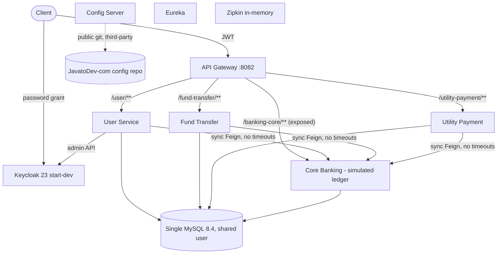
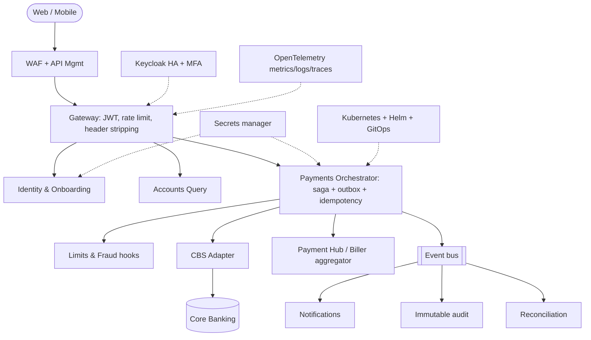

# TDD - Application, Technology and Data Architecture Assessment

> Repository: `Persistent-Systems-Test/ts-java-spring-boot-internet-banking` | Baseline: `main` @ `fa1c445` | Assessment date: 2026-11-03 | Generated by Devin (AI) - evidence-based; items needing confirmation are marked.

## Current-state architecture (logical/physical)

Patterns observed: API gateway, service registry, externalised configuration, declarative REST clients, layered controller/service/repository, DTO mappers, JPA auditing. Constraints: synchronous coupling, single database server, third-party config source.

## Application & technology architecture findings

#### TDD-ARC-01 - Synchronous, non-atomic distributed write for payments

| Field | Value |
|---|---|
| Finding ID | TDD-ARC-01 |
| Technology domain | B. Architecture |
| Description | Orchestrator saves PENDING, calls core via Feign, then saves SUCCESS; no saga, outbox or compensation. |
| Supporting repository evidence | [E-33](https://github.com/Persistent-Systems-Test/ts-java-spring-boot-internet-banking/blob/fa1c445/internet-banking-fund-transfer-service/src/main/java/com/javatodev/finance/service/FundTransferService.java#L31-L51) `FundTransferService.java` (31-51); [E-34](https://github.com/Persistent-Systems-Test/ts-java-spring-boot-internet-banking/blob/fa1c445/internet-banking-utility-payment-service/src/main/java/com/javatodev/finance/service/UtilityPaymentService.java#L31-L53) `UtilityPaymentService.java` (31-53) |
| Technical impact | Partial failures leave channel and ledger inconsistent. |
| Business impact | Lost/duplicate payments; reconciliation cost. |
| Risk severity | Critical |
| Recommended remediation | Saga state machine + transactional outbox + idempotent ledger API + reconciliation job. |
| Implementation complexity | High |
| Priority | P1 |
| Confidence | High |
| Related PDD findings | PDD-F-08, PDD-F-09 |

#### TDD-ARC-02 - Core ledger exposed through public gateway route

| Field | Value |
|---|---|
| Finding ID | TDD-ARC-02 |
| Technology domain | B. Architecture |
| Description | Route /banking-core/** -> core-banking-service; gateway only requires authentication. |
| Supporting repository evidence | E-13 `[external] internet-banking-api-gateway*.yml` (routes); [E-15](https://github.com/Persistent-Systems-Test/ts-java-spring-boot-internet-banking/blob/fa1c445/internet-banking-api-gateway/src/main/java/com/javatodev/finance/configuration/security/SecurityConfiguration.java#L24-L35) `SecurityConfiguration.java` (24-35) |
| Technical impact | Ledger API reachable from the internet. |
| Business impact | Unrecorded money movement. |
| Risk severity | Critical |
| Recommended remediation | Remove route; internal network only; service-to-service auth. |
| Implementation complexity | Low |
| Priority | P0 |
| Confidence | High |
| Related PDD findings | PDD-F-03 |

#### TDD-ARC-03 - No authorisation tier between edge and services

| Field | Value |
|---|---|
| Finding ID | TDD-ARC-03 |
| Technology domain | B. Architecture |
| Description | Gateway enforces 'authenticated'; downstream services have no Spring Security and trust X-Auth-Id. |
| Supporting repository evidence | [E-15](https://github.com/Persistent-Systems-Test/ts-java-spring-boot-internet-banking/blob/fa1c445/internet-banking-api-gateway/src/main/java/com/javatodev/finance/configuration/security/SecurityConfiguration.java#L24-L35) `SecurityConfiguration.java` (24-35); [E-17](https://github.com/Persistent-Systems-Test/ts-java-spring-boot-internet-banking/blob/fa1c445/internet-banking-user-service/src/main/java/com/javatodev/finance/configuration/filter/AppAuthUserFilter.java#L21-L33) `AppAuthUserFilter.java` (21-33) |
| Technical impact | Every resource vulnerable to IDOR; zero-trust absent. |
| Business impact | Data breach and fraud. |
| Risk severity | Critical |
| Recommended remediation | Every service as OAuth2 resource server; entitlement/policy layer. |
| Implementation complexity | Medium |
| Priority | P0 |
| Confidence | High |
| Related PDD findings | PDD-F-02, PDD-F-05, PDD-F-06 |

#### TDD-ARC-04 - Shared MySQL server and over-privileged shared DB user

| Field | Value |
|---|---|
| Finding ID | TDD-ARC-04 |
| Technology domain | B. Architecture |
| Description | Four schemas on one instance; one app user with DDL+DML on *.*. |
| Supporting repository evidence | [E-07](https://github.com/Persistent-Systems-Test/ts-java-spring-boot-internet-banking/blob/fa1c445/docker-compose/mysql/privileges.sql#L1-L2) `privileges.sql` (1-2); [E-08](https://github.com/Persistent-Systems-Test/ts-java-spring-boot-internet-banking/blob/fa1c445/docker-compose/mysql/privileges.sql#L5-L8) `privileges.sql` (5-8) |
| Technical impact | Blast radius across services; no data-ownership enforcement. |
| Business impact | One compromise exposes all data. |
| Risk severity | High |
| Recommended remediation | Per-service least-privilege users; separate ledger instance in prod. |
| Implementation complexity | Medium |
| Priority | P1 |
| Confidence | High |
| Related PDD findings | PDD-S-02 |

#### TDD-ARC-05 - No asynchronous/event backbone

| Field | Value |
|---|---|
| Finding ID | TDD-ARC-05 |
| Technology domain | B. Architecture |
| Description | No broker or domain events though README describes RabbitMQ notifications. |
| Supporting repository evidence | [E-02](https://github.com/Persistent-Systems-Test/ts-java-spring-boot-internet-banking/blob/fa1c445/README.md#L60-L75) `README.md` (60-75); [E-03](https://github.com/Persistent-Systems-Test/ts-java-spring-boot-internet-banking/blob/fa1c445/README.md#L83-L101) `README.md` (83-101) |
| Technical impact | Tight temporal coupling; no notification/audit stream. |
| Business impact | No customer notifications; harder integration. |
| Risk severity | Medium |
| Recommended remediation | Introduce Kafka/RabbitMQ with outbox-published domain events. |
| Implementation complexity | Medium |
| Priority | P1 |
| Confidence | High |
| Related PDD findings | PDD-G-01 |

#### TDD-ARC-06 - No adapter / anti-corruption layer for real core and payment rails

| Field | Value |
|---|---|
| Finding ID | TDD-ARC-06 |
| Technology domain | B. Architecture |
| Description | Core is a simulated ledger with bespoke REST API. |
| Supporting repository evidence | E-26 `core-banking-service/src/main/java/com/javatodev/finance/controller/*.java`; [E-21](https://github.com/Persistent-Systems-Test/ts-java-spring-boot-internet-banking/blob/fa1c445/core-banking-service/src/main/java/com/javatodev/finance/service/TransactionService.java#L48-L75) `TransactionService.java` (48-75) |
| Technical impact | Replacing core requires changes in every orchestrator. |
| Business impact | Unbounded first-integration effort. |
| Risk severity | High |
| Recommended remediation | Define ports/adapters (CBS, payment hub, biller) behind stable internal contracts. |
| Implementation complexity | High |
| Priority | P2 |
| Confidence | Medium |
| Related PDD findings | PDD-A-02, PDD-F-10 |

#### TDD-ARC-07 - Gateway identity-propagation filter likely ineffective

| Field | Value |
|---|---|
| Finding ID | TDD-ARC-07 |
| Technology domain | B. Architecture |
| Description | GlobalFilter calls exchange.getRequest().mutate().header(...).build() but returns the original exchange, so X-Auth-Id is not added; client-supplied X-Auth-Id passes through. |
| Supporting repository evidence | [E-16](https://github.com/Persistent-Systems-Test/ts-java-spring-boot-internet-banking/blob/fa1c445/internet-banking-api-gateway/src/main/java/com/javatodev/finance/configuration/GatewayConfiguration.java#L18-L28) `GatewayConfiguration.java` (18-28) |
| Technical impact | Audit identity missing or spoofable. |
| Business impact | Untrustworthy audit trail. |
| Risk severity | High |
| Recommended remediation | Return exchange.mutate().request(mutated).build(); strip inbound X-Auth-* headers. Confirm at runtime. |
| Implementation complexity | Low |
| Priority | P0 |
| Confidence | Medium |
| Related PDD findings | PDD-G-02 |

#### TDD-ARC-08 - Platform duplication: Eureka + Config Server + static IPs

| Field | Value |
|---|---|
| Finding ID | TDD-ARC-08 |
| Technology domain | B. Architecture |
| Description | Discovery and config via Spring Cloud plus static Docker IPs in config. |
| Supporting repository evidence | [E-05](https://github.com/Persistent-Systems-Test/ts-java-spring-boot-internet-banking/blob/fa1c445/docker-compose/docker-compose.yml#L1-L139) `docker-compose.yml` (1-139); E-12 `*/src/main/resources/bootstrap*.yml`; E-14 `[external] *-service.yml` (ddl-auto / management) |
| Technical impact | Extra moving parts; brittle addressing. |
| Business impact | Higher ops cost. |
| Risk severity | Medium |
| Recommended remediation | On Kubernetes use native DNS/ConfigMaps/Secrets or Spring Cloud Kubernetes. |
| Implementation complexity | Medium |
| Priority | P2 |
| Confidence | High |
| Related PDD findings | PDD-S-01 |

## Data architecture

| Entity / table | Owner service | Key attributes | Relationships |
|---|---|---|---|
| banking_core_user | core | id, first_name, last_name, email, identification_number | 1-* account |
| banking_core_account | core | id, number, type, status, actual_balance, available_balance DECIMAL(19,2), user_id | *-1 user; 1-* transaction |
| banking_core_transaction | core | id, amount, transaction_type, reference_number, transaction_id, account_id | *-1 account (mapped @OneToOne) |
| banking_core_utility_account | core | id, number, provider_name | - |
| user | user-service | id, auth_id, identification, status + audit | auth_id -> Keycloak user |
| fund_transfer | fund-transfer | id, transaction_reference, from_account, to_account, amount, status + audit | transaction_reference -> core transaction_id |
| utility_payment | utility-payment | id, provider_id, amount, reference_number, account, transaction_id, status + audit | transaction_id -> core |

#### TDD-DAT-01 - Available balance double-adjusted

| Field | Value |
|---|---|
| Finding ID | TDD-DAT-01 |
| Technology domain | E. Data Architecture |
| Description | availableBalance computed from already-updated actualBalance on debit and credit. |
| Supporting repository evidence | [E-20](https://github.com/Persistent-Systems-Test/ts-java-spring-boot-internet-banking/blob/fa1c445/core-banking-service/src/main/java/com/javatodev/finance/service/TransactionService.java) `TransactionService.java` (63-64,90-91,99-100) |
| Technical impact | Ledger inconsistency. |
| Business impact | Wrong customer balances. |
| Risk severity | Critical |
| Recommended remediation | available = available -/+ amount; explicit holds. |
| Implementation complexity | Low |
| Priority | P0 |
| Confidence | High |
| Related PDD findings | PDD-F-04 |

#### TDD-DAT-02 - Lost updates under concurrency

| Field | Value |
|---|---|
| Finding ID | TDD-DAT-02 |
| Technology domain | E. Data Architecture |
| Description | Read-modify-write on BankAccountEntity without @Version or SELECT ... FOR UPDATE. |
| Supporting repository evidence | [E-23](https://github.com/Persistent-Systems-Test/ts-java-spring-boot-internet-banking/blob/fa1c445/core-banking-service/src/main/java/com/javatodev/finance/model/entity/BankAccountEntity.java#L16-L37) `BankAccountEntity.java` (16-37); [E-18](https://github.com/Persistent-Systems-Test/ts-java-spring-boot-internet-banking/blob/fa1c445/core-banking-service/src/main/java/com/javatodev/finance/service/TransactionService.java#L35-L46) `TransactionService.java` (35-46) |
| Technical impact | Concurrent debits can overdraw. |
| Business impact | Financial loss. |
| Risk severity | Critical |
| Recommended remediation | Pessimistic locking ordered by account id or optimistic @Version + retry; DB CHECK constraints. |
| Implementation complexity | Medium |
| Priority | P0 |
| Confidence | High |
| Related PDD findings | PDD-F-01, PDD-F-04 |

#### TDD-DAT-03 - Account status ignored in postings

| Field | Value |
|---|---|
| Finding ID | TDD-DAT-03 |
| Technology domain | E. Data Architecture |
| Description | Status not checked in TransactionService. |
| Supporting repository evidence | [E-19](https://github.com/Persistent-Systems-Test/ts-java-spring-boot-internet-banking/blob/fa1c445/core-banking-service/src/main/java/com/javatodev/finance/service/TransactionService.java#L77-L81) `TransactionService.java` (77-81); E-25 `core-banking-service/src/main/java/com/javatodev/finance/model/{AccountType,AccountStatus,TransactionType}.java` |
| Technical impact | Invalid postings. |
| Business impact | Regulatory breach. |
| Risk severity | High |
| Recommended remediation | Status rules in ledger domain. |
| Implementation complexity | Low |
| Priority | P0 |
| Confidence | High |
| Related PDD findings | PDD-F-07 |

#### TDD-DAT-04 - No idempotency keys

| Field | Value |
|---|---|
| Finding ID | TDD-DAT-04 |
| Technology domain | E. Data Architecture |
| Description | transactionId generated server-side per call; no unique client key. |
| Supporting repository evidence | [E-18](https://github.com/Persistent-Systems-Test/ts-java-spring-boot-internet-banking/blob/fa1c445/core-banking-service/src/main/java/com/javatodev/finance/service/TransactionService.java#L35-L46) `TransactionService.java` (35-46); [E-33](https://github.com/Persistent-Systems-Test/ts-java-spring-boot-internet-banking/blob/fa1c445/internet-banking-fund-transfer-service/src/main/java/com/javatodev/finance/service/FundTransferService.java#L31-L51) `FundTransferService.java` (31-51) |
| Technical impact | Duplicates on retry. |
| Business impact | Double debits. |
| Risk severity | High |
| Recommended remediation | Idempotency-Key persisted with unique constraint. |
| Implementation complexity | Medium |
| Priority | P1 |
| Confidence | High |
| Related PDD findings | PDD-F-09 |

#### TDD-DAT-05 - Mutable single-entry ledger without timestamps

| Field | Value |
|---|---|
| Finding ID | TDD-DAT-05 |
| Technology domain | E. Data Architecture |
| Description | Balances are mutable columns; transaction rows lack timestamps, status, balance-after; transaction_id not unique. |
| Supporting repository evidence | [E-22](https://github.com/Persistent-Systems-Test/ts-java-spring-boot-internet-banking/blob/fa1c445/core-banking-service/src/main/java/com/javatodev/finance/model/entity/TransactionEntity.java#L17-L35) `TransactionEntity.java` (17-35); E-24 `core-banking-service/src/main/resources/db/migration/` (V1.0.*) |
| Technical impact | No auditability or replay; weak integrity. |
| Business impact | Audit/regulatory failure. |
| Risk severity | High |
| Recommended remediation | Double-entry append-only journal with posted_at/value_date and unique ids. |
| Implementation complexity | High |
| Priority | P1 |
| Confidence | High |
| Related PDD findings | PDD-G-02, PDD-S-03 |

#### TDD-DAT-06 - Hibernate ddl-auto: update in three services

| Field | Value |
|---|---|
| Finding ID | TDD-DAT-06 |
| Technology domain | E. Data Architecture |
| Description | User, fund-transfer, utility-payment schemas managed by Hibernate auto-DDL. |
| Supporting repository evidence | E-14 `[external] *-service.yml` (ddl-auto / management) |
| Technical impact | Uncontrolled schema drift. |
| Business impact | Production outages/data loss. |
| Risk severity | High |
| Recommended remediation | Flyway in all services; ddl-auto validate. |
| Implementation complexity | Low |
| Priority | P1 |
| Confidence | High |
| Related PDD findings | - |

#### TDD-DAT-07 - Seed data in production migration path

| Field | Value |
|---|---|
| Finding ID | TDD-DAT-07 |
| Technology domain | E. Data Architecture |
| Description | V1.0.20210427174721__temp_data.sql inserts customers/accounts/billers. |
| Supporting repository evidence | E-24 `core-banking-service/src/main/resources/db/migration/` (V1.0.*) |
| Technical impact | Fake data in every environment. |
| Business impact | Ledger contamination. |
| Risk severity | High |
| Recommended remediation | Move to test-only Flyway location. |
| Implementation complexity | Low |
| Priority | P0 |
| Confidence | High |
| Related PDD findings | PDD-R-04 |

#### TDD-DAT-08 - No currency, settlement or suspense accounts

| Field | Value |
|---|---|
| Finding ID | TDD-DAT-08 |
| Technology domain | E. Data Architecture |
| Description | No currency column; utility payment has no credit leg. |
| Supporting repository evidence | E-24 `core-banking-service/src/main/resources/db/migration/` (V1.0.*); [E-21](https://github.com/Persistent-Systems-Test/ts-java-spring-boot-internet-banking/blob/fa1c445/core-banking-service/src/main/java/com/javatodev/finance/service/TransactionService.java#L48-L75) `TransactionService.java` (48-75) |
| Technical impact | Ledger cannot balance. |
| Business impact | Unreconcilable books. |
| Risk severity | Medium |
| Recommended remediation | Currency + GL/settlement accounts. |
| Implementation complexity | Medium |
| Priority | P2 |
| Confidence | High |
| Related PDD findings | PDD-F-10, PDD-S-03 |

#### TDD-DAT-09 - No backup, retention or data-lifecycle evidence

| Field | Value |
|---|---|
| Finding ID | TDD-DAT-09 |
| Technology domain | E. Data Architecture |
| Description | No backup scripts, retention policies, or archival in repository; volumes only. |
| Supporting repository evidence | [E-05](https://github.com/Persistent-Systems-Test/ts-java-spring-boot-internet-banking/blob/fa1c445/docker-compose/docker-compose.yml#L1-L139) `docker-compose.yml` (1-139) |
| Technical impact | Data loss on host failure. |
| Business impact | Business continuity risk. |
| Risk severity | High |
| Recommended remediation | Define RPO/RTO; automated backups and PITR; retention policy. |
| Implementation complexity | Medium |
| Priority | P1 |
| Confidence | High |
| Related PDD findings | PDD-R-01 |

#### TDD-DAT-10 - Unbounded pagination

| Field | Value |
|---|---|
| Finding ID | TDD-DAT-10 |
| Technology domain | E. Data Architecture |
| Description | Pageable endpoints without max page size. |
| Supporting repository evidence | E-26 `core-banking-service/src/main/java/com/javatodev/finance/controller/*.java`; [E-33](https://github.com/Persistent-Systems-Test/ts-java-spring-boot-internet-banking/blob/fa1c445/internet-banking-fund-transfer-service/src/main/java/com/javatodev/finance/service/FundTransferService.java#L31-L51) `FundTransferService.java` (31-51) |
| Technical impact | Large queries / memory pressure. |
| Business impact | Availability. |
| Risk severity | Low |
| Recommended remediation | spring.data.web.pageable.max-page-size. |
| Implementation complexity | Low |
| Priority | P2 |
| Confidence | Medium |
| Related PDD findings | - |

## Architecture gap analysis

| Dimension | Current state | Target state | Gap findings |
|---|---|---|---|
| Edge & identity | Gateway JWT validation only; Keycloak dev mode; no MFA | WAF + API mgmt, rate limiting, HA Keycloak with MFA, auth-code+PKCE | TDD-SEC-09, TDD-SEC-11, TDD-STK-02 |
| Authorisation | None below edge; header trust | Zero-trust: JWT per service, entitlements, RBAC, maker-checker | TDD-ARC-03, TDD-SEC-02, TDD-SEC-03, TDD-SEC-04 |
| Payments orchestration | Sync Feign, no state machine | Saga + outbox + idempotency + reconciliation | TDD-ARC-01, TDD-DAT-04 |
| Ledger | Mutable single-entry, simulated | Adapter to real CBS; double-entry journal if in-house | TDD-DAT-05, TDD-ARC-06 |
| Integration | Synchronous only | Event bus for notifications/audit/reconciliation | TDD-ARC-05, TDD-SCA-04 |
| Data management | Shared MySQL, ddl-auto update, seed data | Per-service least privilege, Flyway, backups/PITR | TDD-ARC-04, TDD-DAT-06, TDD-DAT-07, TDD-DAT-09 |
| Platform | docker-compose, static IPs, Eureka/Config | Kubernetes + Helm, ConfigMaps/Secrets, IaC | TDD-INF-02, TDD-ARC-08, TDD-INF-04 |
| Delivery | No CI/CD | Secure pipeline with quality and security gates | TDD-INF-01, TDD-ENG-01, TDD-SEC-14 |
| Operability | Tracing only | OTel metrics/logs/traces, SLOs, alerting, HA/DR | TDD-REL-01, TDD-REL-02, TDD-REL-04, TDD-REL-05 |

## Target-state technology architecture

