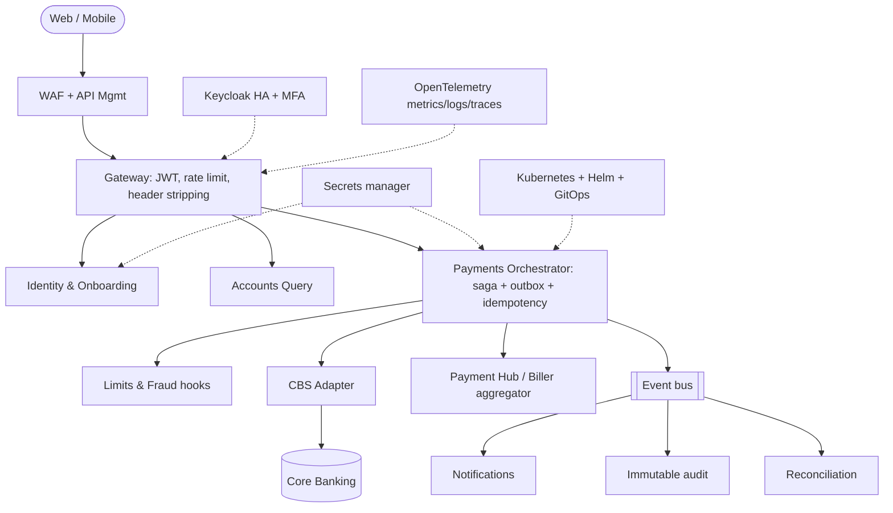

# TDD - Modernisation Recommendations and Prioritised Technology Roadmap

> Repository: `Persistent-Systems-Test/ts-java-spring-boot-internet-banking` | Baseline: `main` @ `fa1c445` | Assessment date: 2026-11-03 | Generated by Devin (AI) - evidence-based; items needing confirmation are marked.

## Modernisation recommendations

| ID | Recommendation | Findings |
|---|---|---|
| MOD-01 | Upgrade to supported Spring Boot / Spring Cloud / Keycloak lines | TDD-STK-01, TDD-STK-02 |
| MOD-02 | Adopt Gradle multi-project with version catalog and shared internal starter | TDD-ENG-02, TDD-CQ-01 |
| MOD-03 | Kubernetes-native deployment (Helm, probes, HPA, Secrets), drop static IPs | TDD-INF-02, TDD-REL-03, TDD-INF-04 |
| MOD-04 | OpenTelemetry-based observability stack | TDD-REL-04 |
| MOD-05 | Event-driven payments (saga + outbox) on Kafka/RabbitMQ | TDD-ARC-01, TDD-ARC-05 |
| MOD-06 | Ports-and-adapters for CBS / payment hub / biller aggregator | TDD-ARC-06 |
| MOD-07 | Zero-trust security model (per-service resource servers, mTLS, policy engine) | TDD-ARC-03, TDD-SEC-10 |
| MOD-08 | Secure software supply chain (SBOM, signing, SCA, secret scanning) | TDD-SEC-06, TDD-SEC-14, TDD-INF-03 |

## Roadmap (indicative assessor estimate)

| Phase | Timeline | Team | Findings addressed |
|---|---|---|---|
| Phase 0 - Stabilise | 0-6 weeks | ~3 engineers (~15 EW) | TDD-ARC-02, TDD-ARC-03, TDD-ARC-07, TDD-CQ-02, TDD-CQ-03, TDD-SEC-01, TDD-SEC-02, TDD-SEC-03, TDD-SEC-04, TDD-SEC-05, TDD-SEC-06, TDD-SEC-07, TDD-SEC-08, TDD-SEC-12, TDD-SEC-14, TDD-DAT-01, TDD-DAT-02, TDD-DAT-03, TDD-DAT-07, TDD-INF-01, TDD-INF-04, TDD-ENG-01 |
| Phase 1 - Production engineering | 1.5-5 months | 6-8 engineers | TDD-STK-01, TDD-STK-02, TDD-ARC-01, TDD-ARC-04, TDD-ARC-05, TDD-CQ-01, TDD-CQ-05, TDD-CQ-07, TDD-CQ-08, TDD-SEC-09, TDD-SEC-10, TDD-SEC-11, TDD-SEC-13, TDD-DAT-04, TDD-DAT-05, TDD-DAT-06, TDD-DAT-09, TDD-INF-02, TDD-INF-03, TDD-INF-05, TDD-SCA-01, TDD-SCA-05, TDD-REL-01, TDD-REL-03, TDD-REL-04, TDD-ENG-02, TDD-ENG-03 |
| Phase 2 - Bank-ready | 5-9 months | 6-8 engineers | TDD-ARC-06, TDD-ARC-08, TDD-DAT-08, TDD-SCA-02, TDD-SCA-04, TDD-REL-02, TDD-REL-05, TDD-STK-03, TDD-STK-04, TDD-CQ-04, TDD-CQ-06, TDD-DAT-10, TDD-ENG-04, TDD-ENG-05 |
| Phase 3 - Optimise | 9-12+ months | steady-state team | TDD-SCA-03, TDD-SEC-15 |

## Target-state technology architecture

